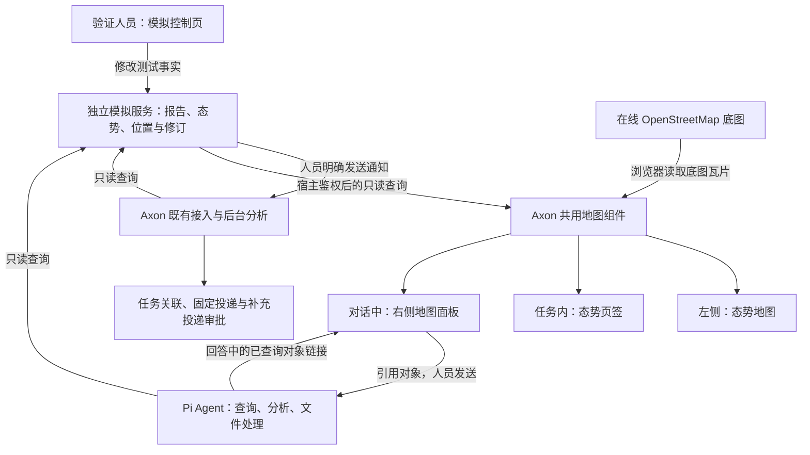

# 态势模拟与地图交互接入

日期：2026-10-11。状态：**已审阅，2026-10-11 获准实施。**

本期让人员在地图上查看模拟态势、选取对象向 Agent 提问，并用可控的状态变化验证后台分析与席位办理。地图和 Agent 使用同一来源的数据。道路、车辆只是验证材料，不作为未来业务模型的定稿。

## 建设内容

| 内容 | 本期交付 |
| --- | --- |
| 模拟系统 | 扩展现有独立服务：区域、道路和资源位置；道路通行状态、资源数量；保存修订和变化 |
| 测试控制 | 验证环境提供控制页，修改模拟状态、发布模拟报告、向 Axon 发送通知，查看接收回执 |
| 全局地图 | 左侧新增“态势地图”，保留现有侧边栏；查看获准资料，筛选区域与对象类型 |
| 任务地图 | 任务页增加“态势”页签，突出任务引用和关注区域；不复制一份任务专属态势数据 |
| 对话联动 | Agent 回答正文中的对象链接可点击定位，查询依据保留“在地图查看”；从地图选对象引用到输入框，再由人员发送问题 |
| 在线底图 | MapLibre GL JS 加在线 OpenStreetMap Standard 底图，叠加模拟态势；本期不部署地图服务 |
| 变化验证 | 修改来源数据后，地图显示新状态；通知沿现有流程分析、关联任务、投递或申请补充投递 |

模拟服务独立运行；测试控制页可复用 Axon 登录和页面框架，由宿主转发受控指令。普通地图只读，Agent 不获得模拟控制工具。

## 重点待审选择

1. **入口组合**：全局页面、任务页签、对话侧面板共用地图，不另建日常使用的独立态势门户。
2. **模拟能力**：本期支持预置对象的状态修改、报告发布和通知发送；不做任意绘图建模、移动轨迹仿真或完整模拟平台。
3. **底图范围**：采用 MapLibre GL JS 与在线 OpenStreetMap Standard 底图，在真实地理背景上叠加模拟态势，持续标明“模拟态势”及底图署名。选定小范围真实区域准备测试几何；本期无须自建瓦片服务或商业密钥，不建设地名检索和路网服务。
4. **Agent 边界**：浏览不调用模型；引用后发送时加载所选对象当前数据。仍使用 Pi 和现有查询工具，不要求模型看地图截图，不授予源数据修改能力。

回答正文可呈现“[西区通道]限制通行”这样的对象链接，点击名称即在侧面板定位。链接对应实际查询或显式加载的对象；不根据名称猜位置。模型没有生成链接时，查询依据入口仍可用。

通过标准是：同一对象在模拟系统、地图和查询结果中具有一致的编号、修订与状态；来源变化能够进入既有分析和办理流程，且任务、席位隔离保持有效。模型结论是否正确另行核对，不能用“地图显示成功”替代。

## 文档

- [需求与验收](prd.md)
- [页面、数据与技术设计](design.md)
- [接口与数据契约](integration-contract.md)
- [实施顺序与验证计划](implement.md)
- [现状核对与参考依据](research/current-state.md)

本期不建设道路拓扑、最优路线计算、车辆调度、历史态势回放、多人共享标绘或新的审批体系。
