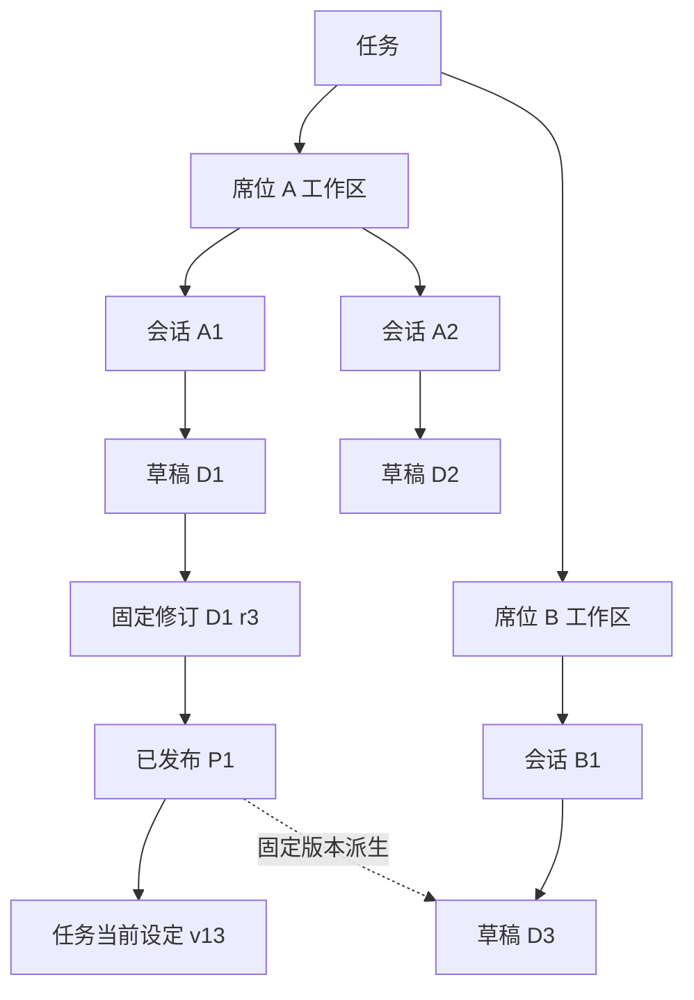

> 2026-10-13：用户已明确授权实施。功能与验收进度见 [实施验证记录](research/implementation-validation.md)；未通过的验收项不视为完成。

# 多用户多任务地图标注设计

状态：已作为实施依据，2026-10-13。本文保留设计约束；是否通过验收以实施验证记录为准。
补充：2026-10-13 明确会话草稿自动上下文与显式版本引用的分工，并收紧默认上下文用量。
配套文档：[需求与验收](prd.md) · [实施顺序](implement.md) · [代码与选型依据](research/evidence.md)。

## 1. 设计结论

以“标注集 → 图层 → 对象”组织地图上的工作成果：

- 每个会话独立编辑一份草稿；同席位同任务的其他会话可查看、引用或派生，不能直接写入。
- 草稿每次保存形成固定修订，发布只是把其中一个修订作为任务可见成果共享。
- 有现有任务管理权限的人将已发布版本设为任务当前标注。不新增审批单、审批状态或审批角色，发布者有权限也可自行设定。
- 来源态势是独立只读图层组。人工标注的发布和设定不更新来源事实。
- 图层组名称、状态标签、版本和编辑目标承担身份辨识；不强制改变对象的颜色、虚线、轮廓、纹理或符号。
- 保留 MapLibre、现有登录与工作区、SQLite 和 Pi 工具机制。新增的持久状态仅用于已明确需要的草稿隔离、固定版本引用、发布和任务设定。

## 2. 概念与归属

| 概念 | 关系及边界 |
| --- | --- |
| 用户 User | 执行操作的账号，记录 userId；不由模型或浏览器正文自报 |
| 席位 Seat | 现有业务身份和私人工作成果边界；当前每席位最多一个启用账号，不新建多人共席位私有空间 |
| 任务 Task | 当前已有 public／private TaskSpace；容纳已发布标注和当前设定历史 |
| 工作区 Workspace | 一个 taskId × seatId 对应一个工作区；会话、私人草稿归属于此 |
| 会话 Session | 只属于一个工作区；0 或 1 份自己的可写草稿，可以引用多份获准版本 |
| 标注集 AnnotationSet | 持久工作成果。草稿头可推进，保存修订不可变；ownerSessionId 唯一 |
| 业务图层 Layer | 标注集中的具名分组，不独立授权或发布，随标注集保存 |
| 对象 Feature | 一个点、线、面或文字注记；含业务属性、样式与可选来源引用 |
| 发布记录 Publication | 对标注集某一修订的固定任务共享引用 |
| 任务当前记录 CurrentSelection | 任务管理者把某个发布记录设为当前的历史记录；最新记录就是当前选择 |



逻辑图层与 MapLibre 渲染图层不同：一个“集合点”业务图层可以对应点符号、文字两个渲染图层；渲染层 ID 不作为业务对象 ID。

## 3. 会话基线与草稿生命周期

### 3.1 尚无草稿

- 会话地图初次使用时选择“空白”或一个有权读取的固定版本。选择“任务当前”时立即解析为当时的发布 ID／修订；保存这个固定基线，后续重开不再次跟随 latest。
- 只查看只建立轻量会话地图绑定，不创建草稿、不启动模型。
- 从某一发布版本进入“新会话继续标注”，携带该发布引用；会话创建仍使用现有工作区和会话 API。
- 普通会话没有打开或操作地图时，不创建地图记录。Agent 首次要求创建时，工具必须给出明确空白或固定基线；不能用无依据的“最新”替代已经显示的基线。
- 已归档任务没有既有绑定时，只以页面状态查看明确版本，不在只读任务中补建绑定或草稿。
- 草稿不存在时可以显式更换基线；运行中的地图写操作不允许重绑定。草稿一旦存在，不重新挂接到别人的草稿。

### 3.2 编辑

首次修改在事务内由基线创建独立标注集，并可原子应用首批编辑。一会话只有一份，重复请求复用已创建结果。

- 来源版本内容复制成独立草稿；保留来源关系，不保持实时联动。
- 保留派生对象的逻辑 objectId，整份标注集 ID 不同；新建对象生成新 ID，便于比较。跨集合读取／选中始终使用集合与修订限定，不能仅凭 objectId 定位。
- layerId、objectId 各自在整份标注集中唯一。整份基线派生保留 ID；显式“复制对象”生成新 objectId 并保留 originFeatureRef，避免同一对象被复制多次后身份冲突。
- 鼠标移动中的几何只是本地编辑缓冲；完成绘制、完成拖动或提交属性时保存一次，形成一份新修订。失败显示“未保存”并保留缓冲，离开时提供保存／放弃选择。
- Agent 使用结构化批量操作，同一批要么全部成功，要么全部失败；不要求模型回传整个地图。
- 在另一会话继续相同方向：基于固定版本创建该会话自己的草稿。任务地图“继续编辑”返回原草稿绑定会话，不把原草稿授权给当前无关会话。
- 关闭页面不丢失已保存版本；本地尚未保存的缓冲不承诺跨重启恢复。

### 3.3 发布

发布请求指定 draftId + revision，而不是“当前最新”。发布固定名称、说明、发布人、时间和内容摘要；同一草稿修订的相同发布请求复用原记录。后续编辑、重命名草稿不改变已发布内容。

发布不触发审批、设为当前、后台研判或席位通知。界面明确展示将发布的修订；存在未保存缓冲时不能误称其已包含在发布中。

### 3.4 设为任务当前标注

- 仅可选择本任务已发布且当前操作者有权读取的版本。
- 页面先展示与任务当前版本的对象／图层差异；以操作按钮直接完成设定，不建立审批环节。
- 草稿来源较旧不是绝对禁止条件。说明“基于 v12，当前为 v13”，比较实际内容后允许整份选定。
- 每次设定携带 expectedCurrentSequence，事务内比较后追加历史序号。两人同时基于 v13 操作，后到者冲突，不能自动重试覆盖。
- 重新选择早期发布版本也产生一条新的设定记录，不能倒写历史；重复设定已是当前的同一发布可返回无变化结果。
- 无选择时 sequence 为 0。首期不增加撤回发布、清空当前、历史硬删除或自动合并。
- 某用户无权读取被设定版本所需资料时显示“当前标注不可访问”，不能用空图冒充完整结果或自动扩大权限。

## 4. 数据结构与存储

### 4.1 内容结构

一个修订保存完整、规范化的 JSON 内容：

```text
AnnotationDocument
  schemaVersion
  title
  layers[]
    layerId, name, order, defaultVisible
    features[]
      objectId, kind(point/line/polygon/text)
      geometry(WGS84，经度在前)
      name, note, attributes
      style(受控字段)
      sourceRefs[] / originFeatureRef
```

- 文本注记由 Point 几何与文字属性表示；线至少两点；首期编辑单环闭合面，拒绝无效、自交或未闭合几何，不默默修正出另一个区域。
- 样式限于点符号、颜色、大小、线宽、线型、填充与标签等受控属性；复用本地符号，不接受任意 HTML、脚本、外链图标或任意 MapLibre 表达式。
- 图层顺序与默认可见性属于保存内容；用户当前的显隐、独显、缩放、选择、对照组属于页面视图。显式“保存图层默认状态”才改变修订。
- sourceRefs 采用原有完整系统／对象引用，加明确来源修订或查询依据标识。从已有版本或实际查询结果复制时，宿主保留关联资料范围；不接受模型通过删除 scope 字段解除权限。
- 来源范围校验覆盖结构化引用和派生来源；不宣称能自动识别所有自由文本的资料来源，不新增内容分级引擎。
- 修订的 required_system_ids 继承基线与历史已引入来源的范围，再与新增来源取并集；普通删除、重命名或样式操作不能降低这个集合。首期不提供资料降级／解密操作。
- 导入也遵守同一几何约束；不支持的多面、带洞面等明确拒绝，不删除内环后冒充原区域。

建议规模边界：单修订规范化内容最多 2 MiB、32 个业务图层、500 个对象、累计 20,000 个坐标点；单次操作最多 100 项且请求不超过 256 KiB。超限明确返回错误，不裁掉图形。它们是首期服务边界，实施验证后如需改变应同步契约与界面提示。

### 4.2 主数据表

复用现有宿主业务 SQLite 连接，不把权威文件放进 /workspace 或暴露给 Bash／普通文件工具。首期使用完整快照，避免引入 Git、事件回放或增量链。

| 建议表 | 主要字段／约束 |
| --- | --- |
| annotation_session_bindings | session_id 主键，task_id、workspace_id、owner_seat_id、base_ref、binding_revision；支持未建草稿的固定基线 |
| annotation_sets | id 主键，owner_session_id 唯一，task_id、workspace_id、owner_seat_id、base_ref、head_revision、created_by_user_id |
| annotation_revisions | (set_id, revision) 联合主键，规范化内容、hash、required_system_ids、actor／time；不可变 |
| annotation_publications | id，task_id，(set_id, revision) 外键，固定标题／说明、hash、publisher／time；不暴露私人会话元数据 |
| task_annotation_selections | (task_id, sequence) 联合主键，publication_id、setter／time；当前值从最新记录取得，不另存第二份内容 |
| annotation_actions | 作用域化动作键、输入摘要、结果引用及状态；保存／创建／发布／设定的幂等回执 |

会话绑定和标注集中的 task／workspace／seat 仅由已校验的现有会话解析，不采用客户端权威字段。组合键／校验保证不能把其他任务的发布记录设为当前。

快照、head 推进与动作回执在同一事务内完成。大块规范化和几何验证先完成，再在短事务中重新校验权限、头版本并写入。任务归档互斥复用既有 acquire admission，不建设新的任务级队列。

### 4.3 版本命名

- D1·r3：私人草稿 D1 的固定第三修订。
- P1：从 D1·r3 发布的不可变成果。
- 任务当前·v13：任务第十三次有效设定，指向某个 P；与 TaskSpace 元数据 revision 分开。

展示使用可读名称，完整引用使用不可混淆的 ID。一次发布不复制一套业务对象 ID，也不使私人版本树对读者全部开放。

## 5. 权限

| 操作 | 服务端规则 |
| --- | --- |
| 列出／读私人草稿 | 当前任务可见，且相同任务 × 席位工作区；资料范围仍需满足 |
| 修改草稿 | 在前述条件上，执行上下文 sessionId 等于 ownerSessionId，任务 active |
| 读其他席位成果 | 有本任务发布记录，任务可见且符合该发布内容的资料范围；不能绕用私人修订接口 |
| 发布 | 当前会话自己的草稿中明确修订；任务 active；发布者有读取该完整修订的权限 |
| 设当前 | public 任务检查现有 createPublicTask 管理能力；private 任务检查 ownerSeatId；同时检查发布可读且属于当前任务 |
| 复制／派生 | 有权读取明确来源；首期仅同任务；目标只能是本会话独立草稿 |
| 读历史 | 仍检查当前访问权，但读取原固定内容，不用最新事实重建 |
| 管理员读私人草稿 | 不授予额外能力，任务管理不等于私人内容访问 |

用户已确定复用现有管理权限；其 public 管理能力当前覆盖所有公共任务，不改造成“任务创建人权限”或“每任务负责人权限”。

列表、计数、标题、差异、来源入口均先过滤权限。发布读取只返回发布成果及必要作者信息，不返回私人会话标题、聊天记录或不可访问的基线内容。引用可能指向私人祖先时，只展示允许披露的来源说明，不给越权跳转。

所有 HTTP 写入复用现有登录、Origin、CSRF、view 检查。模型工具从宿主执行上下文捕获身份，不接受 userId／seatId／权限／任意写目标。权限变化后每次工具／页面操作重新校验；不把点击时的按钮状态当授权。

当前普通模型入口只传 seatId；接入标注时须在宿主内部保留提交请求的 userId、seatId、sessionId、requestId，作为实际执行与审计依据。延后消费的文本沿用已接收请求的身份；账号已停用或权限失效则拒绝新写入，不能改用浏览器后来登录的账号。开发身份模式沿用现有明确测试身份规则，不伪造正式账号。

## 6. 页面与图层交互

### 6.1 三种入口

- 全局态势：保留来源图层，不自动汇集私人标注。
- 任务态势：默认当前任务标注与来源态势；提供我的草稿、已发布、设定历史入口。无当前标注显示明确空状态，不自动选择第一个发布。
- 会话侧地图：自己的草稿或固定基线为主；引用的其他版本只读。支持展开为任务内大地图并保留会话编辑身份，返回不改变草稿。

示例图层面板：

```text
来源态势                         模拟数据 · 截止 10:00
  [开] 道路状态
  [开] 资源位置

会话 A 标注                      草稿 r5 · 可编辑
  [开] 关注区域
  [开] 集合点                     ← 当前编辑图层
  [开] 分析备注

参考标注                         已发布 P2 · 只读
  [关] 关注区域
  [开] 集合点
```

### 6.2 图层操作

图层组显示名称、工作状态、修订、来源与必要时间。提供显隐、独显、定位、查看详情；业务图层可在自己的草稿中新增、重命名、排序。删除非空图层明确包含对象数量，由显式删除动作完成。

会话默认显示自己的草稿／基线与来源态势；新增参考组默认收起且不叠加，用户显式勾选后上图。参考与草稿同样式时，通过独显、交替查看及对象归属详情辨认，不依赖肉眼从颜色推断版本。

新建对象只落入当前可写图层。查看、点击、引用其他组不自动切换目标；删除或隐藏当前编辑层时退出该编辑动作并提示选择有效目标，不把对象放入未知层。

保留对象业务颜色、轮廓、线型、填充和符号。编辑控制点只表达当前交互，不成为“草稿身份编码”。选中对象的详情展示“标注集 → 版本 → 图层 → 对象”；重叠点击列出可见且获准对象供选择，不固定选择最上面一个。

当前标注与某参考组指向同一发布时只加载一份内容，附加身份标签，避免重复绘制。不同组的同名图层不合并。

### 6.3 差异比较

首期支持两份固定版本的新增／删除／变更列表，按对象和图层定位，左右内容或单图交替独显。差异统计不替代业务判断，不做自动冲突消解；更丰富的并排同步地图不作为首期前置。

同血缘对象根据保留的 objectId 比较几何、属性、样式和图层归属；无共同来源时按不同对象列出，不根据名称或相近坐标自动合并。

### 6.4 刷新、保存与失败

- 来源态势保留既有可见页面轮询；固定发布／引用修订不轮询“最新内容”。
- 自己草稿在本页保存或本会话工具完成后刷新头；有本地未保存缓冲时不直接替换，显示新修订提示并保留冲突内容。
- 普通任务浏览可提示当前设定有更新，再读取固定新版本；已有对照引用和编辑草稿不改变。
- 所有请求按席位／任务／会话／视图代际隔离，旧响应不能写进新画面或草稿。
- 基础图层失败与标注失败分别提示；无 WebGL 时仍可查看图层／对象列表和属性，但不宣称已完成可视化绘制。
- 状态标签与图层控制支持键盘；拖拽提供坐标／属性表单替代。对比度适配底图，不能依赖颜色或只在悬停时解释版本。
- 首期桌面 1280／1440 CSS 像素验收；沿用现有组件和图标，不重做全站设计系统。

## 7. API 与 Agent 契约

以下为拟定名称，不代表已有接口。

### 7.1 页面 API

| 接口 | 用途 |
| --- | --- |
| GET /api/tasks/:id/annotations | 权限过滤后的我的草稿／发布列表，分页 |
| GET /api/tasks/:id/annotations/current | 当前发布和设定序号，允许空 |
| GET /api/tasks/:id/annotations/history | 任务历次设定 |
| GET /api/sessions/:id/annotation | 会话地图绑定、基线及自己草稿头 |
| PUT /api/sessions/:id/annotation/base | 无草稿时选择固定基线，带 expectedBindingRevision |
| GET /api/annotations/:setId/revisions/:revision | 本席位私人修订；不能借发布授权打开整个私人版本树 |
| GET /api/annotation-publications/:id | 发布成果读取入口 |
| POST /api/sessions/:id/annotation/actions | create_draft／apply／publish；身份及目标由 session 解析 |
| POST /api/tasks/:id/annotations/current | publicationId + expectedCurrentSequence + clientActionId |
| POST /api/tasks/:id/annotations/compare | 两个固定引用，双方都做完整权限校验 |
| GET /api/annotation-actions/:id | 在原作用域内查询已提交动作结果 |

所有写入携带稳定 clientActionId。相同键、相同规范化输入返回同一回执；相同键不同输入返回冲突。先校验当前读取权再返回旧回执，不能借幂等查询绕过权限。

apply 使用受控操作列表：增加／重命名／排序／删除图层，新增／修改／删除／从固定获准版本复制对象。带 expectedRevision；禁止客户端替换整个集合、owner 或来源权限。写回返回新修订与 hash、变更对象摘要和有效地图链接。

无权限目标沿现有契约返回不可枚举的拒绝结果；冲突区分草稿已更新、当前设定已更新、同一动作内容不同；超限与几何无效明确报错。

### 7.2 主 Agent 工具

首期拟定三个工具，复用普通 Pi defineTool：

- annotation_list：当前任务中可见的私人／发布版本与当前设定；返回少量元数据，不自动载入所有几何。
- annotation_read：读取明确修订、选定图层／对象或比较两份版本，分页并返回真实查询依据。
- annotation_action：受控 create_draft／apply／publish／set_current 动作；完整联合类型 schema，不接受 owner 或其他会话写目标。

publish 和 set_current 分开，不因“完成编辑”自动执行。工具描述明确只有用户要求共享／设当前才执行；无需新增业务审批。无管理权限时不提供 set_current 分支，服务层仍重新检查实际权限。真实模型验证要覆盖含糊请求是否澄清，不以提示词当硬权限边界。

已有文件工具不能读写宿主标注表；子 Agent 和后台分析本期不获得标注写入工具。普通主会话通过现有公开 SDK 执行，工具原生记录保留真实结果，不添加第二份聊天历史或自建执行循环。

宿主为模型工具操作分配可恢复动作 ID；基于 requestId／toolCallId 保持一次调用回执稳定。失败／取消不回滚此前已成功动作，不自动重放不确定写入。后续读取回执是新的实际查询，不补造中断前的工具成功消息。

### 7.3 模型输入与排队

当前会话绑定的草稿作为默认工作对象，不要求用户每条消息通过 annotationRefs 重复引用。采用“自动带入身份与版本，按需读取内容”：

- 每次普通请求准备时，宿主按已认证会话读取绑定，校验权限后，只向主 Agent 提供草稿 ID、当前已保存修订与可写状态；没有草稿则明确固定基线或未绑定状态，不因发消息自动创建草稿。默认不提供名称、图层索引、对象清单、业务属性或几何正文。
- 自动上下文只说明当前工作对象，不声称已读取图形。涉及具体布局、对象或修改时，Agent 使用 annotation_read 读取这个明确修订的相关内容；先按需查询图层／对象摘要，再获取所需对象的属性或几何。需要了解全部布局时遍历所需分页，不能只凭摘要回答。
- 请求准备时固定本轮起始修订，并用现有 native custom input 机制保存实际提供的上下文；与用户主动选择的引用分别标识，不伪称用户显式附加了草稿。完整内容读取由原生工具结果记录，不另建对话副本或同步缓存。
- 下一条普通请求重新取得自己草稿的已保存修订，因此能看到用户上次手工保存的修改。本轮 Agent 写入成功后，以工具返回的新修订继续操作；其他并发保存仍触发 expectedRevision 冲突，重新读取并评估后再决定下一步，不能静默覆盖。
- 浏览器尚未保存的绘制缓冲不属于该自动上下文；界面说明“Agent 读取已保存内容”，需要讨论这些变化时先完成保存。无关地图的普通问答不加载完整几何。

上下文占用边界：自动绑定不等于自动加载整个草稿。固定少量元信息仍会占用上下文，原生历史中重复的元信息和真实工具结果也会累积；不得宣称自动关联“零 token”。工具定义本身有固定开销。草稿从几个对象增加到数百个对象，不应增加普通问答的默认注入正文。

annotation_read 默认返回有界摘要，支持名称／ID、图层／对象范围和字段选择，几何按需请求，分页不默认自动展开。对于同一修订且仍在当前模型上下文中的已有结果，Agent 可直接使用；内容缺失或经原生压缩后需要精确数据时，再按固定引用读取。不新增宿主摘要缓存、专用记忆系统或历史删改机制，长会话沿用 Pi 原生上下文管理。已显式引用的旧版本保持原引用和原生记录，不因节省窗口而替换为最新版本。

annotationRefs 是可选的显式引用，与自动会话上下文以及既有 contextRefs 分工如下：

| 来源 | 作用 | 是否要求用户选择 |
| --- | --- | --- |
| 会话草稿上下文 | 默认工作对象，提供本轮起始修订，内容由工具按需读取 | 否 |
| annotationRefs | 强调自己草稿中的对象／图层，或引用历史修订、其他会话、已发布版本供讨论与比较 | 按需选择 |
| contextRefs | 引用外部来源态势，发送时按既有规则查询 | 按需选择 |

显式引用不改变当前草稿绑定或默认写目标。用户要求修改只读引用时，Agent 应说明目标并按已有派生／复制路径处理，不直接修改引用来源。

- annotationRefs 固定人工标注版本；contextRefs 继续按既有语义在发送时读取当前来源态势，不能互相冒用。
- 引用包含 setId + revision 或 publicationId，以及可选 layerIds／objectIds。点击“引用最新草稿”先解析出固定 revision。
- 准备普通消息时宿主校验归属、固定版本和所选对象／图层是否存在，只向模型提供经过核实的引用及有界描述性元信息（名称、对象类型、选择范围、只读状态），并通过现有 native custom input 机制保存实际提供内容。显式引用也不默认附加几何、业务属性或整个图层对象清单；这些按需通过 annotation_read 获取。浏览器不能自报标题、权限或任意几何正文冒充已核实资料。
- 限制每条消息最多 20 个选择，实际材料与已有来源选择合计 256 KiB；超限要求缩小图层／对象范围，不静默截断，工具可继续分页。
- 上述 256 KiB 是输入字节上限，不是推荐上下文预算，也不等于 token 数。显式选中大量内容仍可能占用较多窗口，应通过图层／对象选择控制范围；实际自动元信息、工具定义和查询结果的 token 成本须在实施验证中分别记录。
- 历史解码保持旧消息文本构造不变；新字段使用可明确区分的兼容分支或新 custom message 版本，不重算旧正文。旧来源地图入口保持“读当前”；新增人工标注入口坚持“读固定版本”。
- 原输入队列目前是文本输入。首期不扩展其附件／版本选择能力：带新标注引用的消息在忙碌时留在 composer 草稿，明确等空闲发送；纯文本 followUp／steer 保持原行为。
- 队列消费始终属于原会话。延后文本不自动采用当前任务新版，写入前照常读取本草稿修订；需要指向特定版本时使用明确引用消息或可核验的版本 ID。
- UI 切层只改变当前视图，不能悄悄改变已接收请求中的编辑层。执行使用输入里捕获的有效 layerId，或工具明确且校验有效的 layerId。

### 7.4 一条带标注引用的消息示例

假设本会话已经从发布版 P2 派生草稿 D1，当前保存到 r5；用户选择 P2 中的两个集合点作为比较依据。以下 ID 是便于阅读的示意值，接口尚未实现。

浏览器提交的是文本与引用地址，不附带对象正文：

```json
{
  "text": "比较当前草稿与 P2 中集合点 A、B 的位置变化。",
  "annotationRefs": [
    {
      "publicationId": "P2",
      "objectIds": ["point-a", "point-b"]
    }
  ]
}
```

引用私人历史修订时，使用 setId + revision 替代 publicationId；layerIds 可用于选中图层，不指定选择范围则指向整个固定版本，但仍不自动展开全部对象。首期 layerIds 与 objectIds 二选一，避免选择范围含义不明确。当前会话的可写草稿由宿主解析，无需浏览器再将它加入 annotationRefs。

模型首次收到的相关材料示意如下（实际按现有原生输入格式提供）：

```text
用户正文：比较当前草稿与 P2 中集合点 A、B 的位置变化。
默认工作对象：D1 · r5，可写。
显式参考：P2，只读，已核实固定发布记录。
选择对象：point-a（集合点 A，Point）、point-b（集合点 B，Point）。
尚未读取对象坐标、业务属性或其他图层。
```

Agent 随后按问题需要读取 D1·r5 与 P2 的这两个对象几何；位置变化分析不必读取备注、全部业务属性或其他图层。结果应包含固定引用、对象 ID、实际所请求字段及完整性说明。读取依据来自原生工具结果；未调用工具前不能声称知道坐标或布局差异。

如果问题是“查看这两个点的备注”，就读取 note；如果问题是“整体布局是否合理”，则逐步获取相关图层与足够的空间信息。引用描述只帮助模型找到资料，实际读取多少由问题和有界工具契约共同决定。

## 8. 技术落点与选型

| 部分 | 处理方式 |
| --- | --- |
| 渲染 | 保留 MapLibre GL 6.4.0；将标注内容转为 GeoJSON，按标注集／修订／业务层命名 source 与 render layer，避免 ID 碰撞 |
| 几何交互 | 首选 Terra Draw + 官方 MapLibre adapter，外包绘制／选择／顶点编辑；通过薄适配层转换为本项目契约 |
| 服务 | 新增 src/annotations/ 的 validation、store、service、composer 等小模块；页面和 Pi 共用 |
| 契约 | 新增 contracts/annotations.ts，复用 ContextRef 与适用的几何校验，严格区分 sourceRef 和 annotationRef |
| 接入 | server/annotation-routes.ts、pi/annotation-tools.ts；在现有 app/lab 注册，不改 Pi 内核 |
| 前端 | 扩展现有 situation 入口；提取图层树、标注详情、编辑适配、版本浏览等组件，不复制三套地图 |
| 历史 | 现有 Pi custom message／tool result 和已有原生消息投影；新标注表保存业务内容，不存对话副本 |

Terra Draw 的官方适配声明支持 MapLibre >=4，MapLibre 官方有结合示例，但尚未在本项目验证。不能把版本范围等同兼容测试；实施的第一个技术步骤验证 6.4.0、现有 worker、样式恢复、点线面编辑、中文标签和组件卸载。如果不兼容，先报告并更新选型，不偷偷降级地图或删除产品能力。官方依据见 [研究记录 E9](research/evidence.md)。

绘制库是交互依赖，不负责业务权限、版本、发布或持久化。自己的草稿几何加载进编辑器，只读参考层不进入编辑器。编辑器刷新需抑制自身回调造成重复保存。

## 9. 兼容、迁移与回退

当前认证数据库无后台终态为 v7，有后台为 v8。建议在原业务库增加标注表：基线下预计新无后台终态 v9、有后台终态 v10，实际实施前复核当时主线。所有数据库使用者共同支持新版本，不能只改某一 constructor。

- 旧 v1–v8 数据通过已有路径补齐原模块后再执行标注增量迁移；v9 后启用后台可迁至 v10。启动顺序不能把版本号写回 7／8。
- 新终态缺表视为损坏，不静默补表；新建空库／正式无后台／正式带后台／升级已有库均覆盖。
- 旧 task、workspace、session 不预建草稿，旧原生 JSONL 不改写。
- 标注数据不放入模拟源，也不改变原模拟实例及保存／发送通知流程。
- 任务 archive 写入互斥遵守原有 admission；归档保留版本与发布可读，拒绝新建／编辑／发布／设当前。
- 首期不新增会话硬删除或自动成果清理；未来会话删除不得级联删除已有成果，失去来源会话可从可读版本派生新会话。
- 实际发布需另行授权。部署前备份完整业务库与原生数据，回退到旧二进制时恢复匹配数据库备份；不能仅降版本号或删除新表。业务备份与代码应作为同一回退点。

## 10. 首期取舍与验证重点

已确定的产品原则见 PRD；以下为本稿提出的落地取舍，供整体审阅：

- 每会话 0..1 草稿；每任务一个当前发布引用，可有多个已发布版本。
- 整份修订快照、受控增量操作；不做分支合并引擎或对象级多人共享锁。
- 业务图层随标注集发布；不做图层独立授权或逐层发布。
- 图层开关与独显优先；差异列表和单图交替对照优先，双地图同步后置。
- 首期手工点线面和文字；不引入复杂行业符号、外链素材或地名解析。
- 现有消息队列继续只收文本，不借本任务扩展通用附件队列。
- 发布／设当前均可由页面动作或有权限人的明确对话指令完成，不做审批流。
- 不把已经发布、设当前或来自模拟源解释为客观真实。

关键风险是受限资料经发布越权、旧引用漂移、界面切换导致错误写目标、同会话人工与 Agent 冲突、绘制库与 MapLibre 兼容、现有共享数据库升级及大几何响应。验收必须覆盖实际接口、原生消息和浏览器链路；验证项与对应需求见 PRD AC01–AC13。技术兼容性、容量数值与上下文成本待获准实施后验证，不以本设计文档宣称通过。
