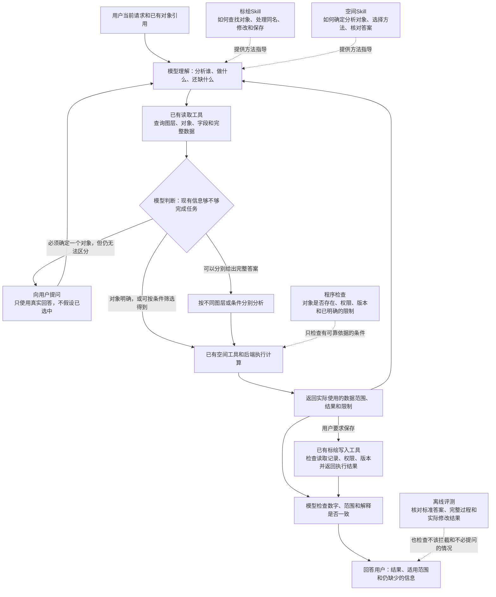

# 当前改进方案：测评可信度与Skill加载诊断

> **2026-10-24 业务口径已确认，其余继续审阅：** 用户接受“草稿点可按指定参与分析，不自动代表真实可用资源；来源无法唯一确定且影响答案时澄清或分别说明”，并要求更新方案、提交Git，暂不实施或测评。见[下一轮修改建议](r11-20261023/next-change-proposal.md)。32项替代安排、评分标签和实现仍未批准；下文保留原计划供对照。

> **历史阶段启动记录｜2026-10-23。** 用户在方案提交`a4b065e`后要求“开始本阶段”。现先执行材料准备；人工标签确认仍是评分校准及后续48项对照的前置条件。范围和预算不变，进度见[R11执行记录](r11-20261023/README.md)。

| 状态 | 内容 |
| --- | --- |
| 已完成 | R7—R10测评；R10结果已提交`1557a15`。固定B版自动加载24项：主任务23/24，严格20/24；T13存在结果碰巧正确但漏读的情况 |
| 原阶段计划（当前不执行） | 题集调整、24份人工评分校准材料、Skill加载判断方法；8题×3组×2次的48项对照，以及最多72次独立评分请求 |
| 继续保留 | 现有Pi、Skill、工具及后端架构；整体与新保留集90%严格门槛；关键对象/权限/写入错误为0 |
| 暂不开展 | 产品或Skill修改、新测评与自动追加、main合并及部署；当前分支为`codex/agent-result-grounding` |

**阅读顺序：** 先看[当前问题](#1-当前问题和工作边界)与[架构分工](#2-架构和职责分工)，再审阅[评分校准](#4-评分怎么校准)、[三组对照](#6-下一轮对照固定b版只改变skill提供方式)、[预算](#7-预算任务运行与评分分开)及[执行条件](#8-实施顺序验收和停止条件)。

背景材料：[R10报告](research/r10-results-20261023.md) · [历轮方案和决策](post-round1-improvement-plan.md) · [已有架构设计](design.md)。本轮审阅不需要逐条重读历史授权。

## 1. 当前问题和工作边界

当前执行记录、真实状态核验、版本冻结和故障注入已有较好基础；主要短板是题目代表性、语义评分的人工校准，以及从小样本推广到实际使用时的证据不足。R10的24项适合诊断；每类仅4项，一项就影响该类25个百分点，不能直接估计生产正确率。

本轮顺序是：**先校准评分、整理题集，再在固定B版上比较加载条件。** 不同时修改Skill正文、工具、宿主或模型。新的产品候选依据诊断结果另行提出。本文件接替历史方案第10.6—10.7节中尚未执行的后续安排；既有结果和评分保持原样。

继续复用当前框架，普通澄清与交互API契约分开计分。路网计算、专业作业决策、新的范围凭证和在线审核Agent仍不在范围内。本次不启动服务，不执行工程测试、评分或模型测评。

### 已有基础及结论边界

| 当前做法 | 保留的价值 | 不能扩大解释成什么 |
| --- | --- | --- |
| 真正经过宿主、工具和后端，核对几何、版本和写入结果 | 验证实际任务效果，不能只听模型自述 | 不等于已经验收浏览器展示或当前main整体版本 |
| 固定题目、运行版本、模型、正文和评分，记录实际wire输入 | 可以追查输入、环境及模型配置 | 冻结旧快照的成绩不能直接代表后来部署的组合 |
| 保留全部执行记录、失败、中断和补测身份 | 支持独立追溯，避免择优报分 | 原始证据仅在本机时，拉取Git还不能独立复核全部过程 |
| 数值使用独立真值；保存检查实际数据库和前后状态 | 防止工具自证、错误写入漏检 | 少量规则几何通过不代表覆盖所有支持的几何类型 |
| 评分分为主任务、过程、最终、副作用及边界 | 分清做错与说错 | 五项全部通过的总分不能替代具体错误类型 |
| 主Agent和独立Agent复核 | 能发现误读和评分分歧 | 不等于人工标注，也不等于两个统计独立的裁判 |
| 六项评分汇总测试 | 确保已有pass/fail/pending按规则汇总 | 没有测试语义裁判是否真的会识别一句话的事实错误 |

本方案参考的是官方方法，不引用其他项目的成功率作为本项目目标或模型能力保证；具体预算、门槛和抽样安排是本项目的拟议选择。

## 2. 架构和职责分工

- **模型**理解用户目标、选择来源与方法、判断是否需要澄清，并解释结果。
- **map-annotations Skill**说明如何查找和管理标绘、使用框架接口，以及修改和保存规则。
- **spatial-analysis Skill**说明分析对象、方法选择、计算和解释核对。
- **工具和现有后端**执行查询、空间计算、保存，核验身份、权限、版本和真实效果。
- **离线评测**检查完整过程和真实结果；它不参与线上每次对话，也不是在线审核Agent。

以下沿用原架构说明图：

图中“信息是否足够”和回答自查仍由模型完成，不是程序保证。后端可以核实实际算了哪些对象，不能仅凭合法ID证明理解了用户意图。执行沿用Pi正常对话与工具循环；Skill通过本产品受控目录、显式选择或`skill_read`进入模型上下文。本轮只在隔离测评中改变正文提供方式，不改变产品架构。

## 3. 测评集怎么调整

### A. 分清三种用途，不再让一套题承担所有结论

| 题集 | 内容与用途 | 使用约束 |
| --- | --- | --- |
| 开发诊断集 | R7—R10旧失败及新诊断题，用来定位来源选择、分页、解释等问题 | 看过并据此调过方案的题及近似变体都标为开发题；不能当保留集 |
| 固定回归集 | 已确认正确、覆盖关键功能的旧题及故障恢复案例 | 冻结题目、数据、真值和口径；检查修改后是否从通过变失败，不只看总分 |
| 独立验收集 | 候选固定后独立组织的新表达、新数据和组合情境，逐步加入经授权脱敏的真实使用记录 | 不参与Skill/工具调参；与开发题按场景家族分开，不靠改名制造“新题”；泄露后转开发题 |

R10全部24项留在开发诊断集。经复核的通过题可登记为回归候选，单次通过不立即称为稳定回归。下轮只使用开发诊断题，不同时建设或运行大规模正式保留集。没有真实业务样例时，明确标记为合成场景，不冒称线上抽样。

### B. 每个任务家族同时覆盖“用户怎么问”和“数据是什么样”

- 保留给出明确ID/来源的功能题，同时增加自然表达、明确的会话引用、指代和背景干扰。用户可有真实歧义，但评分规则不能偷偷指定唯一目标；合法澄清和完整条件答案都应可通过。
- 取得用户选择后继续完成任务，另测“澄清之后能否正确执行”；不要只因问出一句澄清就声称完整多轮流程已验证。脚本用户只按事先冻结的选择回答，不暗示工具或正确结果。
- 分页题使用不可推断的名称、非连续编号、干扰图层及固定乱序；同时检查成员、总数和完整读取依据。T13的连续名称漏洞不在历史批次中补改，而在新夹具中消除。
- 正反例成对：有命中/确实为空/来源失败/几何缺失；应澄清/上下文已足够；需复用旧结果/需重新查询更新结果；只读/授权保存。避免把所有任务都优化成追问、拒绝或加载全部Skill。
- 后续回归扩展在已支持能力内变化坐标、区域、对象数和几何形状，覆盖中国、澳大利亚的适用场景；不借测评扩大到路网、三维或专业作业决策。
- 参考解法只证明任务可解，不规定唯一工具序列；实际前后状态、明确范围约束及证据完整性才是主要判定依据。

每题冻结：题干与可见上下文、数据快照、真值、允许的等价答案/澄清、禁止副作用、应发生的故障、所需规则来源和数据完整性要求。所有oracle仅在评测侧，不能通过Skill、夹具备注或预加载文字泄露给被测Agent。

## 4. 评分怎么校准

### A. 先用旧记录建立24份人工可核对的判定样本

从R7—R10中整理24份“原句＋当时足够的上下文＋真实证据”记录，拟覆盖六类各4份：明确事实矛盾、结果正确但依据缺失、合法推导/估算、计划或条件表达、范围/版本/保存状态、歧义或后续纠正。既含应通过也含应失败；一份材料可能有多个标签，不能靠每类4份推定正负标签平衡。

人类审阅者确认原句表达的事实、支持证据、标签及严重程度。未得到人工确认时，只能写“Agent拟判定”，不启动后续受此校准约束的模型批次。当前仅落盘此流程，不要求用户在本轮立即标注。

按原任务/场景家族划分16份用于制定规则和演练，8份作为不向评分模型提供标签的验证材料；避免同一段话改写后分到两边。验证8份应包含4份可通过与4份应失败，并覆盖关键错误。真实原文无法满足时如实登记缺口，不能改写原文再冒称历史样本。

语义评分模型看到完整必要上下文，但不看到候选组名、历史得分、人工答案或另一裁判结论；用于规则制定的示例与验证材料分开。模型、评分提示、证据选择方式和版本全部留存。人工与模型有分歧时记录原判定，再由人裁定，不以多数Agent意见替代人工。

拟议的小样本启动条件：验证8份的通过/失败判断全部与人工一致，关键错误误判通过为0；16份演练结果只用于定位问题，不合并成“独立验证准确率”。这只是启动下一步的检查，不证明评分器长期100%准确。若不满足，停止并提交分歧，评分规则修改及重新验证另行审阅，不在同一批内反复调到通过。

分别报告：误判通过数/人工判失败数、误判失败数/人工判通过数、未定数量及多维分歧。证据不足保留未定，不自动算通过。确定性数值、状态及完整性检查继续优先使用程序；人工语义标签不覆盖真实数据库证据。

### B. 保留五维严格评分，增加可解释的辅助指标

| 指标 | 计算及用途 |
| --- | --- |
| 主任务结果正确 | 检查必要输出、目标对象和真实操作效果，不以调用次数代替 |
| 完整证据支持的任务完成 | 必要结果正确，且取得足够数据/有效完整查询依据；允许后端完整过滤、聚合等合法方式，不强迫把全部原始对象下载给模型 |
| 过程/最终事实正确 | 检查全部可见声明，按当时证据判断；分别标明与事实矛盾、缺乏依据、有依据推导、条件表达或未定 |
| 严格通过 | 技术流程完成且主任务、过程、最终、副作用、边界五项均通过；必要事实无依据也不能通过 |
| 必要回答覆盖 | 用户明确要求的内容是否齐全；不能靠沉默或删去必要数字刷分 |
| 操作与恢复 | 只读不变、保存、发布、采用分别计数；故障暴露数和实际恢复数单列，不用大量只读成功稀释写入风险 |
| 严重程度 | 错对象、未经授权写入、伪造确认等关键错误；其他影响结论的事实错误；不影响事实的表达质量。先定义标准，不因想提高分数临时降级 |
| 自我纠正 | 首次错误是否已展示、何时更正、最终是否恢复；纠正不抹掉首次错误，也不把未展示的内部候选文本算成误述 |

同一题多个错误在严格失败数中只计一次，但分类表可多次登记。逐条事实比例仅作辅助，不让大量正确句子抵消一个关键错误；不强求唯一措辞或唯一工具路径。评分记录包含原句、消息位置、对象/时间、支持证据、理由和评分版本。

历史T13保持主任务输出通过、严格失败；新口径另报其完整证据支持不满足，不覆盖原成绩。旧记录若重新裁判，使用新的文件和评分版本，不回写R7—R10。技术中断、未执行和未定保留计划分母，同时另报已完成口径；中断不直接归因模型能力。

## 5. 如何判断Skill加载机制是否合理

**先判断任务需要哪些知识，再判断知识是否及时到位，最后看它是否改善完成效果。** 不设所有任务都必须读Skill的目标，也不使用“读取率越高越好”。

### A. 每题先列一张规则来源表

每条规则记录：规则内容、它出现在Skill/宿主/工具说明/用户上下文的哪个位置、当前是否已经送达、何时首次需要它、缺失会影响什么。表只给评测侧，不送给模型提示正确路线。

| 预先核对后的情况 | 对加载的期待 |
| --- | --- |
| 关键规则只在Skill，当前上下文没有 | 在相关决策前取得正文；未取得记知识取得缺口，是否任务失败仍由实际结果判定 |
| 工具说明或有效上下文已足够 | 读取可选；不读但正确完成可以通过，不以未读强行判失败 |
| 与相关Skill无关 | 通常不需读取；偶尔读取不是直接判任务失败，记录开销、干扰及错误动作 |

不能仅凭“多步/复杂”认定必须读取。若审计发现所有必要规则已存在工具说明，就如实报告“本组没有Skill独占规则题”，不为凑读取指标把正确规则从工具中删去。也不能把Skill才有的隐含要求强加给用户任务的核心成功标准。

### B. 分别验证宿主交付、模型选择、读取时机和实际遵循

- 宿主交付：首请求目录是否正确，实际调用是否成功，正文是否逐字进入后续模型请求。文件存在、调用过或日志有名称，都不能单独证明正文送达。已预加载正文不重复读取也算知识已到位。
- 模型选择：选择的Skill是否适用，是否漏掉独占的必要规则，是否加载了无关方法。读取数只描述行为，不直接代替正确率。
- 时机：以每条规则首次适用的决策为界，不统一要求所有查询前都读。来源选择规则应在作出相应来源决定前取得；故障恢复规则可在收到真实故障后、实施恢复前取得。
- 遵循：读到后是否选对对象、保持查询范围、正确解释字段并完成任务。读取后仍犯错，不能继续一概归因“没加载”。

拟报告：目录/交付检查通过数；独占必要规则及时取得数/适用任务数；相关规则晚到数；无关任务读取数/无关任务数及额外token；正文送达后仍失败数；各加载条件下完整证据支持和严格正确率。分母为0时写不适用，不能写100%。记录“先查后读”和“作出错误结论后才读”的区别。

R10的13/24只能说明13项成功收到正文。T11已读仍误述，T03未读又选错来源；这两项不能单独证明加载导致成败。读取/未读取两组的任务难度不同，不能直接用其正确率差计算Skill收益。

## 6. 下一轮对照：固定B版，只改变Skill提供方式

### A. 冻结条件和三组设置

建议下一轮是加载诊断，不是新版产品验收。继续冻结R10被测B组合：af13107归档基础＋c95b3d3的两份Skill；测试工具/后端和真实输入哈希须核对一致。使用同一方舟Agent Plan入口、同一Flash请求/响应型号及thinking disabled适配、8192输出上限。服务响应型号变化或快照不一致时暂停，不悄悄换模型、合入main或改题后继续拼分。

| 组别 | 提供给Agent的内容 | 主要回答什么 |
| --- | --- | --- |
| N：自动按需加载 | 当前两份Skill目录可见，正文由正常skill_read按需获取 | 正常使用能否及时取得规则并完成任务 |
| P：预先提供正文 | 在首请求现有显式正文上下文位置提供固定B两份原文，目录、工具、用户问题保持可比 | 把正文提前送达，能否减少失败；不是假设一定更好的“上限” |
| X：不提供这两份Skill | 在隔离测评配置中同时去掉这两份目录及读取入口，保留原有宿主和业务工具说明、其他资源 | 没有这两份Skill时能做多少，Skill整体可用性是否有增益 |

P组每题都提供相同两份正文，不按题预选“正确Skill”、不额外提示答案；对无关题也提供，用于观察额外上下文的成本。只改测评适配，不开发产品多选入口。若现有适配无法保持正文位置和其他输入可比，先离线说明差异，不能直接冒用已有显式加载成绩。

X组不是故意诱导调用不存在的Skill，也不伪造读取成功或空正文；测试配置须使目录与可读资源一致。P比N多初始正文，X比N少目录和可用资源，这些就是干预本身，需保存逐字段差异。X用于整体可用性消融，不能声称它只测正文措辞；P/N差异也可能来自上下文长度和时机，并非纯粹“主动性”。

全部都是测评条件，**不修改产品的加载策略**。隐藏oracle，禁止根据得分为某组增加提示。普通澄清与交互API契约单列；只有共同完成约定任务才算成功。

### B. 八个任务家族，每组每题预先安排两次

| 编号 | 拟议任务与关键控制 | 要定位的问题 |
| --- | --- | --- |
| L01 | 自然表达引用本会话地图区域，同时存在来源关注区干扰；可见引用足以确定目标 | 是否先选错来源；不把题意含糊当模型错 |
| L02 | 同名区域，题目确有歧义；澄清后按冻结选择继续，或接受完整条件答案 | 是否需要时澄清、澄清后完成；API用法另计 |
| L03 | 两次历史范围结果，用户明确沿用其中一个；可见上下文能唯一定位 | 是否选对固定结果；规则是否在决定前到位 |
| L04 | 范围筛选叠加属性，分别存在全层候选数、范围内数量和最终数量 | 是否读到规则仍混淆数量；必要时做旧轨迹单步分析 |
| L05 | 跨页名单，随机顺序且名称不可推断，有其他图层干扰 | 查询范围变化、漏页和猜测是否仍发生 |
| L06 | 明确对象和单位的两点距离，工具说明足够 | 简单任务是否正确完成，是否增加无谓读取或追问 |
| L07 | 普通问候，不涉及地图或操作 | 是否无关加载、增加套话或误触工具 |
| L08 | 只润色用户给定的非地图文本，不涉及检索或业务操作 | 是否把无关任务带入空间流程 |

L01—L05的规则是否只能从Skill取得，须按第5节实际核对后标注，不能在此预判。L07/L08作为加载负例单列；其容易通过的分数不能帮助掩盖六项业务题的失败。

规模为**8个任务×3组×每题2次＝48次独立任务尝试**。两次是拟议预算内事先登记的重复，不是失败后补跑；目的在于暴露明显波动，仍不足以精确估计稳定成功概率。每组16次，其中业务题12次、无关题4次。分别报告业务与负例结果，不只给一个48项总分。

同一道题在三个组和两次重复中使用同一冻结业务数据与题干，使用全新会话和隔离状态；会话标识等必要差异单列。两次不是数据变体；数据变体属于后续泛化测试。组别执行顺序预先交错、两次轮换，保存固定排程，降低时间和服务波动影响；不保证供应商随机种子可控。

旧R10不充当本批N组：新题表达、分页数据及评分有变化，且需要同批比较随机波动。R10只作历史诊断，不把旧分数与新分数相减归因。

### C. 怎样解释组间差异

- P重复成功而N反复漏读、迟读且失败：支持加载选择/时机存在缺口；仍需核对实际差异和失败轨迹。
- N与P均已收到正文但同样错误：优先审视规则、工具信息和模型执行，不以强制多读作为结论。
- N与X同样成功：在这些题上未观察到额外收益，不等于Skill在所有任务中无用。
- P比N差或代价更大：提前放入正文可能有干扰，不能默认强制加载更好。
- 两次表现相反或差异仅一个样本：标为证据不足，列出每题变化，不自动增加次数直到出现理想结论。

按相同题的两次记录并排列出三组结果、正文到达时点及失败类型；另报每题0/2、1/2、2/2和两次均通过的任务数。不得挑每组最好的一次。P、X都不是可用于冒充正常产品成绩的模式。

## 7. 预算：任务运行与评分分开

**以下为原阶段预算记录，当前模型调用为0。2026-10-24用户要求继续审阅、暂不实施或测评；即使下列前置条件满足，也不能自动恢复执行。** 后续先完成人工确认和离线准备，再分阶段释放预算；校准不通过则不进入48项对照。当前没有批准自动追加、重试或第二批。

| 阶段 | 拟议范围 | 新的模型调用预算 |
| --- | --- | --- |
| 0：整理与人工确认 | 24份历史判定材料、规则来源表、题集划分和文档检查 | 不调用被测Agent，不另发自动评分请求；人工时间单列 |
| 1：评分校准 | 16份演练＋8份标签隔离验证，冻结评分模型后各评一次 | 最多24次独立评分请求；不过关即停，无自动重评 |
| 2：离线验证 | 题目、真值、三组输入差异、交互和隔离、分数聚合、故障停止及证据保存 | 模拟提供商，真实模型请求0；不是模型正确率成绩 |
| 3：三组对照 | 8题×3组×2次，共48次任务尝试 | 预计约200—300次Agent模型请求；不是48次API请求 |
| 4：本批评分与复核 | 每次任务一次初始语义评分，程序检查真实效果；人工复核失败、分歧及抽样通过 | 最多48次独立评分请求；人工裁决不再触发Agent重跑 |

阶段1与4的评分请求总计最多72次，拟使用同一已配置Flash端点作为可复现的初判器，并接受人工校准/裁决；与被测模型相同可能存在共同偏差，不能称独立模型共识。暂不添加第二付费模型。提示与正文检查、复核分析不计为新的业务任务；通过API实施的每一次评分仍必须计入用量。

预计合计约**272—372次模型请求，输入约410万—780万token，输出约6万—12万token**。任务部分以R10的115请求/24任务、约214万输入token为粗略基准；预加载两份正文、重复上下文和语义评分会增加开销，新题也可能不同。这是规划区间，不是保证或人民币报价。

拟设置整批启动保护阈值：**480次请求、1000万输入token、25万输出token**，包含任务和评分；评分另受72次约束。开启一个新任务前预留36请求/50万输入/1.6万输出token；开启一次评分前检查其实际输入大小和输出上限。不得为满足预算静默截断必需证据；超过评分输入预留时停止待审阅。

在上述总阈值内，为阶段1、4预留72次评分请求、180万输入和10万输出token；Agent任务部分可用启动预算相应为408次请求、820万输入和15万输出token。阶段结束后核对实际消耗，但不挪用剩余预算追加任务或重评；证据较长导致评分预留不足时停止待审阅，不能省略关键材料勉强判分。

保护阈值用于停止开启后续工作，不是保证正在执行的任务必定在阈值内结束。已有任务持续有效推进时允许完成，记录可能的超出，完成后不再开新任务；不恢复按固定工具次数机械截断。明确循环无进展、供应商错误、未知用量、冻结漂移或关键错误写入时保留记录并停止；故障后的重新尝试须另行授权。

不声称Agent Plan必然零额外费用：本方案仅沿用专属端点，未核实账户抵扣、剩余额度和超额计费。执行前确认可用额度，不自动开启超额付费、不回退官网计费入口。用量记录区分Agent与评分，记录实际请求型号、响应型号和供应商usage，不打印API Key。

## 8. 实施顺序、验收和停止条件

| 顺序 | 后续获批后要做的事 | 进入下一步的条件 |
| --- | --- | --- |
| 1 | 准备人工判定材料、规则来源表、题集用途清单 | 人工确认关键标签；题意与真值清楚，不把内部偏好当要求 |
| 2 | 按已批预算校准语义评分 | 第4节验证要求满足，否则提交分歧后停止 |
| 3 | 完成八题及三组测评适配、确定性离线检查 | 三组除预定差异外保持可比；参考解法可达；未泄露答案；不用模型付费冒烟替代离线检查 |
| 4 | 冻结代码、题目、数据、评分、排程、模型配置和证据目录 | 用户后续明确允许执行所审阅的批次；再核对人工确认、校准通过及预算条件全部满足 |
| 5 | 执行并汇报全部尝试 | 不重跑、不拼最佳成绩、不追加下一批；不同时改产品 |
| 6 | 根据归因提出Skill、工具或宿主的最小候选 | 另行审阅改动和同题对照；不会仅因低读取率就强制加载 |
| 7 | 对实际准备发布的集成版本正式验收 | 新保留集、回归、桌面浏览器检查及相应预算另批 |

正式验收仍保留正常自动加载下整体严格通过率≥90%、独立新保留集≥90%，关键对象错用、违反明确限制、伪造确认和未经授权修改为0。总体分布与分母在执行前冻结，普通聊天负例独立报告，不能增加容易题凑过线。回归逐项报告退步，不能用新题提升抵消关键能力退步。

本批48项只决定是否存在值得修复的加载或执行缺口，不因超过90%宣布正式验收，不把两次重复合计当作16个不同业务场景，也不将“关键错误观察为0”说成未来风险为0。若样本不支持归因，就报告尚不能判断；没有自动扩样预算。

保留原始轨迹和状态用于复核，后续获批时整理可分享的脱敏证据包、文件清单、哈希及获取位置；不要只提交汇总而让其他Agent无法核查。历史本机原始证据不移动、不删除；本次不上传任何日志。共享前排除密钥、认证头和真实敏感业务数据。

## 9. 参考依据与自行验证的边界

以下官方资料于2026-10-23审视时查阅，引用方法而非把其默认实现全部搬入本项目。

| 官方资料 | 借鉴到本方案的做法 | 本项目需要自行确定/验证 |
| --- | --- | --- |
| [Anthropic：Demystifying evals for AI agents](https://www.anthropic.com/research/demystifying-evals-for-ai-agents) | 检查轨迹与最终状态；区分能力和回归；参考解法、重复尝试与多种评分相结合 | 本项目的任务代表性、90%门槛和关键错误定义；24题是起点，不是生产准确率证明 |
| [Anthropic：Writing effective tools for agents](https://www.anthropic.com/research/writing-tools-for-agents) | 贴近实际的数据和任务；接受合法替代路线；保留集防过拟合；观察工具、token和耗时 | 不可推断的分页夹具、自然表达任务和工具语义是否适合我们的模型 |
| [LangChain：Evaluation concepts](https://docs.langchain.com/langsmith/evaluation-concepts) | 数据集分割、按类别报告；逐步用真实运行记录补充离线题集 | 无真实样例时诚实标注合成数据；发展为独立验收集的组织方式 |
| [LangChain：Improve evaluators using human feedback](https://docs.langchain.com/langsmith/improve-judge-evaluator-feedback) | 用人工标签检查并改善语义评分，不把Agent互审叫人工校准 | 24份材料、16/8划分、启动要求都是本项目拟议规模，不是官方保证 |
| [LangChain：How to evaluate with repetitions](https://docs.langchain.com/langsmith/repetition) | 预先安排重复，保留各次结果并观察波动 | 每题两次仅初步诊断；48项预算并非统计充分性的保证 |
| [LangChain：Evaluate a complex agent](https://docs.langchain.com/langsmith/evaluate-complex-agent) | 区分最终回答、完整轨迹和单步判断 | 必要时从旧记录单独分析来源选择/字段解释；不能用单步成功代替整任务成功 |
| [Google ADK：Evaluation criteria](https://adk.dev/evaluate/criteria/#hallucinations_v1) | 将事实是否有上下文支持独立评分，可检查中间可见说明 | 不直接照搬ROUGE或精确工具序列；本项目对象、版本和真实副作用由独立检查补充 |

这里提出的N/P/X三组、规则来源表、48项和预算是结合本项目失败证据的设计，不是上述机构发布的统一标准。参考思想即可，无须迁移Pi或引入LangSmith/ADK平台依赖。

本文件从历史方案第11节拆出，并补入仍有效的架构分工；本次只调整文档组织，原有预算、评分约定和待审阅状态保持不变。后续工作继续使用`codex/agent-result-grounding`，main仅在另行授权的集成阶段处理。
