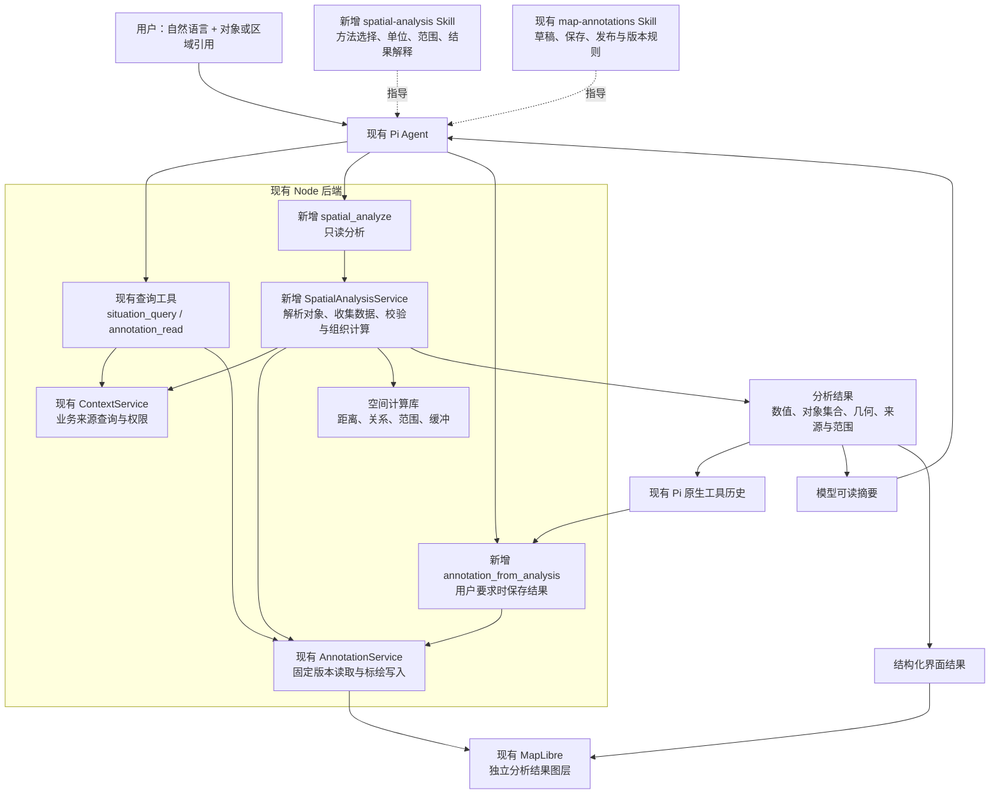

# Agent 第一阶段空间分析能力：架构设计

> 状态：待用户审阅，未开始实施。
> 日期：2026-10-15。
> 配套文档：[范围与验收](prd.md) · [实施计划](implement.md)。
> 工作分支：`codex/agent-map-spatial`。
> 2026-10-16 更新：在底图分支 `a79f1ae` 的基础上合入 main 已提交快照 `75fc7f1`，包含 `d79a561` 结果投影和 `fdba343` 工具契约整理。空间分析仍未实施；整合记录见 [主线合并复核](research/main-merge-review.md)。
> 本轮补充：方法选择规则见第 4 节，参考依据与自建边界见第 14 节，效果评测见实施计划第 4 节；架构图保持不变。

## 1. 设计结论

保留现有 Pi Agent，在现有 Node 后端内增加空间分析模块。Skill 指导分析方法，工具提供明确入口，后端通过已有服务读取真实数据并计算，MapLibre 展示计算结果。

`SpatialAnalysisService` 是现有后端中的代码模块，随现有后端部署。第一阶段不新增独立空间服务器、MCP 服务、第二套 Agent 循环或分析结果数据库。

本方案服务于已确认的基础测量、空间关系、范围查询、邻近排序、缓冲范围、组合分析与结果展示。路网计算和专业作业决策不在本期。

底图合并后的复核结论：核心架构仍可行。新底图已提供稳定地图实例、`basemap:*` / `business:*` 隔离和 `business:anchor`；空间分析接入需落实第 9.3 节的图层、点击、定位和文字约定。详细依据与验证边界见 [底图合并可行性复核](research/basemap-merge-review.md)。

## 2. 架构说明图

以下 Mermaid 源码是方案的一部分，在支持 Mermaid 的 Markdown 阅读器中可直接显示。

数据路径中的权限检查由宿主与现有服务执行。图中从历史到保存工具的连线表示宿主解析经过验证的结果引用，不表示浏览器或模型可以提交任意历史内容作为真实结果。

## 3. 现有代码依据与复用边界

Pi 结果投影相关代码来自已合入的 `d79a561`，工具契约包含 `fdba343` 更新；底图与画布来自已合入的 `a79f1ae`。以下复用能力已进入当前 worktree，行号用于审阅定位，实施前重新核查。

| 位置 | 已有能力 | 本方案如何复用 |
| --- | --- | --- |
| `experiments/harness-lab/src/pi/lab.ts:666` | 原生 Pi 会话、请求固定身份、工具注册与原生历史 | 增加受控工具注册和结果投影，保留既有循环 |
| `experiments/harness-lab/src/resources/service.ts:9` | 受控 Skill 目录、快照、按需加载 | 注册 spatial-analysis，沿用 skill_read 和显式选择 |
| `experiments/harness-lab/src/pi/resource-tools.ts:69` | Skill 正文读取工具 | 不新增 Skill 加载器 |
| `experiments/harness-lab/src/context/service.ts:9` | 来源目录、来源权限、HTTP 查询与响应校验 | 读取业务对象及属性，不绕过服务访问来源 |
| `experiments/harness-lab/src/contracts/context.ts:36` | WGS84 的 Point、LineString、Polygon 与对象版本 | 作为已有空间对象输入 |
| `experiments/harness-lab/src/annotations/service.ts:36` | 任务/身份检查、固定标绘版本、草稿写入和回执 | 读取标绘与保存派生结果 |
| `experiments/harness-lab/src/annotations/validation.ts:43` | 几何校验，写入仅支持单环面 | 不把复杂面静默降级保存 |
| `experiments/harness-lab/src/pi/annotation-results.ts` | 模型 content 与界面 details 的分离 | 空间结果采用同一分工，不改旧回执语义 |
| `experiments/harness-lab/src/web/situation/evidence.ts` | 从真实查询/回执生成地图入口 | 新增经过校验的分析结果入口，不解析助手散文当作几何 |
| `experiments/harness-lab/src/web/situation/MapCanvas.tsx:29` | 稳定 MapLibre 实例，底图和标绘各自运行时 | 添加独立分析图层，不通过配置变化重建地图 |
| `experiments/harness-lab/src/web/situation/basemap-runtime.ts:24` | 仅管理底图源与图层，切换可见性、隔离重试和旧请求错误 | 分析运行时只管理 analysis:*，不调用底图清理 |
| `experiments/harness-lab/src/contracts/map.ts:1` | 底图 WGS84 / Web Mercator XYZ 约定和新旧配置兼容 | 复用配置；计算仍读取业务 GeoJSON，不从瓦片取分析候选 |

相关规范： [空间来源与地图](../../spec/backend/situation-map.md)、[标绘与版本](../../spec/backend/map-annotations.md)、[会话引用](../../spec/backend/conversation-references.md)、[多源上下文](../../spec/backend/context-analysis.md)。

工作树已同时包含底图和结果投影规范。主线仍在并行修改，本次固定到已提交的 `75fc7f1`，不包含其工作区未提交的修改；实施前仍需核查后续变化。

## 4. Skill 如何设计

### 4.1 职责与加载机制

新增 `spatial-analysis` Skill，建议放在现有受控目录：

`experiments/harness-lab/fixtures/skills/spatial-analysis/SKILL.md`

| 方法内容 | 职责 |
| --- | --- |
| 问题拆解 | 将问题拆成测量、空间判断、筛选、排序和统计 |
| 方法选择 | 区分地理距离、沿线长度与道路行驶距离；明确不提供行车时间 |
| 数据准备 | 明确对象身份、候选范围、版本和必要属性；缺数据或歧义时补充查询 |
| 结果解释 | 按实际范围回答，解释单位、缺失数据、版本与时间 |
| 保存衔接 | 用户要求保存时进入既有标绘工作流，区分保存、发布与采用 |

现有 `map-annotations` Skill 继续维护草稿、图层、标绘修改、发布和采用规则。新增 Skill 只指向相关工作流，不复制一整套版本规则。

Skill 沿用现有 `ResourceService`、`skill_read`、显式选择及请求资源快照。登记新 Skill 时同步检查受控 ID、目录数量限制与历史解码；旧会话的正文和哈希不能被改写。

权限、支持的参数和几何类型、计算限制、完整性判断属于程序契约。即使模型未加载 Skill，这些规则仍必须生效。

### 4.2 参考方法与本项目责任

本方案借鉴参考项目的知识组织、工具说明和评测方法，不直接移植一套已验证适用于本平台的分析 Skill。参考项目中的相关能力可能分布在提示词、工具文档、数据检查和执行程序中，不能一概视为 `SKILL.md` 的能力。

- **借鉴 geoskills**：按“任务与数据检查 → 方法适用条件 → 操作 → 结果核对”组织知识。具体规则须按本项目的 GeoJSON、WGS84 和计算库契约改写；例如采用接受经纬度的球面算法时，不应机械套用“所有测量先转平面坐标”的做法。
- **借鉴 GIS Copilot / SpatialAnalysisAgent**：结合数据元信息和工具说明拆分步骤、选择方法，并保留可核对的执行依据。研究原型的表现不等于本平台的验收结果，也不要求引入其 Python 代码生成或 QGIS 运行环境。
- **借鉴 qgis-mcp**：明确输入类型、参数含义和失败后的可行动提示。本期仅有固定操作，直接在工具 schema 和说明中表达，不建设动态算法目录。
- **借鉴 MapLibre Agent Skills**：以对照实验判断 Skill 是否减少错误，并包含不应触发空间分析的用例。该项目的回答评测需扩展为本平台的实际工具调用和结果验收。
- **由本项目建设并验证**：下述规则表、适用几何矩阵、候选完整性、对象和版本引用、工具契约、Pi 中的 Skill 发现与加载、地图及保存一致性。没有参考项目替我们证明这些适配已经正确。

各项来源、证据局限和可复用边界见第 14 节。下表的 M1—M11 是本项目拟定规则，不是参考项目原有规则编号，也不是新增业务决策。

### 4.3 方法选择规则

| 规则 | 问题或触发条件 | 拟定方法及必要前提 | 不应采用的解释或做法 | 依据与验证归属 |
| --- | --- | --- | --- | --- |
| M1 | 两点相距多远；点距某条线多远 | 先明确点/线身份，再用 measure 的两点地理距离或点到线最短距离；返回单位与实际算法 | 用经纬度差当米数；把点到线距离当沿线行程 | 借鉴 E1、E3；具体算法依据 E6，自建数值和类型测试 |
| M2 | 线有多长；区域有多大 | 分别使用线长度、面面积；读取真实几何，说明米/平方米和适用精度 | 用端点距离代替折线长度；用包围盒面积代替实际面面积 | 借鉴 E1；依据 E6 验证，自建样例 |
| M3 | 是否在区域内、相交或分离 | 使用 relate 或对应空间过滤；先按契约确定边界、完全包含或部分相交的含义 | 将“部分相交”当作“完全位于”；将相交解释为道路连通 | 借鉴 E1、E3；关系与几何矩阵由本项目定义和验证 |
| M4 | 查询区域内且符合已有属性的对象 | 明确候选来源、范围和版本，再执行空间及属性 filter；只使用实际字段 | 默认以屏幕可见对象代替完整候选；猜测字段；把缺失属性当成不匹配而不披露 | 借鉴 E2、E3；范围、分页和属性语义由本项目建设 |
| M5 | 最近的 N 个对象 | 本期限定参考点和候选点；先完成所有限定条件，再 nearest；固定并披露同距排序规则 | 将最近解释为最快或最适合；候选不完整时声称全局最近 | 参考项目启发工具选择；先筛选后排序及并列规则由本项目定义和验收 |
| M6 | 点或线周边指定距离；生成并展示范围 | 需要范围几何时 buffer，再用结果引用 filter；仅问单个点到线是否在阈值内时，可 measure 后比较 | 没有展示或后续使用需求仍强制生成范围；忽略缓冲近似误差；混用不同阈值语义 | 借鉴 E2、E3；依据 E6 建立缓冲与距离方法的误差和边界测试 |
| M7 | 区域内按类别计数 | 先取得符合条件的对象集合，再 summarize；按完整对象身份去重，明确缺失类别的处理 | 统计所有候选后再解释为区域内统计；将当前返回页当总数 | 本项目基于既有来源契约建设，验证 E2 所启发的步骤依赖 |
| M8 | 多个条件、排序、统计组合 | 根据输入和输出依赖组织原生工具调用，后续使用真实 resultRef；允许语义等价的执行顺序 | 编造中间结果；重新查询变化后的数据却声称沿用同一次快照 | 借鉴 E2；固定结果引用、等价性判定及组合用例由本项目建设 |
| M9 | 对象歧义、缺几何、缺属性、来源失败或候选不完整 | 能用现有查询消除的问题先查询；仍有实质歧义则澄清；必要数据不足时停止相关结论并说明缺口 | 猜位置；把失败或缺数据解释为零命中；为完成回答放宽范围 | 借鉴 E1、E3；程序状态区分和模型表达由本项目共同验证 |
| M10 | 最快到达、道路可通行、专业派遣；或只是改名等非分析请求 | 前者解释本期缺少路网或专业依据，必要时澄清是否改问地理距离；后者使用既有工作流 | 偷换成最近距离后声称已回答最快；无关请求额外执行空间计算 | 范围由用户确认；负向评测借鉴 E4，样例和断言自行建设 |
| M11 | 保存刚才的分析范围 | 用户明确要求时，以同一可信 resultRef 进入标绘工作流；检查几何可无损保存 | 模型重画坐标；重新计算后替换原结果；自动发布或采用 | 借鉴 E5 的地图结果反馈；保存规则来自本项目既有标绘契约 |

“区域内”的默认边界规则见第 7 节。线或面与区域的关系须由工具参数明确表达；用户措辞无法区分完全包含和部分相交且会改变结果时，先澄清。候选来源可以从明确的上下文推断，不要求每次机械重复询问。

阈值筛选不能只写“周边 500 米”：契约须规定 `≤` 或 `<`、计算方法、容差和返回完整性。距离判断与近似缓冲可能在阈值附近有差异；只有符合预先约定的误差和边界语义时，才能作为等价方法。不得为了让两个实现一致而静默改变用户阈值。

### 4.4 组合分析与责任分配

请求“找出区域内、排除禁入区后，距离目标最近的 3 个对象”的依赖关系为：

`确认目标和候选范围 → 限定区域与排除条件 → 对剩余候选计算距离并取前 3 个 → 核对结果和完整性`

两个独立过滤条件可以交换顺序，也可在契约支持时合并；取前 3 个必须发生在候选限定之后。评测检查这一依赖和最终集合，不把某一串工具调用当作唯一正确答案。这里的“禁入区”只是用户给定的排除几何，不表示系统已经具有专业禁入判断能力。

| 所在层 | 负责保证的内容 |
| --- | --- |
| Skill | 识别问题类型、组织依赖、选择适用方法、遇到歧义时澄清、按实际依据解释 |
| 工具 schema 与说明 | 操作能力、支持的输入类型、参数单位、边界含义、必要前提及错误状态 |
| 后端 | 权限、真实对象与版本、几何合法性、完整性、限制、数值计算及保存一致性 |
| 评测 | 验证 Agent 是否正确使用以上能力，以及 Skill 是否改善结果；不增加产品内第二套规划器 |

模型能力来自现有 Pi 循环所使用的模型，Skill 提供可执行的方法指导；写入一句“先拆解问题”不会自动获得可靠规划能力。记录可观察的调用、输入输出与简要方法说明即可，不要求模型输出私有推理过程，也不新增规划状态库。

### 4.5 Skill 交付与效果判定

实施时应交付与 M1—M11 对应的适用条件、简短操作示例和反例，并在任务评测材料中保存“来源或本项目契约 → 规则 → 用例 → 结果”的映射。Skill 正文保持精简；只在现有资源机制支持时拆分必要参考材料，不为此新建知识检索系统。

效果需要分别验证：计算是否正确、加载 Skill 后方法是否改善、按需发现并加载是否正常、最终解释与地图/保存是否一致。以实际结果和执行证据验收，不能以 Skill 文件存在、工具调用成功或回答流畅作为通过依据。

具体三组对照、样例分布、评分与拟定门槛见 [实施计划第 4 节](implement.md#4-验证矩阵与-skill-效果评测)。当前仅确定空间分析评测设计，未运行空间 Skill 对照。已合入的地图工具 [问题记录](../10-15-map-query-scope/issues.md) 仍存在局部范围扩大、实际筛选与用户意图错配等模型错误；这些是相关风险证据，不是空间 Skill 已经失效或生效的证明。没有改善证据的内容应精简；未通过的方法规则仍属于待修订提案。

## 5. 工具如何设计

### 5.1 工具分工

| 工具 | 类型 | 职责 |
| --- | --- | --- |
| situation_query | 复用，只读 | 查找业务对象，确认真实身份、位置和版本 |
| annotation_list / annotation_read | 复用，只读 | 查找标绘、读取明确版本中的图层与对象 |
| spatial_analyze | 新增，只读 | 执行空间运算，返回结果和依据 |
| annotation_from_analysis | 新增，写入 | 将已有分析几何准确保存到本会话草稿 |
| annotation_action | 复用，写入 | 创建草稿/图层、修改名称样式、发布等 |

首批接入前台主 Agent。后台处理和既有子 Agent 不因为新增 Skill 自动获得这些工具；权限范围保持原有白名单。

### 5.2 spatial_analyze

采用固定操作集合，不接收任意代码或模型编写的脚本：

| 操作 | 输入 | 输出 |
| --- | --- | --- |
| measure | 对象引用、测量类型 | 两点距离、点到线距离、线长度或区域面积 |
| relate | 两个几何对象、关系类型 | 包含、相交、分离及相关边界语义 |
| buffer | 点或线、正距离及单位 | 缓冲范围 |
| filter | 候选集合、空间条件、可用属性条件 | 匹配对象集合 |
| nearest | 参考点、候选点集合、数量 | 距离与排序 |
| summarize | 已确定的对象集合、已有分类字段 | 数量统计 |

这些名称是拟定契约，冻结时须建立明确的操作与几何类型矩阵。属性筛选仅作用于来源/标绘实际提供的字段；不猜测字段、补造业务分类或执行表达式代码。

每次调用完成一个操作，多步分析交给 Pi 原生工具循环。后续调用通过宿主返回的结果引用使用前序集合或几何，不需要模型转抄坐标。

已有结果还需要一个最小的按引用读取入口，供压缩后续问和保存使用。冻结工具 schema 时确定由 spatial_analyze 的读取模式承载，避免只返回一个后续无法解析的结果标识；不另建通用结果平台。

### 5.3 输入引用

| 输入种类 | 定位方式 | 处理规则 |
| --- | --- | --- |
| 业务来源对象 | 完整 ContextRef，附可获得的修订条件 | 通过 ContextService 读取，实际版本进入结果；已指定修订不匹配时明确报告变化 |
| 标绘对象/图层 | 固定 AnnotationRef 加对象或图层选择 | 固定读取；草稿先解析为本次明确版本，不在计算途中改用最新版本 |
| 前序分析结果 | 宿主签发或构造的受控结果引用 | 在当前获准会话的真实工具历史中核实，不信任模型自报结果正文 |

结果引用可基于现有会话、请求和工具调用身份定位。它只是原生历史的定位方式，不是新增数据库的主键系统，也不自带跨会话授权。

若用户给出自定义位置或范围，可先使用现有输入/标绘途径明确其含义；不得把模型猜测的坐标当作来源对象真实几何。

### 5.4 annotation_from_analysis

模型指定结果引用、目标图层和必要名称等意图；宿主从已验证的结果读取真实几何，进行权限和可保存性检查，再进入现有 AnnotationService 写入事务。

- 保存的是已经展示的固定结果，不能重新查询最新来源并替换其几何。
- 保存前重新检查当前身份、来源访问权限和目标草稿版本。
- 复用现有草稿读取依据、CAS、幂等、取消和不确定提交回执处理。
- 沿用既有来源权限传递与公开投影，避免泄露私有会话或私有标绘引用。
- 不自动发布或设为任务当前。
- 用户已在原请求中明确要求保存时，无需再增加额外批准步骤。

## 6. 后端如何衔接

建议模块分布如下，均属于现有 harness-lab：

| 路径 | 职责 |
| --- | --- |
| `src/contracts/spatial.ts` | 分析操作、输入引用、输出和错误的共享契约 |
| `src/spatial/service.ts` | 一次分析的组织、限制、取消和结果状态 |
| `src/spatial/inputs.ts` | 经现有服务解析几何、属性与候选集合 |
| `src/spatial/geometry.ts` | 包装空间计算库，固定单位与操作语义 |
| `src/spatial/validation.ts` | 输入、几何、类型组合及规模检查 |
| `src/pi/spatial-tools.ts` | Pi 工具适配、捕获身份与请求控制 |
| `src/pi/spatial-results.ts` | 模型投影、结果历史解析与完整性检查 |
| `src/web/situation/` 内新增分析展示模块 | 分析入口、结果图层和显示状态 |

以上是拟定文件边界，不要求为每个操作建立一个类。

ContextService 继续负责来源鉴权、查询和响应校验；AnnotationService 继续负责固定版本读取及标绘持久化。SpatialAnalysisService 不直接访问业务来源凭据或绕过 AnnotationService 操作标绘数据库。

Pi SDK、SessionManager 和原生历史访问保持在 `src/pi/` 内，浏览器只使用共享契约和经过授权的投影，不导入后端或 Pi 模块。

工具直接调用后端内部模块，不为工具调用额外绕一层 HTTP。若历史预览需要按结果引用加载数据，只在现有认证路由中提供必要的读取入口，仍使用相同身份和会话范围校验。

## 7. 空间计算库与数据约定

### 7.1 首选方案

在现有 Node/TypeScript 后端按需引入 Turf.js，并锁定经过验证的版本。它支持 GeoJSON，提供距离、面积、关系与缓冲等能力。计算库作为普通依赖调用，不要求部署 Python 服务。

计算库负责数学运算，不读取业务数据库、不持有用户身份、不判断权限，也不解释专业作业规则。

### 7.2 计算约定

- 交换几何继续采用 WGS84 经纬度和 GeoJSON；经度在前，纬度在后。
- 坐标单位为度，测量结果内部统一为米或平方米；展示按需转换。
- 距离/长度采用考虑地球曲率的算法，记录实际方法；不将 Web Mercator 显示坐标直接当作统一测距依据。
- Turf 距离采用球面近似，不对外承诺测绘级或厘米级精度；缓冲及面关系的适用范围与误差须经样例验证。
- 范围筛选默认包含边界；严格内部和仅接触边界须有明确语义，不能直接把不同库函数当作等价操作。
- 无效几何、未知坐标约定、不支持的类型组合明确拒绝；不静默换坐标、修复原数据或改变顶点。
- 对跨日期变更线、极区、大范围缓冲等边界情况先验证；未建立正确处理方式前返回明确不支持，不能给出看似精确的错误结果。
- 对对象数、总顶点数、结果大小和耗时设置限制。具体阈值由基准测试冻结，超限不截断成成功结果。
- 检查 Node 事件循环影响与取消响应；如单次库调用无法满足时限，再把纯计算移入受限 worker，不能仅用 Promise 超时声称已停止同步计算。不预建后台任务系统。

### 7.3 复杂几何的首版限制

当前标绘只支持简单单环 Polygon，计算库可能生成含内环的 Polygon 或 MultiPolygon。

分析输出必须保留实际几何，可在能力矩阵允许的范围内展示和继续计算。保存时只有无损兼容现有标绘格式才允许写入；否则明确报告暂不支持保存。不得删除内环、只保留最大面、截取第一块或以包围盒替代原结果。

这项保存限制仍待用户随本设计审阅；若要求复杂结果全部可编辑保存，需要单独评估对标绘类型、编辑器与持久契约的扩展，不把扩展隐含在本次实现中。

## 8. 数据范围、分页与版本

- 用户选择的任务或地图视口不是来源权限。始终使用现有身份与来源授权。
- 一个查询必须声明候选范围，例如某来源的区域过滤、完整对象引用列表、某个固定标绘版本的图层。
- 后端对声明范围收集必要分页。候选是否完整与结果列表是否分页是不同概念。
- 最近排序、全量数量依赖候选完整性；缺页、来源失败、超限或缺少必要几何时不能报告完整结论。
- 区分“查询完整且无命中”“存在无法计算的对象”“查询失败”。
- 读取所得几何、属性、修订和来源时间构成本次输入快照。前序结果参与后续计算时继续使用该快照。
- 多来源不承诺同一瞬时快照，分别保留 queriedAt、asOf 和业务有效时间；分页快照失效时停止，不能混用后续新页。
- 同一输入快照、参数及算法版本应得到一致结果。只固定对象 ID、但重新查询已变化的数据，不属于相同输入。

## 9. 结果、历史与地图展示

### 9.1 结果契约

| 字段类别 | 含义 |
| --- | --- |
| 操作与参数 | 实际执行的运算和单位 |
| scope | 实际来源、标绘版本、图层或对象候选范围 |
| completeness | 完成、不完整或失败，以及缺口原因 |
| values / items | 数值、关系或对象集合 |
| provenance | 参与对象引用、版本、读取时间与来源时间 |
| geometry | 真实生成或用于展示的几何 |
| method / limitations | 算法版本、适用条件和必要限制 |
| resultRef | 后续读取、组合分析和保存的受控引用 |

这里只描述拟定信息结构，最终字段名随共享契约统一，避免与现有结果范围字段重复造同义词。

### 9.2 模型与界面分工

- `content`：模型需要的结果、单位、对象摘要、范围、完整性与结果引用。
- `details.spatialResult`：界面、后续计算和保存需要的真实几何及必要依据。
- 正常 Pi 工具历史同时保留这些内容；不建立第二份对话或证据数据库。
- 严格检查工具名称、调用归属、成功状态、schema 和投影一致性；被 hook 改写、失败或缺失的结果不能恢复成可保存的成功结果。
- 历史读取遵循现有会话/任务授权，并核对必要来源权限；结果 ID 本身不授予访问权。
- 历史分析看当时输入和结果；查看最新来源走现有来源查询入口，不覆盖原记录。

### 9.3 前端展示

沿用现有地图面板与真实工具结果入口，增加独立分析结果组及 `analysis:*` 渲染标识。支持定位、显示、隐藏、清除临时显示，并明确显示计算时间或结果范围。

底图合并后按以下已核实接口接入；这些是未来实现约定，当前尚未新增分析运行时：

- 在现有地图实例中创建和销毁分析运行时；只清理自己持有的 analysis:* 源、图层和标记。底图切换或重试不调用 `setStyle`、不重新挂载 MapCanvas、不恢复或重置绘制器。
- 以固定 `business:anchor` 和业务图层作为插入依据，不依赖带代次的 basemap 图层 ID。分析范围填充置于 anchor 上方、业务对象下方；描边、高亮与标绘的顺序须明确，编辑控制点保持可见。对象刷新、标绘重绘和分析开关后均检查层序。
- 点击命中按图层身份识别分析结果，不复用标绘的 `group/objectId` 作为分析身份。协调现有 MapCanvas 和标绘点击处理，避免分析点击落入既有空白清选分支；绘制期间遵循现有交互禁用规则。
- 分析定位纳入已有 focusRequest/deferFocus 约定，用户明确打开或定位结果时才移动视角；不让异步分析完成触发第二套自动 fitBounds。
- 纯影像首开时路网可能从未加载，不能假设路网已经设置字形。分析标签优先复用现有 DOM 标记/文字方式；若采用 MapLibre symbol，须单独明确共用字形配置及失败降级，不以加载道路底图作为分析标签的前提。
- 底图覆盖提示、加载错误与分析数据完整性分别表达。底图覆盖范围或原生缩放不用于裁剪分析候选；底图失败不等于计算失败或没有对象。

来源对象、草稿、只读参考和分析结果保留各自身份。缓冲范围可使用中性半透明样式，匹配对象通过描边或高亮表达，不覆盖既有业务颜色含义。

用户打开或定位结果时才调整视角；计算完成不强行中断绘制。清除图层只是清除本地显示，不删除原生会话结果。身份、会话、任务切换时丢弃不再适用的迟到响应和临时显示。

底图失败时仍可查看结果文本和列表；无 WebGL 时沿用既有降级行为。

## 10. 典型调用链

示例请求：“找出这条线周边 500 米内的资源，并保存这个范围。”

1. Agent 按需读取 spatial-analysis；通过现有查询工具确定真实线对象与资源候选范围。
2. spatial_analyze 执行 buffer，宿主读取明确版本的线，生成真实范围。
3. spatial_analyze 的 filter 引用该范围，收集并筛选候选资源；需要分类数量时再执行 summarize。
4. 模型根据实际结果回答，界面据结构化结果显示范围与匹配资源。
5. 用户原请求已要求保存，Agent 使用既有标绘流程确定草稿和图层，再调用 annotation_from_analysis 保存同一份范围几何。
6. 返回既有标绘回执；不自动发布或采用。

若请求仅为“分析一下”，流程止于结果解释与展示。若查询不完整，说明实际完成部分和缺口，不把未分析对象算作不匹配。

## 11. 与并行任务的衔接

| 并行工作 | 已核查状态 | 本任务衔接方式 |
| --- | --- | --- |
| map-result-projection | d79a561 已随 main@75fc7f1 合入 | 直接沿用 content/details 分离和严格历史取证 |
| map-query-scope | fdba343 已合入工具契约整理与评测；范围误报仍未解决，query.scope 未采用，counts 未改名 | 复用实际参数和分页语义；不把已整理说明等同于模型可靠性，空间分析范围与方法选择继续独立验证 |
| map-basemaps | 已合入 05ea07d 与 a79f1ae，合并提交 0e5e457 | 直接遵循稳定实例、business:anchor、basemap:* / business:* 契约，新增独立 analysis:* |

底图分支和 main@75fc7f1 的已提交内容已合入空间分析分支，没有修改 main 工作区。正式编码前重新检查主线和其他 worktree 的后续变化；不复制其他会话未提交文件，不修改其进行中的任务文档。

重点共享位置包括 MapCanvas、contracts/index、PiLab 工具结果投影、resources/service 和标绘回执消费者。计算与输入解析优先放入新增 spatial 模块，减少交叉编辑。

## 12. 历史兼容、回退与后续入口

- 添加 Skill ID 和新工具结果时检查原生资源记录、composer 输入、显式 Skill 选择、压缩、重新打开会话及实时事件投影。
- 不重写旧记录，不用当前数据补造旧记录中的结果。
- 不另建空间数据库。若保存派生几何需要扩展既有回执或内部意图，采用兼容字段并保留旧读取。
- 新历史产生后，回退版本必须仍能读取新 Skill 与空间结果；不能直接回退到无法解析新记录的旧二进制。
- 暂停新能力可关闭新工具入口，但保留必要历史读取和已保存标绘访问。
- 后续业务知识通过现有 Skill、source_read 或明确接入的知识查询工具参与推理。它提供规则和约束，空间计算模块提供可核对的计算结果；本期不建设空知识库或提前定义业务规则。
- 路网能力若未来纳入，将另行引入路网数据与路由引擎，不把地图瓦片当作路由图。

## 13. 待审阅的设计取舍

1. 空间分析作为现有 Node 后端内部模块；首选 Turf 按需依赖。
2. 新增 spatial_analyze 和 annotation_from_analysis，复用其他查询、标绘与 Skill 机制。
3. 结果依托 Pi 原生工具历史，支持固定结果引用，不新建结果持久系统。
4. 首版复杂面结果无法无损落入当前标绘格式时，明确限制保存。
5. 首批接入前台主 Agent，不自动扩大后台和子 Agent 权限。
6. 按第 4 节建设有限的方法规则，通过实施计划中的三组对照及结果验收后，才判断 Skill 的实际价值；评测门槛仍随本方案审阅。

精度容差、规模限制、全部几何类型组合、原生结果读取接口和最低兼容回退版本需要在编码前冻结。任何会改变已批准功能的发现，须更新方案供审阅，不能静默缩减范围。

## 14. 参考依据

### 14.1 参考项目及证据边界

以下依据于 2026-10-15 核查。它们用于支撑设计，不能证明本项目已经具备相同能力；研究论文的评测版本、仓库当前版本及我们的模型/工具环境应分别对待。实施时记录实际采用的文档版本或快照；涉及代码或文本复用时另行确认许可证并保留署名。

| 编号与来源 | 已有内容或证据 | 本方案借鉴 | 自行建设和验证的部分 |
| --- | --- | --- | --- |
| E1 [geoskills](https://github.com/phuismann/geoskills)、[坐标系 Skill](https://github.com/phuismann/geoskills/blob/master/skills/crs-and-reprojection/SKILL.md) | 提供数据和坐标系检查步骤；项目定位是轻量 starter skills。所核查材料未提供系统性任务效果评测 | 任务、数据前提、方法适用条件和结果检查的组织方式 | 与本项目球面算法、数据契约相容的规则；具体方法选择和失败行为的测试。不能视为成熟自主规划器 |
| E2 [GIS Copilot 论文](https://arxiv.org/abs/2411.03205)、[工具文档格式](https://github.com/Teakinboyewa/SpatialAnalysisAgent/blob/master/SpatialAnalysisAgent/Tools_Documentation/Tools_documentationREADME.MD) | 结合数据元信息、工具文档和步骤生成；论文评估 110 个任务，仍报告参数、数据类型和投影相关失败 | 依据数据和工具约束拆解任务，保留执行依据 | 适配 Pi 和有限操作；组合规则、结果引用与本地评测。论文成功率不是本项目指标，也不表示生产环境完全自主分析已经成熟 |
| E3 [qgis-mcp](https://github.com/nkarasiak/qgis-mcp) | 提供算法发现、参数帮助与执行接口；这是工具接入证据 | 明确操作前提、参数和错误提示 | 本项目固定操作 schema、权限和版本、范围完整性；工具接口存在不证明模型选择可靠，不引入 QGIS/MCP 运行依赖 |
| E4 [MapLibre Agent Skills 评测](https://github.com/maplibre/maplibre-agent-skills/blob/main/evals/README.md)、[贡献规范](https://github.com/maplibre/maplibre-agent-skills/blob/main/CONTRIBUTING.md) | 有无 Skill 对照，覆盖明确、隐含、反例和负向请求；评测将 Skill 注入系统消息，主要评分回答 | 先定评分标准再写 Skill，检验实际增益及误触发 | 使用现有 Pi 加载方式；增加按需发现组、真实工具与几何断言、历史及保存验收。回答评测不能替代执行正确性 |
| E5 [MapOS 架构与测试说明](https://github.com/NicHaley/mapos/blob/main/CLAUDE.md) | 提供地图状态、覆盖物与计算分工参考；所述自动测试聚焦少量主进程纯函数，不含端到端覆盖 | 区分视图状态、业务数据与派生结果，展示并定位结果 | 本项目身份/任务隔离、历史结果和标绘保存、浏览器验证；不能由其地图交互推断 Agent 分析可靠性 |

成熟度判断应分别落在具体层：库和工具的能力由其实现与测试支撑；模型的问题拆解和方法选择需要任务评测；迁入本平台后的效果必须重新验证。上述项目提供借鉴依据，不提供可直接沿用的生产可靠性承诺。

### 14.2 计算与数据规范依据 E6

- [Turf：Node、TypeScript 与 GeoJSON 使用方式](https://turfjs.org/docs/getting-started)
- [Turf：distance 的球面距离算法](https://turfjs.org/docs/api/distance)
- [Turf：pointToLineDistance](https://turfjs.org/docs/api/pointToLineDistance)
- [Turf：buffer](https://turfjs.org/docs/api/buffer)
- [GeoJSON 标准 RFC 7946](https://datatracker.ietf.org/doc/html/rfc7946)

这些资料支撑算法接口和交换格式；具体版本、数值容差、缓冲近似、关系边界和支持地域仍由本项目测试冻结。

前期调研：[Agent 空间分析与地图协作的开源设计调研](../10-10-task-plan-validation/research/spatial-analysis-repository-designs.md)。本节补充 Skill 效果相关证据；前期调研不是已经通过的集成或验收记录。
