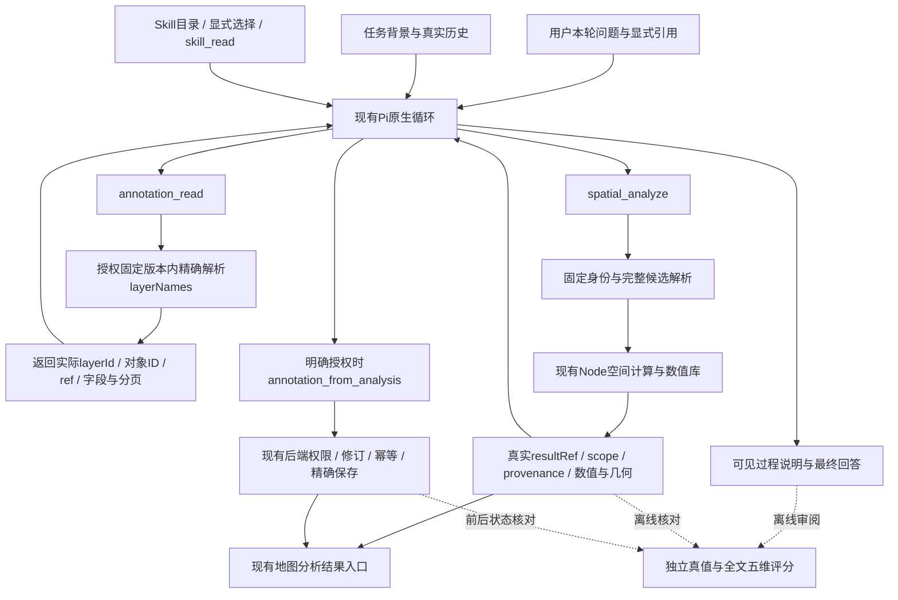

# 空间分析与标绘：合并 main 后的下一轮改进及评测方案

> **最新审阅入口（2026-10-18）：** 首轮已补齐，完整结果为29通过/16失败/3待裁定、主任务完成43/48。针对5项主任务失败和11项解释错误的后续建议见[首轮后改进方案](post-round1-improvement-plan.md)。当前仅批准方案落盘和提交；产品修改、新测试及第二轮均未获授权。下文保留历史方案与架构图。

> **首轮结果（2026-10-17）：** 旧断言及R0校准完成；冻结预算内46项完整、1项中断、1项未执行，未追加第二轮。严格27通过/16失败/3未决，详见[首轮结果与失败分析](research/round1-live-results.md)。以下方案及授权历史保留，当前处于结果待审阅。

> **执行授权（2026-10-17）：** 用户已批准先提交方案（`8f2aa31`），修复旧测试断言、完成R0评分校准及R1首轮48次。产品Skill/工具不改；第二轮及R2仍须另行批准，不自动追加。以下“待审阅”保留为方案形成时的历史，当前授权以本条为准。

日期：2026-10-17。状态：**待用户审阅；未批准下一轮产品修改或真实模型调用。**

> **本次方案修订：** 保留显式B与原生C两种Skill加载方式，R1先按一轮48次设计；第二轮为另行报审的可选48次，首轮结束默认停止。用户当前仅要求修改方案，尚未授权R0校准、代码修改或首轮模型调用。

此前合并阶段已将main已提交快照合入空间分支、运行确定性工程检查并整理两边已有证据；本次仅修订48次安排与审批边界，不新增工程检查或模型调用。原产品实现、历史失败及评分均保留。本文是下一轮审阅入口；旧 [修复方案](remediation-plan.md) 第7节中的开发试验安排不作为新的执行授权，最终总体及新保留集90%门槛继续有效。

## 1. 基线与本轮边界

- 合并前空间分支：`5587af32c41a31e1d5e7665584623c1f735da692`。
- 本地合并提交：`ae9cb6da06fa0e71352623b4c21ceeb805c69f71`。
- 固定合入 main：`e7d56e8cb7d4e10b34c016bd5d37a2a7cd7e6aa8`。其中包括 `ae7236c` Pro自然流程测评、`e7d56e8`精确图层名称筛选及其对照。此次不是上一轮核对的`22bb05b`。
- 合并的既有产品变化：`annotation_read`增加`layerNames`，在已授权固定版本内精确解析；分派工具说明更明确。测试辅助`ask`支持可选标绘引用。新测评工具与记录进入各自任务目录。
- 此前合并检查：类型/Lint/构建通过，桌面26/26；全量单元1051通过、1失败。失败为`provider-payload.test.ts:122`仍断言旧描述；同例124/128行亦待同步。本轮不修测试，不宣称全绿；后续真实模型实验前须先经审阅同步断言并通过相关确定性检查。
- 不追加空间算法、实际Skill、宿主提示、结果格式、UI或评测器修改；不运行真实模型或离线重评改变历史得分；不推送、部署或更换默认模型。
- 合并记录及检查：[最新 main 合并复核](research/main-merge-review-20261017.md)。本文涉及的后续代码、数据集和预算全部是提案。

## 2. 两边证据合起来说明了什么

| 证据 | 已观察结果 | 可以支持的结论与边界 |
| --- | --- | --- |
| 空间修复诊断及8项额度补测 | 五组共120项：84通过、28明确失败、8待裁定；V0/V1/V2/V3/V4通过分别17/17/16/15/19，每组24项。28失败中23项仅回答声明维度失败，5项涉及核心任务/流程。 | 原型能够完成许多计算和保存，但完整解释不稳定；70%是五组混合描述，不能当新版候选独立成绩。旧31项实施遗漏批次不拼入，首次中断与补测独立保留。 |
| 空间原生Skill（V3） | 补测后按冻结口径需要Skill18项，分析前加载7项。 | 当前加载行为是短板；显式与原生差异不只在加载，还涉及调用时机与上下文。不能认为未读Skill就一定答错。 |
| main旧错误上下文续答 | 增加readSummary后总体严格6/15→9/15，但漏筛选分页案例仍0/5完成。候选已撤回。 | 正确复述范围不代表能据此修正判断；不要重复采用已撤回的摘要补丁。错误后的恢复与自然起步是不同能力。 |
| main Flash自然完整流程 | 主问题14/15、严格13/15；图层发现10/10、必要分页补查3/3。失败是A甲/B乙错配、整图64误归目标层。 | 缩小到跨轮目标保持和数量范围解释，不重建图层发现、版本或Agent循环。小样本不是总体可靠率。 |
| main Pro同协议自然流程 | 主问题15/15，严格15/15为单人初评；T06存在范围歧义，若判错为14/15。8次参数错误均恢复；请求63 vs Flash53。 | Pro值得在空间任务中做同基线对照，不能直接宣布100%或替换默认模型。先补独立审阅。两个历史批次不是同期随机A/B。 |
| main精确图层名称对照 | 每组14流程；原接口严格10/14，新接口13/14确定通过、1措辞歧义；名称填ID错误5→0，新组同名/缺名/历史改名均正确处理。 | 将名称解析交给程序有具体收益，已合入；不证明通用解释问题解决。采用Pro，A先B后，每格2次；F2不使用名称选择器，前置修改差异不能归因于它。 |
| main分派说明对照（跨域旁证） | 明确分派结构完成13/20→17/20、多余确认7/20→3/20；仍有来源要求扩写、保存goal偏移和文字转述错误。 | 操作入口更清楚不等于任务语义或回答完整正确；观察终点仅到分派/接收读取，不能称全流程验收。回答机会不同，不能用错误数直接比较语义优劣，也不并入空间分母。 |

证据入口：[空间报告](research/remediation-implementation-diagnostic.md)、[空间120项补测视图](research/remediation-quota-retry-summary.json)、[范围摘要实验](../10-16-agent-map-evidence-audit/results.md)、[Flash自然流程](../10-17-map-query-native-evaluation/results.md)、[Pro对照](../10-17-map-query-native-evaluation/pro-results.md)、[名称选择器实验](../10-17-map-layer-name-experiment/results.md)、[分派说明实验](../09-22-handoff-attachment-integrity/reliability-2026-10-16/results.md)。这些协议、模型、任务和审阅强度不同，**不合并分母，不从比例相减宣布提升**。所有曾用于讨论/调优的案例均为已见开发或回归数据。

需要修正此前判断：不能再说“换Pro也没有任何积极证据”；自然流程已有正向信号。但[旧同输入坏历史重放](../10-15-map-query-scope/model-comparison/blind-review.md)中的两模型失败仍有效。更准确的问题是：模型在正常起步、跨轮保持、错误恢复和结果解释上表现不同；工具结构是否降低了其需要自己维护的映射，要逐项验证。

旧空间分组：V0为旧工具＋旧显式Skill；V1只改工具；V2改工具＋显式新Skill；V3改为原生按需；V4为V2加中性背景。这里与下文A/B/C、主线实验各自A/B不是同一套组别，不能互换。

这些记录至少暴露三类不同缺口：名称/ID等明确映射可交给确定性接口；“本轮要求—实际范围—证据足够性”的语义保持仍依赖模型；整例验收必须同时覆盖实际动作和完整回答。它们不构成一个已证实的共同根因，更不支持通过加一层通用Agent来统一修复。下一轮按首次偏差位置分别检验。

## 3. 当前架构与明确分工

- **Skill**给出方法选择、证据核对与纠错步骤，通过现有原生加载使用；不是授权器或第二套执行引擎。
- **工具/后端**负责参数意义、名称解析、固定引用、数值与权限；界面继续展示真实回执。合并没有增加回答裁判、独立空间服务器、状态库或通用查询规划器。
- **模型**仍负责把用户要求映射为调用，发现证据与目标不符时补查，并准确回答。返回合法结果不等于完成用户任务。
- **评测**验证上述责任是否落实；不把独立评分器作为产品运行时的强制审核器。

### 名称入口与空间工具的衔接

`layerNames`目前仅属于`annotation_read(draft/read)`；`spatial_analyze`的annotation输入仍接受固定ref、layerIds/objectIds。合法流程是：按名称精确读取 → 采用该返回中的真实ID与固定ref → 调用空间工具。不得把自然语言名称直接塞进layerIds，也不得认为两个工具已经共享名称选择器。

同名返回固定版本中的候选ID，不能默选第一个；缺名明确失败，不改查相似名称冒充成功；固定历史版本按其旧名称解析。名称是查找入口，后续计算与保存使用固定身份。仅返回部分字段/分页也不能被当成全图证据。

这条“名称→真实ID→固定计算”链是合并后的优先集成评测点。当前没有证据要求立即给spatial_analyze新增名称参数；只有出现可重复的该链转换错误，才另立最小工具候选。

## 4. 下一轮改进顺序及具体候选

### R0：先校准证据与判例，不调用模型

1. 为Pro全15例补第二份独立复核（优先T06），并独立复核空间8项待裁定，保留原评分；新增裁定文件关联原始证据/哈希，不覆盖历史。
2. 冻结下一轮评分规则和失败分类，核对可解性、独立数值/身份预期、合理等价路径。程序评分不覆盖全文时，不能把“自动通过”叫整例成功。
3. 提前给每类新规则正反例；原始输入/轨迹缺失时标证据不足，不能用报告反造旧历史。仓库包含报告/评分，原provider输入等部分在本地忽略目录，迁移机器须核对文件存在及hash。
4. 经审阅后先同步上述旧工具文案断言，保留原生schema投影、receipt与历史检查；只把机械断言与批准契约对齐，不能删掉检查以变绿。核对互斥/可选字段到provider后的真实语义，并通过相关确定性回归。
5. 查清合并后工具schema、Skill正文/目录与真实provider输入。先用确定性provider验证接线，任何真实调用等用户批准后再进行。

### R1：先建立合并版的同批模型/加载基线，一轮48次，不修改产品

建议四组完整因子对照：Flash＋显式B、Flash＋原生C、Pro＋显式B、Pro＋原生C。全部使用合并版同一工具/Skill/真实任务背景；除模型及声明的加载方式外不改输入机制。对比模型要固定加载方式，对比加载要固定模型。候选模型为`deepseek-flash`与`deepseek-v4-pro`，均thinking disabled；容量配置在测评进程中显式设为双方共同支持的值并冻结，不沿用不同默认值造成混杂。若无法保证同配置，停止这项对照并披露，不修改线上设置。

首轮为12个任务族×1轮×2模型×2加载方式＝48次，每个条件12次。显式B用于观察Skill送达后的使用，原生C用于观察发现、加载及使用的实际流程；单次观察不能证明稳定性，也不能把差异全归为正文或加载率。第二轮触发条件和报审流程见第7.1节。

不复制旧V0—V4全套，也不把主线Pro15次直接填入空间结果。主线图层名称改动可能改变路径和模型上下文，旧空间快照`f6a6447`仍是历史基线，不能冒充合并后表现。无需为本次Git同步立即重跑旧120项。

### R2：依据R1的首次偏差选择一个最小候选

| 实际重复出现的问题 | 候选改动（待另行批准） | 责任位置与验证 |
| --- | --- | --- |
| 已显式载入Skill仍不断附加无依据距离/状态，或未用真实结果纠正计划 | **优先Skill候选：精简现有核对流程**为“本轮目标→实际查询/计算范围→证据足够性→回答/必要补查”，删重复展开，不增加逐案例禁令。不要求用户看见内部清单。 | 只改空间Skill正文，保持目录/工具/模型/背景不变，在显式B对照，保证正文确实送达。当前Skill已经有相关规则，候选检验的是组织/复杂度，不冒称首次补上规则。 |
| 显式B明显优于原生C，失败与加载缺失吻合 | 单独精简/明确现有目录发现描述与触发边界，正文保持不变。 | catalog字段独立对照，验证同名定义同步、首请求可见与实际skill_read时机；不强制预加载后仍叫原生按需。纯查询/改名不要求空间Skill。 |
| 名称查询已得正确ID，但空间候选转换多次错误 | 单独审阅工具选择契约的最小调整，先用既有真实返回中的ID/ref；必要时论证名称输入或可引用选择结果。 | 先定位真实参数与版本，不预建新选择器框架，不自动从用户文本补参数，不改旧结果解码。main已解决的名称解析不重复实现。 |
| 数量、状态等真实字段被持续错述 | 先用已有工具结构与真实UI回执，评估减少无关输出/明确字段作用范围的单项候选。 | 不复活readSummary失败补丁，不把UI按钮有效当全文正确，不新建通用答案验证Agent；若改变模型结果格式，先单独设计历史兼容。 |
| Pro改善解释但增加参数恢复成本 | 对照后再审阅模型选型，维持明确的延迟/调用成本报告。 | 先补双人审阅及空间新任务证据；不自动换线上默认，不借更高分扩大专业决策范围。 |

只有在同一问题族至少两个独立试次能从轨迹定位相同断点时，才把它作为本轮候选的依据；首轮可以观察跨条件重复，但不能把它称为同一条件内已复现。这是选题规则，不是因果证明。若选型或改动方向依赖一个孤立现象，按第7.1节申请重复验证。R1若没有清晰可改点，应提交诊断而非自动堆提示。R2一次只检验一项变化；组合候选须另立新批。宿主任务/席位背景修改、硬只读模式、独立答案裁判、路网/影像/业务知识库均不进入默认计划。

## 5. 评测分为三条轨道

| 轨道 | 起点与终点 | 能回答什么 |
| --- | --- | --- |
| 自然完整流程（主成绩） | 正常用户请求→发现→查询/计算→续问/保存→完整回答；保留真实前轮动作 | 用户正常使用能否完成；不得预置坏调用、正确目标ID或答案 |
| 固定错误上下文恢复（单列） | 已有真实失败参数/结果→下一步是否纠正→正确完成 | 发现错误并恢复的能力；不与自然流程合并成功率，也不把没发生错误计恢复成功 |
| 确定性合同/状态验证 | 独立几何、身份集合、字段/分页、引用依赖及前后状态 | 算法/权限/保存及接线是否正确；假模型不证明真实模型效果 |

每条记录首次偏差（发现、目标/参数选择、补查/纠正、解释）、后续恢复和最终效果。用户要求明确且已有权限的只读补查，不应额外请求批准；确有同名歧义、缺数据或超范围时允许必要澄清/拒绝。原错误调用被纠正而无错误事实/副作用，不因工具曾isError自动判失败；可见中途事实错误仍按既有全文口径记录，最终正确不能擦除。

### R1自然流程12个开发任务族（不是新保留集）

| 族 | 主要断点 | 固定覆盖 |
| --- | --- | --- |
| J01 | 图层名称→真实ID→空间计算 | 精确名称限定候选，保留ref；不误扩大到全图 |
| J02 | 分页数量归属 | 整图/目标层不同总数，目标超出默认首50项，允许合法全量或补页 |
| J03 | 跨轮比较对象保持 | 前轮改乙，后轮显式引用甲；保持A甲/B甲，验证共同基线身份 |
| J04 | 读取/计算/命中范围 | 宽读合法，但只计算指定候选，说明各数量归属 |
| J05 | 几何筛选后的解释 | 缓冲/筛选/分类；不凭名称估距、边界或运力 |
| J06 | 固定结果续用 | 改名/来源更新干扰下续用已生成范围，不重新生成替换 |
| J07 | 明确预览后保存 | 完整执行授权保存，几何逐值一致、原对象不变，不重复确认 |
| J08 | 仅分析与状态证据 | 有既往发布/采用的草稿场景，本轮不写；“本轮没发布”不等于状态未发布 |
| J09 | 同名图层边界 | 首轮固定同名场景，必要澄清为预期；不默选首个图层 |
| J10 | 历史改名与固定版本 | 名称来自旧修订，用旧名称解析，不跳到最新版本 |
| J11 | 同名对象与等价条件回答 | 区分对象歧义和图层歧义；明确需要选择与允许列全部候选的题型 |
| J12 | 缺字段与能力限制 | 首轮固定缺属性场景，不把缺失当0或拿直线距离替代最快到达 |

缩减轮数也缩减子场景：J09仅同名、J12仅缺属性；缺名和缺几何仍保留在确定性工程回归及后续验收覆盖中，不声称首轮验证了它们的真实模型表现，不把两题塞进一次试次以变相维持96次工作量。每族四组使用相同生成规则、身份关系和oracle，真实UUID/时间可不同；报告该差异。如第二轮获批，沿用首轮全部12个场景及其语义、评分、配置，独立初始化后重复，不换成缺名/缺几何新题。分配中国/澳大利亚坐标与边界/同距等标签，不扩展算法范围。具体题面、数据与预期在用户批准后、首个调用前冻结；本文件只给覆盖矩阵，没有生成新题或泄露新保留集。

## 6. 评分修订提案与待裁定的处理

五维继续使用对象范围、方法、数值/几何、全文声明、实际效果。增加并列的主任务完成、有效补查、原生Skill加载、协议/服务故障、调用成本；这些辅助指标不替代严格整例成绩。

| 情形 | 建议的下一轮规则（待审阅；不追改旧分数） |
| --- | --- |
| 多个同名对象，分别计算且明确对应，用户只要信息且不涉及单一动作 | 可接受完整、真实的条件回答；若题目必须选择一个对象进行后续动作，则应先消歧。图层工具明确AMBIGUOUS时不得默选首个。 |
| 数值舍入/粗估 | 核心及附加数值都按预登记单位和展示精度核对；一般舍入容差为半个末位单位＋独立oracle误差。需要粗估的题目须另定容差，不临时加5%豁免。已有“约3.1公里”等争议只新增裁定记录。 |
| 未调用measure但给了数字 | 不仅凭少一次工具调用判错；若已读取足够数据、可独立核验正确且方法允许，可以通过。错误数字/无依据精度保证仍失败。 |
| 缩写ID | 允许省略或正确前后缀缩写；不准确的字面后缀建议列非关键全文错误。真实错误操作对象则为关键错误；不能把正确保存说成失败。该规则及旧D12争议需审阅确认。 |
| 发布/采用/保存状态 | “本轮没有执行”可由实际轨迹支持；绝对系统状态须有对应状态证据。读取draft不证明未发布，未读字段不证明不存在。 |
| 可恢复参数错误 | 自行恢复、完整达成、无错误事实与副作用时可通过；参数错误次数与成本另列。预期同名/缺名领域拒绝不是同一种失败。 |
| 纠正中途事实错误 | 主任务完成可通过；全文严格仍记录中途明确错误，同时统计纠正。计划句与已经作出的事实声明分开。 |
| 无必要澄清、只承诺稍后查询、正确但答非所问 | 信息和权限足够时为未完成，不靠谨慎拒绝抬高分数。 |
| 待裁定 | 通过/失败/待裁定分别保留；主表待裁定不计通过，另报从宽上界。正式验收前关键争议须完成人类校准。 |

至少两名独立审阅者看到完整轨迹与所有可见文字，第二位不看第一份得分，尽可能隐藏条件名称。工具schema/调用痕迹可能暴露分组，不声称双盲。明确错误、歧义、冗余分开；计划不足不能当作已证明模型内部动机。预登记身份/几何等确定性事实断言及正反例，不用关键词计数替代全文评价。

## 7. 分阶段预算与停止条件（全部待批准）

| 阶段 | 拟定规模 | 场景试次 |
| --- | --- | ---: |
| R0离线校准/工程检查 | 既有证据、确定性provider | 0真实模型调用 |
| R1首轮合并版自然基线 | 12族×1轮×2模型×B/C | 48，仍待执行批准 |
| R1第二轮（可选） | 同一12族×1轮×2模型×B/C，独立初始化 | 另48，满足第7.1节后单独报审，不自动执行 |
| R2单一候选对照（有依据才审阅） | 从R1冻结8族：目标问题4族＋不回归控制4族，各3次×旧/新2条件；固定一个模型及加载方式 | 48，另行批准 |
| 恢复轨道（可选） | 4个已记录真实坏历史×3次×旧/新2条件；固定同一模型 | 24，另行批准，单列 |
| 最终回归 | 旧24例经已冻结口径另存版本×2次×ABC | 144，候选稳定后另批 |
| 最终新保留集 | 30个未调优任务×2次×ABC | 180，另批 |

当前仅提请审阅R0→R1首轮48次，不一次授权全部。除可选R1第二轮之外，其余阶段若未来均获批，合计444场景试次（48＋48＋24＋144＋180，含可选恢复24）；若再批准R1第二轮，才增至492。以上均是分阶段提案，不是已获授权的总预算，不把已执行159次冲抵或混算，也不按每个候选自动重复48次。R1首轮结束即停止并提交报告；R2若未达到目标，停止并交回证据，不自动换候选、补题或多跑。

R1运行约束提案：每个完整场景含其必要前置/续问，合计最多24次provider HTTP尝试、64次工具调用、600秒；单次输出4096 token、请求60秒。首轮全批最多1152次provider请求，累计输入400万token（含缓存）、输出15万token，任一达到即停止后续派发，完整计划分母仍为48。第二轮若获批，另立批次及同样上限；未用完的首轮额度不构成第二轮授权。每次请求预留输出额度；输入按provider报告的input/prompt总量统计；若其中已包含缓存命中，缓存不得再加一次；仅在接口分项报告且总量缺失时合计互斥项。最后一次可能越阈值须披露；usage缺失不得当0。旧main使用2048输出，旧空间有其他边界，因此新协议不得与旧成绩直接相减。具体模型可用性、容量配置与预算在调用前核对，不改.env/线上默认，不推测账单价格。

同一族内四组顺序平衡轮换、清单在首个付费调用前冻结，不沿用A全部先跑B全部后跑。每项独立身份/工作区，前置失败不可人工修好再继续。来源/Skill/工具/源码hash、真实provider参数、所有尝试、时间与前后状态完整记录。quota/鉴权、证据缺失、源漂移或未授权写入尝试立即停止全批；普通模型错误按原冻结日程继续，不能删失败。独立重试仅在用户另行批准技术故障后另批保留，不取最好成绩。服务恢复后的统计与首次尝试分开。

### 7.1 何时提出第二轮，以及如何停止

第二轮用于确认重复性，不用于补足某个成功率。**只有首轮完整48次、证据齐备、双份审阅及影响决策的评分争议已处理后，才评估是否提出补测。** 满足下列情形之一，且答案确实会改变模型/Skill候选选择，才建议申请：

| 建议申请的情形 | 必须提供的首轮证据 |
| --- | --- |
| 对比差异依赖个别案例 | 在固定加载方式比较模型，或固定模型比较B/C时，有逐例差异，但改变单个任务的对比结果即可消除或反转总体方向；轨迹尚不能支持明确解释。 |
| 不同条件下结论相反 | Pro/Flash在B与C下的通过数差方向相反，或B/C在两个模型下方向相反；需确认这种交互现象能否重复，不能先当作随机噪声或确定因果。 |
| 拟修问题仅出现一次 | 拟采用的改动只由一个孤立失败/成功支撑，其他条件未复现，且离线轨迹/确定性检查不能判断断点是否会重复出现。关键错误仍保留为失败，不等补测才承认，也不因下次成功而豁免。 |

这些是诊断报审条件，不是统计显著性阈值，触发也不授权执行。若断点已在多个独立试次清楚出现，可直接提交最小候选设计供审，不必为凑96次补测；若没有可行动的新问题，也可停在首轮。首轮全通过、未达到90%、希望结果更好，本身都不是补测理由。两轮仍不足以证明生产稳定性。

额度/网络中断、证据缺失、评分争议或接线错误，先分别处理基础设施、证据、离线校准或确定性问题；不借第二轮重新覆盖失败。若需改变Skill、工具、模型配置、题面或评分，应另立新实验供审，不能仍称同版第二轮。

报审材料必须包括：触发条款、对应试次与轨迹、待回答的问题、48次补测清单、冻结版本和预算。**等用户明确批准后才能派发第二轮；沉默、首轮批准或剩余额度均不视为批准。** 第二轮须完整重复全部12族×四条件，包含首轮成功与失败项，组序按首轮前冻结的平衡规则轮换；不得只重试失败组、换题、挑成功或临时加第三轮。两轮分别报告，并逐例列出成功→失败、失败→成功等变化；可另报全部96项汇总，但其“因首轮结果触发补测”的探索性质须明确，不能作为正式验收或无条件预定的稳定性证明。第二轮结束仍无清晰结论则停止并交回审阅。

### 7.2 候选进入正式验收的前置条件

R1用于定位，不能声称正式达标。某候选进入最终验收前：R2候选组确认通过至少22/24、目标问题4族的12项至少11项通过，四控制族无新增关键错误或任务阻断；未决不算通过，旧/新逐例改善与退化均公开。这是小样本研发停止规则，不是显著性证明。没有净改善或有关键回归则不采用；即使通过也须经过新保留集。

## 8. 最终验收与新保留集

保留原方案：B显式与C原生**分别**总体≥90%、新保留集≥90%，不能混组平均或用B替C。若最终采用一个模型，先冻结该模型，ABC均使用它；A无空间Skill只是对照。旧24×2＋新30×2使每条件108项，确认通过至少98/108；新保留至少54/60。关键错误/未请求动作尝试为零，基础任务95%、组合及可完成任务90%的分层目标沿用原待审设置。C需加载子集分析前加载≥90%仍保留；只给复杂方法/固定结果续用等预登记需加载任务打此标签，普通标绘查询/改名不因未读Skill自动判失败。

新保留集仍按10基础、12组合、8边界构成，加入名称选择后的空间链、跨轮目标保持、总数作用范围、固定结果引用、合法保存及字段缺口的交叉标签。不是把已见main F1–F3/N1–N4换名后冒充新题。独立编制者须未参与本轮Skill调优，改变关系结构和必要判断，而非只平移坐标；oracle在模型工作区外，锁实现/评分后才揭示表现。一旦用来调优即转已见回归，不循环刷同一保留集。

若R1/R2表现不足，不启动正式324项验收。报告保留主任务、全文、操作、恢复和成本各维度，统计任务族及重复稳定性；不能用重复次数伪装独立样本，不能仅凭观测比例断言真实总体可靠率≥90%。

## 9. 需要审阅决定的事项

1. **优先批准到哪一步：** 建议先审阅R0离线校准与R1首轮48次；第7.1节第二轮条件和另行批准边界一并供审。本轮只修改方案，未执行新的评分裁定、产品/测试代码修改或模型调用。
2. **评分边界：** 条件回答、数值展示容差和错误ID缩写采用第6节提案，还是另定业务口径；旧8项未决须保留并独立裁定，不能自动改成通过。
3. **模型候选：** 将Pro纳入空间对照，保持线上默认不变；其单人初评先补独立复核。成本阈值与4096输出上限须一起审阅。
4. **下一步产品范围：** 只在R1定位重复断点后提出一项候选；优先精简Skill/原生发现，工具扩展必须有新证据。当前不授权强只读、宿主删背景或答案审核器。

本方案完成不等于批准执行。任务保持in_progress、modelAcceptancePassed=false；合并与工程检查记录和下一轮方案分别提交，便于审阅。原设计、底图分离和旧修复方案中的架构图保留。
