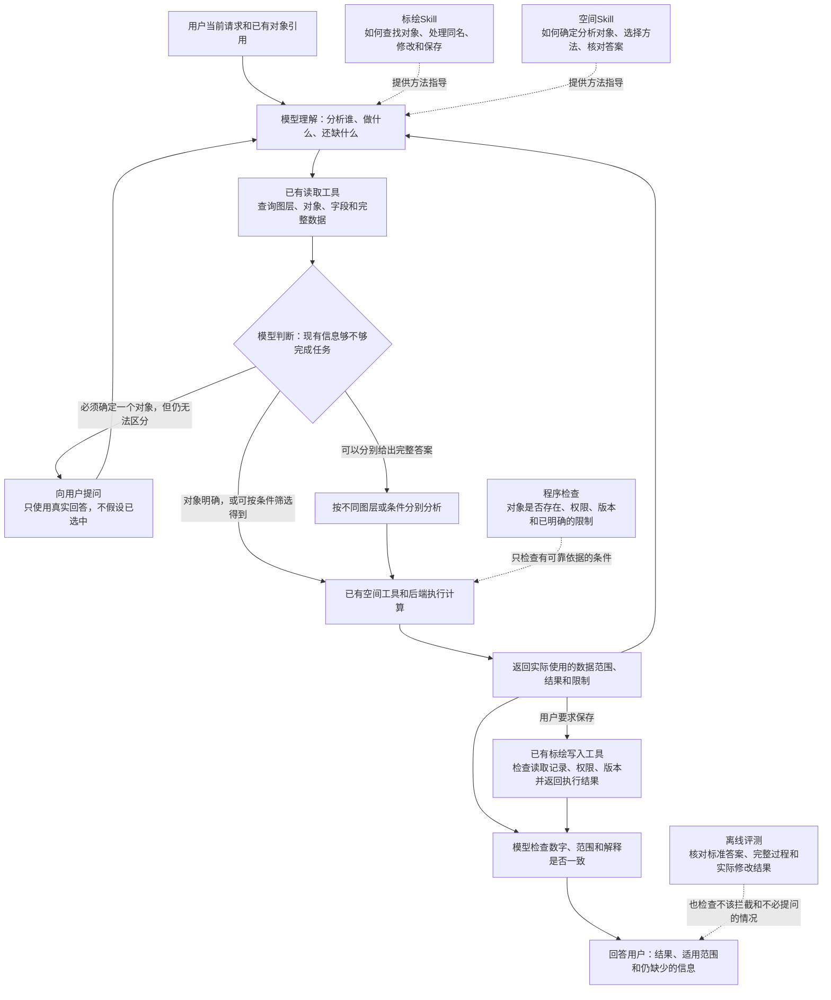

# 空间分析改进方案：选对分析对象，算对结果，把结果说清楚

更新日期：2026-10-22。状态：**用户已批准实施；新的真实模型测评安排仍待审阅。**

实施进展见[本轮实施记录](r3-implementation-20261022.md)。以下保留已审阅的设计与验收要求；文中的“本次只修改文档”等表述记录方案修订阶段，后续开发授权以实施记录为准。

本次只修改方案文字，使设计和评测要求更容易理解。下文的“拟调整”“可以考虑”都表示待审阅的建议，不表示已经实现或已经证明有效。架构图、参考依据和90%的验收目标保留。

## 1. 目前的问题和改进方向

目前需要分别解决三件事：

1. **选对对象**：用户要查A图层，Agent不能查成B图层，也不能擅自把A、B合在一起。
2. **算对结果**：确定对象以后，使用正确的数据、版本和计算方法。
3. **把结果说对**：即使数字正确，也不能附加错误的数量、方位、范围或保存状态说明。

本方案建议：**Skill指导模型如何分析；工具和后端检查程序能够核实的事实；评测检查整个任务是否真正完成。** 不要求模型在每次计算前领取一种新的“范围证明”。原因是：证明某个图层确实存在，不等于证明用户想查的就是它。

例如，用户要查A港附近的船，模型却传入了B港的合法ID。程序可能在B港算得完全正确，但任务仍然失败。新增一张证明“B港ID有效”的凭证，解决不了这个问题。

### 1.1 上一轮结果说明了什么

2026-10-18获批的R2测评已完成：当前产品版本、只改标绘Skill、只改空间Skill，各测16题，共48项。两份Skill试验版都没有达到采用条件，**当前产品仍使用原版**。详见[R2完整报告](research/r2-results-20261018.md)。

这里区分两个指标：

- **主任务完成**：用户要求的主要工作按事先约定完成了。例如数量算对了，但附加的方位说明可能仍有错。
- **严格通过**：主任务完成，并且检查过程中和最终回答中的事实性陈述，没有发现错误。因此“主任务完成”不一定“严格通过”。

| 组别 | 严格通过，已确定 | 主任务完成，已确定 | 试验版Skill正文实际进入模型输入 |
| --- | ---: | --- | --- |
| B：当前产品原版 | 12/16（75%） | 15/16 | 使用原版，无试验版 |
| M：只改标绘Skill | 13/16（81.25%） | 15/16 | 7题 |
| S：只改空间Skill | 11/16（68.75%） | 14/16，另1题尚有评分分歧 | 9题 |

“实际进入模型输入”很重要：改过Skill文件，不代表模型在每道题中都读到了它。这一轮模型也没有另外主动读取另一份Skill。

- M组实际收到新版规则的7题，与原版对应题都通过6题，不能据此认定有净改善。
- S组实际收到新版规则的9题，原版是6通过、2失败、1项评分未定；试验版是8通过、1失败。这是值得继续研究的信号，但不足以证明已经稳定改善。
- 没有收到新版规则的题，成绩变化不能算成新版规则的效果。

48项合计36项严格通过、10项失败、2项评分未定。三组使用不同方案，**不能把这个合计当成当前产品的正确率**。10项失败包括：3项主要分析范围选错；6项主任务完成但解释有错；1项解释确定有错，而主任务是否完成仍有分歧。

已有几何计算、复用固定结果范围、预览与保存一致性的检查通过，未发现未经授权的写入。这些结果说明哪些已有检查有效，并不等于整个分析任务已经可靠。单轮16题主要用于查问题，不能代表所有真实业务场景。

### 1.2 哪些历史记录保持原样

本次改写不重新评分，也不改旧测试记录：

- R1的5项主任务失败、11项解释错误，以及J09的旧交互规则，仍以[原报告](research/round1-completed-results-20261018.md)为准。
- R2的B-J05、S-J03严格评分分歧，以及S-V09主任务和关键错误的分类分歧，继续保留。
- 原方案保留在Git提交`746d4cc`和`13d65ce`；[R2运行前确定的规则](r2-execution-plan-20261018.md)、[此前架构与评测方案](next-round-plan.md)、原始记录和评分均保持原样。

上次批准的开发和测试已经完成，不自动延伸到本方案。下一步仍需审阅。

## 2. 哪些保留，哪些不再采用

**这里的“不再采用”，是修改之前提出的设计，不是回滚已有实现。尤其是新增“范围证明凭证”的机制，之前没有实施，因此无需回滚。** 下表说明设计方向；哪些能力已经存在，见第5.1节。

| 处理方式 | 具体内容 | 通俗解释 |
| --- | --- | --- |
| 保留 | 对象身份、来源、所属会话和版本检查 | 防止用错草稿、串用对象或悄悄换成最新数据；但仍需模型判断该对象是否符合用户要求 |
| 保留 | 按名称查询时，区分找不到、唯一匹配、多个同名对象 | 找到多个时如实返回，不能默认取第一个，也不能擅自合并 |
| 保留 | 复用上次计算结果、按条件筛选、跨图层比较 | “查港口附近且可用的船”应允许程序筛选，不要求用户先逐艘选好 |
| 保留 | 真实的用户澄清回答，以及已有写入检查 | 用户没有回答就不能声称用户已选中；修改或保存继续检查权限、读取记录、版本和实际执行结果 |
| 保留 | Skill的方法指导，以及对全部可见回答的检查 | 模型读到规则与遵守规则是两回事；最终数字正确，也要检查其余说明 |
| 不再采用此设想 | 每次计算都必须先取得新的“已证明范围引用/凭证” | 有效凭证仍可能指向错误对象，还会增加步骤和状态管理 |
| 不再采用此限制 | 分析对象只能来自用户直接引用、唯一名称匹配或澄清选择 | 还应允许按条件筛选、跨图层比较、连续分析和合理的上下文推断 |
| 不再采用此限制 | 直接传入合法ID，或没有走固定查询顺序，就拒绝计算 | ID可能已在上下文中明确，不应为补步骤而重复查询 |
| 不把它当证明 | 模型自己写“用户已确认”、填写`userConfirmed:true`，或工具调用成功 | 模型自述不是用户回答；工具调用成功也不证明选对了对象 |
| 有依据才考虑 | 针对某项明确规则增加程序检查 | 先说明现有功能缺了什么、程序根据什么判断，再决定是否增加拦截 |
| 暂不建设 | 新的目标记录系统、范围令牌、通用查询规划器、额外审核Agent；暂不更换默认模型 | 目前没有足够证据证明需要这些新增机制，也没有证明换模型就能解决 |

“先确定要分析谁”仍然是必要步骤。不再承诺的是：设计一套通用凭证，就能让程序可靠判断模型是否理解了用户。参考理由见[源码审视记录](research/range-binding-design-review-20261022.md)。

## 3. Skill、工具和现有后端怎么配合

- **模型**负责理解请求、判断还缺什么信息、选择方法和解释结果。
- **Skill**是模型可读取的操作指南，说明何时查询、何时澄清、怎样使用工具和核对答案。它不是自动执行的程序校验。
- **工具**是模型调用后端的接口。它接收参数，返回实际数据、计算结果或错误。
- **现有后端**负责读取、计算、保存，以及身份、权限、版本等检查。本方案继续复用它，不另建一套空间分析服务框架。
- **离线评测**在测试时检查完整过程和结果，不在每次用户使用产品时增加一个审核Agent。

图中“信息够不够”由模型判断，后端目前不能替模型证明这一判断正确。工具调用和Skill加载继续使用Pi已有机制。

文中的“范围”，需要区分两种含义：

- **实际算了哪些数据**：使用哪一版数据、哪些图层和对象、什么筛选条件。工具可以记录并检查。
- **用户想算哪些数据**：例如“这些船”到底指当前选中的船，还是上轮提到的船。通常仍需要模型结合上下文理解。

用户引用了A图层，不一定等于“只准访问A图层”。例如用户说“比较这个图层和其他图层”，就必须读取其他图层。地图选中项和上一轮目标，也不能自动变成限制本轮所有操作的名单。

## 4. Skill准备怎么改

以下是拟调整内容，本次不修改产品中的Skill。R2试验版也不直接替换原版。

### 4.1 标绘Skill：帮助模型选对对象，用对接口

文件：[map-annotations/SKILL.md](../../../experiments/harness-lab/fixtures/skills/map-annotations/SKILL.md)。这是已有Skill，同时包含标绘管理规则和工具使用方法。

1. **每轮重新确认当前任务的对象。** 上轮查A、本轮查B，就使用B。比较两个会话的对象时，分别检查所属会话；名称或简短ID一样，不代表同一个对象。
2. **区分用户明确要求和模型自行推断。** 用户说“只查A”是明确限制；模型根据上下文猜测A，只能作为推断，不能说成“用户已选择A”。推断仍可用于正常查询和探索。
3. **把同名对象的处理写清楚。** 只知道名称时，优先使用已有名称查询。出现多个候选后，先看上下文能否区分；仍不能区分时，按任务需要提问，或分别给出各候选的完整答案。不能默认取第一项或合并全部。
4. **说明答案针对谁。** 例如先说“A图层中有12艘，B图层中有8艘”，不能先无条件说“有12艘”，再在末尾补一句“如果你指A”。
5. **准确说明动作状态。** “准备读取”“已经读取”“尝试保存”“保存成功”分别表述；保存成功必须有工具返回的执行结果支持。

### 4.2 空间Skill：算完整，也把解释核对完整

文件：[spatial-analysis/SKILL.md](../../../experiments/harness-lab/fixtures/skills/spatial-analysis/SKILL.md)。保留“确定分析对象→补齐数据并选择方法→计算→回答”的组织方式，拟加强以下内容：

- **允许正常的多步分析。** 例如先筛出港口附近的船，再筛出可用的船；允许跨图层比较和继续使用上次固定的计算结果。
- **检查数据是否足够。** 确认查询条件、返回字段、是否还有下一页、是否只拿到了前N项。参与筛选的数量、命中数量、对象数量和容量是不同概念，不能互相替代。
- **给附加说明找依据。** “在东侧”“位于区域内部”“距离更近”等说法都要有几何数据或计算支持。例如点落在区域边界上，也可能被“包含”计算计入，不能据此声称它严格位于内部。
- **不靠少回答来提高分数。** 用户需要的事实，应补查或计算；不能删除必要结论来避开错误。方法、单位、数据限制、缺失信息和保存状态要如实说明。
- **发现错误就纠正，但不抹掉过程记录。** 核实前不先报确定数字，也不先声称已经具备写入所需的读取记录。后续纠正仍保留在评测中，不能让先前的错误从评分中消失。

要求模型自检，是改进方法之一，不等于已经有独立程序替它验证了答案；也不要求向用户输出冗长的内部检查清单。

### 4.3 分开测试“模型有没有读到”和“读到以后有没有用对”

Skill目录中的名称和简介，帮助模型决定是否读取完整说明；正文才包含具体规则。因此可能有两种不同问题：模型没读正文，或者读了但没有遵守。

后续分别记录：目录是否进入模型输入、正文何时进入、关键决定之前是否读到、读到后是否遵守。没有读取Skill但答对，可以通过；读到规则却违反，不能归咎于加载失败。

目录简介是否需要改得更容易触发读取，与正文规则怎么改，分开比较。继续使用Pi已有目录、用户显式选择和模型按需读取机制，不默认把两份Skill全文塞进所有请求，也不另加一套宿主提示规则。

## 5. 工具准备怎么改

### 5.1 先用好已经存在的能力

这里的“工具调整”不一定是新增工具，也可能只是让现有工具返回的信息更清楚。以下能力已经存在，应先复用：

| 已有能力 | 能核实什么、不能核实什么 | 代码位置，供实施时查阅 |
| --- | --- | --- |
| 按图层名称精确查找，报告同名问题 | 能知道名称匹配到几个图层；不能证明模型输入的名称就是用户想要的名称 | [annotations/service.ts](../../../experiments/harness-lab/src/annotations/service.ts)的`read`，使用`layerNames` |
| 返回查询范围、字段和分页信息 | 能说明这次查到了什么、是否查全；返回某个候选不代表用户选中了它 | [annotation-results.ts](../../../experiments/harness-lab/src/pi/annotation-results.ts)、[context/service.ts](../../../experiments/harness-lab/src/context/service.ts) |
| 检查固定结果引用、权限、对象所属范围和版本 | 能检查结果是否真实、该用生成的几何还是原对象、对象是否属于指定范围；不能证明选对了用户目标 | [spatial/inputs.ts](../../../experiments/harness-lab/src/spatial/inputs.ts) |
| 返回实际计算范围、参数、数量、结果、方法和限制 | 让模型有依据说明“算了谁、怎么算的、有什么限制”，不另建一份重复摘要 | [spatial/service.ts](../../../experiments/harness-lab/src/spatial/service.ts)、[接口定义](../../../experiments/harness-lab/src/contracts/spatial.ts) |
| 把分析结果保存为标绘 | 检查已有读取记录、固定几何、权限、并发修改和执行结果；不要求所有动作都重新向用户确认 | [pi/spatial-tools.ts](../../../experiments/harness-lab/src/pi/spatial-tools.ts)的`annotation_from_analysis` |

### 5.2 工具层拟调整内容及实施前提

**先考虑让返回信息更容易用。** 检查同名错误是否清楚列出候选ID、名称和已有来源；是否容易区分“本次查到的部分数据”和“来源中的全部数据”；出错时是否说明哪些修改没有发生、接下来怎样恢复。只有发现现有返回确实不够用，才做必要修改。

**程序拦截只用于能独立核实的条件。** 例如，接口要求使用某次固定计算结果，工具就必须使用对应的`resultRef`（该次结果的引用）；要求使用某一版对象，就不能悄悄换成最新版。这些已有检查优先复用。

如果要新增“只允许计算A范围”的拦截，需要先弄清楚四件事：

1. **程序凭什么知道只允许A？** 是用户通过已有界面明确选择并限定了A，还是模型读完一句话后自己填了A？后者不能独立证明理解正确。
2. **这个限制管哪次操作？** 它是本轮还是上轮的要求？限制比较中的哪一方？从A筛出一部分对象、根据A生成新区域，或用户随后改口，应该怎样处理？
3. **程序能否自己检查？** 要能比较允许的对象和实际传入的对象，不能只检查模型有没有填写“已确认”。
4. **会不会妨碍正常任务？** 不能把合法的查询、筛选和比较挡住。如果其他入口仍可访问这些数据，也不能宣称这处检查已经管住了所有操作。

目前没有证据表明，现有系统已经能普遍提供这样的明确限制。因此，**新增“只许算A”的通用拦截不是本轮必做项**。自然语言“只分析A”仍应指导模型；但只靠模型把这句话转换成参数，程序无法保证它转换正确。

本节也明确保留正常使用方式：已知合法ID可以直接使用；可以分别分析同名候选；可以为完成任务读取其他相关数据；不能因同名就禁止所有查询，也不能擅自改成另一个对象。

本轮不扩展空间算法、路网计算或专业作业决策。

## 6. 参考项目能借鉴什么，还需要我们验证什么

参考源码支持的是一些具体做法，并没有证明“采用同样架构，我们的空间分析就会达到某个正确率”。详细路径、函数和限制见[源码审视记录](research/range-binding-design-review-20261022.md)。

| 参考项目 | 可以借鉴的做法 | 不能据此得出的结论 |
| --- | --- | --- |
| Codex | 打补丁前检查文件内容是否符合修改条件；结合上下文判断操作风险和授权 | 文件修改条件成立，不代表选对了用户想改的文件。Guardian安全审查也不是空间答案正确性检查，且包含模型判断 |
| DeepSeek Harness | 修改前检查是否读取过文件、版本是否匹配 | 读过文件，不代表理解对了任务；版本检查不能证明用户目标正确 |
| Hermes | 覆盖文件前检查已有读取内容是否过时；区分用户真实回答、跳过和未回答 | 有真实回答记录，不代表模型正确解释了回答，也不保证最终答案正确 |
| Claude Code | 通过公开的Hook接口，在工具执行前后加入具体检查 | 有扩展检查入口，不代表已有通用机制可以证明模型理解了用户。公开示例也不等于完整内核实现 |

我们需要自行建设和验证的是：空间任务的Skill规则、什么情况下该问用户、工具信息怎样更易理解，以及符合本产品需求的测试题和评分规则。不照搬外部项目的插件框架，也不新增审批Agent。之前地理参考项目的知识组织和测评经验仍见[原修复方案](remediation-plan.md)。

模型继续负责理解目标、推导筛选条件、决定是否澄清、选择方法和解释结果。R2一直使用同一模型，不能证明问题全由模型本身造成，也不能证明换模型就能解决。默认模型和推理设置保持原样；如需比较，单独安排测试。

## 7. 下一步评测怎么改

### 7.1 先说清楚什么算正确，再跑测试

R2已经允许：纯查询任务中，分别说明相关候选并给出完整、正确的条件答案；如果任务必须确定唯一对象且仍有歧义，就向用户提问。不能把多个候选合并后冒充用户指定的范围。下一步把这些规则写成更明确的例子：

- **信息已经够用，就完成任务。** 用户已给出明确ID，或上下文足以区分对象，不应停下来要求重复选择。这种多问一句不算完成。
- **分别回答，就把各自条件说清楚。** 条件要和对应结论一起出现，必要候选都要覆盖，数值要正确。不能先给无条件答案，再用末尾含糊的“如果”补救。
- **确实需要用户补充，就单独记录。** 对专门检查“此时应澄清”的题，可以按事先约定记为该题完成，但必须单列，不能当作已完成计算。若测试还要模拟用户回答，回答内容提前固定，运行中不临时帮模型补救。
- **目标明确且已有授权，就走现有写入流程。** 因目标不明而提问，与请求操作权限是两回事，分别统计，不增加每次都要确认的步骤。

历史上对“仅备注不同”、定性距离和条件范围的评分分歧继续保留。新一轮先确定这类表述怎样判分，再开始测试。未确定的结果不算通过，也不通过修改规则来重写旧成绩。

### 7.2 既测容易出错的题，也测本来就应该顺利完成的题

| 测什么 | 期望表现 | 要避免的问题 |
| --- | --- | --- |
| 唯一名称、明确ID、充分上下文 | 直接完成，无需补走固定查询步骤 | 正确操作被挡住，或不必要提问被算成成功 |
| 多个同名对象，信息不足 | 必要提问，或分别给出完整答案 | 默认选第一个，或合并后给出唯一答案 |
| 多个同名对象，但本轮已明确选中一个 | 使用正确对象和角色，不重复确认 | 一遇到同名就必须问 |
| 引用A作为参照，再比较其他图层 | 正常读取和比较其他合法对象 | 把“提到A”误当成“只允许A” |
| 港口附近且可用、分类筛选、连续分析 | 正确筛选并继续使用结果 | 不是用户逐项点选的对象，就拒绝计算 |
| 上轮A、本轮B；历史版本；不同会话同名 | 使用本轮目标和要求的版本，分清所属会话 | 沿用旧目标，或悄悄换成最新版本 |
| ID确实有效，但指向错误对象；名称唯一匹配，但模型查错了名字 | 仍按用户实际要求判为失败 | ID有效或名称唯一，就被算成任务正确 |
| 用户回答、跳过、取消、没有回答 | 如实记录，不冒认选择 | 把默认选项或模型自述当成用户确认 |
| 保存、版本冲突、按固定预览保存 | 核对实际修改，正确处理冲突并说明结果 | 只看工具返回成功；或把正常纠错恢复判成失败 |
| 数字算对后，又解释方位、数量或状态 | 全部可见事实准确 | 只查最后一个数字，漏掉其他错误 |

以上只是新测试题的设计要求，尚未生成或执行。后续分别报告三类结果：旧失败题是否修好、常见任务是否仍能完成、没用来修改Skill的新题是否也能答对。

第三类就是**新保留集**：编写Skill和调整方案时不拿它反复试，以检查能力能否用于新问题。只把旧题换个名字或坐标，仍然只是开发测试，不算独立的新保留集；新题应有不同表述和组合关系。

### 7.3 不只统计正确率，也看有没有增加麻烦

同时统计主任务完成和严格通过，并记录主要对象选错、解释错误、评分未定、实际数据修改、提问、错误拦截、恢复情况、请求次数、token用量、耗时和Skill实际加载情况。

其中几项容易混淆，明确如下：

| 指标 | 怎么理解和统计 |
| --- | --- |
| 错误拦截 | 输入有效、有权限、信息也足够，本来可以执行，却被新增检查拒绝。既记拦截次数，也记任务后来是否恢复完成 |
| 不必要提问 | 已经能完成任务，却要求用户重复提供信息。以事先标记的“不需要澄清”的题为分母，另报次数，不混入必要澄清的成功项 |
| 总体正确率 | 按事先安排的全部任务计算，不只选成功调用或模型愿意回答的题。评分未定不算通过；技术中断单列，原记录保留 |
| Skill是否有效 | 先报告整体结果，再看实际读到新版规则的可比题。没读到的题仍保留在整体统计中，不能删掉来提高分数 |
| 工具是否有效 | 看从用户请求到最终结果的整组表现，不能只看某次检查成功拦住了调用 |
| 正常纠错和方法差异 | 可恢复的工具错误不自动算模型失败。正确手算，或完整读取后计数，不因没有调用某个指定工具就判错；只有产品确实要求的流程才检查调用路径 |

继续由两名审阅者独立评分，固定各自结论后再讨论分歧。核对实际发给模型服务的输入、工具结果、全部可见回答、独立算出的标准值，以及操作前后的数据状态。报告中说明审阅由Agent完成、审阅者能看到组别等限制。

### 7.4 如何对照，达到什么目标才算通过

每次对照只改变一个主要因素：Skill正文、目录简介、工具返回信息或检查、模型或推理设置，分开研究；保留同批原版对照，避免同时改很多处后无法判断是哪一处起作用。

两种Skill加载方式继续区分报告：**按产品真实方式加载**，用于判断实际使用效果；**明确指定加载**，用于诊断“模型读到规则后是否改善”。后者不能替代前者的产品成绩。

**正式验收中，整体和新保留集的严格正确率都保持90%的目标。** 同时检查：是否出现主要对象选错或未经授权的修改、原本成功的任务是否变差、是否增加错误拦截和不必要提问。这些问题不能被平均分掩盖。

新一轮开始前，还需确定并审阅：允许多大的成绩波动、多少题、重复几次、怎样估计小样本的不确定性（置信区间）、预算和停止条件。本次不自动沿用R2的16题和“至少多通过2题”等采用规则，也不把单轮小样本达到90%当成稳定可靠的证明。

## 8. 审阅后怎么推进

建议按以下顺序推进，但本次只更新文档：

1. 先确定交互和评分例子：什么时候直接算、什么时候分别回答、什么时候必须问用户。
2. 再选择最小的一项调整，明确改哪段Skill，或哪项工具返回信息；如要增加拦截，先证明程序有可靠的判断依据和现有功能缺口。不为实现拦截而先造一套新状态系统。
3. 确定对照组、新测试题、预算和停止条件，审阅后再实施、运行。模型之间的比较最后单独安排。

本方案涉及的文档包括本文件、[参考源码记录](research/range-binding-design-review-20261022.md)和任务审阅状态。本次仅对本文件做通俗化改写：保留架构图、设计取舍、参考依据和验收要求，不修改产品Skill、代码、模型配置、测试程序、测试数据或历史成绩，不运行工程测试或模型测评，不自动追加第二轮。
