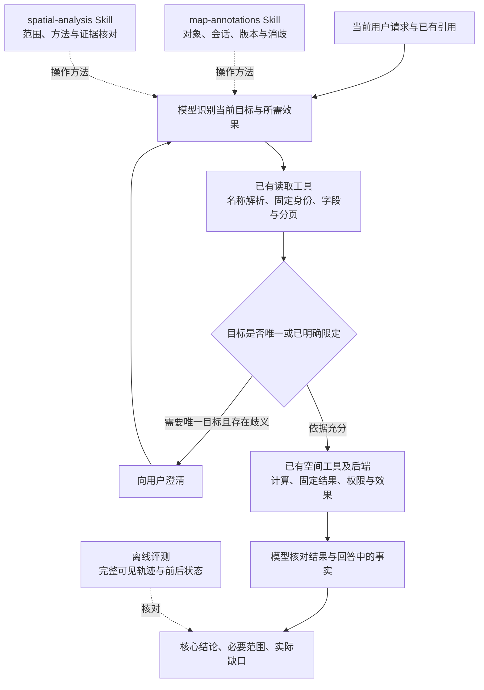

# 空间分析首轮后改进方案：目标保持与证据解释

日期：2026-10-18。状态：**待审阅，尚未实施。**

当前授权仅为整理方案并提交 Git；不修改产品代码、Skill、工具契约或模型配置，不运行新的模型测试，不自动执行第二轮。本文细化[上一版方案](next-round-plan.md)的 R2 候选，保留该文架构图及历史执行记录，不覆盖原测评分数。

## 1. 依据与目标

依据[补齐后的首轮报告](research/round1-completed-results-20261018.md)：48个计划槽位完整，29严格通过、16明确失败、3待裁定；主任务完成43/48。严格通过率60.4%，主任务完成率89.6%，两者不可替代。总体及新保留集90%门槛不变。

16项明确失败中，5项未完成主任务，11项完成主任务但可见过程或附加解释出错：

| 问题 | 证据 | 本次改进目标 |
| --- | --- | --- |
| 跨轮目标错配 | J03-PC把A甲与B乙比较，受上一轮乙干扰 | 当前请求明确指定的对象优先；比较双方身份分别核实 |
| 同名图层处理 | J09四组默选或合并同名图层 | 依照产品消歧规则解决目标范围，不自行选择或合并 |
| 把局部返回当来源全集 | J02-FB、J03-FB、J05-PB、J10-FB | 区分来源、查询条件、字段投影、分页及前N项 |
| 额外解释越出证据 | J04-PB、J06-FB/FC、J05-PC、J06-PC等 | 数值、方位、范围与业务含义均有对应证据 |
| 中途事实错误或手工估算 | J04-PC、J10-PC | 核验后再作事实陈述，避免无依据的确定表述 |

这些是问题类型而非互斥计数，同一案例可含多个症状。J05-PB采用独立审阅确认的“带query空集被泛化为整个来源无对象”作为明确失败依据；主审对属性投影措辞的另一解释仍保留原记录。

**J09-PC单列理解：**合并后的数值本身正确，但不符合冻结题目要求的先澄清策略。不能把它描述为空间数学错误；是否属于关键错误仍有分歧。原3项语义未决和“4项确定关键错误＋1项级别争议”不随本方案改变。

## 2. 架构职责

复用Pi原生调用、现有后端及结果引用。Skill提供方法，工具保证明确参数的计算与效果，模型负责理解当前要求和准确解释。离线评测不进入产品运行时，不新增持久化任务目标、通用查询规划器或答案审核Agent。

空间算法暂不调整：本批已有几何和保存检查未发现异常，但不由此宣称全部GIS能力已被证明正确。

## 3. Skill层：重组已有规则，落实到关键步骤

现有空间Skill已要求同名先澄清、区分候选与命中、对象数不等于容量、附加声明须有依据。因此候选是改善组织与执行时机，不宣称首次补上这些规则，也不逐案例追加禁令。

### 3.1 map-annotations：当前目标和双方身份

位置：[现有标绘Skill](../../../experiments/harness-lab/fixtures/skills/map-annotations/SKILL.md)。

- 每轮优先依据当前请求中的显式对象，不能自动沿用上轮操作目标。
- 跨会话比较分别核实左、右的固定版本与对象身份；明确A甲对应B甲，而不是因为上一轮改了乙就改为比较乙。
- 不假设不同草稿中相同名称或objectId天然对应。依据共同基线、来源身份或现有originFeatureRef等可读信息核实关系；已有充分依据时直接完成，不额外要求用户确认。
- 仅有图层名称时，优先走已有layerNames解析。出现多个候选不把候选列表当成“任选一个”的授权。

以上对齐步骤是当前调用中的方法，不引入新的持久化目标状态。

### 3.2 spatial-analysis：范围 → 数据 → 计算 → 回答

位置：[现有空间Skill](../../../experiments/harness-lab/fixtures/skills/spatial-analysis/SKILL.md)。

正文围绕四个检查点组织，保留必要的方法说明并精简重复展开：

1. 确定当前对象、候选集合、参照范围和固定版本。
2. 检查方法需要的几何/属性是否已取得；未请求字段、字段实际缺失、查询未命中分别处理。
3. 依真实依赖计算并使用固定结果；宽读取不等于宽计算，nearest前N项不等于候选全集。
4. 回答先给核心结论，再给必要范围与实际缺口；每个附加数字、方向、距离、状态和业务含义都能对应证据。

执行原则：

- 用户只问资源数量，不从点数扩展为车辆数量或运力不足。需要专业映射的结论仍在第一阶段范围外。
- 不必要的附言省略；用户需要的附加事实则补查或计算，不能靠少回答来回避任务。
- 未核验时使用“正在读取/核对”等计划表述，不先报一个确定数量再纠正。真实错误、限制和重要进度仍应如实展示，不通过隐藏过程美化评分。
- 短任务不向用户展开内部检查清单；输出前核对在现有单Agent流程中完成，不承诺自检可以保证正确。

## 4. 工具层：先用已有信息，仅补明确缺口

沿实际模型可见路径检查后，现有契约已经包含：

| 能力 | 已有位置与内容 | 对方案的约束 |
| --- | --- | --- |
| 名称消歧 | [annotation service](../../../experiments/harness-lab/src/annotations/service.ts)的layerNames精确解析及ANNOTATION_LAYER_NAME_AMBIGUOUS | 不重复建设名称解析器；J09调用合法ID绕过消歧的问题不能靠重复校验ID解决 |
| 标绘读取范围 | [模型结果投影](../../../experiments/harness-lab/src/pi/annotation-results.ts)已回显data.query的对象/图层/名称/fields及分页信息 | 不新增重复的readScope或selectedFields |
| 来源查询范围 | [context service](../../../experiments/harness-lab/src/context/service.ts)回显query及分页/未知引用信息 | 带query空集不代表来源没有对象，优先改善使用纪律 |
| 空间结果边界 | [spatial service](../../../experiments/harness-lab/src/spatial/service.ts)及[契约](../../../experiments/harness-lab/src/contracts/spatial.ts)提供scope、parameters、candidateCount、items、method和limitations | 不新建另一套coverage摘要；先确认这些现有字段被正确解释 |

工具候选限于两类，均需独立验证收益：

- **描述与呈现优化：**在对应字段/工具说明附近明确total的查询范围、candidateCount的输入候选含义、nearest只返回前N项。保持现有数据事实与权限不变，不复活此前无充分收益的readSummary补丁。
- **歧义候选结构化：**若现有文本错误不便模型准确提问，将候选ID、名称及已有来源信息结构化。属于易用性候选，优先级低于Skill重组；不能单独解决模型绕过名称解析的行为。

工具不能仅从一个合法对象ID推知用户其实想要另一个对象。没有独立可验证的目标依据时，不让后端自动“纠正”模型选择。

## 5. 模型层：正文、触达与能力分别判断

本轮Flash原生与Pro显式均9/12，其他组较低，不能泛化为Pro更好或显式加载一律更好。不更换默认模型，不因加载率低直接增加强制宿主注入。

后续拟分别回答三个问题：

| 问题 | 对照方式 | 主要观察 |
| --- | --- | --- |
| Skill正文组织是否有效 | 固定模型、显式加载和工具，只比较旧/新正文候选 | 当前目标保持、范围解释、无依据附言，以及是否牺牲必要回答 |
| 原生入口是否有效 | 正文固定，只调整目录描述与触发说明 | 首请求目录是否送达、是否在需要时读取、读取后是否遵守；不把未读Skill但正确作答直接判错 |
| 剩余模型能力是否不同 | 输入、加载方式、工具与评分固定，再比较模型；推理设置另作单变量候选 | 对象保持、歧义处理、解释准确性、恢复成本、请求/token/延迟 |

Pro原生在5个必需Skill族均未读取，值得单独诊断。该现象不证明所有错误都由未读取造成；显式加载后的J09失败表明送达与遵守必须分别观察。

暂不采用微调、多Agent产品审核或自动升级模型。是否需要更强模型/推理设置，等待固定条件下的证据；本方案不承诺某项设置必然改善。

## 6. 实施与验证顺序（尚未批准执行）

1. 先确认第7节产品交互原则，避免把产品政策与算法正确性混为一谈。
2. 从Skill中选择一个明确主题作为最小候选，例如跨轮身份对齐或回答证据核对；其余变量保持不变。不是同时修改两个Skill、工具和模型再计算总体增益。
3. 仅在轨迹证明必要时，单独评估工具描述/呈现候选；结构化歧义错误也须独立列项。
4. 正文固定后诊断原生加载入口，最后再评估模型或推理设置。没有明确收益的候选不组合上线。

后续评测应保留16项失败对应的问题族，同时覆盖已成功的分页、固定版本、结果续用、预览保存和缺字段恢复，避免只对失败样例优化。使用新的名称、对象关系和几何变体检查迁移，不把已见回归集冒充新保留集。

严格通过、主任务完成、可见过程错误、必要澄清/无必要澄清、实际效果与加载率分别统计。一次工具错误后正确恢复可以通过；少回答、只提问或仅调用工具不等于完成。核心对象错配和越权等关键错误单列，不被平均分掩盖。

本轮历史评分及证据不追改。正式总体与新保留集90%门槛保持。测试数量、预算、配置及停止条件须在具体候选获审阅后另行明确；此处不授权第二轮48次或任何新模型调用。

## 7. 待确认的产品规则

建议原则：**只读信息查询遇到同名候选，可以分别给出完整、明确的条件答案；需要唯一结果或执行动作时，应先澄清。任何情况下均不得自行合并候选冒充用户指定范围。**

这仍是提案。若获同意，需要定义哪些题目确实要求唯一结果、哪些条件回答足够完整，并在新测试前固定判例。J09-PC现有合并计算和条件附言不自动满足新原则，也不因此追认本轮通过。

现有3项措辞歧义与J09-PC关键级别仍待人类裁定；它们不阻碍整理本方案，也不应通过默改规则抹平。

## 8. 交付与边界

本次交付仅为本方案、旧方案入口更新及任务元数据，随后提交Git。原架构图、原始中断、补测单列和各审阅原判均保留。产品代码、Skill正文、工具契约、默认模型、执行权限及模型测试均不变。
