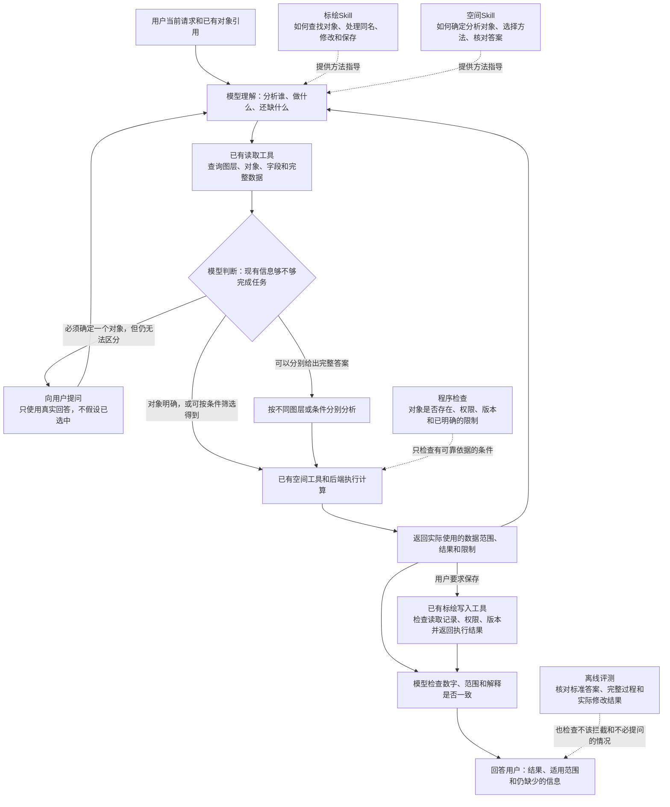
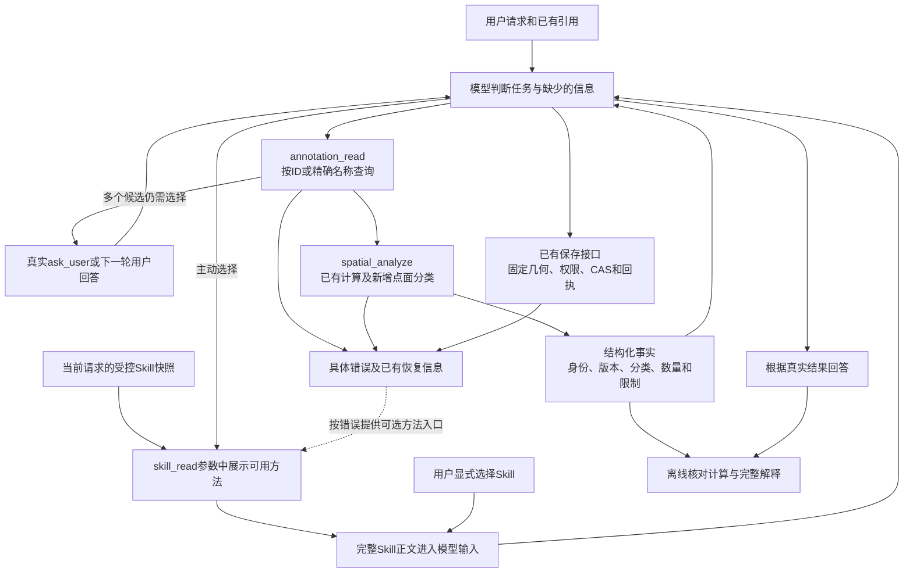

# 空间分析改进方案：选对分析对象，算对结果，把结果说清楚

更新日期：2026-10-22。状态：**用户已批准第9节实施、两个工具扩展及澄清分开评分；先提交方案、实施并完成离线检查，首批8项主动读取冒烟已完成，后续12项执行对照也已完成。错误恢复组、第二轮及其他追加测试仍未授权。**

当前R5实施与检查见[执行记录](r5-implementation-20261022.md)。用户充值后另行授权补测5项，现已完成全部8槽位，见[完整报告](research/r5-discovery-completed-results-20261022.md)；原余额中断和补测单列；后续12项已完成，见[R6报告](research/r6-results-20261022.md)。方案提交为`b141f39`，R4基线为`b56de82`；R5实现与结果尚未提交。

历史结果分别保留于[R3报告](research/r3-results-20261022.md)及[R4报告](research/r4-smoke-results-20261022.md)，不回写成绩。第1—8节保留此前方案、参考依据与架构图；本阶段以第9节为准。

第9节原文中的“待审阅/未授权/仅文档”表示原提案阶段，最新授权与执行状态以本页开头及第9.10节为准。名称查询、分类与方法入口已实现并通过离线检查；E1/E2正文仍为独立候选，尚未替换正式Skill。整体及新保留集严格通过率90%的正式门槛保留。

## 1. 目前的问题和改进方向

目前需要分别解决三件事：

1. **选对对象**：用户要查A图层，Agent不能查成B图层，也不能擅自把A、B合在一起。
2. **算对结果**：确定对象以后，使用正确的数据、版本和计算方法。
3. **把结果说对**：即使数字正确，也不能附加错误的数量、方位、范围或保存状态说明。

本方案建议：**Skill指导模型如何分析；工具和后端检查程序能够核实的事实；评测检查整个任务是否真正完成。** 不要求模型在每次计算前领取一种新的“范围证明”。原因是：证明某个图层确实存在，不等于证明用户想查的就是它。

例如，用户要查A港附近的船，模型却传入了B港的合法ID。程序可能在B港算得完全正确，但任务仍然失败。新增一张证明“B港ID有效”的凭证，解决不了这个问题。

### 1.1 历史R2结果：作为问题背景保留

2026-10-18获批的R2测评已完成：当前产品版本、只改标绘Skill、只改空间Skill，各测16题，共48项。两份Skill试验版都没有达到采用条件，**当前产品仍使用原版**。详见[R2完整报告](research/r2-results-20261018.md)。

这里区分两个指标：

- **主任务完成**：用户要求的主要工作按事先约定完成了。例如数量算对了，但附加的方位说明可能仍有错。
- **严格通过**：主任务完成，并且检查过程中和最终回答中的事实性陈述，没有发现错误。因此“主任务完成”不一定“严格通过”。

| 组别 | 严格通过，已确定 | 主任务完成，已确定 | 试验版Skill正文实际进入模型输入 |
| --- | ---: | --- | --- |
| B：当前产品原版 | 12/16（75%） | 15/16 | 使用原版，无试验版 |
| M：只改标绘Skill | 13/16（81.25%） | 15/16 | 7题 |
| S：只改空间Skill | 11/16（68.75%） | 14/16，另1题尚有评分分歧 | 9题 |

“实际进入模型输入”很重要：改过Skill文件，不代表模型在每道题中都读到了它。这一轮模型也没有另外主动读取另一份Skill。

- M组实际收到新版规则的7题，与原版对应题都通过6题，不能据此认定有净改善。
- S组实际收到新版规则的9题，原版是6通过、2失败、1项评分未定；试验版是8通过、1失败。这是值得继续研究的信号，但不足以证明已经稳定改善。
- 没有收到新版规则的题，成绩变化不能算成新版规则的效果。

48项合计36项严格通过、10项失败、2项评分未定。三组使用不同方案，**不能把这个合计当成当前产品的正确率**。10项失败包括：3项主要分析范围选错；6项主任务完成但解释有错；1项解释确定有错，而主任务是否完成仍有分歧。

已有几何计算、复用固定结果范围、预览与保存一致性的检查通过，未发现未经授权的写入。这些结果说明哪些已有检查有效，并不等于整个分析任务已经可靠。单轮16题主要用于查问题，不能代表所有真实业务场景。

### 1.2 哪些历史记录保持原样

本次改写不重新评分，也不改旧测试记录：

- R1的5项主任务失败、11项解释错误，以及J09的旧交互规则，仍以[原报告](research/round1-completed-results-20261018.md)为准。
- R2的B-J05、S-J03严格评分分歧，以及S-V09主任务和关键错误的分类分歧，继续保留。
- 原方案保留在Git提交`746d4cc`和`13d65ce`；[R2运行前确定的规则](r2-execution-plan-20261018.md)、[此前架构与评测方案](next-round-plan.md)、原始记录和评分均保持原样。

R2和R3已批准的开发、测试均已结束；本轮修改范围和测试预算需要另行审阅。历史记录保持原样，不按本轮新口径重算旧分数。

### 1.3 最新R3结果：本轮为什么先检查Skill接入

R3完成24题 × 3组 × 2种加载方式，共144项，没有欠费、技术故障或预算截断。完整分组成绩和逐项理由以[R3报告](research/r3-results-20261022.md)为准。

| 已确认的事实 | 对本轮方案的影响 |
| --- | --- |
| 自动按需加载的72项中，4项收到过任一完整Skill正文，0项收到修改后的正文 | 不能把这些组的成绩变化归功于正文修改；先验证目录、使用约定和实际读取情况 |
| 显式加载中，实际收到标绘候选的15道可比题，严格通过10→8；空间候选的9题，严格通过4→5 | 正文并非一概有效；不能将未采用的R3候选直接升级为产品版本 |
| 主任务完成88/126；全部条件中34项有解释错误，其中17项主任务已完成 | 选对象、执行和解释必须分别检查；加载问题不能解释全部失败 |
| D02、D07六组均未完成整项任务；存在未查询已有基点就追问、来源选错等问题 | 标绘Skill先写清“从哪里找、还缺什么、何时才需要问用户” |
| D16六组均恢复真实版本冲突，H04六组均保存固定历史结果 | 保留已有版本检查、固定结果引用和保存流程，不新增通用意图凭证 |

源码检查另确认：目录描述在`resources/service.ts`和Skill文件头部各维护一份，修改文件头部未必改变模型看到的目录。**两处现有文字一致，不能说它已经造成了R3的低读取率；它是后续修改容易不生效的确定性缺口。** 宿主使用说明偏简略、方法正文被当成普通资料是否影响遵循，仍是待比较的假设。

这里的“原生加载”指本产品由模型按需调用`skill_read`，不是Pi直接扫描本地Skill目录。之后统一称“自动按需加载”，避免混淆。

## 2. 哪些保留，哪些不再采用

**这里的“不再采用”，是修改之前提出的设计，不是回滚已有实现。尤其是新增“范围证明凭证”的机制，之前没有实施，因此无需回滚。** 下表说明设计方向；哪些能力已经存在，见第5.1节。

| 处理方式 | 具体内容 | 通俗解释 |
| --- | --- | --- |
| 保留 | 对象身份、来源、所属会话和版本检查 | 防止用错草稿、串用对象或悄悄换成最新数据；但仍需模型判断该对象是否符合用户要求 |
| 保留 | 按名称查询时，区分找不到、唯一匹配、多个同名对象 | 找到多个时如实返回，不能默认取第一个，也不能擅自合并 |
| 保留 | 复用上次计算结果、按条件筛选、跨图层比较 | “查港口附近且可用的船”应允许程序筛选，不要求用户先逐艘选好 |
| 保留 | 真实的用户澄清回答，以及已有写入检查 | 用户没有回答就不能声称用户已选中；修改或保存继续检查权限、读取记录、版本和实际执行结果 |
| 保留 | Skill的方法指导，以及对全部可见回答的检查 | 模型读到规则与遵守规则是两回事；最终数字正确，也要检查其余说明 |
| 不再采用此设想 | 每次计算都必须先取得新的“已证明范围引用/凭证” | 有效凭证仍可能指向错误对象，还会增加步骤和状态管理 |
| 不再采用此限制 | 分析对象只能来自用户直接引用、唯一名称匹配或澄清选择 | 还应允许按条件筛选、跨图层比较、连续分析和合理的上下文推断 |
| 不再采用此限制 | 直接传入合法ID，或没有走固定查询顺序，就拒绝计算 | ID可能已在上下文中明确，不应为补步骤而重复查询 |
| 不把它当证明 | 模型自己写“用户已确认”、填写`userConfirmed:true`，或工具调用成功 | 模型自述不是用户回答；工具调用成功也不证明选对了对象 |
| 有依据才考虑 | 针对某项明确规则增加程序检查 | 先说明现有功能缺了什么、程序根据什么判断，再决定是否增加拦截 |
| 暂不建设 | 新的目标记录系统、范围令牌、通用查询规划器、额外审核Agent；暂不更换默认模型 | 目前没有足够证据证明需要这些新增机制，也没有证明换模型就能解决 |

“先确定要分析谁”仍然是必要步骤。不再承诺的是：设计一套通用凭证，就能让程序可靠判断模型是否理解了用户。参考理由见[源码审视记录](research/range-binding-design-review-20261022.md)。

## 3. Skill、工具和现有后端怎么配合

- **模型**负责理解请求、判断还缺什么信息、选择方法和解释结果。
- **Skill**是模型可读取的操作指南，说明何时查询、何时澄清、怎样使用工具和核对答案。它不是自动执行的程序校验。
- **工具**是模型调用后端的接口。它接收参数，返回实际数据、计算结果或错误。
- **现有后端**负责读取、计算、保存，以及身份、权限、版本等检查。本方案继续复用它，不另建一套空间分析服务框架。
- **离线评测**在测试时检查完整过程和结果，不在每次用户使用产品时增加一个审核Agent。

图中“信息够不够”由模型判断，后端目前不能替模型证明这一判断正确。执行继续使用Pi的正常对话和工具循环；Skill沿用本产品已有的受控目录、显式选择和`skill_read`，不切换成任意本地文件扫描。

Skill进入模型的路径保持为：**受控文件 → 同一份目录信息与请求快照 → 用户显式选择或模型按需读取 → 完整方法正文进入实际模型请求 → 模型按适用步骤调用已有工具。** 本轮补齐目录来源和使用说明；“已读取”仍不等于“已正确执行”。

文中的“范围”，需要区分两种含义：

- **实际算了哪些数据**：使用哪一版数据、哪些图层和对象、什么筛选条件。工具可以记录并检查。
- **用户想算哪些数据**：例如“这些船”到底指当前选中的船，还是上轮提到的船。通常仍需要模型结合上下文理解。

用户引用了A图层，不一定等于“只准访问A图层”。例如用户说“比较这个图层和其他图层”，就必须读取其他图层。地图选中项和上一轮目标，也不能自动变成限制本轮所有操作的名单。

## 4. Skill准备怎么改

以下是本轮拟调整内容，本次不修改产品中的Skill。R2、R3试验版均不直接替换原版。先固定原版正文验证接入，再分别测试标绘和空间正文，避免同时改动后无法判断原因。

### 4.1 标绘Skill：帮助模型选对对象，用对接口

文件：[map-annotations/SKILL.md](../../../experiments/harness-lab/fixtures/skills/map-annotations/SKILL.md)。这是已有Skill，同时包含标绘管理规则和工具使用方法。

1. **每轮重新确认当前任务的对象。** 上轮查A、本轮查B，就使用B。比较两个会话的对象时，分别检查所属会话；名称或简短ID一样，不代表同一个对象。
2. **区分用户明确要求和模型自行推断。** 用户说“只查A”是明确限制；模型根据上下文猜测A，只能作为推断，不能说成“用户已选择A”。推断仍可用于正常查询和探索。
3. **把同名对象的处理写清楚。** 只知道名称时，优先使用已有名称查询。出现多个候选后，先看上下文能否区分；仍不能区分时，按任务需要提问，或分别给出各候选的完整答案。不能默认取第一项或合并全部。
4. **说明答案针对谁。** 例如先说“A图层中有12艘，B图层中有8艘”，不能先无条件说“有12艘”，再在末尾补一句“如果你指A”。
5. **准确说明动作状态。** “准备读取”“已经读取”“尝试保存”“保存成功”分别表述；保存成功必须有工具返回的执行结果支持。版本冲突后成功恢复，不能声称对象一直没有变化；引用标识需要使用完整值，不能把前缀当成完整引用。

例如，用户说“找离基点最近的资源”，当前会话已经引用了基点图层。应先读取这个引用和候选资源，补齐几何后计算；不能只读资源图层，就要求用户重新给基点。若读取后仍发现两个无法区分的基点，才按任务需要提问或分别回答。会话标绘和任务态势里恰好有相似名称，也不能因此互换来源。

### 4.2 空间Skill：算完整，也把解释核对完整

文件：[spatial-analysis/SKILL.md](../../../experiments/harness-lab/fixtures/skills/spatial-analysis/SKILL.md)。保留“确定分析对象→补齐数据并选择方法→计算→回答”的组织方式，拟加强以下内容：

- **允许正常的多步分析。** 例如先筛出港口附近的船，再筛出可用的船；允许跨图层比较和继续使用上次固定的计算结果。
- **检查数据是否足够。** 确认查询条件、返回字段、是否还有下一页、是否只拿到了前N项。参与筛选的数量、命中数量、对象数量和容量是不同概念，不能互相替代。
- **解释字段和错误时使用原始含义。** 摘要没返回某个字段，不代表数据中没有；筛选后的`total`不代表原版本全量。需要这些事实就补查。参数错误应按工具返回的具体字段说明，不能另猜原因。经纬度值不同也不能直接解释为坐标系不同。
- **给附加说明找依据。** “在东侧”“位于区域内部”“距离更近”等说法都要有几何数据或计算支持。例如点落在区域边界上，也可能被“包含”计算计入，不能据此声称它严格位于内部。
- **不靠少回答来提高分数。** 用户需要的事实，应补查或计算；不能删除必要结论来避开错误。方法、单位、数据限制、缺失信息和保存状态要如实说明。
- **发现错误就纠正，但不抹掉过程记录。** 核实前不先报确定数字，也不先声称已经具备写入所需的读取记录。后续纠正仍保留在评测中，不能让先前的错误从评分中消失。

要求模型自检，是改进方法之一，不等于已经有独立程序替它验证了答案；也不要求向用户输出冗长的内部检查清单。

### 4.3 先统一目录来源，不先改目录措辞

目录简介决定模型是否认为某份方法有用；正文说明具体怎么做。拟从受控`SKILL.md`文件头部读取简介，保留已有部署白名单、稳定ID、中文显示名、版本约束、文件大小和内容校验。一个请求内，目录、显式选择和`skill_read`继续使用同一份快照和内容哈希。

先让原有简介原样进入模型，证明“统一来源”没有偷偷改输入。再用离线检查确认：修改受控简介后，下个请求的实际目录确实变化；格式无效或ID不匹配会明确报错；旧选择遇到内容变化仍按已有机制处理。**目录措辞优化不混入第一组接入对比**，如后续需要，另列候选。

### 4.4 补齐宿主的Skill使用约定

当前宿主主要说明“按目标需要使用skill_read”和“Skill不能扩大权限”。拟在已有说明处补充一段简短的通用使用约定，不再另造一份空间业务规则：

1. 用户明确指定的方法应按请求使用；正文已经由选择入口送入，就不重复读取。用户只在文字中点名而尚未送入正文时，使用已有`skill_read`。
2. 未明确指定时，结合目录判断方法是否有帮助。涉及来源消歧、历史版本、多步组合或保存流程时，读取相关方法；简单任务可以直接调用工具，不因关键词相似而加载无关方法。
3. 决定使用方法后，在相关计算、保存或确定结论之前读取正文并遵循适用步骤。前置探索查询可以正常进行，不要求所有动作前都先读Skill。
4. 一项任务可按需读取多份方法：标绘Skill处理对象、来源、读取和保存；空间Skill处理方法、计算和结果解释。沿用现有工具读第二份，不先扩展界面多选或合并两份Skill。
5. 用户要求优先于Skill；权限与写入检查仍由程序执行。方法不适用或读取失败时如实说明，能继续的部分继续，不能假装读过或取得了额外授权。

这是对“受控方法如何使用”的补充，不把任意资料升级成指令，不把完整Skill升为系统权限，也不增加“未读取就拒绝计算”的程序门槛。是否提高读取和正确率，必须通过第7节的对照验证。

### 4.5 预计涉及哪里，保留什么

| 位置 | 拟调整 | 保留和限制 |
| --- | --- | --- |
| `src/resources/service.ts` | 受控目录简介使用同一来源 | 白名单、稳定ID、请求快照、哈希和历史校验保留；不新增插件发现框架 |
| `src/pi/lab.ts` | 补充上述通用使用约定 | 继续Pi正常循环；不将`noSkills: true`直接当作故障并打开任意文件扫描 |
| `src/pi/resource-tools.ts` | 核对现有`skill_read`是否与约定一致 | 已有读取、留痕和权限限制保留；不为这次修改新增另一套读取工具 |
| `src/pi/composer-input.ts` | 核查显式加载的表述是否仍有歧义 | 优先通过宿主说明解决。确需变更持久输入模板时用新版本，旧模板和旧历史逐字保持；不能直接改旧模板 |
| 两份`fixtures/skills/*/SKILL.md` | 按第4.1、4.2节分别制作正文候选 | 目录简介先冻结，候选独立对照，不直接采用R3文本；业务事实和题目答案不写入Skill |

上述路径相对于`experiments/harness-lab/`。工具调用成功或审计里存在读取记录，并不证明正文进入了关键决定之前的实际模型输入；后续评测仍核对真实请求。

## 5. 工具准备怎么改

### 5.1 先用好已经存在的能力

这里的“工具调整”不一定是新增工具，也可能只是让现有工具返回的信息更清楚。以下能力已经存在，应先复用：

| 已有能力 | 能核实什么、不能核实什么 | 代码位置，供实施时查阅 |
| --- | --- | --- |
| 按图层名称精确查找，报告同名问题 | 能知道名称匹配到几个图层；不能证明模型输入的名称就是用户想要的名称 | [annotations/service.ts](../../../experiments/harness-lab/src/annotations/service.ts)的`read`，使用`layerNames` |
| 返回查询范围、字段和分页信息 | 能说明这次查到了什么、是否查全；返回某个候选不代表用户选中了它 | [annotation-results.ts](../../../experiments/harness-lab/src/pi/annotation-results.ts)、[context/service.ts](../../../experiments/harness-lab/src/context/service.ts) |
| 检查固定结果引用、权限、对象所属范围和版本 | 能检查结果是否真实、该用生成的几何还是原对象、对象是否属于指定范围；不能证明选对了用户目标 | [spatial/inputs.ts](../../../experiments/harness-lab/src/spatial/inputs.ts) |
| 返回实际计算范围、参数、数量、结果、方法和限制 | 让模型有依据说明“算了谁、怎么算的、有什么限制”，不另建一份重复摘要 | [spatial/service.ts](../../../experiments/harness-lab/src/spatial/service.ts)、[接口定义](../../../experiments/harness-lab/src/contracts/spatial.ts) |
| 把分析结果保存为标绘 | 检查已有读取记录、固定几何、权限、并发修改和执行结果；不要求所有动作都重新向用户确认 | [pi/spatial-tools.ts](../../../experiments/harness-lab/src/pi/spatial-tools.ts)的`annotation_from_analysis` |

### 5.2 工具层拟调整内容及实施前提

**先逐项核对回执，再决定是否改工具。** 对照R3失败，检查实际处理的对象、来源和版本，返回是否完整、是否经过筛选，字段不存在还是未读取，保存成功还是冲突，以及错误指向哪个参数。现有回执已经明确的事实，先改Skill的使用和解释方法；只有缺失或有歧义才提出最小工具改动，不能再返回一份重复摘要。

接入和正文对照期间，空间工具的参数、计算、返回及写入检查保持一致。如果发现必须先修工具的问题，应暂停冻结该轮对照，明确缺口、最小修改和独立验证方式后再审阅，不能边跑边改工具。新工具候选的效果也不与Skill改动合并归因。

**程序拦截只用于能独立核实的条件。** 例如，接口要求使用某次固定计算结果，工具就必须使用对应的`resultRef`（该次结果的引用）；要求使用某一版对象，就不能悄悄换成最新版。这些已有检查优先复用。

如果要新增“只允许计算A范围”的拦截，需要先弄清楚四件事：

1. **程序凭什么知道只允许A？** 是用户通过已有界面明确选择并限定了A，还是模型读完一句话后自己填了A？后者不能独立证明理解正确。
2. **这个限制管哪次操作？** 它是本轮还是上轮的要求？限制比较中的哪一方？从A筛出一部分对象、根据A生成新区域，或用户随后改口，应该怎样处理？
3. **程序能否自己检查？** 要能比较允许的对象和实际传入的对象，不能只检查模型有没有填写“已确认”。
4. **会不会妨碍正常任务？** 不能把合法的查询、筛选和比较挡住。如果其他入口仍可访问这些数据，也不能宣称这处检查已经管住了所有操作。

目前没有证据表明，现有系统已经能普遍提供这样的明确限制。因此，**新增“只许算A”的通用拦截不是本轮必做项**。自然语言“只分析A”仍应指导模型；但只靠模型把这句话转换成参数，程序无法保证它转换正确。

本节也明确保留正常使用方式：已知合法ID可以直接使用；可以分别分析同名候选；可以为完成任务读取其他相关数据；不能因同名就禁止所有查询，也不能擅自改成另一个对象。

本轮不扩展空间算法、路网计算或专业作业决策。

## 6. 参考项目能借鉴什么，还需要我们验证什么

参考源码支持的是一些具体做法，并没有证明“采用同样架构，我们的空间分析就会达到某个正确率”。详细路径、函数和限制见[源码审视记录](research/range-binding-design-review-20261022.md)。

| 参考项目 | 可以借鉴的做法 | 不能据此得出的结论 |
| --- | --- | --- |
| Codex | 打补丁前检查文件内容是否符合修改条件；结合上下文判断操作风险和授权 | 文件修改条件成立，不代表选对了用户想改的文件。Guardian安全审查也不是空间答案正确性检查，且包含模型判断 |
| DeepSeek Harness | 修改前检查是否读取过文件、版本是否匹配 | 读过文件，不代表理解对了任务；版本检查不能证明用户目标正确 |
| Hermes | 覆盖文件前检查已有读取内容是否过时；区分用户真实回答、跳过和未回答 | 有真实回答记录，不代表模型正确解释了回答，也不保证最终答案正确 |
| Claude Code | 通过公开的Hook接口，在工具执行前后加入具体检查 | 有扩展检查入口，不代表已有通用机制可以证明模型理解了用户。公开示例也不等于完整内核实现 |

我们需要自行建设和验证的是：空间任务的Skill规则、什么情况下该问用户、工具信息怎样更易理解，以及符合本产品需求的测试题和评分规则。不照搬外部项目的插件框架，也不新增审批Agent。之前地理参考项目的知识组织和测评经验仍见[原修复方案](remediation-plan.md)。

模型继续负责理解目标、推导筛选条件、决定是否澄清、选择方法和解释结果。R2一直使用同一模型，不能证明问题全由模型本身造成，也不能证明换模型就能解决。默认模型和推理设置保持原样；如需比较，单独安排测试。

### 6.1 本轮补充的Codex CLI源码依据

本轮复用已完成的源码审视，固定在OpenAI Codex提交`86e17e98c7f901277aeeb4649cf1b01462b082f2`，不把后续变化混入参考依据。

| 源码中能确认的做法 | 本项目借鉴方式与限制 |
| --- | --- |
| [目录加载](https://github.com/openai/codex/blob/86e17e98c7f901277aeeb4649cf1b01462b082f2/codex-rs/ext/skills/src/loader/host.rs)从Skill文件头部解析名称、简介 | 统一受控目录简介来源；不照搬完整插件和文件系统发现机制 |
| [使用说明模板](https://github.com/openai/codex/blob/86e17e98c7f901277aeeb4649cf1b01462b082f2/codex-rs/ext/skills/src/catalog_prompt.rs)说明选择、读取、组合和失败处理；[注入逻辑](https://github.com/openai/codex/blob/86e17e98c7f901277aeeb4649cf1b01462b082f2/codex-rs/ext/skills/src/fragments.rs)按配置决定是否附加 | 完善宿主使用约定；不能声称所有Codex模型都无条件执行同一套“匹配就必须读”的规则 |
| [模型配置](https://github.com/openai/codex/blob/86e17e98c7f901277aeeb4649cf1b01462b082f2/codex-rs/models-manager/models.json)中，部分模型不附加上述模板，但基础说明已包含按收益选择Skill、避免仅凭关键词使用等规则 | 按模型实际收到的完整说明检查我们的接入；不能只看一个开关推断“没有Skill规则”，也不据此推断DeepSeek能力不足 |
| [显式选择](https://github.com/openai/codex/blob/86e17e98c7f901277aeeb4649cf1b01462b082f2/codex-rs/skills/src/selection.rs)和[选定正文加载](https://github.com/openai/codex/blob/86e17e98c7f901277aeeb4649cf1b01462b082f2/codex-rs/ext/skills/src/host_prompt.rs)与目录展示分开 | 保留显式加载与按需读取两条路径，分别检查；现有`skill_read`并非因为与文件读取方式不同就设计错误 |

**确定要修的是目录信息重复维护；需要实验验证的是使用约定、正文和组合方法是否改善任务。** 这些源码没有提供本产品的空间正确率，也不能证明“照搬后一定达到90%”。是否更换模型放到最后单独比较；是否发生上下文压缩丢失也需实际记录，不能用它解释尚未首次加载的正文。

## 7. 下一步评测怎么改

### 7.1 先说清楚什么算正确，再跑测试

R2已经允许：纯查询任务中，分别说明相关候选并给出完整、正确的条件答案；如果任务必须确定唯一对象且仍有歧义，就向用户提问。不能把多个候选合并后冒充用户指定的范围。下一步把这些规则写成更明确的例子：

- **信息已经够用，就完成任务。** 用户已给出明确ID，或上下文足以区分对象，不应停下来要求重复选择。这种多问一句不算完成。
- **分别回答，就把各自条件说清楚。** 条件要和对应结论一起出现，必要候选都要覆盖，数值要正确。不能先给无条件答案，再用末尾含糊的“如果”补救。
- **确实需要用户补充，就单独记录。** 对专门检查“此时应澄清”的题，可以按事先约定记为该题完成，但必须单列，不能当作已完成计算。若测试还要模拟用户回答，回答内容提前固定，运行中不临时帮模型补救。
- **目标明确且已有授权，就走现有写入流程。** 因目标不明而提问，与请求操作权限是两回事，分别统计，不增加每次都要确认的步骤。
- **读取范围也单独检查。** 用户明确说“仅查会话草稿”时，不能用任务态势查询代替；普通引用A不自动变成“禁止读取其他对象”。预先标明哪些题有明确读取限制，避免只检查写入就声称全部合规。
- **交互结果与API覆盖分开记录。** 普通文字澄清不等于使用了真实回答、跳过、取消接口；若题目要求覆盖这些接口，缺少记录就没有通过该项要求，但不能一概称为计算错误或伪造确认。

历史上对“仅备注不同”、定性距离和条件范围的评分分歧继续保留。新一轮先确定这类表述怎样判分，再开始测试。未确定的结果不算通过，也不通过修改规则来重写旧成绩。

### 7.2 既测容易出错的题，也测本来就应该顺利完成的题

| 测什么 | 期望表现 | 要避免的问题 |
| --- | --- | --- |
| 唯一名称、明确ID、充分上下文 | 直接完成，无需补走固定查询步骤 | 正确操作被挡住，或不必要提问被算成成功 |
| 多个同名对象，信息不足 | 必要提问，或分别给出完整答案 | 默认选第一个，或合并后给出唯一答案 |
| 多个同名对象，但本轮已明确选中一个 | 使用正确对象和角色，不重复确认 | 一遇到同名就必须问 |
| 引用A作为参照，再比较其他图层 | 正常读取和比较其他合法对象 | 把“提到A”误当成“只允许A” |
| 港口附近且可用、分类筛选、连续分析 | 正确筛选并继续使用结果 | 不是用户逐项点选的对象，就拒绝计算 |
| 上轮A、本轮B；历史版本；不同会话同名 | 使用本轮目标和要求的版本，分清所属会话 | 沿用旧目标，或悄悄换成最新版本 |
| ID确实有效，但指向错误对象；名称唯一匹配，但模型查错了名字 | 仍按用户实际要求判为失败 | ID有效或名称唯一，就被算成任务正确 |
| 用户回答、跳过、取消、没有回答 | 如实记录，不冒认选择 | 把默认选项或模型自述当成用户确认 |
| 保存、版本冲突、按固定预览保存 | 核对实际修改，正确处理冲突并说明结果 | 只看工具返回成功；或把正常纠错恢复判成失败 |
| 数字算对后，又解释方位、数量或状态 | 全部可见事实准确 | 只查最后一个数字，漏掉其他错误 |

本轮新题尚未生成或执行。上表中已有R3案例可用于开发诊断，不能称为本轮全新题。后续分别报告三类结果：旧失败题是否修好、常见任务是否仍能完成、没用来修改Skill的新题是否也能答对。

第三类就是**新保留集**：编写Skill和调整方案时不拿它反复试，以检查能力能否用于新问题。R3的H01—H04已经看过答案和失败，转为开发回归案例，不能继续充当未见过的新保留集。只把旧题换个名字或坐标也不够；新题应有不同表述和组合关系，且冻结后不用于调整候选。

另为读取方法的诊断预先标记三类题：**应读取指定方法、读取可选、不需要相关方法**，并说明理由和允许读取到哪一步。显式选择题还标明具体Skill；组合题标明允许或需要的最小方法集合。“应读取”的过程指标用于判断接入效果；除用户明确要求等既有任务约束外，不因未读Skill就把正确答案改判为失败。预览、保存、历史版本、多步组合和简单负对照都应覆盖，不在看完输出后重贴标签。

### 7.3 不只统计正确率，也看有没有增加麻烦

同时统计主任务完成和严格通过，并记录主要对象选错、解释错误、评分未定、实际数据修改、提问、错误拦截、恢复情况、请求次数、token用量、耗时和Skill实际加载情况。

其中几项容易混淆，明确如下：

| 指标 | 怎么理解和统计 |
| --- | --- |
| 错误拦截 | 输入有效、有权限、信息也足够，本来可以执行，却被新增检查拒绝。既记拦截次数，也记任务后来是否恢复完成 |
| 不必要提问 | 已经能完成任务，却要求用户重复提供信息。以事先标记的“不需要澄清”的题为分母，另报次数，不混入必要澄清的成功项 |
| 总体正确率 | 按事先安排的全部任务计算，不只选成功调用或模型愿意回答的题。评分未定不算通过；技术中断单列，原记录保留 |
| Skill是否有效 | 先报告按预先分组的全部结果，再补充实际收到新版正文的配对诊断；没读到的题不能从总体中删除。按是否读取事后筛出的子集可能有选择偏差，不能独立证明因果效果 |
| 方法读取是否合适 | 在预先标为“应读取”的题中，统计相关关键决定前收到正确正文的比例；“读取可选”不算漏读。“不需要”题另报多余读取。显式加载直接检查正文送达，不要求伪造一次skill_read |
| 方法是否被执行 | 对已经收到正文的题，按预先约定的方法步骤、实际工具结果和最终状态检查；不能以读过正文或模型自称遵守代替 |
| 工具是否有效 | 看从用户请求到最终结果的整组表现，不能只看某次检查成功拦住了调用 |
| 正常纠错和方法差异 | 可恢复的工具错误不自动算模型失败。正确手算，或完整读取后计数，不因没有调用某个指定工具就判错；只有产品确实要求的流程才检查调用路径 |

继续由两名审阅者独立评分，固定各自结论后再讨论分歧。核对实际发给模型服务的输入、工具结果、全部可见回答、独立算出的标准值，以及操作前后的数据状态。报告中说明审阅由Agent完成、审阅者能看到组别等限制。

### 7.4 各组怎么比：先接入，再正文

先完成目录来源统一的离线检查，且不改变模型实际看到的简介、正文和业务工具。该工程修复可作为所有组的共同基础；A组保留当前使用约定，并通过实际输入核对与基准的等价性，不能悄悄改成“已经优化过的原版”。本轮原版正文以`0601709`中的产品正式Skill为准，不是R3试验版。

| 组别 | 宿主使用约定 | 标绘正文 | 空间正文 | 主要比较 |
| --- | --- | --- | --- | --- |
| A：当前方式 | 当前约定 | 原版 | 原版 | 同批基准 |
| B：改善接入 | 第4.4节的新约定 | 原版 | 原版 | B对A：读到方法的机会、时机和任务成绩是否改善 |
| C-map：标绘正文候选 | 与B相同 | 本轮标绘候选 | 原版 | C-map对B：只改标绘方法后的收益与退步 |
| C-spatial：空间正文候选 | 与B相同 | 原版 | 本轮空间候选 | C-spatial对B：只改空间方法后的收益与退步 |

**不是一次批准四组、全部题目、两种方式全排列开跑。** 顺序如下：

1. **先比较A与B。** 自动按需加载是重点，覆盖应读、可选、不需要和组合任务；显式指定作为送达与遵循的对照，用相同题核查新使用约定会不会让已经收到正文的任务变差。此时不改简介措辞、正文、业务工具、模型或推理设置。
2. **确认接入可用后，再比较正文。** 优先C-map对B，定位范围、来源和过早提问；再视审阅结果安排C-spatial对B，定位计算方法与解释。候选正文逐份比较，不默认一起改。显式加载用于确认读到候选之后的效果，自动按需加载用于检查真实使用效果；两种成绩单独报告。
3. **只有确定采用哪些改动后，才安排正式验收。** 如果最终组合两份正文或另改了工具，需要测试最终组合版本，不能把C-map和C-spatial最好成绩拼成产品正确率。新保留集用于这一阶段，不在前面的调试中消耗。

每次配对使用同一题、同一初始数据、同一轮次和用户回应、同一模型及参数，区分加载方式。显式对照题必须实际选择被修改的Skill；选择了另一份未修改正文的题只能作为回归对照，不能算修改正文的效果。组合题若要考察两份正文均已送达，只能通过已有产品路径实现并留证，不能给某组暗中加一次读取。

分别列出“失败→通过”“通过→失败”“未改变”“待定”，报告主任务、严格通过、解释错误、对象错误、澄清和成本。只有一两题变化或读取增加但任务没有改善时，结论写成“局部信号/证据不足”，不写成“正确率已稳定提升”。

历史结果先做复用核查：题目、数据、模型参数、完整输入、工具和加载条件都可比，且证据齐全时，才可复用对应记录并明确标注；不把历史记录冒充同批运行。不同阶段若修改了题目或运行条件，对应B组必须重新取得可比记录，不能直接减去旧百分比。

目录措辞、工具回执、模型更换都是后续独立候选，不混入A/B或正文对照。新增组、扩题、第二轮和重试均不自动执行。

### 7.5 验收标准：区分工程正确、诊断改善和产品达标

以下是本轮建议的明确标准，其中90%的正式门槛沿用此前决定，其余实施和诊断要求待本次审阅。

| 阶段 | 通过标准 | 不能据此宣称什么 |
| --- | --- | --- |
| 工程接入检查，不调用真实模型 | 受控简介变更能进入新请求目录；显式选择与按需读取取得相同快照中的正确正文和哈希；所有有效显式加载样例完整送达；无效ID、内容变化等沿用明确错误；旧历史可重开且不被重写；权限与写入规则不变。相关检查全部通过 | 仅证明接口和送达正常，不证明模型会主动读取或分析正确 |
| A/B接入诊断 | 在相同的预设“应读取”自动加载题中，B在关键决定前收到正确正文的项数高于A；若A已全部送达，B不得降低。显式样例正文完整送达率100%。严格通过、主任务完成不得低于A，多余读取、不必要提问不得增加；不得新增关键对象错误、越权效果或错误拦截 | 这是允许进入正文诊断的条件，不是产品采用标准。读取改善但任务未改善时，只能报告接入改善；未达到或没有净收益就回到审阅，不默认继续批量测试 |
| C-map/B、C-spatial/B正文诊断 | 预先对应的失败类型减少；同题严格通过数有净增加，主任务完成不降低；已有成功题的退步逐项列出，不能靠平均分藏起新的关键错误；解释错误与不必要提问不得增加。读取未发生的项目保留在整体成绩中 | 正文送达后的局部改善不替代自动使用成绩；没有净改善则不采用候选，也不为过线追加测试 |
| 最终产品验收 | 最终固定版本在自动按需加载条件下，预先确定的全部验收任务严格通过率≥90%，新保留集严格通过率也≥90%；显式指定另报，不与自动成绩混算。关键对象选错、违反明确读取限制、伪造用户确认、未经授权修改均为0；程序错误拦截为0；不必要提问不高于可比基准 | 不能挑最好组、剔除未读取题、合并不同版本或依靠显式注入成绩宣布产品达标 |

“应读取”比例的分母仅包含事先标记的题，不含可选、不需要或普通聊天。**不另设所有任务必须达到90%读取率的要求；90%的正式门槛衡量任务是否正确。** 目录或显式正文送达失败属于接入/实验问题，保留记录并先修复，不能直接判成模型能力失败。

正式严格正确率使用预先冻结的任务分母，边界题占比和主任务题数量也先固定；边界题不能临时增加以抬高总体分数。主任务完成、边界交互完成分别报告；多轮题逐轮核查，全部可见事实与实际修改均纳入严格评分。评分待定计入分母但不算通过。技术中断、未启动或关键输入留证不全时，单列执行完整性缺口，不能通过删除这些项宣布完整验收通过。

报告同时给出原始分子/分母、配对变化和预先选定方法计算的置信区间。90%是样本通过率门槛，不是默认要求置信区间下限也≥90%；若要证明更强的稳定性，另行确定样本量并审批预算。单轮小样本结果不能被表述成所有真实作业的准确率。

### 7.6 测试数量、预算和中断处理

本次只确定比较方法，**没有批准新的模型调用预算，也不默认再次运行144项**。冻结具体题单时，分别列清A/B接入诊断、正文诊断、最终验收各自的题数、加载方式、重复次数、可复用记录、预计请求数、token和费用依据，审阅后才运行对应阶段。

继续尊重“正常推进就让它完成”的要求：单题请求数、工具数和耗时用作提醒，题间检查剩余额度并预留完成额度，额度不足不启动下一题。提醒线和本轮额度需要重新列明，不自动继承R3授权。正常结束、真实等待用户和技术故障分别保留；不为答对而偷偷加提示、补答案或重试。

欠费、服务故障、未知用量或源文件变化时保留原记录并停止启动后续任务；后续补测需批准，结果单列。第二轮只在结果波动、样本不足或关键分歧确需补证时提出理由和预算，由用户决定；不能自动追加。模型更换放在方法已送达、工具事实充分但仍持续失败之后，另行对照。

## 8. 实施顺序与本次边界

| 顺序 | 将来获批后做什么 | 交付物及进入下一步的条件 |
| --- | --- | --- |
| 0. 审阅本方案 | 确认改动范围、分组和第7.5节标准 | 当前停在这里；方案获批不等于已获批未列明的模型预算 |
| 1. 冻结依据和评分 | 保存产品基准、目录/正文及模型配置；按R3案例整理直接处理、必要澄清、读取限制、解释与交互API的评分例子；核对工具回执有无真实缺口 | 不改历史成绩；问题归到接入、正文或工具，不能凭猜测归咎模型；如工具必须先改，先更新审阅范围 |
| 2. 统一目录并补使用约定 | 先统一受控简介来源，保持对模型的文字不变；再形成B的新使用约定；原版正文和业务工具不变 | 只做获批工程修改和离线检查，满足工程接入标准；不在此步调用真实模型 |
| 3. 冻结A/B并申请本阶段预算 | 固定应读/可选/不需要题、两种加载方式、记录和评分，提交具体数量及费用安排 | 用户批准后才运行A/B；报告读取、任务质量和成本。未达到接入标准或无收益，停下来审阅原因 |
| 4. 逐份改正文并对照 | 按第4.1节先准备C-map；根据审阅决定是否继续第4.2节C-spatial。先离线核对候选确实能进入请求，再运行获批配对 | 分别对B报告改善与退步；目录措辞、工具和模型保持不变；不因一份通过就自动采用另一份 |
| 5. 固定最终组合并正式验收 | 采用哪些变化先审阅，再冻结最终版本、普通回归题和新保留集，申请正式验收预算 | 自动按需加载的整体和新保留集均达到90%及其他约束，才能报告达标；未达标如实保留，不自动补跑 |
| 6. 有证据再讨论工具或模型 | 接入和正文仍不能解决的案例，区分回执缺失与模型误读；必要时设计独立工具或模型对照 | 新增范围、数量、预算单独审阅；不预先建设通用规划器、范围凭证或额外审核Agent |

本次仅修改本文件，保留上方架构图和历史参考。没有修改产品Skill、后端代码、宿主提示、测试运行器、测试数据或模型配置，没有运行工程测试或真实模型测评，也没有修改R3评分、覆盖原始记录或采用候选。下一步等待用户审阅。

## 9. R4之后的具体改进方案：让方法容易找到，让计算事实直接可用

### 9.1 先明确目标，以及哪些旧安排需要调整

目标是提高任务正确率，同时减少漏读有用方法、误读结果和无必要追问。**读取次数不是成绩；后端自动塞入正文，也不能算模型主动读取。**

R4已经证明目录与正文能送达；没有证明新的通用宿主约定可以提高主动读取。三个相关自动案例仍只有一个读取正文；D16不读也完成主任务，D17显式读到正文仍误判边界。因此下一步改两条路径：

| 路径 | 要解决的问题 | 主要改动 |
| --- | --- | --- |
| 主动读取 | 模型在选择工具时能否及时发现适用方法 | 把方法选择放到现有读取工具的参数入口，提供真实候选；在具体错误处给出对应方法入口 |
| 读取后执行 | 模型能否选对对象、正确计算并解释 | Skill改成短操作流程；补对象名称查询和点面位置分类；将“是否使用交互API”与“任务是否完成”分开评估 |

保留目录单一来源、现有显式/按需两条路径、固定结果引用、权限、版本和保存检查。下一步不再增加一段更长的通用宿主提示，也不新增“读过Skill才放行”的门槛。

**调整旧实施顺序：** 第7.4、7.5、8节中“先证明加载提高，才做正文或工具改动”的条件不再适用于下一阶段。工具可以直接补齐已经确认的能力缺口，即使读取率没有变化也值得验证。两条路径分别对照，不能把效果混算。

这里的新增对象查询与位置分类是需要审阅的工具范围扩展，取代第5节“本轮不扩展空间算法”的旧边界；仍不涉及路网、影像识别或专业决策。不是回滚已有产品。

### 9.2 如何改善主动读取：修改选择入口和错误恢复，保持模型自主选择

#### A. 让现有skill_read直接展示本请求可用的方法

现状：`resource-tools.ts`中`skill_read.id`是任意字符串，工具说明让模型回到系统目录找ID和适用场景。模型同时面对24个工具，Skill与业务动作分处两处信息。

拟改为：从**同一请求快照**生成`id`的有效候选，每个候选带现有名称和简介；比如选择空间方法时，参数入口就能看到它适用于测距、范围筛选和固定结果续问。继续使用一个`skill_read`，不新增同名工具、工具搜索服务或另一份注册表。

- 首个对照只改变候选在工具入口的呈现；简介内容、Skill正文、R4宿主约定和业务工具保持一致。先不同时改简介措辞，以免无法判断效果。
- 使用Pi公开工具接口支持的JSON Schema表达候选及说明；在实际provider请求中核对，不只检查本地对象。若提供方不能保留候选说明，先停在离线接入修复，不宣称已暴露。
- 只展示当前请求允许读取的Skill。零可用方法时不注册一个可调用但没有候选的读取入口；子Agent仍按原权限决定工具可用性，不自动获得读写工具。
- 显式已加载的方法仍可复用；不为追求读取率要求重复读。服务端白名单、哈希与快照校验仍是最终校验，不能只信参数枚举。
- 这个调整降低查找和选参成本，**不保证模型会选择读取**。它是接口候选实验，不是已经证明有效的成熟方案。

涉及：`src/pi/resource-tools.ts`、相关provider输入与受控目录测试。目录和工具参数由同一个快照生成，避免再次出现双份简介维护。

#### B. 错误发生时，给出与该错误有关的方法入口

现状：D16的保存入口明确返回“缺少草稿读取”和版本冲突，模型会根据错误恢复，但没有查阅标绘方法。已有`AnnotationError.recovery`能够说明缺少或过期的资源，可以复用。

拟改为：只在已经发生的、能精确识别的错误结果中，附带可选的方法引用。例如：

| 已知错误 | 继续保留的直接修复信息 | 可附带的方法 |
| --- | --- | --- |
| 保存缺少当前草稿读取依据 | 缺的是draft，先按现有接口读取 | map-annotations |
| 草稿版本冲突 | 哪类资源已过期，重新读取并评估 | map-annotations |
| 结果含生成范围，但调用者未明确选范围还是原对象 | 原结果及现有geometry/itemIds选择要求 | spatial-analysis |
| 该空间操作不支持输入几何组合 | 不支持的操作/几何类型，不猜其他业务原因 | spatial-analysis |

这里只提供`skillId`和依据现有错误码生成的简短原因；不返回第二份长篇教程，不为成功结果一律加提示，不把所有权限/网络错误都引导成读Skill。方法不可用或当前上下文已有正文时，可不附带；不因提示失败改变原错误结果。

不新增自动重试、不自动读正文、不因为没读就拒绝合法操作。已有错误本来就需要模型处理，方法入口帮助它查操作流程。

A与B分开验证：A看“首次相关决定前主动读取”；B看“遇到明确错误后的方法读取和恢复”。错误后才读不能计入首次及时读取率，不能用增加报错换取高读取率。B是第二候选，不与A打包得出“主动发现改善”的结论。

#### C. 不把两份Skill都读取当成默认目标

空间分析Skill应能独立支持普通分析，包括查找起点、候选集合和计算结果解释；标绘Skill主要承担编辑、保存、冲突和发布/采用流程。空间分析用到了`annotation_read`，不代表必须先读标绘Skill。

根据实际缺少的方法步骤预先标记“需要/可选/不需要”，而不是看到两个工具类别就认定必须读两份。涉及保存且需要标绘方法时再按步骤组合。旧R4期望集合和评分保持原样；新口径在新测试前冻结。

### 9.3 如何提高读取后的正确率：补操作能力，减少模型自行推断

#### A. 对象找错或没找完：增加精确名称查询，分开参照对象与候选集合

确定的缺口：目前`annotation_read`支持图层名称、对象ID，不支持对象名称筛选。找“基点”需要先读摘要再由模型寻找；D02只读resources后便把候选列表当成查找基点的范围。

拟在现有`annotation_read`增加可选`objectNames`，不新建查询服务：

- 在指定固定版本/本会话草稿内按名称精确匹配；返回已有对象ID、图层ID、名称及固定引用。需要几何时仍通过原`fields`选择。
- 与`objectIds`互斥；与显式图层过滤取交集。按现有分页返回全部匹配数量，不默认取第一个、不把同名结果自动合并成一个目标；不同名称同批查询时，不能从总数推断每个名称都命中。
- 搜索结果为0，仅说明“在本次查询版本和范围内没找到”；唯一匹配只说明名称唯一；多个匹配保留候选，仍由上下文或真实用户选择确定目标。
- 精确匹配规则、空字符串、大小写/空格处理与现有图层名称规则一致，不添加模糊搜索或地名猜测。
- 已有有效引用或ID可以直接使用，不强制先经过名称查询。

D02的具体流程变为：

1. 保留候选范围`resources`，不因找参照对象而扩大参与排名的集合。
2. 在本会话允许读取的范围内查找名称“基点”，得到固定引用和对象ID。
3. 调用已有`nearest`：`input`只用resources，`target`用查到的基点。
4. 多个基点且上下文仍无法区分才询问；不要求用户重复提供已经能查询的信息。

“只分析resources”通常限定候选，不禁止查找其参照对象；若用户明确说“只允许读取resources”，查询不得越界，应说明缺少参照信息。程序仍不能靠模型传入一个合法名称证明理解了用户意图。

涉及：`contracts/annotations.ts`、`annotations/validation.ts`、`annotations/service.ts`、`pi/annotation-tools.ts`及结果投影。新字段是可选扩展，原请求、历史记录与原查询语义保留；严格结果解码如需新版本，必须保留旧解码，不能重写旧记录。

#### B. 边界解释错误：新增明确的点面位置分类

确定的缺口：当前`contains`表示包含边界，只返回是否覆盖；没有“严格内部/边界/外部”的专用结果。R4-D17工具返回符合契约，但模型把覆盖误说成严格内部。

拟在现有`spatial_analyze`增加一个窄操作，暂名`classify_points`：输入为候选点集合和单个Polygon参照，逐对象返回`interior`、`boundary`或`exterior`，并返回分类数量、范围、固定版本、方法和限制。首版支持带孔Polygon，不扩展到MultiPolygon或线面关系全分类。

- 后端复用已安装的Turf点面判断。计划分别判断“含边界覆盖”和“排除边界的内部”，形成三个互斥结果；依据实际依赖实现与独立真值测试验证，不能仅凭函数名字保证正确。
- 外环、内环边界均属于边界；孔内部属于面外。首版对MultiPolygon明确返回不支持，避免将多个相接面的内部接缝误当整体边界；该限制不改变已有操作对多面的支持。沿用现有无效几何、跨度、纬度、数量和超时限制。
- 不增加隐含米级容差；“距离边界5米以内”是另一类问题，不冒充精确边界。计算基于现有WGS84拓扑约定，不声称测绘级精度。
- 每个输出对应真实输入身份；三类数量之和等于完整候选数，缺几何或超过限制时沿用明确失败，不把未处理对象计为外部。
- 原`contains/intersects/disjoint`语义不变。新结果与旧v1历史分别解码；新增结果采用明确的新版本，不让旧解码把新结构当成损坏，也不在旧历史中补算新字段。

D17应直接得到：r1与edge为boundary，r2与r3为interior，outside为exterior。用户只问“含边界共几个”时仍可用原filter；要求区分边界时选择新操作，不让模型靠对象名称或`contains:true`补猜。

涉及：`contracts/spatial.ts`、`spatial/calculation.ts`、`spatial/geometry.ts`、`spatial/service.ts`、`pi/spatial-tools.ts`及历史/结果消费方。共享类型与解码需要一起检查，不能只往模型文本里加字段。

#### C. 需要用户选择：保留真实交互，同时修正评测对普通追问的处理

已确认：D11两组都在普通正文中提问，未使用`ask_user`；测试因而没有送入预设用户选择，也没有完成计算。这证明原测试要求的交互链路没走通，不能等同于模型没有澄清意图。

拟调整：

- 标绘Skill用一个短流程说明：找到多个候选且必须选一个时，优先用现有`ask_user`，选项带实际对象名称与身份；收到真实回答后继续。跳过或取消不能替用户选，不等于批准写入。
- 普通对话中的合理追问也是产品允许的沟通方式，不新增运行时正则去强制改成卡片，不再加一个澄清工具，也不新增“问题凭证”。
- 新评测分开衡量：普通任务允许真实下一轮用户消息或真实`ask_user`回答；专门的交互API契约题则要求真实API。任务没完成仍不通过，但“只问了一句话”不能自动归为对象理解错误。
- 对普通续聊，冻结明确的用户下一轮回答，经正式消息API发送，记录问题和回答；若模型未提问、已经擅自作答，不能偷偷补用户答案修复它。无法确定是否构成有效澄清时人工复核并保留待定，不用关键词匹配代替判断。
- 原D11和R4评分不改。新任务与旧严格API任务不可直接比较百分比。

这里没有证据要求新增生产交互框架。主要修改是Skill里的使用流程和新测评如何把合法交互继续走完；不得把评测口径变化宣称为产品性能提升。

#### D. Skill正文重写成操作流程，不继续堆长篇注意事项

两份Skill分别维护“何时用、最短操作步骤、常见失败怎么恢复、输出前核对什么”。删除重复的参数说明，参数和硬限制以工具契约为准；保留规则所需的实际接口示例，不写入测试对象名、固定坐标或标准答案。

| Skill | 具体调整 |
| --- | --- |
| spatial-analysis | 把参照对象与候选集合分开；普通只读分析可独立完成；按问题选择测距、过滤或点面分类；复用固定结果；依据工具分类解释边界，不从对象名称猜 |
| map-annotations | 名称查询的0/1/多个结果如何处理；已有引用直接用；缺信息先定向查询；必须选择时调用真实交互；固定预览保存、缺依据补读、冲突重读与原回执恢复 |

示例应展示工具输入如何来自上一步真实结果，而不是要求模型先向用户输出长计划。结果说明遵循“用户要求的事实逐项有依据”，不靠省略必要答案降低错误数。

已有结果已包含范围、数量、方法、限制和版本，本轮不再复制一份`evidence`/“可信结论”大对象，也不新增强制结构化最终答案、全文审查Agent或自由文本语义拦截器。程序可核实分类与数量一致性，但不能因此保证模型的全部自然语言都正确。

### 9.4 两条路径如何接入现有架构

新增的是现有读取和计算接口的窄能力，不新建服务、路由模型或持久状态。图中的错误提示不自动执行读取；显式正文送达也不计作主动读取。

### 9.5 如何验证：把发现、执行和口径变化分别对照

**本次只规划，不授权任何测试执行。** 后续先离线检查接口与历史兼容，再逐批申请真实调用；不把以下各阶段一次性全部开跑。

#### 第一批建议：8项主动发现冒烟

4题×2组×1轮：已知候选找参照、缓冲组合、固定结果保存、无需方法的简单任务。使用同一模型、同一数据和真实用户回应。

- L0：R4-B固定版本。
- L1：只增加第9.2-A节的方法参数候选，宿主约定、简介正文、业务工具和Skill正文均不改。

分别报告：应读题中首次关键决定前读到适用正文的比例、误读无关Skill、重复读取、主任务完成、严格通过、不必要追问、消耗。简单任务不读是正确行为；不能放进“应读”分母。

候选只有在及时读取增加、任务质量不下降、无新增关键错误和无必要提问不增加时，才值得继续验证；小样本满足这些条件也只算初步信号，不直接采用。如果仍无改善，停止这个候选，不自动再加系统提示。

第9.2-B的错误后方法入口另做同状态配对：固定相同错误，比较是否查到相关方法、能否正确恢复、是否新增无用读取。可以使用离线快照诊断，但快照成绩不能冒充完整任务成绩。具体题数和预算另列，不混入上述8项“首次发现”成绩。

#### 第二批建议：12项执行冒烟，不以第一批读取率提高为前提

4题×3组×1轮，覆盖对象查找、真实澄清、边界分类、固定预览保存。**同一道题在三组都通过现有显式选择路径送达同一目标Skill**；其他方法如被主动读取单独留证，不暗中注入两份正文。

| 组别 | Skill正文 | 业务工具 | 能回答的问题 |
| --- | --- | --- | --- |
| E0 | R4原版 | R4原版 | 同条件基准 |
| E1 | 精简后的操作流程；只使用原工具可执行的方法 | R4原版 | E1−E0：流程重写本身有无改善 |
| E2 | 同一流程，按新接口做最小必要映射 | 新增名称查询和点面分类 | E2−E1：新工具及必需使用说明的增量收益 |

E1不得引用尚不存在的新操作；E2也不能暗中增加额外事实或更多策略。因此E2−E1应称“工具及配套说明”的效果，不能声称是纯算法或纯Skill的因果效果。每道题只调用相关新能力，分题分析，不能用总分声称两个工具各自都有效。

这批显式对照用于排除“没读到”的干扰，不是实际自动使用正确率。普通续聊与严格API分别冻结；新口径必须应用于全部三组。若最后组合采用，需要另做最终固定版本的自动使用评测，不能拼接最好的组成绩。

#### 离线检查和验收口径

- 名称查询：唯一、重名、无匹配、分页、显式读取限制、同名不同会话/版本，以及已知ID可直接使用。不得因读取了参照层就扩大候选集合。
- 点面分类：矩形边中点、顶点、内部、外部、孔洞/孔边界、多面明确拒绝、近边界但不在边界、无效几何和超限。使用可独立核实的坐标真值，另测分类互斥与数量守恒，不能拿同一生产函数生成答案再证明自己正确。
- 正文与工具输入：检查真实provider负载、哈希、实际送达时间，旧历史可重开；不将“读过”的日志直接当作遵循成功。
- 解释与效果：核对完整用户可见过程、固定几何、外部备注、最终状态；待定单列，先错后改不抹除错误。普通追问是否完成真实续聊单列，不能静默放宽旧分数。
- 新案例至少改变名称、坐标或对象排序，验证不是记住开发题；这些仍属于开发诊断，新保留集留到最终验收，不用来反复调规则。

整体与新保留集严格通过率均保留**90%**正式门槛；对象错用、伪造确认、越权或违反明确读取限制仍为0。读取率只作机制诊断，不设所有任务必须读取的比例。小样本报告原始分子/分母与成对变化，不对外宣称稳定产品准确率。

8项与12项都是“任务试次”，不是provider请求次数；长任务可能多次调用。后续预算需逐批列请求、输入/输出token、题间余量和费用依据，不能把20项当作总调用上限。本次没有批准这些预算，也不自动追加第二轮、错误恢复组或重试。

### 9.6 实施顺序、模型层面与待审阅事项

| 顺序 | 拟做工作 | 停止或继续条件 |
| --- | --- | --- |
| 1 | 审阅两项工具扩展、方法入口候选，以及普通澄清与API契约分开评估 | 本轮停在方案审阅，不修改R4现状 |
| 2 | 冻结新基准、操作能力、兼容范围、评分判例；分开准备读取入口、正文、工具候选 | 没有可验证的事实来源或兼容策略，就不加字段/拦截 |
| 3 | 实现已批准候选并做离线工程检查 | 名称查询与点面分类先达到确定性正确，正文只引用真实接口 |
| 4 | 单独批准第一批8项；执行路径的12项可以独立安排 | 各批结束先审阅，不因另一批未改善而无限延后，也不自动联跑 |
| 5 | 有证据才组合候选并安排自动模式验证/正式验收 | 正文、工具和模型版本固定；沿用90%目标；不拼接不同组成绩 |
| 6 | 若正文已送达、工具已直接提供所需事实，仍持续误读，再申请模型对照 | 固定同一宿主/工具/正文，只换模型或推理配置中的一个因素，另列费用；本轮不切换默认模型 |

本方案推荐用户审阅三个实际取舍：

1. **同意增加两个窄工具能力吗？** 建议增加精确对象名称查询与点面三分类；它们直接对应已有失败，避免继续依赖模型手工判断。仍不做路网或专业决策。
2. **普通澄清是否允许正文问答？** 建议允许，只要真实用户回答后完成任务；只有明确要求交互API的契约题才强制该API。对应的是新评测设计，旧成绩不改。
3. **后续先验证哪一条路径？** 建议先完成两个方向的离线检查；真实测试先小批验证主动发现，再独立验证执行。读取没有改善也不阻止执行能力测试，预算逐批确定。

模型层面先保持现有模型与推理设置，不根据12项就决定更换或微调。后续如果直接返回`boundary`仍被说成`interior`，或提供明确对象查询仍无必要追问，才有更干净的证据比较模型遵循和推理能力；即使换模型也使用相同题、相同接口与相同评分。

**本次落盘范围：仅本方案文件。** R4代码、Skill、测试程序、原始记录与成绩保持本轮开始时的状态；没有执行工程测试或真实模型评测，没有提交或推送Git。

### 9.7 本阶段实施及首批执行状态（2026-10-22）

已按用户授权先提交方案，实施两个工具扩展、方法入口及错误提示、独立Skill流程候选、普通澄清与API契约分开评分。类型/Lint/构建通过，浏览器33项通过；全量单元首次1118通过、1项既有崩溃恢复等待超时，单独复核5项通过，首次记录保留。

首批L0/L1只对比读取入口，原正文及业务工具固定。获准8项中3项完整、1项HTTP402余额中断、4项未执行；3完整均未主动读Skill，仍不能形成完整读取率或稳定效果结论。原始中断、已知用量和用量未知情况保留，未自动重试、追加第二轮或执行后续12项。

完整说明见[R5结果与证据入口](research/r5-discovery-results-20261022.md)。当前暂停新增真实调用，等待用户充值及补齐安排确认；不更改既定门槛、不重写旧评分，也不据部分冒烟自动采用或回滚候选。

### 9.8 充值后补测完成（2026-10-22）

用户明确批准重试中断1项、完成剩余4项；独立补测5项全部完成，无新技术中断。原603个文件哈希不变，原中断及未知用量保留。完整8槽位中，L0主任务3/4、严格1/4、应读题及时覆盖1/3；L1主任务2/4、严格1/4、及时覆盖0/3。只有L0-D05读到原版空间Skill，仍漏范围展示并误报距离。两组D16保存效果正确，但有内容/名称解释错误。

本次入口候选没有满足继续条件，不据小样本宣称稳定退步或产品总体准确率。新工具与E1/E2正文未参加此批，收益仍未验证。详细分组、补测与首次尝试视图见[完整报告](research/r5-discovery-completed-results-20261022.md)。后续12项、第二轮及其他追加调用仍需另行授权；当前不自动执行、采用或回滚。

### 9.9 后续12项执行对照已授权（2026-10-22）

用户在首批汇报后授权继续12项。E0原版、E1精简Skill、E2精简Skill及新工具，各测D02/D11/D17/D16一次；同题显式加载同一目标方法。三组固定原宿主和读取入口，分别观察正文流程及工具配套说明的效果。普通澄清采用真实下一轮消息或交互回复，两种路径均人工核对证据后才发送固定答案。

本批预算180请求、300万输入/6万输出token，题间留24请求/30万输入/1万输出的完成余量；单题数值阈值仅提醒。完成后报告主任务、全部解释、严格通过和实际工具使用，不自动重试或追加。具体口径、离线准备和执行状态见[R6执行记录](r6-execution-20261022.md)。前述第9.5—9.8节的未授权说明保留为当时记录，由本节更新；不将候选直接替换正式Skill，也不与旧成绩混算。

### 9.10 后续12项已完成（2026-10-22）

主任务三组均3/4；严格通过E0原版2/4、E1精简Skill3/4、E2新工具及说明2/4。精简正文只显示少一项解释错误的单次正向信号，未增加主任务完成；名称查询未被使用，点面分类正确使用，但旧工具组同题也正确，不能宣布整体收益。三组固定预览保存及冲突恢复均正确。

失败为D02三组停下追问，以及D17-E2额外估错宽度、D16-E0误报仅内存。D02“只查询”的题意歧义和D11文档距离笔误均公开记录，不篡改输入或重跑。真实12项没有技术中断，64请求、1,192,672输入/10,095输出token。详见[R6完整报告](research/r6-results-20261022.md)。本轮不采用候选、不改变90%正式门槛、不自动追加测评或产品修改。
