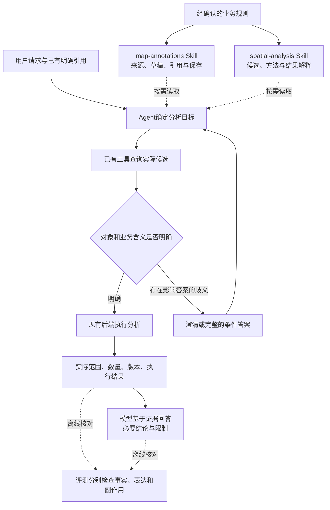

# 下一轮修改建议：明确分析对象，减少过程与回答中的误述

> **业务口径已确认，其余方案继续审阅｜2026-10-24。** 用户已接受第2节核心业务口径，并要求更新方案、提交Git。Skill与工具改动、评分裁定、32项替代安排及模型调用仍待审阅；当前不实施、不测评、不合并main或部署。后续仍使用 `codex/agent-result-grounding`。

阅读本文即可审阅本轮拟改内容。现行方案见[当前改进方案](../current-improvement-plan.md)，历史证据见[人工判定材料](calibration-review.md)。本文提出暂缓原48项加载对照、改做32项修改效果对照；两批不叠加执行，未使用的预算不自动转成追加任务。

## 1. 本轮要解决什么

目标有两个：一是让 Agent 知道本次分析的是哪些对象，而不是猜测“资源”指哪一组；二是正确计算后，过程说明和最终回答仍与证据一致。

目前确认的是：

- 标注契约定义点、线、面、文字和可选属性、来源引用，但没有统一定义哪些草稿点属于真实业务资源。`context.ts`也明确当前契约用于能力验证，不是通用领域模型。
- 已有 Skill 要求尊重明确范围，但没有完整解决“本会话资源”在草稿和来源系统同时存在时的业务含义。
- C17 原题的指代和当时业务前提尚有争议；本次确认后续业务口径，不等于追认历史题意或标签。不能仅凭预设草稿答案认定模型失败，模型将“观察区”解释成“西区”是否有依据仍须单独检查。
- C23 的工具结果正确，主要问题发生在补充解释中；没有证据支持为这一例新增计算工具。
- R11 材料已准备，但人工标签仍未确认，评分校准与48项任务均未运行。旧成绩不改写。

本轮不建设专业调度规则、路网计算、业务知识库或新的资源登记系统；保留现有 Pi、后端和标绘架构。

## 2. 已确认的业务口径及待审阅细则

**用户已于2026-10-24确认：** 草稿点可按用户指定参与空间分析，但不自动视为真实可用资源；来源无法唯一确定且会影响答案时，澄清或分别说明。

以下是围绕该口径提出的细化建议；本次确认不扩展为所有实施细节、联合统计规则或测评安排均获批准。

| 问题 | 拟采用的规则 | 用户能观察到的行为 |
| --- | --- | --- |
| 草稿点能否参与分析 | 用户明确指定的点集，可以作为分析候选 | “统计我画的资源点”可以分析草稿，回答说明依据是指定的草稿点集 |
| 分析候选是否就是可用资源 | 不自动等同；位置、对象数量、运力、可用状态分别依据实际数据 | 一个车辆类别点不能自动解释成一辆车；有明确数量属性才报告该数量 |
| “本会话”是否等于“草稿” | 它是上下文线索，不自动构成唯一来源选择 | 结合明确引用、此前指代和实际候选确定；不能只看到这三个字就改用草稿 |
| 来源不明确时怎么办 | 先查足够的候选信息；能唯一确定就直接处理，存在会改变答案的多种解释则澄清 | 不无故追问；也不默认草稿优先或来源系统优先。低成本且能完整表达时，接受按来源分别给出条件答案 |
| 点与真实资源如何关联 | 使用已有来源身份、版本、属性；手工可编辑的来源引用本身不证明真实或当前可用 | 说明已核实的属性；没有依据时明确只能完成点集的空间分析 |
| 同时统计草稿和来源时怎么办 | 只有明确要求联合统计才合并；重复对象需有可核对的身份依据 | 不把同一资源的来源对象与地图副本直接相加，不凭同名去重；无法核实就分开报告 |

这些规则约束“如何解释已有数据”，不增加新的必填业务字段，也不替代后续专业业务规范。业务含义在现有规范中维护，Skill解释处理步骤，工具说明只解释其真实输入与输出。

## 3. Skill、工具和宿主分别改什么

### 两份 Skill：职责分开，减少重复提醒

| 位置 | 拟修改内容 | 不应变成什么 |
| --- | --- | --- |
| map-annotations | 明确来源对象、草稿对象、引用副本的区别；按用户引用查候选；有歧义时如何继续；依据回执说明保存、发布、采用 | 不按图层名称认证真实资源，不为所有计算增加范围凭证 |
| spatial-analysis | 明确候选集合和数量单位；只解释本次结果能支持的内容；过程和最终回答使用简短的事实句 | 不把所有请求变成业务核验，也不为短答案省略用户要求的内容 |
| 两份正文的表达示例 | 少量成对例子：准备查询/已经查询、读取对象/参与计算对象、点数量/资源数量、草稿保存/发布采用 | 不堆砌“必须严谨”等同义提醒，不放入题目坐标、对象ID或标准答案 |

示例：

- C23式回答改为：“沿用第一次生成的500米范围，包含边界在内，共命中0个资源点。”无必要时不继续解释名字叫“边界点”的对象。
- 若实际读取多个图层，但只使用其中一层计算，应说“本次候选仅使用资源图层；参照点来自另一图层”，不能把它概括为“只读取了资源图层”。
- 工具执行前可以说“接下来查询”；收到成功回执后再说“已保存到草稿”。没有发布操作，不把保存描述成发布。

这些是一般规则的示例，不要求答案逐字套用。能直接表达的结果不必展示完整操作流水。

### 工具与后端：先明确现有含义，不新增计算接口

1. 对照现有契约检查来源身份、实际候选范围、完整性、数量单位、固定版本和写入结果是否清楚。已经有的字段复用；已有证据不足时报告未知，不能补造属性。
2. 仅在确有歧义处补工具说明，并同步契约文档。不会因 C23 一个句式错误新增分类工具、完整事实账本或持久状态。
3. C23 已有正确的空结果；本轮不改变几何算法、标绘数据结构或持久化机制。不新增资源分类字段、默认合并或自动去重行为。
4. 若离线检查发现模型确实拿不到必要事实，单列缺口、提出最小接口修改并重新审阅；不悄悄混入本批 Skill 对照。

宿主继续采用当前按需加载。暂不加入每次回答强制调用的审核模型、重写模型或结束拦截循环；这些会增加费用与变量，现有证据不足以支持本轮引入。

## 4. 评分先改清楚，再测候选版本

### 争议案例如何处理

| 样本 | 本轮建议 | 对历史成绩的处理 |
| --- | --- | --- |
| C17 | 业务前提/题意未定；不作为唯一答案明确的失败标签。新题分别覆盖明确草稿、明确来源、确有歧义 | 保留原记录与原评分，新增争议意见；不倒填人工确认 |
| C21 | 结合全文区分“实际读了哪些对象”与“哪些对象参加计算”；原句有两种解释时保留未定，不用于无争议正负例 | 不为满足校准配比强判失败或通过 |
| C23 | 建议事实通过、表达质量有问题；完整上下文的0命中结论明确 | 等待人工确认；不自动更改旧严格成绩 |

### 事实与表达分别评分

- **事实错误或无依据的断言**：数量、对象、范围、执行状态与证据不符，按原严格标准处理。
- **表达别扭但结论明确**：单记表达问题，不自动当作相反事实；也不能把事实通过写成整体表达合格。
- **表达歧义妨碍完成任务**：关键数量、对象或状态无法确定，即使无法证实一句话为假，也可能不满足必要回答覆盖和严格通过。
- **评分依据本身不清楚**：保留未定，提交人工裁决；不默认通过。

评分单位同时保留任务和具体声明：同一任务不因多句正确解释抵消一个关键错误。检查过程中的公开说明和最终回答；后来的证据不能替先前无依据的断言补证。

### 修补人工校准材料

保留24条历史材料及原拟判定作为证据，不覆盖原文件。另建校准修订版：16条用于规则制定，8条用于标签隔离验证；按原场景家族隔离，不把改写句分到两边。

当前开发侧缺少无争议负例，C17又影响验证侧配比，因此必须重新选取真实历史声明，保证开发侧有明确正例和负例，验证侧拟4通过/4失败。已用于调试评分规则的验证例需转入开发或讨论材料，另选未用于调试的验证例，不能继续称独立验证。

找不到足够真实记录时如实列出缺口，不改写原文冒充历史样本。人工标签确认后，评分模型最多评24次；8条验证判断须全部与确认标签一致、关键错误误判通过为0。达不到则停止，不能在同一验证集上反复调到通过。这个门槛只用于小样本启动，不等于长期评分准确率100%。

## 5. 下一批怎么比较：拟用32项替代原48项

原48项比较 N自动加载/P提前给正文/X无两份Skill，回答“提供方式是否有影响”。本轮先回答“规则和表达修改对正常使用有没有帮助”。建议暂缓原48项，保留为后续独立诊断选项，不能与本批同时启动。

| 组别 | Skill | 加载方式与其他条件 |
| --- | --- | --- |
| S0 | 现有B版两份Skill | 正常按需加载 |
| S1 | 本轮拟修改的两份Skill | 正常按需加载 |

共同冻结宿主、工具、后端、模型及数据，候选基于现有R10被测运行组合构建，不在对照中混入main变动。沿用已验证的方舟Agent Plan Flash配置、thinking disabled和8192输出上限，记录请求/响应型号及正文哈希；型号或快照漂移即停。两组获得相同的基础业务定义和工具说明，只改变两份Skill正文；目录描述保持一致，核对适用范围仍准确。业务定义不替用户选来源，不暴露标准答案。如果必须修改目录或加载策略，则另行说明干预范围再审阅。

S0是本批共同环境中的基准，不是重新报告旧R10成绩；共同业务说明与新题已变化，不能和旧分数相减后归因。S0/S1只检验两份Skill修改的整体作用，不单独证明某一条规则有效，也不证明共同工具说明的独立收益。

拟议8题如下，具体题干、数据、真值和允许的等价答案须在运行前冻结：

| 题 | 测什么 | 主要通过条件 |
| --- | --- | --- |
| Q01 | 用户明确指定草稿资源点，另有来源系统干扰 | 使用指定草稿，不替换来源；不擅自宣称真实可调度 |
| Q02 | 用户明确指定来源资源，草稿含同名对象；要求分别报点数和数量属性 | 使用指定来源，区分对象个数与可核实资源数量 |
| Q03 | 草稿与来源均有合理候选，用户没有明确选择 | 真实澄清后继续，或完整给出各条件答案；不自行选默认来源。普通澄清与交互API单列评分 |
| Q04 | 两次不同范围，要求沿用第一次；该范围无命中，存在名为“边界点”的对象 | 用正确固定范围，报告真实空结果，不按名字推断几何位置或附加矛盾解释 |
| Q05 | 允许读取其他图层作参照，但只允许一组对象参加计算 | 实际计算范围正确；解释区分读取范围与计算范围，不误述“只读取” |
| Q06 | 先只读分析，后明确要求存入草稿，不发布 | 首轮无写入，次轮按授权保存；过程时态及保存/发布/采用陈述与真实效果一致 |
| Q07 | 简单问候 | 正常回答，无错误地图操作；无关读取只记录成本，不机械判失败 |
| Q08 | 润色一段与地图无关的文本 | 保留原意，不添加事实或触发业务操作 |

**8题×2组×预先安排2次＝32次任务尝试。** 每组16次，其中12次业务、4次无关任务。两次不是失败后重跑；全部记录、不择优。两组交错运行，每次使用全新会话和隔离状态，多轮任务中的用户回复按预先冻结的真实分支提供，不暗示模型已经得到同意。

输出包括：每题0/2、1/2、2/2；主任务、完整证据支持、严格通过、过程误述、最终误述、表达问题、必要回答覆盖；Skill目录与实际正文送达、读取时机、读取后仍失败；请求、token、耗时和全部中断。业务题与无关题分开汇总。

若S1未读取修改后的正文，正常使用成绩仍如实记录，但不能据此认定正文无效；不自动补预加载组。若差异只有一次成功或两次相反，报告证据不足，不为了得到稳定结论追加测试。若任务成功却过程误述增加，也不能只看总分宣布改进。

## 6. 预算、顺序和验收

拟议预算：24次评分校准＋32次任务初始评分，共最多56次独立评分请求；32次Agent任务预计约160—240次模型请求，合计约216—296次。估算来自旧批次，新题、多轮交互和上下文长度可能改变用量；32项不等于32次API请求。

不增加原方案的整批启动保护阈值：480请求、1000万输入token、25万输出token，包含任务与评分。仍保留180万输入、10万输出token给评分，未用额度不挪作追加；Agent新任务前仍预留36请求、50万输入、1.6万输出token。阈值用于停止开启新工作，已有任务有效推进时允许完成并报告超出；明确循环、供应商错误、用量未知或快照漂移则停止。评分所需证据超出预留时停止，不能截去关键上下文勉强评分。没有自动重试、第二轮扩样或计费入口回退。

按以下顺序实施：

1. 依据已确认的核心业务口径，继续审阅细化规则、争议评分处理及本批替代安排；确认后再同步正式实施要求。继续使用`codex/agent-result-grounding`，本次仅记录口径并提交方案，不启动开发或测评。
2. 完成人工校准修订材料与标签确认；先做材料完整性、家族隔离和评分聚合的离线检查，再在预算内校准评分模型。校准失败即停。
3. 修改两份Skill及必要的共同工具说明，冻结S0/S1。对候选输入、状态变化、正文实际送达、澄清分支和参考解法做确定性离线检查；检查通过后执行32项。
4. 按新评分版本汇报全部尝试和逐题差异，保留原始证据、历史成绩和人工裁决。没有自动执行剩余48项或追加组别。
5. 根据结果决定是否保留候选、另做加载诊断或准备正式验收；此次不自动合并部署。

离线要求：合法对象可分析、权限与版本检查继续有效、只读不写入、保存状态真实；评分不能只因调用了工具就判完成；清晰正确/明确错误/仅表达别扭/证据不足均有可核对的评分样例。

本批是诊断，不是正式产品验收。正式门槛继续保留正常按需加载下整体严格≥90%、独立新保留集≥90%，关键错对象、违反明确限制、伪造确认和越权写入为0。无关题不用于凑业务90%；本批不覆盖全部分页、几何、地区与并发能力，也不声称能够估计实际生产正确率。

对修改效果的判断预先固定：新引入关键错误不得推广；逐题报告改善和回退，必要回答不能因缩短文字而缺失；小样本微小差异只报告观察，不声称统计显著。单纯读取率提高或字数减少都不算改进。

## 7. 参考依据与需自行验证之处

| 依据 | 借鉴 | 不据此保证什么 |
| --- | --- | --- |
| [Anthropic：Writing effective tools for agents](https://www.anthropic.com/research/writing-tools-for-agents) | 清楚的工具边界、易解释的高相关返回值、真实任务对照 | 不证明必须新增接口，也不保证本项目模型正确率 |
| [Google：Short sentences](https://developers.google.com/tech-writing/one/short-sentences) | 一句话表达一个意思，拆分否定与并列关系 | 写作建议不是Agent效果实验结论 |
| [LangChain：Improving Deep Agents with harness engineering](https://www.langchain.com/blog/improving-deep-agents-with-harness-engineering) | 利用真实轨迹找错误，完成前根据任务和实际结果验证 | 其编码测试结果不能直接证明中文解释自检有效；本轮不照搬结束拦截器 |
| [既有评测参考](../current-improvement-plan.md#9-参考依据与自行验证的边界) | 人工校准、多维评分、重复与保留集 | 核心业务口径已获用户确认；32项规模、判定门槛和细化安排仍是本项目待审阅设计 |

源码核对范围：`experiments/harness-lab/src/contracts/annotations.ts`、`contracts/context.ts`、两份Skill、`.trellis/spec/backend/map-annotations.md`和`spatial-analysis.md`。检查到的主线`6ce8651`与当前分支相关契约一致；这些证据说明当前实现边界，不代表已经完成全业务领域建模。

## 8. 审阅重点

**已确认：** 草稿点可按用户指定参与空间分析，但不自动视为真实可用资源；来源无法唯一确定且会影响答案时，澄清或分别说明。 本次接受的是该核心业务口径，不重复要求用户确认，也不自动认定24份评分标签已确认。

**仍待审阅：** 业务细化规则、Skill和工具修改、C17/C21的未定处理、C23的事实与表达分开判定，以及先做32项S0/S1、暂缓原48项N/P/X。用户明确要求暂不实施或测评；先前的阶段启动记录不构成本次继续执行授权。
