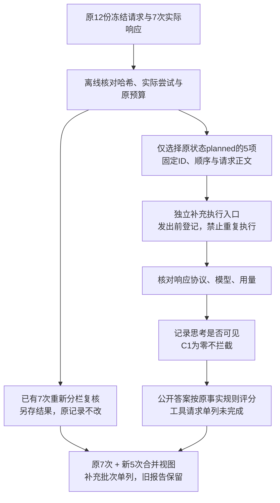

# R12收尾补充方案：区分推理观测，完成剩余5次

> 2026-10-25。用户已明确“好的，那么补充方案设计，然后开工后续”，授权先补充本方案、离线检查，再首次执行R12尚未发出的5次推理请求。不重跑已有7次，不重跑来源对照，不加新题或付费裁判。沿用分支 `codex/agent-result-grounding`。这是R12的收尾补充，不另起一轮、多轮方案不混写；[原方案](plan.md)和[原运行报告](results.md)保留。

## 1. 本次要解决什么

原程序把“开启组无思考文本且reasoning_tokens=0”直接归为failed并停止批次。C04-C1实际HTTP200、正常stop、回答完整且事实正确，原始流也确认不是解析漏读。本轮需要将请求配置、思考观测、协议完整性和回答正确性分开。

这不等于证明该次内部推理实际发生，也不等于确认方舟将零思考定义为正常行为。官方将enabled描述为强制开启，而社区存在同模型零思考的实际报告；单凭零输出不足以断定开关被关闭。

依据（已只读核实，不调用模型）：
- [方舟深度思考](https://console.volcengine.com/ark/region:cn-beijing/docs/deep-thinking)：支持1017版本的开关和high档。
- [Flash模型说明](https://console.volcengine.com/ark/region:cn-beijing/docs/deepseek-v4-1-flash)：参数支持与输出额度。
- [DeepSeek Harness用户复现](https://github.com/deepseek-ai/deepseek-harness/discussions/7050)：V4.1 Flash开启推理仍有零reasoning_tokens报告；属于使用者一手报告，不是方舟官方保证或我们这次原因的证实。
- [已有原始响应复核](reasoning-semantic-review.md)：7次实际输入/输出、C04正文事实与技术标签。

## 2. 保留和调整什么

| 内容 | 本次处理 |
| --- | --- |
| 区分草稿、态势系统、资料文件；来源不明时澄清/分别回答 | 保留设计，不回滚 |
| R12两份Skill和工具描述候选 | 原样保留在当前分支，不继续改写，不据小样本认定改善，不合并/部署 |
| 产品工具、算法、权限、推理默认值 | 不改 |
| 原C请求、程序、响应、停止记录及旧成绩 | 全部保留，补充复核另存，不覆盖 |
| C1零思考响应 | 协议完整且正文正常时继续评分，标记“请求开启，未观测到思考输出”；不自动失败、重试或剔除 |
| 仅有工具调用 | 仍为需要继续取证；本阶段不执行工具、不伪造结果 |
| 缺失正文与工具、非法响应、HTTP/流错误、未知用量、版本或冻结变化 | 仍停止并保留证据 |
| C0关闭组返回非零思考信号 | 请求/响应条件存在明确不一致，保留并停止核查 |
| 预算和没有自动重试 | 不变 |

本补充比较“请求开启high”与“请求关闭”的实际输出，不按事后是否出现思考文本筛选样本。思考文本不用于语义评分。所有开启组长期无信号会使开关效果解释证据不足，不自动增加探测或更换模型。

## 3. 程序怎样衔接

新增任务内 `reasoning-completion.ts` 与对应离线测试，复用原冻结校验、SSE解析和环境校验。只新增收尾执行路径，避免为本次5项改动产品或通用运行框架。原 `reasoning-prepare.ts`、`reasoning-live.ts` 及冻结文件不修改；新入口有自己的程序哈希和排他执行标记，不删除原run-claim。

准备时核对原7次响应、实际请求、原进度账本、原12份请求冻结和旧代码哈希，确保没有已尝试项混入。首个新请求之前创建针对这一原批次的排他补充标记；更换输出目录也不能重复补跑。每个请求发出前登记为已尝试，失败后不恢复或再次发送。

新入口从原冻结文件读取原始请求，不新增提示词、不调整工具定义、不回填reasoning_content、不执行工具。新模型请求仍用原Agent Plan入口及别名，真实返回必须仍为 `deepseek-v4-1-flash-261017`。若版本改变则停止，不悄悄合并不同模型成绩。

## 4. 只执行哪些请求，预算多少

按原顺序首次执行：

| 顺序 | ID | 内容 | 推理配置 |
| --- | --- | --- | --- |
| 1 | C04-C0 | 预览后保存说明 | disabled |
| 2 | C05-C0 | 必须解释方法与依据 | disabled |
| 3 | C05-C1 | 同一方法解释材料 | enabled / high |
| 4 | C06-C1 | 必须给名称与距离 | enabled / high |
| 5 | C06-C0 | 同一名称与距离材料 | disabled |

C04-C1已经有正常回答，不重跑。C05仍是已明确标识的构造用户要求；C03与C06同一题目家族的限制保留。

原C上限仍是12请求、400,000输入、400,000输出。已使用7请求、146,903输入、2,588输出；剩余额度最多5请求、253,097输入、397,412输出，不向B借预算。

这5项预留输入合计127,938；每项输出上限32768，5项最多163,840输出。每次发送前检查已用加本次预留不超过原C总上限，结束后按真实usage记账。思考token包含于输出，不重复相加。没有额外连通性探测或收费裁判。

## 5. 离线检查与实施顺序

1. 落盘本补充及原材料/候选哈希清单，确认范围已获授权。
2. 实现分栏判定和仅5项的补充入口；复核已有7次，仅C04的原异常归类新增“协议完成/正文合格/思考未观测”视图，不修改原记录。
3. 离线验证：零思考正常答案可继续；旧7项与已尝试项不可重跑；只发送指定5份完全相同请求；错误、未知用量、模型漂移、预算不足立即停；工具调用不执行；重复入口被阻止；历史与产品文件不变。
4. 运行R12范围TypeScript、实际ESLint及必要离线测试；Trellis检查代理复核后由主会话发起唯一5项批次。
5. 对新增公开答案做逐条Agent证据复核，合并原7次，形成独立收尾报告、来源标识和哈希清单。Agent复核不冒充人工金标。所有异常与未执行仍列出，不自动补齐。

## 6. 最终怎样判断

先报告各组已尝试数、协议完成数、完整且正确、完整但有误、需要取证、未执行，以及思考观测分布。只有双方完整答案才能形成事实改善/退步配对；没有思考输出本身不排除正确完整答案。C04可以与本次C04-C0配对，但必须披露C04-C1为零思考、补充请求晚于原批次。

主统计包括配置组的全部响应，另列有/无思考信号的描述性观察；不将思考长度当正确性，不据答案正确反推实际发生了思考。原“至少两个时点减少误述、无必要内容遗漏或新错误”仅为后续验证信号，不是稳定性证明。即使补齐仍大量要求继续工具，也如实报告，不能自动扩大为完整Agent任务。

不重跑B，不追加R13，不启用产品推理，不扩大正式测评。90%正式验收目标保留，本次小样本不承担该验收。
