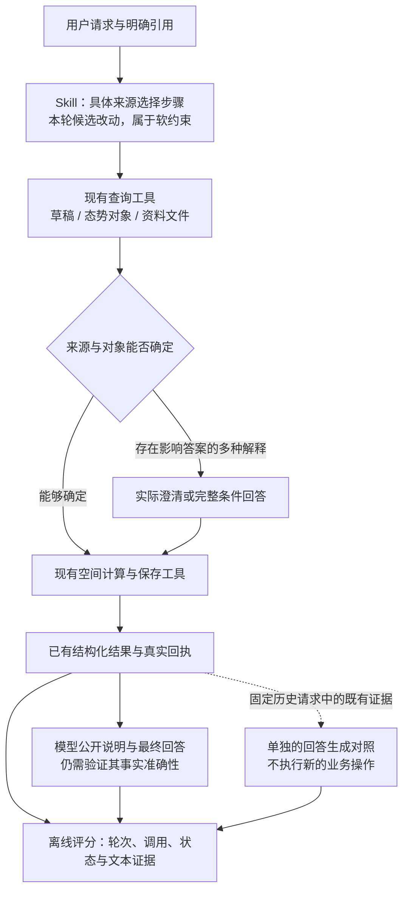

# R12 待审方案：查明分析来源，定位回答误述

> 2026-10-25 更新；状态：仅方案，待用户审阅。当前授权为整理并提交方案文档；不包括实施、调用模型或重新评分。
> 本文只对应R12。A/B/C是同一轮内的三个部分，保留在本文件中整体阅读；上一轮材料只通过链接引用。下一轮另建文件、单独审阅，不继续追加到本文。
>
> 分支沿用 `codex/agent-result-grounding`。产品与评测基线为 `6a631a4`，上一轮推理核查记录已补交 `f11beec`（仅文档）。本方案提交后仍待审阅，不合并、不部署；Git提交不代表实施获批。R11 的任务、原始响应、失败记录及评分保持原样。

## 1. 这次准备做什么

下一阶段分三步，分别交付，不把它们混成一次“大改后看总分”：

| 步骤 | 拟开展内容 | 性质 |
| --- | --- | --- |
| A | 修复已证实的评分程序问题，用已有记录检查 | 有明确证据的工程修复；不调用模型 |
| B | 把来源选择规则改成具体工具使用步骤，小范围对照 | 产品候选；效果尚未证明 |
| C | 同一Flash、相同问题与证据，对比关闭推理与开启high档推理 | 只诊断回答生成；12次请求，不是完整任务正确率 |

B 和 C 分开运行、分开报分。B 不同时换模型；C 不使用 B 的新规则，也不改变评分方式。任何扩大、重复测评或上线采用，均不由本方案自动触发。

本次相比前一版草案，主要补齐四点：已确认R11关闭推理；C明确比较同一Flash的开关；两组共同提高输出上限并对齐采样参数；写清现有宿主会强制关闭推理，必须在隔离评测入口核对实际请求。B的12项完整任务和A的离线修复范围保留。

用一句话理解：先修好“量尺”，再分别检查“来源处理指引是否有效”和“让同一个模型先思考，能否减少看完证据后仍说错的话”。

## 2. 为什么这样调整

依据：[R11 完整结果](../r11-20261023/grading-results-20261025.md)、[独立裁判复核](../r11-20261023/judge-semantic-review-20261025.md)。

- 代理证据复核：主任务56/64、严格54/64；仅业务任务为40/48、38/48。这里的复核不是用户人工金标。
- 同加载方式下，新旧 Skill 的通过数相同。新增规则与共同宿主约定有重合，未显示净收益，不能据此证明 Skill 整体无用。
- 8次主任务失败都来自Q03这一个来源歧义场景的重复，不是8种独立问题。模型只完成草稿分支；没有查明用户要的来源，也没有完整回答各来源条件。
- 草稿引用在上下文中，而另一来源的具体对象需要另查。这可能影响选择，尚未证明是根因。不能说模型“已看到两套候选却忽视其中一套”。
- 另有两次主任务完成但解释错误：Q02把关键词查询说成按区域ID重查；Q04把实际距离第四的点说成第二近。Q03内部还存在位置、读取范围等误述，不能把全批解释错误总数写成只有两条。
- 自动裁判也出错：有效严格判定中有4次误通过、1次误失败，另3条输出不合格。先保证能识别真实改进，不能追着错误分数修改产品。

本方案中的“候选”指用户可能引用的区域、资源集合及其来源。它包括草稿标绘，也包括态势系统对象。区域和资源点可以来自不同来源，不能自动绑定为同一套。

### 新核实的推理条件

[R11推理核查记录](../r11-20261023/flash-thinking-audit-20261025.md)确认：235次任务请求、24次校准请求、64次评分请求，共323次均显式传入 `thinking.type=disabled`，全部输出上限为8192，实际返回版本均为 `deepseek-v4-1-flash-261017`。这说明旧成绩是在关闭推理条件下得到的，不能据此认定它就是失败原因。

官方文档确认Agent Plan提供该Flash，模型支持开关与推理档位；尚未对本项目或账户实际开启验证。当前宿主的[模型注册](../../../../experiments/harness-lab/src/pi/lab.ts)设为 `reasoning:false`，会话设为 `thinkingLevel:'off'`，[请求适配](../../../../experiments/harness-lab/src/pi/controlled-stream.ts)还会给DeepSeek请求写入 `thinking.type=disabled`。不能只改会话配置就声称推理已开启。

本轮不修改这些产品默认值。C拟在独立评测入口构造、记录和核对最终请求；若未来要让产品全程开启推理，再另行审阅Pi适配、思考内容回传与完整任务验证。

## 3. 保留什么，不再把什么当作新改进

| 保留 | 本阶段不建设 |
| --- | --- |
| Pi 原生对话与工具循环、现有按需 Skill 加载 | 强制每个任务加载全部 Skill |
| 现有查询、空间计算、精确保存及版本/权限检查 | 新计算引擎、路网计算、专业资源派遣 |
| 工具已有的结构化结果、模型结果投影和页面展示 | 再建一套结构化结果或结果卡片来宣称解决自由解释 |
| 已确认的草稿与业务来源口径 | 通用“已证明来源”凭证、额外持久状态或默认合并来源 |
| 对公开过程和最终回答都检查事实 | 用工具正确、卡片正确抵消模型文本中的事实错误 |

自由解释的可靠修复尚未得到验证。此次不增加每次回答都调用的审核模型，不用关键词拦截自由文本，也不以“少说话”为通过标准；用户要求的理由、距离、方法说明仍须完整回答。

## 4. A：具体修哪些评分问题

修改放在新的R12评分适配或测试文件中，复用已有函数；不编辑R11冻结输入、rubric、校准金标、脚本快照或原成绩。相同历史材料只能产生另存的诊断结果，不能覆盖旧结果。

### A1. 正确识别轮次和最终状态

从实际记录提取每轮的用户请求、调用顺序、工具回执、before/after状态。保存任务明确区分“第一轮仅预览”和“第二轮已保存”。修订号、实际新增对象、几何是否相同、发布/采用是否改变，由程序检查。

给语义复核提供明确的逐轮索引及必要原文，避免裁判在长嵌套JSON里拿错状态。程序只能证明实际效果，不能替模型判定用户意图、解释是否正确，也不能用后来保存成功证明此前“已保存”的话正确。

### A2. 正确区分生成与读取

以实际工具调用的 `operation` 和 `toolCallId` 统计生成。读取旧缓冲区返回的结果仍标有原来的 `buffer`，不能据返回结果的类型重复计算生成次数。

Q04-2-S1-N应同时得到两个结论：固定范围使用正确；附加距离排序解释错误。不能用前一个评分程序误报掩盖后一个真实问题。

### A3. 总判定由程序汇总

新协议中的语义裁判负责各分项、证据和理由；总判定按已确定规则计算：有fail则fail，无fail但有pending则pending，其余适用项全pass才通过。

- 原始裁判若仍返回总评，保留为原值，不作为权威汇总；与程序汇总矛盾时明确标记。
- 字段缺失、非法枚举、错误引用不能靠填默认值修成通过；记录为裁判异常，不重发、不剔除分母。
- 严重程度另行核对，不因程序算出fail就自动编造critical依据。
- 这个改动只能修复格式和汇总问题，不能保证语义分项正确。

### A4. 离线检查如何算完成

用本轮已有记录覆盖：预览后保存、两次生成加一次读取、错误查询过程说明、错误排名、计划句、同答自纠正、措辞别扭但答案明确，以及3条无效裁判输出。

真实历史与另行构造的边界样例分开标识。代理建议不是人工金标；语义争议保留待审。检查要求是格式/状态/次数等确定性断言准确，以及所有旧原始文件不变，不宣称“离线检查通过等于裁判已校准”。本阶段新增提供商请求为0。

## 5. B：来源选择具体改什么，如何验证

### 候选改动

以当前提交中的两份Skill为基准，重写来源选择的小节，保留已确认业务口径，减少同义提醒：

| 用户已经明确的内容 | 建议处理步骤 |
| --- | --- |
| 明确草稿引用或图层 | 用 `annotation_read` 获取必要对象，不因来源系统存在同名对象就额外追问 |
| 明确态势系统对象 | 用 `situation_query`，保留完整来源引用，不用草稿同名点替换 |
| 只有名称，来源仍不明确 | 先结合用户引用、可核对前文及相关查询确定可能对象；有会影响答案的多种解释时，询问选择或完整回答各条件 |
| 明确跨来源分析 | 分别保留参照区域与资源集合的来源，不强行让它们来自同一处 |

同时只调整已有工具的说明：`source_list`列的是工作区资料文件，`source_read`读资料正文，不能替代`situation_query`查态势对象。现有说明已经具备的内容不重复扩写；参数、查询算法与权限不变。

这是一组“来源处理指引”的候选修改，不是程序消歧保证。它不能证明模型一定执行；也不要求每项任务都扫描两套来源。若现有信息已能唯一确定，就继续处理。

### 拟议对照：6种任务 × 2组 = 12项完整任务

| 编号 | 任务类型 | 主要检查 |
| --- | --- | --- |
| B01 | 明确草稿，来源系统有同名干扰 | 不换来源、不额外追问 |
| B02 | 明确来源系统，草稿有同名干扰 | 不用草稿替代，不混淆点数和数量属性 |
| B03 | 来源含糊，具体候选需要查询发现 | 能否查明相关来源并完成澄清/各条件答案 |
| B04 | 已通过真实读取提供双方候选，用户尚未选择 | 区分“没发现候选”与“已发现但未处理歧义” |
| B05 | 前文已唯一指定来源，当前用简称续问 | 正确承接上下文，不机械重复确认 |
| B06 | 用户明确指定跨来源参照区域和资源点 | 分别保留来源，正确计算，不强行同源 |

每题两组各一次：B0为当前版本，B1为来源指引候选。B03/B04采用相同业务问题和数据，只改变可见候选是否已通过实际查询取得；不伪造工具消息，不把隐藏标准答案给模型。

为单独观察指引送达后的执行，两组都采用相同位置的完整正文预加载，模型、数据、宿主业务约定与其余工具保持一致。这不是产品加载策略修改，也不能代表正常自动加载的成绩。本阶段不另跑自动加载对照；后续如有正向信号，自动加载验证需另列预算和取得授权。

B1同时包含来源小节和相关工具说明的改动，比较的是这组来源指引的整体效果，不单独声称某一份Skill或一句工具说明有效。每项具体变更在执行前列出diff并冻结。

记录四步：有没有发现相关来源、有没有正确处理歧义、实际算了哪些对象、公开说明是否准确。明确来源题不需要无意义地列出其他候选。普通文本澄清和交互API分别记录；真实用户回复由冻结分支提供，不将末尾“需要可另查”自动当成来源已确认。驱动没识别或没接上合理澄清时，单列驱动问题，不直接算模型失败。

## 6. C：同一Flash关闭推理与开启推理，回答是否更准确

本阶段不继续给Skill叠加“必须准确”等同类提醒，也不新增事实展示接口。要比较的是：模型面对同一问题和同一份真实查询记录，直接回答与先推理再回答，哪种更少误述。

例如，工具实际只按名称关键词查到了资源。两组都看到同一调用记录，检查开启推理后是否还会说成“我按区域ID重新查询了”。这不是比较Flash与Pro，也不让模型重新执行整条任务。

### 拟议材料：6个回答时点 × 2配置 = 12次续写请求

| 时点 | 取材方向 | 不能省略的检查 |
| --- | --- | --- |
| C01 | 查询失败后改条件成功 | 方法说明是否对应实际调用 |
| C02 | 固定范围筛选为空 | 是否擅自补充错误排名或位置 |
| C03 | 读取多层、仅部分对象参加计算 | 是否把读取范围说成计算范围 |
| C04 | 先预览、后保存 | 是否正确区分本轮与之前状态 |
| C05 | 用户明确要求解释处理依据 | 不能通过不解释来取得高分 |
| C06 | 用户明确要求数量及距离 | 不能通过漏答必要数值来取得高分 |

优先使用已有历史的真实生成时点。没有匹配历史时另建明确标识的构造材料，取材清单先落盘，不伪称历史任务。材料已用于诊断，不能称新保留集。

截取目标回答之前的完整实际模型输入：用户消息、宿主上下文、已送达的Skill、当时工具参数/结果都保留；不加入原错误答案、后来的证据、裁判解释或标准答案。历史中已存在的前序误述也不偷偷删掉，记录其影响。

### 两组具体设置

| 条件 | C0：关闭推理 | C1：开启推理 |
| --- | --- | --- |
| 套餐入口 | `https://ark.cn-beijing.volces.com/api/plan/v3` | 相同 |
| 请求模型 | `deepseek-v4.1-flash` | 相同 |
| 必须核对的返回版本 | `deepseek-v4-1-flash-261017` | 相同 |
| `thinking.type` | `disabled` | `enabled` |
| `reasoning_effort` | 不传，保留原关闭方式 | `high`，显式固定档位 |
| `max_tokens` | 32768 | 32768，思考和回答合计 |
| `top_p` | 显式1.0 | 显式1.0 |
| `temperature` | 两组都不传，保持一致 | 相同 |
| 消息、Skill正文、工具定义、工具选择方式 | 从同一真实回答时点截取并冻结 | 完全相同 |

选high是因为它是模型专页记载的默认推理档位，本轮只测这一档，不加low/max组。`thinking`和`reasoning_effort`是待审实验参数，不是已执行配置。

两组共同使用32768上限，原因是推理与最终回答会共用输出额度。若仅让推理组继续使用8192，可能把额度不足误判为推理无效。这个额度是本轮实验选择，不保证每个回答都不会截断；出现截断要单列预算干扰，不能据此认定模型能力较差。C0也改为相同上限，因此它保留的是原有“关闭推理”方式，不是对R11整份请求的逐字重放。旧R11答案只用于选取问题，不能代替本轮C0。

显式对齐 `top_p=1.0` 是为了避免平台默认值造成额外差异：模型文档说明，非思考模式固定为1.0，思考模式在带工具且不传参数时默认0.95。除本表列出的共同设置外，不再调整采样、提示词或Skill。核对实际请求时，两组允许不同的生成字段只有 `thinking` 和 `reasoning_effort`。

### 请求准备与兼容检查

- C放在R12独立评测程序中，沿用现有鉴权、录制、零自动重试和记账方式。不要经过会把参数覆盖成disabled的产品请求链路，也不要为此修改全局产品配置；这项隔离本身决定它不能替代产品集成验证。
- 冻结每个时点的原请求文件、哈希、截取位置和两组参数差异；不删历史中已存在的误述，不补事后答案，不让一组读取另一组的新输出。组别顺序在运行前交替排定，不能总等看到第一组结果再修改另一组。
- 历史R11没有思考内容，不补造 `reasoning_content`。若平台不接受从这些历史工具消息切换到开启推理，保存不兼容记录并停止C，先修订方案；不偷偷删消息、加空思考或重新生成历史来凑成一次成功。
- 获批执行C后，第一对已排定材料同时检查协议兼容、实际开关、返回模型、用量及思考字段是否返回；这两次包含在12次内，不额外发“连通性测试”。若没有足够信号证明推理生效，标为生效待核实并停止后续；HTTP成功本身不等于开关已生效。
- 思考字段只用于确认协议与用量，不把内部思考当成公开回答，也不拿它弥补公开说明错误。若未来进入完整工具循环，需另外验证原始思考内容按官方要求回传。
- 保留原请求的工具schema。若续写提出新工具调用，本阶段不执行、不伪造回执，标记“需要继续取证”；它不自动算事实错误，也不能当完整回答通过。对其已说出的公开事实仍照常核对。
- 每个时点每组只调用一次。输出截断、接口拒绝、用量未知或模型版本变化均保留；异常不冒充能力失败，不移出12次计划的完成统计，不重新抽取更有利答案。

这12次会产生真实模型请求和用量。即使最终回答误述减少，也只能说明“在固定的关闭推理历史之后，仅这次回答开启推理”的局部结果，不能代表从任务开始就开启推理；也不能推出中途公开说明已全面改善。C01—C06必须报告完整回答数、需继续取证数、异常数与成对改善/退步数，不能把少答或没有完成的输出算成提高正确率。后续完整任务回归、主动Skill加载与裁判推理对照都需另行审阅。

## 7. 怎么评价，何时才值得扩大

### 不改变原有严格口径

主任务、公开过程事实、最终事实、实际效果、范围边界和回答覆盖分别报告。只评价公开文本，不以隐藏推理作为评分证据。事实错误不能用正确工具结果抵消；表达别扭但结合全文清楚则单列。合法的简单推导可以使用，不强制每个数值都新增工具调用。

本次小批次拟先用程序核对确定性事实，再逐条代理审阅语义；有争议的交用户裁定，不将代理意见冒充金标。暂不启动新一轮付费裁判批次。未来恢复自动语义评分时，需另列整题校准材料与预算，原24条声明校准不能代替多轮整题校准。

### 小批次只决定是否值得继续验证

- B：候选至少修复两项基准失败，明确来源/前文引用/跨来源任务没有新增失败或无必要追问，且不存在新增未经授权写入，才提出扩大验证建议。若基准本来没有失败，报告本批无法证明改善，不自动加难题重跑。
- C：至少两个基准误述时点得到改善，必要解释和数值没有漏答、没有新增事实错误，才认为有后续验证价值。“改善”只计返回完整且有依据的公开答案；仅提出工具调用或没有作答不计改善。还要报告“要求继续取证”及异常的数量，不通过删分母或大量不作答凑正确率。
- 两组都失败、结果只差一次、处理链条不足以支持归因，均按证据不足处理；不得通过自动重复直到出现提升。

上述是诊断信号，不是稳定增益或统计显著性门槛。整体及新保留集90%的正式严格目标继续保留；这批开发材料不承担正式验收。

## 8. 拟议预算、执行顺序与审阅点

### 预算分开列，当前均未获执行授权

| 阶段 | 拟议规模 | 提供商请求与费用 |
| --- | --- | --- |
| A 离线评分修复 | 复用已有记录；本地断言与材料核对 | 0次模型请求 |
| B 来源完整任务 | 6题×2组，各一次，共12项 | 工具循环会多次请求模型；估计48—72次，不能当成12次API调用 |
| C 回答生成对照 | 6时点×2配置，共12次续写 | 12次模型请求；不执行续写提出的新工具调用 |
| 付费裁判、补测、完整回归 | 本方案不安排 | 0次；需要另行审阅 |

| 阶段 | 请求上限 | 输入token上限 | 输出token上限 |
| --- | ---: | ---: | ---: |
| B | 96 | 2,000,000 | 60,000 |
| C | 12 | 400,000 | 400,000，包含思考与回答 |
| 合计 | 108 | 2,400,000 | 460,000 |

相比前一版，题目数量和请求上限不变，只把C输出保护上限从6万调整为40万：12次 × 单次32768 = 393216，40万可覆盖全部请求各自用满的情况。合计输出上限由12万改为46万。这是待审的最大用量保护，不是预计花费，也不要求模型用满额度；实际按返回用量记账，推理部分在提供商输出总量中已包含时不能再重复相加。

B仍是关闭推理、8192单次上限的完整任务；本次不提高B额度。C两组先核对完整输入是否在预算内，不通过删掉必要证据硬凑。若输入、输出或请求数仍不足，保留未执行项并汇报，不自行超额。

继续使用已配置的Agent Plan入口。套餐可用模型和推理参数已获文档支持，账户及历史输入兼容尚未实测；仅按上述首对请求检查，不自动切换到按量计费入口、Pro或economy模型。需要额外探测时先单列预算，不藏在准备工作中。本文不将token上限换算成人民币或AFP承诺。

单个完整任务不使用固定工具次数机械截断；新任务启动前为正常完成预留预算。预算不足、用量未知、供应商错误、冻结漂移或明显失控循环时停止，保留已执行与未执行记录，不越过总授权额度。没有自动重试、追加第二轮、跨批替换或择优报分。

### 执行顺序

1. 用户审阅本方案，确定批准哪些阶段；当前只落盘。
2. 获批后完成A及必要离线检查；不为修评分重新调用旧64项。
3. 准备并冻结B的具体diff、12项题目/等价答案、两组输入差异和预算；离线检查通过后，按明确获批范围执行并汇报。只批准A不启动B。
4. C独立冻结上表配置、6个完整时点、参数差异与请求预算。只有明确批准C才执行；首对兼容性检查不通过则停止，C不自动跟随B执行。
5. 根据两项诊断结果提出采用、撤回或下一次验证建议；不自动大测、合并或部署。

### 用户审阅时最需要看的三点

- 是否接受B先使用两组相同预加载来隔离“规则送达后的执行”，自动加载效果留到后续另批验证。
- 是否接受C固定为同一Flash的关闭推理/开启high档对照，两组同为32768输出上限；它只回答生成环节的问题，不代表完整任务。
- 是否接受C输出上限提高到40万、总输出上限46万；B/C分阶段决定执行，审阅方案本身不授权模型调用。

## 9. 实施位置与证据入口

| 拟修改位置 | 预期改动 |
| --- | --- |
| 新的R12评测文件 | 逐轮状态提取、按真实调用计数、分项汇总、离线回归；C独立请求录制、开关与预算核对 |
| `fixtures/skills/spatial-analysis/SKILL.md` | 来源选择步骤的小范围重写，不改计算方法或追加解释口号 |
| `fixtures/skills/map-annotations/SKILL.md` | 对齐来源身份和标绘引用的必要说明，避免两份规则冲突 |
| `src/pi/resource-tools.ts`及确有必要的`context-tools.ts`说明 | 清楚区分资料文件与态势对象查询；不增加API或改变执行行为 |
| 本阶段方案与评测报告 | 保存假设、冻结条件、真实用量、异常和成对结果 |

以上产品路径相对于`experiments/harness-lab/`。现有能力已核对：[空间工具](../../../../experiments/harness-lab/src/pi/spatial-tools.ts)、[结构化结果及投影](../../../../experiments/harness-lab/src/contracts/spatial.ts)、[工具结果转交模型](../../../../experiments/harness-lab/src/pi/spatial-results.ts)、[态势查询](../../../../experiments/harness-lab/src/pi/context-tools.ts)、[资料目录与Skill工具](../../../../experiments/harness-lab/src/pi/resource-tools.ts)。

历史依据：[Q03来源复核](../r11-20261023/q03-review-20261025.md)、[Q01/Q02过程说明复核](../r11-20261023/q01-q02-review-20261025.md)、[Q04—Q06效果与解释复核](../r11-20261023/q04-q06-review-20261025.md)。本方案不以未经核对的外部案例替代本仓库证据。

## 10. 官方依据与待验证事项

查询日期为2026-10-25；以下只读资料核查不产生模型请求。

| 官方依据 | 本方案据此确定什么 | 尚不能据此证明什么 |
| --- | --- | --- |
| [Agent Plan套餐概览](https://console.volcengine.com/ark/region:cn-beijing/docs/agent-plan-personal-plan-overview) | 套餐提供 `deepseek-v4.1-flash` | 本账户某次调用的实际抵扣或可用余额 |
| [Flash模型说明](https://console.volcengine.com/ark/region:cn-beijing/docs/deepseek-v4-1-flash) | 推理档位、输出包含思考、top_p模式差异、Agent思考回传要求 | 开启推理一定提高本项目正确率 |
| [Chat API说明](https://console.volcengine.com/ark/region:cn-beijing/docs/chat-api) | `thinking.type` 的开关含义及思考输出字段 | 本项目SDK/宿主已完整适配开启推理 |
| [本地323次实际请求核查](../r11-20261023/flash-thinking-audit-20261025.md) | R11任务与评分均显式关闭推理 | 更早所有轮次的设置、开启后的能力 |

后续审阅通过后，仍须在执行前冻结具体材料和请求差异。不能一边看结果一边更换档位、扩大输出上限或追加题目。若未来要比较语义裁判的开关，使用单独材料与预算；本轮没有把这项新问题混入任务模型的对照。
