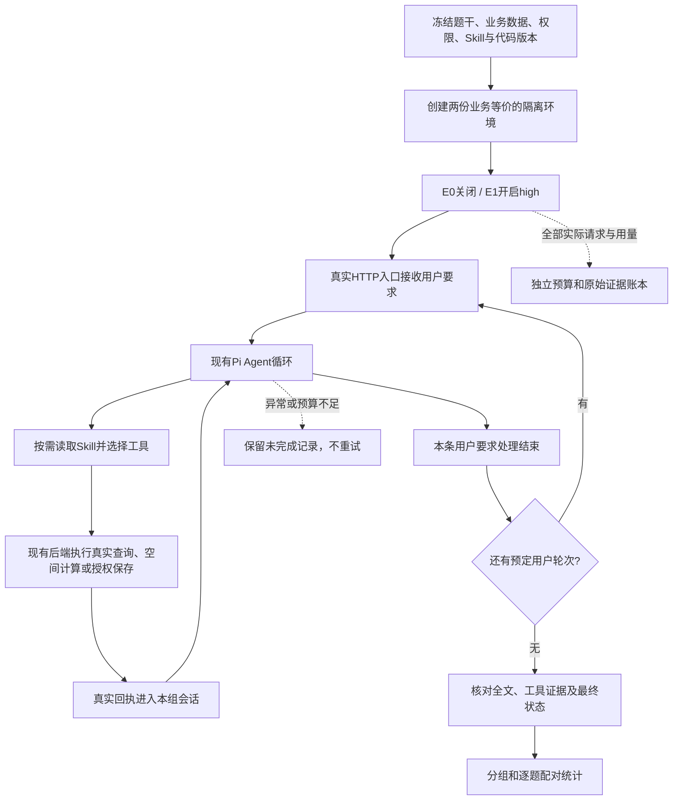

# R13 待审方案：从用户任务开始的完整流程推理对照

> 2026-10-25。当前仅获准写方案与预算，尚未获准实施或真实测评。工作分支 `codex/agent-result-grounding`，沿用现有独立 worktree。本轮独立保存；R12 原方案、程序、成绩、失败及补充记录全部保留。

## 1. 这次要回答什么

**让 Agent 自己找数据、调用工具、处理返回结果，直到给出最终回答或明确无法完成，再比较开启和关闭推理的效果。** 工具请求是正常中间步骤，不再在第一次工具请求处停止。

R12 只观察同一份已有证据之后的下一次响应，因此不能回答完整任务能否完成。本轮从最早一条业务用户要求开始，新建隔离会话，不提供旧模型的查询路径、工具结果、思考、最终回答或评分。多轮任务按预先确定的顺序发送后续用户要求。

本轮只比较推理配置。Skill 正文、工具实现和业务规则固定；两组均正常按需加载 Skill，不预加载正文。这样能够观察真实的读取、查询、计算和解释过程，但仍是五类已知开发题，不能称为生产总体准确率或新保留集验收。

## 2. 分组与数量：10 次完整运行，不是 10 次模型请求

| 项目 | E0：关闭推理 | E1：请求开启推理 |
| --- | --- | --- |
| 模型 | 同一 Agent Plan Flash | 同左 |
| 配置 | `thinking.type=disabled`，不传 effort | `thinking.type=enabled`，`reasoning_effort=high` |
| 每项任务次数 | 1 次 | 1 次 |
| Skill 加载 | 正常按需加载 | 正常按需加载 |
| 工具循环 | 执行工具，继续模型调用到本轮结束 | 同左 |
| 单次输出额度 | `max_tokens=32768`，含思考 | 同左 |
| 其余采样参数 | `top_p=1`，不传 temperature | 同左 |

固定请求别名 `deepseek-v4.1-flash`、Agent Plan 入口 `https://ark.cn-beijing.volces.com/api/plan/v3`，实际返回版本沿用已验证的 `deepseek-v4-1-flash-261017`。版本变化时停止核查，不合并不同版本成绩。父流程、原生子任务及压缩如产生模型请求，均纳入对应组的设置检查和总预算。

**为什么从原 6 份材料变成 5 项任务：** C03 和 C06 都来自 Q05，原始用户要求、图层、对象、几何和属性一致。区别在于旧模型走过的读取路径、Skill 条件和截取时点。现在统一从开头运行，它们就是同一道任务；合并为 F03，避免重复计权和付费。它们暴露的“其余点更远”和“同距点”两类解释问题，仍都在 F03 中检查。

| 本轮任务 | 复用的题目来源 | 完整流程与完成要求 |
| --- | --- | --- |
| F01 来源系统车辆 | C01 / R11 Q02 | 从来源系统查西区车辆，报告资源点名称、点数 1、属性车辆数 4；不拿草稿同名点替代。查询方式的说明必须符合实际调用。 |
| F02 沿用第一次范围 | C02 / R11 Q04 | 三轮：生成 500 米预览；再生成 1500 米；最后沿用第一次固定结果筛选 resources。应得到 0 个命中，不混用第二次范围、不重新生成。 |
| F03 限定图层最近点 | C03+C06 / R11 Q05 | 从头定位基点，在 resources 的 5 点中求最近两点；给资源甲、资源乙及约 556/1225 米。允许读取其他图层定位，但不把它们加入候选。 |
| F04 预览后保存 | C04 / R11 Q06 | 两轮：先预览 500 米、不保存；随后按用户授权把同一结果保存为派生层“临时范围”。只增加该对象，不重算，不发布、不采用，核对真实状态。 |
| F05 含边界统计和方法 | C05 / R11 Q01 | 使用原悉尼草稿，报告 4 个点、内部 2/边界 2/外部 1，并说明判断方法和依据。保留“请同时说明你采用的判断方法和依据”这一已标识的构造要求。 |

五项每组共 8 条预定用户消息，两组共 16 条；每条用户消息内部可有多次模型和工具调用。按 F01 E0→E1、F02 E1→E0、F03 E0→E1、F04 E1→E0、F05 E0→E1 顺序串行执行。每个任务、每个组使用独立初始状态，不串用对方的数据变化。

## 3. 哪些能复用，哪些需要重跑

| 已有内容 | 本轮处理 | 原因 |
| --- | --- | --- |
| 原始题干、合成业务数据、几何、属性、权限口径 | 复用；重新通过真实接口创建隔离环境 | 保持问题可追溯，避免污染旧会话和真实业务 |
| 多轮题的用户要求顺序、预期名单/数量/状态边界 | 复用并在执行前冻结 | 不因模型表现临时改题或换答案 |
| R12 评分规则、错误原句和证据标准 | 复用为离线检查与复核依据 | 继续区分主任务、过程事实、最终事实、实际状态和措辞问题 |
| R12 已有 12 次单步响应，包括 9 份完整回答及 3 份工具请求 | **全部保留作历史诊断，不计入 R13 分母** | 正确的单步答案也不证明前序步骤由本组模型正确完成；历史 9 份完整回答中实际只有 6 份严格正确 |
| 其中 3 份要求补查的响应 | 本轮不单独接着跑；所属任务从头进入 E0/E1 | 只补三条会按旧输出选择样本，且开启组前序查询仍由关闭推理的历史模型完成 |
| R11 旧完整任务结果 | 仅用于选题、用量估计和失败回看，不充当 E0 新成绩 | 旧 Skill 版本、加载方式、上下文和运行日期不同 |
| R12 B 来源指引对照 | 保留原成绩，本轮不重跑、不继续改候选 | 这是另一项实验，不能混入推理对照 |
| R12 旧只生成一步的执行器 | 保留冻结；新建 R13 入口 | 避免覆盖历史运行契约，也不为五项另造 Agent 内核 |

因此，拟重新运行的是 **五项原始任务的两种配置，共十次完整运行**，包含新的关闭组。不是只重跑失败，也不再次执行 R12 的十二个固定快照。新结果与旧结果分开；可说明是否再次出现同类问题，但不能直接相减声称提高多少个百分点。

## 4. 程序如何衔接

复用现有 HTTP/Pi 工具循环、空间计算、标绘状态和隔离夹具。只在评测环境增加配置适配与记录，不修改产品默认推理设置，不改 Skill、计算算法或业务权限。

当前完整任务记录器会把实际请求强制改为 disabled，产品模型登记也标为不使用推理。不能把旧记录器原样复用后就声称 E1 已开启。实施时在 R13 的隔离适配层设置并核验每一次实际请求；优先使用已有 Pi SDK 的消息解析和回传能力，先离线证明“思考+工具请求→真实工具返回→下一次请求”的历史没有丢失或错配。细节和源码依据见 [design.md](design.md)。

同一对初始业务事实必须相同，只有正式生成的账号/会话/版本 ID、端口和时间戳允许按预声明映射比较；不能要求两份独立环境的原始 JSON 字节相同。后续工具路径和上下文允许自然不同，这正是本轮要观察的效果。

## 5. 怎样保证继续处理，而不是再次过早停止

- 只要返回有效工具调用，就交由真实工具执行，真实回执进入会话，再调用模型。不伪造工具返回，不把多次正常调用称为重试。
- 普通工具参数错误可让模型依据真实错误修正；这是任务内恢复。网络/额度/服务端异常后的同一请求重发属于重试，本轮仍禁止。
- 没有工具请求的 `stop` 只是一个用户轮次结束。多轮任务继续发送预先写好的下一条要求；单轮回答即使错误或漏答也保留，不由评分器提示“再想想”直至通过。
- 所有题干均明确来源和操作权限；重复询问题干已有信息时，最多按预先冻结的原文重述一次，不加新事实、方法或授权。真实出现普通澄清和交互 API 时分别记录；无法用题干回答的问题记需用户补充，不编造答案或批准额外操作。
- 不因首次工具调用、没有思考文本、单项超过 12 次模型请求/24 次工具调用/10 分钟而中断；后三项仅提醒检查进度。
- 有输出或工具进展的当前任务继续运行。保留 300 秒无 HTTP 数据的空闲保护，取消评测环境原先“单次请求总长 300 秒”的固定截断；完全无进展、接口/流错误、未知用量、模型漂移、冻结变更或越权操作则保留记录并停止批次。
- 开启组零思考仍可继续，记录观测；关闭组出现正思考信号则停止核查。所有请求按原配置归组，不筛除没有思考的开启组样本。
- **总预算仍有硬上限。** 开新任务对前先预留完成空间，每次实际发送前核验余额。预算不足时如实记为预算导致未完成，不能承诺无限调用直到答对，也不能自动加预算。

新一组正常工具往返不是新增测评项；重跑同一任务、网络失败后再发一次、另起一轮或增加题目则需要另外授权。

## 6. 提议预算：优先留足完成空间

历史五类完整任务在关闭推理时曾合计使用 24 次请求、481,598 输入、4,021 输出 tokens，单任务 3—8 次请求。它们来自不同 Skill 条件，只用作量级参考；两组并跑的简单倍数为 48 次请求、963,196 输入、8,042 输出，开启推理和新路径可能明显增加用量。

| 项目 | 本轮建议 |
| --- | ---: |
| 完整任务运行数 | **10 次：5 题 × 2 组 × 1 遍** |
| 初步预计模型请求 | **40—70 次**，不是承诺或验收指标 |
| 批次模型请求硬上限 | **96 次** |
| 批次输入硬上限 | **2,500,000 tokens** |
| 批次输出硬上限 | **400,000 tokens，包含思考** |
| 付费裁判、额外连通性探测 | **0 次** |
| 自动重试、第二轮、扩题 | **0 次** |

预算由两组共用并逐组公开消耗；不能通过给某组更低单任务上限制造差异。批次额度是授权上限，不是必须花完。

为减少做到一半停下：开新任务对前，至少剩余 **24 次请求、600,000 输入、131,072 输出** 的完成预留。这不是每对的硬配额；一对超出预估但仍有总额度时继续。进入批次最后 **24 次请求或 600,000 输入或 131,072 输出** 时，不再启动新任务对，优先处理已启动的一对。每次发送还必须预留当前请求完整 `max_tokens` 及保守输入估计，绝不把未知用量当作零。

预留不能数学保证任意长任务一定结束。若仍触及总上限，保留已执行部分和未开始项，报告发生在哪里，等待新增预算授权；不自动降输出上限、裁剪上下文、切模型或重跑。费用不按未经核实的人民币价格估算；实际报告 Agent Plan 请求、输入/输出和思考用量，套餐扣减与额外计费以账户记录为准。

## 7. 评分和验收口径

每组分母固定 **5 项完整任务**。报告以下几项，不能用“接口成功”代替“任务正确”：

1. **任务是否完成且必要结果正确**：全部预定用户轮次、名单、数值、方法解释和授权操作达到要求；真实状态与回执一致。
2. **严格正确**：主任务正确，过程与最终回答中的事实均有可见依据，操作边界正确，无必要遗漏。
3. **未完成原因**：等待用户、预算不足、接口/运行异常、截断、拒绝分别列出。有效工具调用是中间事件，不再作为最终“需要继续取证”分类。
4. **Skill 与路径**：何时读取哪份正文、读取后是否遵守；实际来源查询、计算、额外查询、自纠和重复操作。读取率是诊断指标，不强制每题必须读。
5. **代价**：实际请求、工具调用、输入/输出、思考用量、耗时、完成情况，均按任务和组报告。

沿用既有事实评分原则：不把“查到了关键词结果”说成“按区域 ID 过滤”；不把名字“并列”当作同距证据；不把只读分析说成已保存。全过程按陈述发生时已有的证据审查，后来的工具结果不能替之前的完成性宣称补证。明确自纠需保留前后原句，分别报告过程问题及最终是否已纠正。全文有合理解释的措辞单记表达问题，不临时按孤立词升级为事实错误。

本轮 F03 若模型实际读取了 ties 几何并有充分测距/计算依据，再说同距就按新的可见证据判定；不能照搬 R12 的失败标签。评测器知道的隐藏夹具不能替模型补证。

复核时先隐藏组别和思考文本，检查公开轨迹与实际状态，再揭示分组汇总；程序验证数量/状态，Agent 逐句证据复核，争议保留原句供用户审阅，不冒充人工金标。无需付费 LLM 裁判。

若开启组在至少 **2 项配对任务**中由不严格正确改善为严格正确，且没有新增失败、未完成增加或越权，才称为“值得进一步验证的信号”；仍不自动扩样或上线。若双方都正确，只说明未复现失败；若改善与退步并存，或样本不完整，如实报告。每组仅 5 题，一题占 20 个百分点，不能据此声称稳定提升。

**正式整体与保留集 90% 门槛不变。** 本轮为开发对照，不合并两组凑通过率，不承担正式总体验收，也不把单步成绩与完整任务成绩混算。

## 8. 审阅后实施顺序

1. 冻结 R12 全部材料和当前产品候选；选定共同基准 `6a631a4`，从该提交构建两组隔离运行时，不混入尚无改善证据的 R12 来源指引候选。
2. 实现 R13 评测适配、真实工具循环记录、题目准备和预算控制；不改产品或 Skill 内容。
3. 离线检查实际请求差异、SDK 思考历史回传、真实工具往返、完整多轮推进、按需 Skill、参数错误恢复、异常不重发、配对初态、预算及评分；校验范围见 [implement.md](implement.md)。
4. 离线检查通过后才能执行本计划。第一对 F01 同时承担真实链路观察，计入 10 次，不另设收费探测或重复跑。若链路异常保留并停止；正常则完成剩余预定任务对。
5. 形成新报告，给出五项逐题配对、两组任务正确率/严格正确率、Skill 行为、解释错误和代价。全部实际请求保留，不自动追加。

**本次审阅的决定是：采用五项去重后的完整任务、两组正常按需加载、上述预算及停止规则。批准前不实施、不进行真实测评。**

阅读本文件即可审阅范围与预算；[prd.md](prd.md)记录验收要求，[design.md](design.md)记录接口与源码依据，[implement.md](implement.md)记录实施及离线检查步骤，均只属于 R13。
