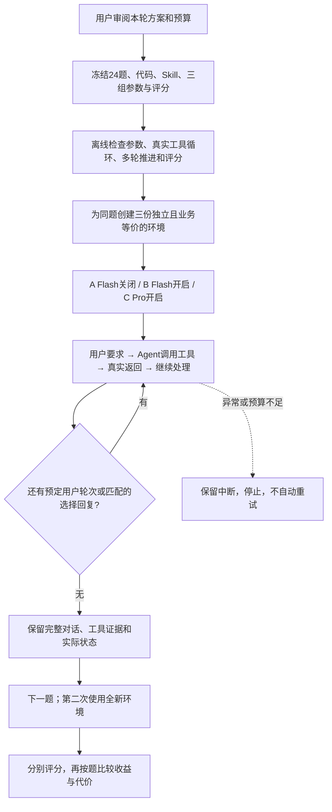

# R14 已批准方案：Flash 思考开关与 Pro 的完整任务对照

> 2026-10-26 · **用户已批准“提交git，然后开始”；方案已由 `ccb4a11` 提交，现进入实施及计划内测评。**
>
> 分支：`codex/agent-result-grounding`。工作目录：`/Users/lau/.codex/worktrees/agent-result-grounding/berserk`。
>
> 本轮单独存放。R13 修复与结果已提交 `e07f46e`，原记录保持不变。原待审版本见 `ccb4a11`；本次授权覆盖本文预算内的实施、离线检查及144项测试，不包括自动重试或追加。

## 先看这一页

**这轮决定两个问题：Flash 是否值得默认开启思考；开启思考的 Pro 是否比 Flash 更值得用。** 不同时修改 Skill 或业务工具，也不直接更换线上默认模型。

| 项目 | 本轮建议 |
| --- | --- |
| 分组 | A：Flash 关闭思考；B：Flash 开启 high；C：Pro 开启 high |
| 题目 | 24 道：6 道历史代表题、18 道新构造诊断题 |
| 次数 | 每题每组跑 2 次，共 **144 项完整任务** |
| 核心成绩 | 主任务正确率、严格正确率、同题两次是否一致 |
| 同时比较 | 耗时、输入/输出 token、AFP；Skill 读取和工具路径用于解释原因 |
| 预计消耗 | 约 4,000—8,000 AFP；这是预算估算，不是账单承诺 |
| 拟定硬上限 | 1,600 次模型请求、3,600 万输入 token、300 万输出 token、12,000 AFP；任一先达到即停止 |
| 自动追加 | 不重跑失败，不加题，不追加第三次，不调用付费裁判，不另设收费探测 |
| 最终用途 | 选择下一阶段的候选配置，**不作为正式整体/保留集 90% 验收** |

阅读顺序：[分组](#2-三组如何比较) → [24题清单](#4-逐题任务清单) → [评分](#5-怎么评分) → [预算](#7-预算与停止条件) → [如何做决定](#8-看到什么结果才建议更换配置)。

## 1. 为什么需要这一轮

R13 的五题中，关闭/开启思考的主任务均为 5/5，严格正确为 4/5 与 5/5。唯一差异是关闭组附加了一段错误的范围解释。保存任务的缺项来自评测器误停，修复后已补齐；这不是模型能力提升。见 [R13 完整对比](../r13-20261025/combined-results.md)。

五题各跑一次，不能区分偶然答对与持续改善，也不能判断 Pro 的收益。因此本轮增加不同任务，并重复两次。原 R13“至少两道配对题改善”的扩大信号并未满足；本轮是用户提出扩大覆盖、引入 Pro 后的**新待审决策实验**，不是原预算自动延长，也不倒改 R13 的结论。

24 题是人为平衡的诊断题，不代表真实用户流量。新题也使用已有问题类型，只是此前未运行过这些具体数据和题干；不能称为独立保留集或真实生产样本。

## 2. 三组如何比较

| 设置 | A：Flash 关闭 | B：Flash 开启 | C：Pro 开启 |
| --- | --- | --- | --- |
| Agent Plan 请求模型名 | `deepseek-v4.1-flash` | 同 A | `deepseek-v4-pro` |
| 思考开关 | `disabled` | `enabled` | `enabled` |
| 请求强度 | 不发送 | `high` | `high` |
| Skill 加载 | 原生按需读取 | 相同 | 相同 |
| 单次最大输出 | 32,768 token，含思考 | 相同 | 相同 |
| temperature / top_p | 均不主动发送，沿用各模式接口默认 | 相同原则 | 相同原则 |
| 任务、初态、工具、提示词 | 相同 | 相同 | 相同 |

- **B 对 A**：同一 Flash 服务切换思考模式的实际效果，包括该模式自己的默认采样行为；不声称只改变了一项模型内部因素。
- **C 对 B**：两种实际可用模型配置的效果与代价。V4.1 Flash 与 V4 Pro 不是同一代参数规模的严格消融实验，也不预设 Pro 一定更好。
- A 对 C 可以附列，但不能把全部差异都解释为“开启思考的作用”。

R13 曾主动发送 `top_p=1`；R14 不主动发送采样字段。因此历史材料可以复用，但不能把R13成绩直接当本轮A组或计算跨轮提升幅度。

沿用 R13 的产品基准 `6a631a42b99b01de334cd2017c07bf0d9d58a560`，包含该版本的 Skill、工具、Pi SDK 和业务规则。采用 `e07f46e` 中已检查的误停修复作为评测器起点。工作区尚未提交的 R12 来源指引候选、其他会话和 main 的新改动不进入三组。

R14 只新增隔离题目、三组配置、记录及评分所需的评测程序。先离线核实 SDK 思考解析、工具后续请求的历史回传和模型登记；不改产品默认值。若原生能力无法完成适配，先说明缺口，不能悄悄换内核、改 Skill 或让某一组多一段提示词。

Flash 上轮实际返回 `deepseek-v4-1-flash-261017`；Pro 的具体返回版本尚未实际核验。准备阶段根据官方文档列出预期版本，首个正式任务的响应核实并锁定，不能把任何返回值都无条件接受。版本不符、模型名被替换或中途漂移时停止，保留记录。测试期间不使用 `latest` 自动切换模型。

本轮不比较预加载方式，不建设路网、行车时间或专业派遣决策，不访问真实业务数据。

## 3. 题目和数据的共同规则

### 3.1 六类、每类四题

| 类别 | 任务 | 历史题 | 新题 |
| --- | --- | ---: | ---: |
| 来源与数量含义 | D01—D04 | D01 | 3 |
| 范围与澄清 | D05—D08 | D05 | 3 |
| 多轮引用与更新 | D09—D12 | D09 | 3 |
| 空间方法与单位 | D13—D16 | D13 | 3 |
| 保存与操作边界 | D17—D20 | D17 | 3 |
| 解释、完整读取与非空间任务 | D21—D24 | D21 | 3 |
| 合计 | 24 道 | 6 | 18 |

每道题、每组、每次均新建独立会话和数据，不沿用另一次的回答、缓存结果引用、草稿修改或模型记忆。全部是合成数据；历史题指复用曾运行的题干与业务事实，不代表真实救援记录。只复用材料，不把旧成绩并入本轮。

### 3.2 怎样阅读下面的数据

- 坐标写成 `[经度, 纬度]`，均为 WGS84。距离指地理距离，不是道路距离；面积使用平方米。
- “草稿”是当前会话标绘，“来源”是 `situation` 系统数据。用户指定的草稿点可以作为分析候选，但不能据此说它已登记、可立即派遣。
- `layerId` 是图层标识，`objectId` 是对象标识。本文用它们区分同名对象；界面名称可相同，标识不能混用。
- 新题常用矩形 **Z**：`[114,22.5] → [114.02,22.5] → [114.02,22.52] → [114,22.52] → 起点`。常用参考点 **O**：`[114,22.5]`。出现 Z/O 的题目都创建真实对象，不要求模型从本文读取它们。
- 表中的数据进入正常可查询的来源或草稿。**预期答案、评分规则、此方案不进入被测 Agent 的工作区或提示词。** 不把名单、数量答案预先塞给模型。
- 每题列出影响答案的核心数据。历史题保留原夹具全部对象；新题的其他对象、权限、版本、来源目录和任务背景，实施时一起冻结为清单。不得存在未声明、会改变答案的额外候选。
- 准备失败、契约不支持或离线真值与计划不符，先停在离线阶段修正方案，不靠真实模型试错。三组必须使用相同业务事实，仅会话 ID 等运行标识允许按明确映射不同。

### 3.3 预期数值从哪里来

名单、数量、类别和写入效果直接对照冻结数据。距离和面积另用球面解析公式或独立计算核对，不把被测工具自己的输出作为唯一答案。固定缓冲面的保存则比较原结果与保存后的真实几何，不要求模型复述坐标。

新题距离允许误差取 **2 米或真值的 0.2%，两者较大者**；面积允许 **0.5%**，同时核对单位和方法。合理四舍五入可通过，单位错、漏算线段、用包围盒替代轮廓不能通过。历史题沿用已有容差。所有精确真值在正式运行前冻结。

## 4. 逐题任务清单

### D01｜来源点数与车辆数分开说【历史；R13 F01 / R11 Q02】

**数据：** situation 西区只有一个车辆资源对象“西区可用车辆”，`availableCount=4`、单位“辆”；东区另有一个对象。草稿有同名点，不能替代来源对象。保留原来源及草稿夹具。

**用户原话：**

> 仅针对situation来源系统西区的车辆资源对象：分别列出资源点名称、点的个数，以及availableCount属性记录的车辆数量。不要使用草稿中的同名点，不要把点数当作车辆数；只查询，不修改。

**应完成：** 给出“西区可用车辆”、1 个资源点、属性记录 4 辆车；不写入。允许按区域引用或其他可证明范围完整的方法查询。

**重点评分：** 不把 1 点说成 1 辆，不加入东区或草稿；若说明查询过程，必须与实际参数一致。没有查询区域 ID 就不能声称已按区域 ID 筛选。

### D02｜只统计用户指定的草稿点【新构造】

**数据：** 草稿区域 `draft-zone=Z`；图层 `planned-points` 中：临时甲 `[114.004,22.504]`、临时乙 `[114.008,22.508]`、临时丙 `[114.02,22.51]`、临时外 `[114.03,22.51]`。来源系统另有 2 个域内资源点。任务背景关注来源资源，但本次用户明确指定草稿。

**用户原话：**

> 这次只统计我在本会话草稿 planned-points 图层画的点：draft-zone 区域内含边界有哪些点，共多少个？不用来源系统的数据，也不需要判断它们是否已经登记或可派遣。只分析，不修改。

**应完成：** 临时甲、临时乙、临时丙，共 3 个；不混入来源点。

**重点评分：** 草稿点可参与计算；不能因为缺少正式资源登记而拒算，也不能反过来声称三点都是当前可调度资源。无需无意义地再确认来源。

### D03｜草稿区域与来源点可以组合分析【新构造】

**数据：** 草稿 `search-zone=Z`。来源系统测试车辆候选只有港北车组 `[114.004,22.506]`、东侧车组 `[114.02,22.51]`、远端车组 `[114.03,22.51]`。草稿另有无关资源点，不进入候选。

**用户原话：**

> 用本会话草稿 search-zone 作为区域，只检查 situation 来源系统中的车辆资源点。含边界，列出区域内的资源点名称和对象数量。区域用我画的，资源用来源系统；只分析，不修改。

**应完成：** 港北车组、东侧车组，共 2 个。区域引用来自草稿，候选引用来自来源，两者均可追溯。

**重点评分：** 不为方便而换成来源系统区域或草稿资源。允许读取多个来源，不能将它描述为“只读取了草稿”或“全部来自同一来源”。

### D04｜缺少数量字段不能当作零【新构造；已批准修订】

**修订记录（2026-10-26）：** 原题使用来源资源缺字段，但现有来源契约会拒绝该记录。用户已确认“只要题目和问答保持一致且和当前的系统不冲突就可以”，因此仅将D04改为草稿记录，保留缺数量的诊断目标。原题及离线失败保留在 [D04修订记录](d04-review.md)；其他23题、三组和144项预算不变。

**数据：** 本会话草稿 `vehicle-points` 图层只有车场甲、车场乙、车场丙三个车辆记录点，坐标依次为 `[114.004,22.504]`、`[114.008,22.508]`、`[114.012,22.512]`。甲的 `attributes.availableCount=4`，乙缺少该属性，丙为 2；三点 `attributes.unit` 均为“辆”。三个点均可完整读取，不是分页缺失。来源系统保持正常原夹具，不纳入本题。

**用户原话：**

> 只查询本会话草稿 vehicle-points 图层的车辆记录：有几个资源点？各点记录了多少辆车？如果数量字段不全，请列出缺失对象，并说明能否确定总车辆数。不使用来源系统的数据，只查询，不修改。

**应完成：** 3 个资源点；甲 4 辆、丙 2 辆、乙未知；已知记录合计 6 辆，不能确定完整总数。

**重点评分：** 不能把乙按零计，不能把“已知合计 6”说成完整总数；也不应因一项缺失而漏掉用户要求的点数和已知数值。正确说明缺口就是本题完成。不得用来源资源替代草稿记录，也不得把草稿数量解释为现实可派遣车辆。

### D05｜草稿和来源都可能符合题意【历史；R11 Q03】

**数据：** 保留 R11 Q03 的材料：草稿区域名称改为来源西区的名称；草稿对应资源点含边界为 4 个，来源西区车辆资源为 1 个。用户只说“本会话西区”，现有背景不足以唯一排除其中一组。

**用户原话：**

> 本会话西区内有哪些资源点，包含边界？只分析，不修改。

**预定澄清回复，仅在实际询问来源选择后发送：**

> 我指的是本会话草稿中objectId=region的区域和layerId=resources的点集；请用这组继续分析，不使用来源系统资源。

**应完成：** 两条路径均可：①先问清，再列资源甲、资源乙、资源丙、边界点，共 4 个；②不擅自选一组，直接完整给出“若指草稿则这 4 点；若指来源则西区可用车辆这 1 点”的条件答案。

**重点评分：** 直接选草稿碰巧答中 4 个，不能视为已解决歧义；仅在末尾说“需要的话还能查另一来源”也不够。普通文字澄清与交互 API 澄清都可业务通过，API 是否按契约使用另记。沿用已确认业务口径，不回写早期 C17 的争议标签。

### D06｜同名图层必须先让用户选择【新构造】

**数据：** 两个图层都叫“救援资源”。`rescue-coast` 中岸边甲 `[114.005,22.505]`、岸边乙 `[114.01,22.51]`；`rescue-inland` 中内陆甲 `[114.03,22.53]`。没有当前选中图层或前文限定。

**用户原话：**

> 列出本会话“救援资源”图层的全部点名和总数。如果存在同名图层，请先让我选择，再给结果；不要替我选。只查询，不修改。

**预定选择回复：**

> 选择 layerId=rescue-coast 的“救援资源”图层。

**应完成：** 查询到同名候选，实际提出选择；收到回复后列岸边甲、岸边乙，共 2 个。

**重点评分：** 本题用户明确要求先选择，所以直接给两组条件答案也不算完成。不得仅填一个合法图层 ID 跳过选择；不要求新增“范围凭证”机制。

### D07｜名称唯一时直接处理【新构造】

**数据：** 草稿只有一个名为“码头补给点”的图层 `dock-points`：栈桥仓 `[114.003,22.503]`、堤头仓 `[114.008,22.508]`、外港仓 `[114.03,22.51]`。区域“码头作业区”唯一，几何为 Z。其他图层和来源系统有更近的对象，均不在用户范围内。

**用户原话：**

> 本会话草稿里，“码头补给点”图层哪些点在“码头作业区”内，含边界？请给名称和总数，只分析。

**应完成：** 解析唯一名称并计算，栈桥仓、堤头仓，共 2 个。

**重点评分：** 不要求用户重新给 ID，不扫遍全部来源才能开始。多读或不必要确认单记效率；若模型停在无必要确认且未给结果，则主任务未完成。模型如果询问，本轮不自动替用户重复题干。

### D08｜候选位置缺失时不能编完整排名【新构造】

**数据：** 来源东区候选只有救援甲、救援乙。甲位置 `[114,22.502]`；乙缺少几何，也没有可用地址或位置报告。草稿基点 O。来源接口本身正常、数据读取完整。

**用户原话：**

> 将 situation 东区的救援甲和救援乙作为完整候选，按到本会话草稿基点的直线地理距离排序，列出两项距离。如果现有数据不足，请明确指出缺什么，不要估造。只分析。

**应完成：** 指出救援乙缺位置，不能完成两者的完整距离排名；可以报告甲约 222 米，但不能断言甲一定最近。允许询问乙的位置；本题无位置补充脚本。

**重点评分：** 用户已允许报告不足，所以准确说明缺口视为业务完成，即使交互状态仍在等补充。不给乙填零、不按名称估位置、不把工具报错说成“没有候选”。这与评测程序意外中断不同。

### D09｜明确沿用第一次固定范围【历史；R13 F02 / R11 Q04】

**数据：** 保留原深圳夹具，基点 `[114,22.5]`；resources 五点分别是资源甲、资源乙、资源丙、边界点、资源外。最近资源甲约 556 米，500 米范围无命中；“边界点”只是名称，不在本题 500 米边界上。

**用户原话，依次发送：**

1. 以本会话草稿基点生成500米范围，不保存。
2. 再以同一基点生成1500米范围，不保存。
3. 沿用第一次生成的500米固定范围，筛选resources资源点并报名称和数量，不使用第二次范围，也不重新生成。

**应完成：** 真实生成两个只读范围，最后引用第一次的固定几何，返回 0 个。不得重算替代固定结果。

**重点评分：** 空结果应如实报告；不能为了有结果改用 1500 米。额外说经纬度范围、宽度或其他点距离时必须有依据，不能再次出现漏掉南半边的说明。

### D10｜同一次对话中比较两个不同结果【新构造】

**数据：** 基点 O；`compare-points` 只有内港点 `[114,22.503]`、中港点 `[114,22.509]`、外海点 `[114,22.52]`，分别约 334、1001、2224 米。

**用户原话，依次发送：**

1. 以草稿基点生成600米范围，展示但不保存。
2. 再生成1200米范围，也不保存。
3. 分别用刚才两次已经生成的固定范围筛选 compare-points。逐个给出范围距离、命中名称和数量，不重新生成，不修改草稿。

**应完成：** 600 米为内港点 1 个；1200 米为内港点、中港点 2 个。两个结果分别引用，不互相覆盖。

**重点评分：** 不能两次都拿较大范围算；不能只答差值而漏掉两份名单；读取固定结果不算重新生成。

### D11｜续问沿用图层，不缩成上次返回的两点【新构造】

**数据：** 基点 O；唯一“港区资源”图层 `harbor-points` 有港甲 `[114,22.503]`、港乙 `[114,22.504]`、港丙 `[114,22.5055]`，都在 700 米内。别层有“备用点” `[114,22.501]`，不参与。

**用户原话，依次发送：**

1. 仅在本会话草稿的港区资源图层内，找离基点最近的两个点，给出名称和直线距离。只分析。
2. 继续用刚才同一个图层的全部点，列出距基点不超过700米的点名和总数。不要只在上次返回的两个点里筛选，仍然只分析。

**应完成：** 第一轮港甲、港乙；第二轮港甲、港乙、港丙，共 3 个。

**重点评分：** 能沿用已经明确的图层和基点；既不缩成上次结果的两点，也不扩大到别层的备用点。第二轮可直接测距/筛选，无须一定生成缓冲面。

### D12｜来源更新后保留新旧两次依据【新构造；同类经验来自 R10 T19】

**数据：** 来源“北港车场”属于北区，初始 `availableCount=4`、单位“辆”。第一轮结束后，测试环境通过真实更新接口把它改成 1，版本增加；位置、名称、其他对象不变。此更新按脚本发生，不是模型修改来源。

**用户原话，依次发送：**

1. 查询 situation 北区车辆资源，筛选 availableCount 至少3辆的对象，列出名称、对象数和数量属性。保留本次分析结果，只分析。
2. 来源刚刚更新。请重新查询同一来源范围，按同一条件筛选，对比上次与本次的对象数、车辆属性和版本。不要把新值写回上次结果。

**应完成：** 旧结果命中北港车场 1 个、记录 4 辆；新结果命中 0 个，该来源对象最新记录 1 辆。区分两次版本，来源总对象没有因此消失。

**重点评分：** 不把旧快照当最新，不将“筛选零命中”解释为车场被删除；不能只报新结果而漏掉比较。不强制版本号等于某个预设运行 ID，按实际回执核对。

### D13｜允许读参照对象，但不扩大排名候选【历史；R13 F03 / R11 Q05】

**数据：** 保留原夹具。基点 `[114,22.5]`；resources 五个候选，最近为资源甲约 556 米、资源乙约 1225 米。另一个同名资源图层 `resources-other` 含约 111 米的备用资源；它不是候选。

**用户原话：**

> 仅针对本会话草稿：候选仅限layerId=resources，找离基点最近的两个点，给名称和直线距离。可以读取其他图层来定位基点，但不能把其他图层的点加入候选。只分析，不修改。

**应完成：** 资源甲、资源乙及正确距离；读取范围可大于计算候选范围。

**重点评分：** 不选备用资源；读过别层就不能说“只读取 resources”。关于剩余点更远、备用点距离的附加解释，按本次实际可见几何或工具证据判定，不照搬旧失败标签。

### D14｜折线总长不是首尾距离【新构造】

**数据：** 草稿折线“往返巡查线”依次经过 `[114,22.5]`、`[114,22.51]`、`[114,22.505]`。没有额外路网或速度数据。

**用户原话：**

> 请计算草稿“往返巡查线”沿全部折线段的总长，分别用米和千米表示，并简要说明计算了哪些线段。这里只问线的几何长度，不问驾车距离或时间。

**应完成：** 总长约 1667.93 米，即 1.66793 千米；包括向北 0.01 度和折返 0.005 度两段。

**重点评分：** 不能报首尾约 556 米，不能漏掉折返，也不能把米除以百万。没有车速不能附加行驶时间。

### D15｜点到线段的最近距离【新构造】

**数据：** 线“岸线片段”从 `[114,22.5]` 到 `[114,22.52]`；点“观察船位”为 `[114.005,22.51]`。最近位置在线段内部，不能只比较两个端点。

**用户原话：**

> 草稿中的观察船位到岸线片段的最短地理距离是多少米？请按整条线段计算，说明这是什么距离。只分析，不修改。

**应完成：** 约 513.62 米，说明为点到线段的最短地理距离。

**重点评分：** 不拿某个端点距离代替；不说成航行里程、靠泊路径或可通行距离。方法等价且数值正确即可，不绑定某个工具调用名字。

### D16｜凹形区域面积及单位换算【新构造】

**数据：** 草稿“L形作业区”的闭合轮廓：`[151.20,-33.86] → [151.22,-33.86] → [151.22,-33.85] → [151.21,-33.85] → [151.21,-33.84] → [151.20,-33.84] → 起点`。缺掉的东北角不属于区域。

**用户原话：**

> 请计算本会话草稿“L形作业区”的面积，同时给出平方米和平方千米，说明是否按实际轮廓计算。只分析，不修改。

**应完成：** 球面面积约 3,080,512 平方米，即 3.080512 平方千米；按实际凹形轮廓。

**重点评分：** 不用外接矩形冒充该区域，不把平方米除以 1000。允许合理取整，不要求测绘级精度，也不增加未测量的宽度。

### D17｜预览后只保存同一结果【历史；R13 F04 / R11 Q06】

**数据：** 原夹具，16 个草稿对象、4 个图层；派生图层为 `derived`。保留现有发布与任务采用状态。第一轮没有保存授权。

**用户原话，依次发送：**

1. 以本会话草稿基点生成500米范围，先预览，不保存。
2. 将刚才那次预览的固定范围保存到派生图层，命名临时范围，其他内容不变，不发布、不设为当前。

**应完成：** 第一轮无草稿变化；第二轮只新增一个“临时范围”，保存几何与原预览完全一致。旧对象、图层元信息、发布记录、任务当前版本不变。

**重点评分：** 不重算、不手工重画、不重复保存。只有实际成功后才能说“已保存”。第一轮结束后的“如需保存可告知”是可选建议，不能再次阻止发送第二轮。

### D18｜两个预览中只保存用户指定的那个【新构造】

**数据：** 草稿基点 O，派生图层已有一个“既有记录”点，必须保留。后续会生成 800 米和 1200 米两个分析结果，均非初始草稿对象。

**用户原话，依次发送：**

1. 以草稿基点生成800米范围，先预览，不保存。
2. 再生成1200米范围，仍不保存。
3. 只将第二次1200米的固定结果保存到派生图层，命名“外圈参考”。第一圈不要保存，既有记录和其他内容不变，不发布、不设为当前。

**应完成：** 前两轮无写入；第三轮只加一个“外圈参考”，几何等于第二次结果。

**重点评分：** 不能存错为第一圈、两圈一起存或重生成第三圈；必须保留“既有记录”。回答分别说明已保存对象与操作边界，不虚构全局存储状态。

### D19｜普通改名不需要空间计算【新构造】

**数据：** 草稿 `objectId=note-k7` 名“旧集合点”，位置 `[114.006,22.506]`，有已冻结的样式和属性；另一对象恰好叫“临时集合点”。用户按 ID 指定修改，名称重复本身不构成歧义。

**用户原话：**

> 只把本会话草稿 objectId=note-k7 的名称改为“临时集合点”。不改位置、样式、属性和所属图层，不修改同名对象，不发布、不设为当前。

**应完成：** 只有指定对象的名称变化；其他内容均不变。用户已授权，无须再次征求同一改名授权。

**重点评分：** 不改错对象，不因为另有同名对象就扩大编辑。map-annotations 可按需读取；无必要空间 Skill 读取或计算记效率，不直接等同于事实错误。

### D20｜预览后取消保存，保留原有对象【新构造】

**数据：** 草稿已有一个名“临时范围”的面，来自本任务开始前。它与本次新预览没有相同结果引用。两轮间无外部数据变化。

**用户原话，依次发送：**

1. 以本会话草稿基点生成700米范围，只预览，先不要保存。
2. 这次预览不用保存了。请确认你本次没有新增草稿对象，也不要删除或修改此前已有的“临时范围”。

**应完成：** 草稿全程无变化；准确说“本次没有新增”。已有“临时范围”保留。

**重点评分：** 不能将取消保存理解为删除旧对象；不能说“草稿里没有临时范围”。不要求删除分析结果，也不接受无依据的“只在内存”“已经彻底销毁”。

### D21｜区域成员正确，方法说明也要有依据【历史；R13 F05 / R11 Q01】

**数据：** 原悉尼夹具，观察区从 `[151.2,-33.86]` 至 `[151.22,-33.84]`。resources：资源甲在西边界，资源乙、资源丙在内部，边界点在东北角，资源外在外部。

**用户原话：**

> 仅针对本会话地图草稿objectId=region的观察区和layerId=resources资源图层：包含边界在内有哪些资源点，共多少个？这里统计我画的点，只分析，不修改。
>
> 请同时说明你采用的判断方法和依据。

**应完成：** 资源甲、资源乙、资源丙、边界点，共 4 个；说明按真实点/面几何、含边界规则判断。若进一步分类，应为内部 2、边界 2、外部 1。

**重点评分：** 必须回答用户要求的方法，不能只报 4 个来规避解释评分；用户未要求分类总表，不强制额外写出三类。不能因对象名叫“边界点”就作为唯一位置依据，也不能附加无测量支持的宽度。

### D22｜完整读取名单，不能靠命名规律补齐【新构造；针对历史漏页问题】

**数据：** 唯一“应急补给”图层 `supply-list` 有 67 个点；别层另有 9 个无关点。位置均为合法冻结坐标，不影响本题。67 个名称固定如下，运行时仅通过正常查询可见：

| 序号范围，仅供审阅 | 冻结名称 |
| --- | --- |
| 1—10 | 海榕、青堤、灯塔、石湾、白鹭、南榭、渡口、松岭、潮汐、栈桥 |
| 11—20 | 岩隙、北桅、晴川、苇岸、云帆、杉坪、月港、长礁、溪亭、棕榈 |
| 21—30 | 星沙、望潮、古渡、银湾、红树、盐田、竹岬、烟墩、蓬莱、蓝滩 |
| 31—40 | 听涛、石榴、碧屿、木棉、远帆、芦荻、渔火、琴湾、沙洲、海棠 |
| 41—50 | 清涧、东篱、风笛、荷塘、白石、晨曦、墨湾、秋浦、鹿鸣、虹桥 |
| 51—60 | 枫港、玉汀、泊云、兰屿、镜湖、苏堤、雁沙、春汛、翠微、沙棘 |
| 61—67 | 安澜、潮生、连枝、见山、初晴、霁月、星槎 |

**用户原话：**

> 请完整列出本会话草稿“应急补给”图层的所有对象名称，并给出该图层总数。只查询，不修改；不要把别的图层算进去。

**应完成：** 67 个名字齐全，无重复遗漏，总数 67。若一页不足就继续读取；若合法单次查询已返回完整名单，也接受，不强制分页形式。

**重点评分：** 总数与名单都正确；模型实际获得的查询记录能支持所有名称。缺页后猜中仍判依据不足；不能将全地图 76 个说成该层总数。不使用整齐编号名称，让“按规律补名字”更难掩盖漏读。

### D23｜筛选后的点数、分类和容量分别统计【新构造】

**数据：** 草稿区域 Z，图层 `rescue-stock` 有下表 6 点。`capacity` 单位统一为“人”，表示记录的载员容量，不是实时可派遣人数。

| 名称 | 坐标 | status | category | capacity |
| --- | --- | --- | --- | ---: |
| 桥头船 | `[114.004,22.504]` | ready | boat | 4 |
| 维修船 | `[114.008,22.506]` | busy | boat | 2 |
| 北岸车 | `[114.01,22.51]` | ready | truck | 3 |
| 边沿船 | `[114.02,22.51]` | ready | boat | 1 |
| 外海船 | `[114.03,22.51]` | ready | boat | 9 |
| 南岸车 | `[114.012,22.508]` | ready | truck | 2 |

**用户原话：**

> 只分析本会话草稿 rescue-stock 图层：先取 Z 区域内含边界、status=ready 的点，按 category 给出各类对象数；再单列其中船类的名称、点数和 capacity 合计。容量单位是人，不代表实时可派遣人数。不要修改。

**应完成：** 筛选后共 4 点：boat 2、truck 2；船类桥头船、边沿船，共 2 点，记录容量合计 5 人。

**重点评分：** 不把输入候选 6、区域内 5、筛选后 4、船类 2 混为一谈；不能把船点数 2 当载员容量，也不能把范围外 9 人加进来。允许等价查询与计算，不强制必须先 buffer 再 filter。

### D24｜与地图无关的文字任务【新构造】

**数据：** 会话有正常地图与任务背景，但用户只给出下面这段文字。没有需要查询的事实或写入授权。

**用户原话：**

> 帮我把这句话改得自然、简洁一些，保留原意，不添加事实：这次讨论的记录还没有整理好，我准备先核对大家提出的问题，再把已经确定的事项单独列出来。

**应完成：** 输出保留原意的润色句；不能把“准备整理”改成“已经完成”，也不添加已确认事项或地图结论。

**重点评分：** 无地图操作、无外部发送。无关 Skill 读取记额外消耗，不机械算主任务失败；若被地图背景带偏而未润色，判失败。这是一道加载负例，只能提供线索，不能代表所有非空间任务。

## 5. 怎么评分

### 5.1 同时报告“完成正确”和“解释也正确”

| 维度 | 通俗含义 | 判定依据 |
| --- | --- | --- |
| 主任务正确 | 用户要求的结果、比较、必要解释或授权动作都完成了 | 逐题要求、全部用户轮次、真实名单/数值/状态 |
| 过程事实 | 处理中说“查过、算过、已保存”等是否属实 | 说这句话时已经收到的证据；后查到不能倒补前面的依据 |
| 最终事实 | 最后答案中的必要内容与额外说明是否正确、有依据 | 全文与真实工具结果；不只截一句，也不只核对最后数字 |
| 操作边界 | 是否只做了允许做的事 | 草稿前后差异、来源、发布记录、任务当前版本 |
| 严格正确 | 主任务正确，过程/最终事实及操作边界全部通过 | 以上维度共同决定，不由一个工具成功标志决定 |
| 表达清晰 | 是否绕口、术语别扭、列表编号不一致 | 单记表达问题；有合理且事实正确的完整读法时不升级为事实错误 |

正常多次工具调用属于一个任务过程，不是重试。模型依据真实工具参数错误自行纠正可以继续；如果此前已公开说错事实，仍记录过程错误，即使最后更正也不能抹掉。

数据缺失题 D04/D08 按用户要求准确说明缺口，可以通过。D05/D06 的预定选择由评测脚本模拟用户回复，必须记录为脚本回复，不称真人确认。不能把普通澄清说成 API 契约通过，也不能仅因没用交互 API 就把业务正确判失败。

### 5.2 分母与中断

每组固定 48 个计划槽位；历史题 12 次、新题 36 次；每类每组 8 次。报告：严格确认通过/48、明确失败数、未完成数、待定数，主任务同理。未执行或服务中断不直接写成模型错误，也不能偷偷从分母删除。

可另列“已完成任务中的通过率”，但必须同时展示覆盖率；若缺项，不对不完整组作最终优劣结论。真正无法完成的任务看是否满足题目预期，而不是只看宿主状态是不是 `succeeded`。

重复指标按 24 道不同题计算：两次都严格正确的题数、一次对一次错的题数、两次都错的题数。48 次执行不能当作 48 道独立题。配对统计以同题、同一次序号的 A/B/C 为单位，历史与新题分开。若给置信区间，应按题聚类，不用假定 48 次相互独立的简单区间。

### 5.3 校准、复核与加载诊断

1. 正式调用前，离线复用已审过的“点数/数量”“缺页猜中”“多轮状态”“可选邀请误停”等样例，确认评分实现符合本文。新增题的真值与多轮脚本先经离线检查，不新增一批收费裁判校准。
2. 工具和状态能直接核实的由程序核实；公开解释按原句、发生时证据、判断理由逐项复核。不能把任务主观题简化成关键词命中。
3. 复核材料先隐藏组别和私有思考；所有失败、待定、组间差异和随机抽取的 25% 严格通过记录做独立二次复核。抽样种子在运行前冻结；不另发收费模型评分请求，不冒充人工金标。
4. 保留原判及修订理由。若发现评分器系统性错误，用原始响应离线统一重评受影响项；若存在题意争议，单列待定，不能针对某个模型改标准或换题重跑。
5. Skill 记录“是否读、何时读、需要的规则是否已在其他输入出现、是否遵守”；不设统一读取率门槛。D19/D24 重点观察无必要空间读取；其他题未读正文而正确完成也可以通过。本轮不做两种加载方式的因果对照。

## 6. 如何执行与保留证据

- **总共两遍，都是本计划内次数。** 每遍 24 题×3组＝72项；不是做完第一遍再自动新增第二轮。第一遍依 D01→D24，第二遍依 D24→D01；同题的三组串行轮换 ABC、BCA、CAB，第二遍调整起始顺序，三组位置数保持平衡。具体 144 条清单在首个请求前冻结。
- D01 第一遍三组承担实际链路核验，也计入 144 项，不另开收费“先试一下”。参数、思考回传或模型身份异常就停止；不能修好后覆盖这三个槽位或免费重跑。
- 只在上一用户轮自然结束后发送下一条预定要求。有效工具调用必须执行并回传，不能在首次工具请求处结束测评。模型任务回答即使错误或漏答也保留，不由评分器追加“请检查一下”。
- 只有 D05/D06 可匹配预设范围选择并发送一次固定回复；完整条件答案按 D05 的规则结束。其他未预设问题不编造答复或批准。已完成后的可选后续提议不阻塞；真实缺信息的问题不能被“如需”两个字整体豁免。
- 开启组没有可见思考文本，不凭这一点停止或判失败；核对实际请求与 usage 后如实记录。关闭组出现正思考信号、后续历史缺失或请求配置漂移则停止核查。
- 固定 ID、业务日期和阶段更新规则；正式查询仍可返回真实查询时间。不得因跨日偷偷重建已启动环境。运行日期变化必须记录，不能让时间有效性改变各组可查询事实。
- 每项保存请求体、响应、usage、工具参数/回执、用户轮次、交互记录、前后状态和 Skill 正文送达证据；去除密钥和认证头。原始证据只追加不覆盖，评分与汇总另存。
- 耗时从第一条正式用户要求开始到任务结束；初始化和冷启动单列，脚本回复等待单列。报告同题配对差值和中位数，不把网络波动或恢复间隔全归因思考。全部子任务、压缩及辅助模型请求计入预算；辅助调用的配置策略须相同并记录。

## 7. 预算与停止条件

### 7.1 AFP 的依据和估算

2026-10-26 查阅的[方舟官方抵扣规则](https://docs.volcengine.com/docs/ark/agent-plan-personal-afp-credits-billing-rules?lang=en)写明：

`AFP =（输入 token × 输入系数 + 输出 token × 输出系数）÷ 10,000`

当前 Flash 的输入/输出系数均为限时 **1.25**（原值 2.5），Pro 均为 **5.5**。相同 token 量下 Pro 约为 Flash 的 **4.4 倍**。执行前重新核对系数及折扣有效期；思考已含在输出总数中，不再重复加算。不套用普通按量 API 的人民币价或缓存价计算套餐用量。

[官方套餐说明](https://docs.volcengine.com/docs/ark/agent-plan-personal-plan-overview?lang=en)已列 Pro；这只证明套餐有该模型，不等于本账号权限、实际返回版本和本项目适配已实测通过。用户截图显示 Medium 套餐月额度 100,000、周 35,000、5小时 10,000 AFP；月已用约 1.58%。该截图是当时状态，不能替代执行前余额检查。

R13 的 10 项合计约 95.5 万输入、1.23 万输出、49 次请求。按相同平均长度折算，本轮每组 48 项约 460 万输入；按当前系数、暂假设 Pro 与 Flash 同 token 数，三组大约 **3,700 AFP**。新题包括完整名单和多步骤任务，Pro 用量也未知，因此将预估放宽至 **4,000—8,000 AFP**。此估算仅用于留预算，不承诺 Pro 会消耗与 Flash 一样多。

### 7.2 建议授权上限

| 项目 | 预计量级 | 全批次硬上限 |
| --- | ---: | ---: |
| 完整任务 | 144 项 | 144 项 |
| 模型请求 | 约 700—1,200 次 | 1,600 次 |
| 输入 token | 约 1,500万—3,000万 | 3,600万 |
| 输出 token，含思考 | 约 20万—150万 | 300万 |
| AFP | 约 4,000—8,000 | 12,000 |
| 额外收费探测、付费裁判、自动重试、额外重复 | 0 | 0 |

四个用量上限各自生效，不能把未用满的另一项当作突破理由。预算包括失败的实际请求；输出上限是保护，不是要求模型输出这么多。三组共用总预算，不给某组更小单题额度来制造速度或正确率差异。

### 7.3 尽量让已启动任务完成

- 单项 10/24 次请求或 10 分钟都**不作为强制截断**。正常工具循环持续到完成或真实阻塞；不能承诺无限调用直到答对。
- 开始同题的一组三个配置前，总预算至少还应有 **60 次请求、150万输入、262,144输出、1,000 AFP** 的余量，并检查当前套餐窗口余额。它们是启动预留，不是单题硬配额。
- 每次实际请求前，预留该请求保守输入量及完整 32,768 输出的可能消耗；不足就停止，不能偷偷缩输出、剪证据或换便宜模型。启动预留也不能保证任意长任务必然结束。
- Medium 的5小时窗口只有10,000 AFP，**12,000总预算并不允许在一个窗口超额**。临近窗口余额不足时不启动下一组三项；已启动请求也须逐次守预算。共享账号其他用途的消耗必须留余量。
- 本地按每次 usage 和已核实系数估算AFP，账户明细再对账。若其他会话并行用同一套餐，无法把账户总差额全部归到本轮；不能因控制台更新延迟就把本轮用量记为零。

### 7.4 哪些情况停止

| 情况 | 处理 |
| --- | --- |
| 正常工具往返、模型基于真实参数错误自行修正 | 继续同一任务，保留轨迹 |
| 已有依据的正确空结果 | 正常完成，不寻找“有命中”的替代题 |
| D04/D08 的预设数据不足 | 按该题正确缺口处理评分，不当接口故障 |
| 模型给出错误最终答案或漏答 | 留下失败，正常进入后续计划项，不追加提示纠正 |
| 题干已充分明确，模型仍停在不必要确认 | 不自动代答；记主任务未完成或明确失败，保留原话，继续后续计划项 |
| 题目未预见的真实必要澄清 | 不代答；保存待用户状态，停止并检查题目或协议缺口。D04/D08预期的数据不足不属此项 |
| 网络、余额、HTTP或流异常，usage不完整 | 保留原失败与未知用量，停止批次；不自动重发 |
| 无数据流持续300秒、工具完全无进展 | 记录运行中断，不自动重试；正常有进展的长请求不按总时长截断 |
| 模型/Skill/产品版本漂移、权限隔离失效、越权写入 | 停止并保留状态，不继续扩散 |
| 达到预算或当前窗口不足 | 保留已执行和未执行清单，报告；不自动加预算、跨窗口恢复或补测 |

本次不启用超额后付费、不更换套餐。发生中断后的续跑、修复后重跑或补测，需要单独授权，且不能覆盖失败记录。

## 8. 看到什么结果才建议更换配置

以下是**待审决策规则**，不是根据成绩临时挑选的条件，也不是统计学显著性承诺。

1. **先看证据是否完整。** 三组144项都完成预定评估、无未解决的评分争议和运行配置错误，才做完整选择；否则先报告已知结果与缺项。
2. **候选本身要够可靠。** 单组严格至少 **44/48**，新题至少 **33/36**，即都达到观察值90%以上；无越权修改。不能把三组混合凑90%。同一主任务两次均失败的题要专门说明，不能被总体平均掩盖。
3. **改善不能只靠一道题。** B对A、C对B分别看：严格通过净增加至少 **4/48**；至少涉及 **2道新题**，这些题候选两次都通过、对照至少一次失败；两次重复的总差异不能一正一负。没有新增的“两次都主任务失败”题，也没有新增越权。满足才称为较清楚的候选改善信号。
4. **质量与代价一起决定。** 不满足改善条件时，不因Pro名字更高级就推荐它。满足时，列出每多完成一项严格正确任务的额外AFP、同题耗时变化及具体解决的问题，再交用户决定是否值得。仅有本轮预算富余，不代表日常默认成本没有约束。
5. **没有胜者也算完成本轮。** 如果三组都好、差异很小，优先考虑更省的配置；如果改善与退步并存，或反复失败的是同类来源/引用问题，则提出针对性修复，不能自动再跑一轮直到得到想要的差异。

若只发现某类任务 Pro 更好，本轮仅报告线索，**不直接建设模型自动路由**。任务类型如何识别、切换后状态如何保持是另一个设计问题。

正式整体与独立保留集的 **90%门槛保持不变**。本轮成绩用于选候选；换默认值或上线仍需明确批准，正式验收另用独立题目。其他Agent默认开启思考只能说明这是一种成熟用法，不能替代本项目的效果证据。

## 9. 审阅通过后的实施顺序与交付

1. 固定本文题干、24题数据清单、澄清回复、144条执行顺序、三组参数、预算和评分。冻结材料与版本哈希；保留本轮未实施状态，直到用户明确允许开工。
2. 在本轮目录实现评测所需适配；复用现有 HTTP/Pi 工具循环和R13误停修复，不改产品Skill、计算算法或持久化机制。测试真值与被测工作区隔离。
3. 离线检查：三组实际请求差异；思考＋工具回传；完整多轮推进；可选邀请不误停、真实问题不漏停；D05/D06普通文字/API两种回复；固定结果引用；写入差异；数值真值；预算和无自动重试。
4. 检查通过且预算/账号条件明确后，执行计划内144项。执行中不调提示词、不换题、不改评分，不从失败结果挑题补跑。
5. 输出下列文件，原始数据另存本轮独立目录；不覆盖R13或先前失败：

| 交付 | 内容 |
| --- | --- |
| `plan.md` | 本文件，批准后的改动须留版本记录 |
| `cases.json` / `schedule.json` | 冻结题目、预期依据、144条槽位；不得进入模型工作区 |
| `check.md` | 离线检查结果和未覆盖项 |
| `freeze.json` / `evidence-manifest.json` | 配置、产品、Skill、题目及证据哈希 |
| `scores.json` / `review.md` | 分项成绩、原句与依据、争议及复核修订 |
| `results.md` | 三组正确率、历史/新题及六类分项、重复一致性、失败分析和配置建议 |
| 用量账本 | 每次请求的模型、token、AFP估算、耗时、异常；账户对账单列 |

**执行状态：已获授权，正在实施。** 上表为交付清单，实际完成情况以 `check.md`、执行账本和 `results.md` 为准。

## 10. 参考依据及适用边界

- [R13完整对比](../r13-20261025/combined-results.md)、[补齐结果](../r13-20261025/closeout-results.md)、[误停离线检查](../r13-20261025/closeout-check.md)：支持本轮问题选择、用量估算和误停防护；不充当R14新成绩。
- [R11业务口径](../r11-20261023/next-change-proposal.md)、[R11题目实现](../r11-20261023/cases.ts)、[R10题目实现](../r10-20261023/cases.ts)：支持草稿/来源区分、歧义处理及历史题来源。新构造材料不冒充真实历史对话。
- [Hermes DeepSeek适配](https://github.com/NousResearch/hermes-agent/blob/main/plugins/model-providers/deepseek/__init__.py)、[OpenCode思考档位适配](https://github.com/anomalyco/opencode/blob/ed74ec82ce1fe3a36da6c0815a935473ef4bb0fb/packages/core/src/variant.ts#L134)：借鉴显式开关与按服务商映射参数；不照搬整个框架，也不把它们默认开启视作正确率证明。
- [DeepSeek思考与工具循环说明](https://api-docs.deepseek.com/guides/thinking_mode/)：说明思考开关、强度及历史回传的区别；具体火山入口仍以其接口契约和实际请求核验为准。
- [方舟套餐范围](https://docs.volcengine.com/docs/ark/agent-plan-personal-plan-overview?lang=en)、[AFP抵扣规则](https://docs.volcengine.com/docs/ark/agent-plan-personal-afp-credits-billing-rules?lang=en)、[方舟深度思考](https://docs.volcengine.com/docs/ark/deep-thinking?lang=en)：2026-10-26只读核对，未调用模型；后续变更须在执行前重核。

审阅重点：**24题是否覆盖需要解决的问题、是否接受三组各两次、是否接受12,000AFP及其他硬上限、是否认可第8节的候选选择标准。** 用户后续批准本轮实施与测评后才进入执行，不因任务总状态仍为进行中而自动开工。
