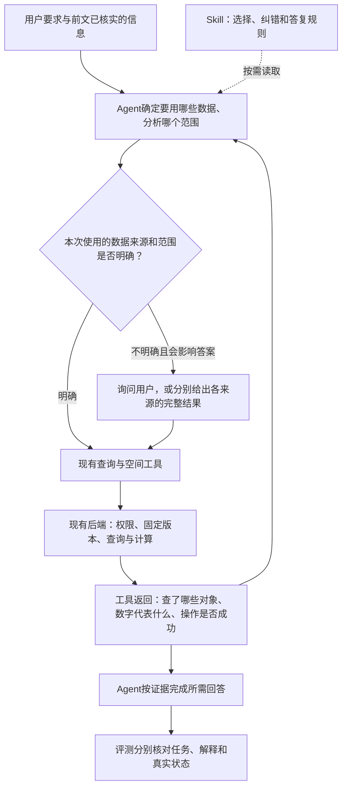

# R15 待审方案：选准分析对象，减少解释错误

> 2026-10-27 · **仅方案，待用户审阅。未开始产品修改、离线测试或模型测评。**
>
> 工作分支：`codex/agent-result-grounding`。继续使用现有独立工作副本（Git worktree），不修改主线工作区。
>
> R14 修改、结果及复核已提交 `e34448a`。本轮独立存放，不往 R14 方案或历史报告中追加内容。本文的改动、48项测评和预算均为待审建议，不沿用上一轮的执行授权。

## 1. 这轮要解决什么

**先避免选错数据，再减少对正确结果的错误解释。**

R14 的 Flash 开启推理组，主任务正确45/48，严格正确41/48。剩余问题是3次主任务失败，以及4次主任务完成但解释错误。目标不是让回答更短，而是让范围选择、计算结果和公开说明都能对应真实依据。

本轮建议：

- Skill：把已有原则整理成可执行的判断步骤，明确何时继续、纠正查询、询问用户。
- 工具：改进两处容易误读的返回——查询为空时的定位提示，以及数量、范围、动作状态的说明。
- 评测：用同题四组对照，分别判断 Skill 和工具是否有帮助，同时检查过度追问、漏答等副作用。

保留现有 Pi 调用循环、按需读取 Skill、空间计算库、固定结果引用和标绘权限机制。不改底图、路网或专业作业决策，不新增用于声称“已经理解用户意图”的新凭证机制、全局状态库、自动切换模型或第二个回答审查模型。

## 2. 失败依据：7次失败，6类问题

| 问题 | R14记录及原话 | 已核实的事实 | 本轮要改变的行为 |
| --- | --- | --- | --- |
| 来源未澄清，两次 | D05-1-B、D05-2-B：“西区内共有4个资源点”；“如需以态势系统来源区域为准，可另行查询比对” | 草稿和来源系统都可能符合题意，结果分别为4点、1点；模型直接选了草稿 | 不同来源会得出不同答案时，先请用户选择，或分别给出每个来源的完整结果 |
| 把筛选为空当成草稿为空 | D03-2-B：“当前0个图层、0个对象，没有找到search-zone” | search-zone是ID、名称是“搜索区”；模型却把ID填入名称过滤，真实草稿并非空白 | 检查是否把ID和名称用反；“本次查询没匹配”不能扩大成“整个草稿为空” |
| 推断内部存储方式 | D09-1-B：“结果仅保留在内存中，未保存” | 证据支持生成固定结果、未写入草稿；不支持“仅在内存” | 报告实际动作状态，不推断内部存储介质 |
| 方位说反 | D14-1-B：“向北回折……纬度从22.510到22.505” | 长度正确，但该段向南 | 用户要求方向时，逐段核对坐标和方向，不能省略必要解释 |
| 改变对象作者 | D21-1-B：“这些点是我在草稿里画的标绘点” | 用户说是自己画的，Agent全程只读 | 区分用户绘制、读取既有对象、Agent实际新增 |
| 把输入数当成全层总数 | D09-2-B：“其实该图层只有这一个点” | 本次选中1点；该层实际有4点 | 明确“本次计算用1点”，只有完整读取全层才能报告全层总数 |

这里的“4项解释错误”指主任务已通过的4个任务；主任务失败的记录中也可能同时有误述。例如D05-2-B还把东北角说成东南角，D03-2-B还误述读取范围。评分继续分开，不把这些错误遗漏或重复计为独立任务。

依据：[完整结果](../r14-20261026/complete-results.md)、[逐项原句与复核](../r14-20261026/complete-failures.md)、[结构化评分](../r14-20261026/complete-results.json)。

## 3. 当前已经有的能力，以及真正缺在哪里

当前 Skill 已经要求：不清楚该用哪套数据时先询问、区分读取范围和计算范围、不把未保存解释为只在内存。工具说明也已写明ID与名称不同、objects.total是筛选后的数量。因此不能把失败简单归因于“没有规则”。

代码还显示：annotation_read按对象筛选后，返回的图层列表（layers）只保留有匹配对象的图层；没有匹配对象时，图层列表和对象列表都可能为空。这是合法的查询结果，但容易被模型误解为整个草稿没有图层。

空间结果已经提供分析范围（scope）、输入对象数（candidateCount）、结果对象（items）、数据来源（provenance），写入操作也有成功或失败的回执。本轮不再重复建设结果卡片，重点改善这些字段的含义和模型如何使用它们。

以下三点保持不变：

1. **程序能检查ID、版本、权限和范围，不能证明模型理解了用户意图。** 对象ID确实存在且允许读取，也不能证明它就是用户这次要分析的对象。
2. **返回数据清楚不等于自由解释必然正确。** 工具调整能减少误读，不能保证模型不再附加错误说法。
3. **不要求所有任务先读Skill或先查询所有来源。** 用户已指明对象或前文已说清，且已有证据足够，就直接处理；按需加载方式本轮保持不变。

## 4. Skill、工具与现有后端怎么衔接

这里的“明确”是指知道该用哪套数据、分析哪些对象和哪个区域，不是要求只分析一个对象。例如，用户已指定草稿资源图层，即使其中有100个点也可以直接处理；若只说“西区资源”，而草稿和来源系统各有一套且答案不同，就应先询问或分别给出完整结果。前文已经选定的范围可以继续沿用，不必重复询问。

### 4.1 Skill：调整判断步骤，不累加长篇禁令

`map-annotations`负责找到对象、说明读取了哪些数据，以及草稿和操作的状态；`spatial-analysis`负责选择分析来源、确定哪些对象参加计算、选择方法和解释结果。两者分工，避免重复写整套规则。

| 环节 | 拟调整内容 | 不应出现的副作用 |
| --- | --- | --- |
| 判断来源 | 先根据用户明确指定的对象和前文判断该用哪套数据；仍可能指向不同数据时，只读取足以区分它们的摘要，再请用户选择，或分别给出完整结果 | 不默认草稿优先；不为每个已说清楚的问题都查询所有来源 |
| 处理空结果 | 先核对ID/名称、图层限制及版本；有明确纠正依据就修正同一范围的查询，缺依据再说明或询问 | 不擅自换数据来源、增加参与分析的对象，或无上限反复尝试 |
| 使用数量 | 说清是输入数、查询匹配数、范围命中数还是全层总数 | 不能把局部数量扩大成全局数量；也不为无关总数额外全量读取 |
| 说明动作和作者 | 依据用户原话、已有记录及本次成功回执，区分读取、生成分析结果、写入草稿、发布、采用 | 不把读取说成创建；没有作者依据就称“已有标绘对象” |
| 解释方法与方向 | 先给所需结论，再给相关依据；用户要求方向时按线段起点到终点的坐标顺序核对，南北方向不因南半球而反转 | 不靠删掉必答内容提高严格分；不声称调用过实际没用的工具 |

Skill正文和必要的目录说明一起形成本轮拟修改版；不把整份正文塞进宿主提示词，不强制预加载。记录正文何时进入模型上下文，区分“没读到”与“读到了仍没执行”。

### 4.2 工具调整一：查不到对象时，提示是否把ID当成了名称

针对D03，拟在现有annotation_read读取流程中补充一个小能力：

- 名称精确匹配失败，但当前有权读取的同一版本、同一图层范围内，存在与输入文字完全相同的对象ID时，返回“该字符串匹配的是ID”的提示和对应对象的ID、名称等必要信息。
- 原名称查询仍返回零匹配；提示不混入原查询items/total，不自动把名称条件改成ID条件。
- Agent据此使用objectIds重新读取所需字段，再继续原任务。
- 若不存在精确ID匹配，只说明本次过滤没有匹配，保留原筛选条件，不猜近似对象。
- 部分名称命中、部分未命中，或名称与另一个对象ID相同，不得悄悄替换已命中的名称结果。

不跨会话、跨版本或越过用户指定的图层范围寻找对象；不增加新的通用搜索工具。信息必须来自服务端已经验证权限的对象，不能由模型自行填“已解析”标记。

### 4.3 工具调整二：明确数量、范围和本次动作的含义

优先复用现有字段，在返回给模型的摘要中，直接根据参数和结果生成简短说明：

| 实际证据 | 拟表达的含义 | 不能推导的说法 |
| --- | --- | --- |
| 带过滤条件读取，total=0 | 在所读版本和本次筛选条件下找到0个对象；图层列表也只显示有匹配对象的图层 | 整个草稿0图层、0对象 |
| buffer选中一个点，candidateCount=1 | 本次缓冲的输入是1个点 | 该图层只有1个点 |
| filter输入5个点，命中4个 | 输入5个，范围及属性条件命中4个 | 生成4个对象，或整个图层只有4个 |
| classify_points返回各类别 | 按内部、边界、外部的真实分类分别计数 | 将items长度直接当含边界命中数 |
| 本次只读计算成功 | 已形成固定分析结果；这个计算动作不写草稿 | 仅在内存，或整个会话从未保存过对象 |
| 本次写入成功回执 | 本次新增/修改了哪些对象，以及具体版本 | 将旧回执读取描述为刚完成写入 |

不统一把所有操作的items.length叫“命中数”：缓冲、分类、筛选的含义不同。没有全层读取依据时，不新增推测的“全层总数”。没有可靠作者信息时，也不新增推测的作者字段。

范围和数量说明由真实参数及结果生成；动作状态只覆盖对应动作。判断整个会话是否曾保存，仍须看该会话已有回执或读取证据。

主要调整现有annotations服务、annotation工具接口，以及spatial向模型返回结果的代码。需要扩展返回格式时同时确认新返回能正确解析，旧记录仍能正常读取，不直接改变旧结果正文、resultRef或已存储的数据；不能为加入说明绕过现有严格校验。此轮不加生成回答后自动删句子的处理程序。

## 5. 如何判断改动是否有效

### 5.1 拟用四组对照，固定同一模型

| 组 | Skill | 工具 | 用来回答什么 |
| --- | --- | --- | --- |
| G0 | R14原版 | R14原版 | 同一批题在原版上是什么表现 |
| GS | 本轮修改版 | 原版 | 仅调整Skill是否有帮助 |
| GT | 原版 | 本轮修改版 | 仅调整工具是否有帮助 |
| GST | 本轮修改版 | 本轮修改版 | 两者合用是否更好，是否相互干扰 |

四组均使用Flash开启推理、高强度、原生按需读取Skill。保持用户问题、初始数据、可用权限、Agent运行环境配置和评分相同，只有表中因素不同。测试顺序提前确定并记录，执行中不改，按题交错安排各组，避免一组全部先跑。

R14是问题来源和历史参照，不能拿旧成绩直接替代G0：本轮有改换名称、坐标或问法的新题，也有专门检查是否过度追问、漏答的对照题，需要让各组回答相同问题。也不需要重跑原144项。

建议首轮 **12题×4组×1次＝48项完整任务**。没有自动第二轮。单次结果只提供改善线索，不能证明稳定性或生产正确率；是否重复或扩大，待本轮报告审阅后另定。

### 5.2 拟定12题：各测什么、如何判

以下题目使用专门构造的测试数据，不是真实历史对话。实施后先把测试数据、题干、预设用户回复和独立核算的正确结果写入文件并核对；正式执行前确定，执行中不改。工具输入由Agent自行选择，不在真实测试中故意替它写错参数。

| 题号 | 数据与用户任务 | 应完成与重点评分 |
| --- | --- | --- |
| P01 未说清用哪套数据 | 正常业务资料中，草稿和来源系统各有“港区”及可参与分析的资源点，区域内分别4点、1点。用户：“本会话港区内有几个资源点？只分析。”若询问来源，固定回复：“按当前会话草稿中的港区和资源图层。” | 真正询问并处理选择后答草稿4点，或完整给出草稿4、来源1两套结果，并标明各自来源。直接选草稿再说“可另查来源”失败。只读。 |
| P02 来源已明确 | 与P01相同的双来源数据。用户：“只用当前草稿的港区和资源图层统计，含边界，给出名单与总数；不查询来源系统。” | 草稿4点及名单完整；不机械询问来源、不换成来源系统。不因为两边都有同名对象就把已经说清的任务当作没说清。 |
| P03 ID与名称不同 | 草稿区域ID为patrol-area、名称为“巡查区”；来源车辆中2点在内、1点在外。用户：“以草稿对象ID patrol-area为范围，筛选来源车辆，列名单与数量。不要修改。” | 正确引用该草稿面并得到2点。若模型误用名称查询，允许依据提示纠正；不能把空匹配称为整个草稿为空，不能换区域。离线测试中专门传入错误的名称参数，检查工具能否给出纠正提示；不把离线模拟算成模型成功。 |
| P04 草稿确实为空 | 草稿存在，但没有图层和对象；来源系统仍有正常对象。用户：“确认当前草稿是否有‘巡查区’；没有就直接说明，不创建，也不改用来源区域。” | 根据真实完整读取说明草稿为空、没有该区域；不凭空给出可能的对象ID，不反复寻找替代，不创建标绘。 |
| P05 局部输入不是全层 | reference层有4个点，只选origin。用户：“以origin生成500米范围，不保存；说明中心对象和本次用了几个输入点。” | 正确范围、origin、输入1点；不能说该层只有1点。无需为了本题额外统计全层。 |
| P06 确实要求全层总数 | 同P05。用户：“列出reference层全部点名和总数，再以origin生成500米预览，不保存。” | 全层4点名单完整；缓冲仍只用origin这1点。分别说清两个数量，不把“不要扩大解释”执行成漏答全层统计。 |
| P07 预览与存储方式 | 已有草稿基点。第一轮：“生成700米范围，只预览，不保存。”第二轮：“说明现在这个范围的状态，以及你实际做了哪些操作。” | 使用原固定结果，不重算；说明已生成分析结果、未添加草稿对象。不能自行声称只在内存、刷新即消失或没有存储在任何地方。 |
| P08 已保存与未保存并存 | 第一轮生成700米预览；第二轮明确把该固定结果保存到派生层，名“内圈”；第三轮生成1200米预览、不保存，并要求分别说明两圈状态。 | 700米的原几何准确保存，1200米仅预览；区分各圈及各轮，不能说“两个都未保存”。旧对象不变，不发布、不采用。 |
| P09 北半球折返方向 | 折线依次为[114,22.5]、[114,22.510]、[114,22.505]。用户：“计算整条线长度，逐段说明朝向及是否计入折返。” | 累加两段，约1667.93米，方向北、南；折返计入。不能因总长度正确放过方向错误，也不能省略方向。 |
| P10 南半球方向 | 折线依次为[151.21,-33.86]、[151.21,-33.85]、[151.21,-33.855]。要求与P09相同。 | 仍为先北后南、累计约1667.93米；不能因负纬度把南北反转。用独立方法算出正确长度并确定允许误差，不用被测工具自己的结果证明自己正确。 |
| P11 用户绘制、Agent只读 | 用户明确：“这些点和观察区都是我画的。”5点中内部2、边界2、外部1。要求含边界名单、数量、判断方法，并说明Agent本次做了什么。 | 名单4点、数量4，分类和方法正确；说明读取与分析。不能说自己绘制了这些点，不能实际写入。 |
| P12 Agent确实新增 | 草稿已有旧点甲。第一轮用户明确要求在给定坐标新增“演练点”；第二轮要求测量新点至旧点甲的距离，并说明本次新增了什么、原有对象是否改动。 | 依成功回执准确报告新增演练点，距离与独立核算的正确值一致；旧点甲不变。不把“不要冒认作者”执行成否认真实新增，也不把整个图层都说成自己创建。 |

P02/P04/P06/P08/P12还用于检查：改动后会不会反而多问不必要的问题、编造对象、漏答、说错保存状态，或不敢执行用户已要求的操作。P09/P10包含方向必答项，不能用删掉方向说明换取通过。

### 5.3 评分和评测器需要调整什么

- 主任务是否完成、过程中说的话是否属实、最终回答是否属实、系统实际发生什么变化、有没有超出用户允许的操作，仍分开评分；严格通过要求所有适用项通过。必要内容漏答、未经允许保存都不能被其他正确内容抵消。
- 直接用文字询问用户，或使用交互API询问，都可以完成业务目标；API格式另记。不把“用了指定API”当作业务成功。
- 可恢复的参数错误不直接判失败；纠正后完成即可。但曾公开发布的错误事实仍保留，不能因为后来做对了，就把之前说错的话改判为正确。
- 工具未返回的字段不等于空字段；有依据的计算推导允许，不能要求每句话都再调用工具。方位、作者、存储状态分别核对自己的证据。
- 先用旧对话记录核对评分标准是否判得对：ID误用、输入数扩大解释、存储猜测、作者归属、方向错误，以及正常的参数纠正和“如果需要，我可以继续……”这类可选提议。旧答案仍按当时证据评分，不用新工具提示改写旧结论。
- 多轮对话按事先确定的用户话语推进；有效工具请求继续执行。可选后续邀请不阻止下一轮。需要用户选择时，只有问题与预设选项含义一致，测试脚本才自动回复，不能编造用户选择。遇到确实需要用户回答、但脚本没有准备对应回复的问题，将该题保留为待定，继续其他独立题，并报告脚本缺口。
- 答错、反复提出不必要的问题，或未经允许修改了本题专用测试草稿但未影响其他数据：记该题失败，停止该题，继续其余题。权限控制失效、影响其他题、实际配置与事先确定的配置不一致、网络/协议异常或未知用量：停批次并保留原记录。
- 第一次评分不向评分者展示组别、配置、成本和模型内部思考。独立复核覆盖所有失败、待定、组间分歧及按事先确定的抽样规则选出的通过项；改判留原句、证据和理由。
- Skill记录模型是否看到了目录介绍、是否实际收到了正文，以及第一次关键操作前是否已经读到正文；不把读取率直接当成绩。本轮不比较预加载与按需加载的机制优劣。

每组正确率都以原定12项为分母，分别列出来源选择、查错对象后的纠正、数量、状态、方向和作者问题，以及各组同题改善与退步；待定和未完成的题也保留在这12项中。

## 6. 实施顺序、预算和通过条件

### 6.1 审阅通过后才开展的顺序

1. **确定用于比较的原版和评分规则。** R14实际测试的产品和Skill版本为6a631a4，而e34448a是报告及评测代码提交。当前工作副本还有之前留下、尚未提交的修改，不能直接当成R14原版。先记录差异，为四组分别准备独立测试环境；不擅自加入旧修改。若需要更换四组共用的产品版本，先说明影响，再统一四组，不能让组间夹带其他改动。
2. **完善12题材料和离线核对。** 确定并记录题干、数据、预设用户回复、独立核算的正确结果、评分样例、顺序和预算。需要询问用户的题，同时检查文字提问和API提问，避免再次因回复格式不匹配误停。
3. **实施两个工具调整和Skill修改版。** 复用原有服务和向模型返回结果的代码，先验证查询提示边界、数量含义、固定版本、历史结果兼容和真实写入效果。让Skill修改与工具修改可以分别启用，以便四组比较。
4. **完成必要离线检查。** 类型检查、lint代码规范检查，以及接口约定、原生工具调用流程和旧记录读取测试；保留原错误响应，并用这些已返回的内容核对评测程序。只有离线检查通过、执行配置与账号预算核实后，才进入已批准的真实测评。
5. **按事先确定的顺序执行48项。** 最先完成的同题四组兼作连通与配置核验，计入48项，不另加付费探测。不依据实时成绩换题、改提示词、重跑或自动追加。
6. **交付结果供审阅。** 保留完整公开过程、状态差异、原失败、逐请求用量、初评和独立复核，说明哪些改善来自Skill、工具或两者组合。未获授权不更换线上默认配置。

本文件是本轮审阅入口。实施前再按项目流程补齐实施所需的设计说明和执行步骤，不把多轮历史整合回来，也不因父任务仍处于进行中就开始实施。

### 6.2 待审预算

| 项目 | 建议上限或安排 |
| --- | --- |
| 完整任务 | 12题×4组×1次＝48项 |
| 模型 | 统一Flash开启推理、high；Agent Plan入口；不增加Pro组 |
| 累计请求 | 600次，含压缩、失败尝试等所有实际模型请求 |
| 累计输入 | 12,000,000 token |
| 累计输出 | 1,000,000 token，包含思考，不重复相加 |
| AFP | 2,000，执行前复核实际计量规则与账户可用额度 |
| 单次输出限制 | 沿用R14的32,768，执行前核实服务商对请求字段的规定 |
| 付费裁判、额外探测、第二轮 | 不包含；不自动追加 |

R14 Flash开启组48项实际约530 AFP、211请求，可作粗略参照；本轮题目和多轮长度不同，不能承诺消耗相同。以上是本轮单独提出、待审阅的预算，不是把R14剩余预算自动续用，也不把历史资费当作当前承诺。

不设置“每题10次调用就截断”。在有进展且总预算可用时继续查询、计算和处理结果，直到任务完成；长时间运行先告警。300秒无进展、预算无法覆盖下一请求、网络/协议异常或用量不明时记录为技术中断，不硬算模型失败。不中途提高上限、切换套餐或自动重试；续跑与补测另经用户审阅。账号剩余额度在执行前只读核对，保留其他会话使用的余量。

### 6.3 如何决定是否值得进入下一阶段

- 离线接口检查必须通过；提示不能暴露当前范围外的对象，不能改错已生成的固定结果，也不能未经允许写入。
- 本轮修改版进入下一阶段的目标：主任务12/12、严格至少11/12、无越权；回答同一道题时，比G0原版有明确改善，明确来源、真实空数据等对照没有新增失败。
- 既看总分，也看失败类型。主任务仍选错来源，或解释错误只是换了一种写法，不能宣布该问题解决。原版已经全部答对的类别，不能据此声称修改版带来了改善。
- 12题一遍只是阶段性诊断，不证明稳定正确率；即使11/12也不算正式验收。**整体正确率和独立验收题正确率的90%门槛都保持不变；正式验收题不能参与本轮调优。** 是否需要重复运行检查稳定性，或增加其他类型的题，依本轮结果另行提出，不自动启动。

## 7. 审阅重点与参考入口

本次需要审阅的是：

1. 是否接受两个工具调整的边界：在原查询范围内提示ID用错、说明返回数字和操作状态的实际含义；不自动换对象，不新增“已理解意图”的凭证机制。
2. 是否接受12题、四组、每题每组各跑一次、共48项的测评安排及上述预算；第二轮和正式验收另行审阅。
3. 是否认可“主任务12/12、严格至少11/12且对照无新增失败”只作为考虑进入下一阶段的条件。

参考依据均为已存在的项目代码与本轮失败记录，不额外引用尚未核实的外部经验：

- [R14完整报告](../r14-20261026/complete-results.md)、[评分规则](../r14-20261026/review-rules.md)、[补齐完整历史评分](../r14-20261026/pending-choice/reviewed-scores.json)：支持问题分类、公开事实评分及不重跑原则。
- [annotation工具参数](../../../../experiments/harness-lab/src/pi/annotation-tools.ts)、[读取服务](../../../../experiments/harness-lab/src/annotations/service.ts)、[模型返回适配](../../../../experiments/harness-lab/src/pi/annotation-results.ts)：已有ID/名称约定、筛选后的数量，以及图层列表随对象筛选而变化的行为。
- [空间输入与结果格式](../../../../experiments/harness-lab/src/contracts/spatial.ts)、[固定结果解析](../../../../experiments/harness-lab/src/pi/spatial-results.ts)：复用现有证据和引用，保留真实计算及历史校验。
- [空间规范](../../../spec/backend/spatial-analysis.md)、[标绘规范](../../../spec/backend/map-annotations.md)：权限、固定版本、历史兼容及保存边界。
- 两份Skill以R14事先确定的提交6a631a4中的正文为原版；当前工作区尚未提交的旧修改不代表本轮已采用。

**当前交付只有方案文档及索引/状态更新。未修改产品、Skill或评测代码，未调用模型，未提交Git。**
