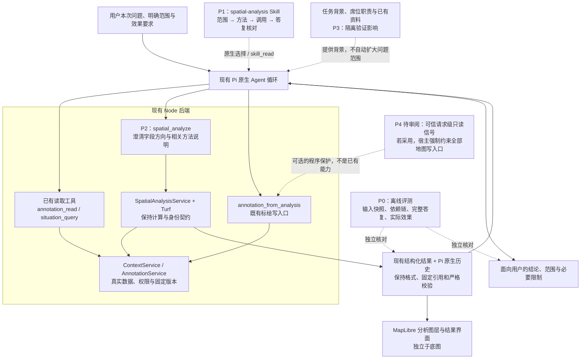

# Agent 空间分析：失败归因与修复方案

> **本轮执行结果（2026-10-16）：** P0/P1/P2已实施并通过工程检查。新版诊断计划120、已执行95（87完整、8服务额度中断），25未执行；完整代理审阅59通过、24失败、4待裁定，AC10仍未通过。旧31次不合并。详见[实施与诊断报告](research/remediation-implementation-diagnostic.md)。

> **诊断规模修订（2026-10-16，用户确认）：** 首批因静态 Skill 目录遗漏停止派发，实际 31 次保留，149 次未执行；补齐后另行冻结 12 例 × 2 轮 × 5 组＝120 次，总计 151 次，不合并新旧成绩。此处替代下文开发诊断 180 次/3轮的本次执行规模，最终 90% 门槛及新保留集要求不变。新批次前登记全部案例、轮数、版本与分母；未按既有结果选题。

> **最新授权（2026-10-16）：** 用户要求“提交当前git，然后开展”。修复方案已提交 `21988f6`，现执行 P0 → P1/P2 → 开发诊断；下文“待审阅/暂停”表述保留为此前历史。整体及新保留集 90% 门槛不变。P3 宿主改动以对照证据为前提，P4 强只读模式、第二模型及超预算扩展仍需另行审阅。尚未通过模型效果验收。

> **状态：待用户审阅，尚未批准修复实施。** 日期：2026-10-16。
> 本次修订仅补充本方案，保留架构图、历史证据和整体 90% 门槛；不修改产品、实际 Skill、评测器或夹具，不执行离线重评或模型试验，不提交、推送或合并分支。文中的工作包、试验规模和新增分层目标均供继续审阅，不代表已授权实施。
> 分支：`codex/agent-map-spatial`；当前实现快照：`661861f`；首轮实现及评测快照：`5910928`。
> 原设计和架构图继续有效：[架构设计](design.md) · [原实施计划](implement.md) · [范围与验收](prd.md)。本文约束后续修复，原“开始开发”的授权记录保留为历史。

## 1. 建议审阅的结论

**建议保留现有架构，先修评测与模型使用契约，再判断是否需要更换模型或调整上下文。** 当前失败是多个环节共同造成的：工具存在过输入歧义，Skill 对对象范围和回答核对的约束不足，按需加载不稳定，模型会在正确计算之外增加错误解释，评测器也存在漏检和误拒。不能把失败全部归为模型能力不足，也不能认为只改 Skill 就能解决。

优先顺序：

1. **P0：校准评测。** 让评分真正检查对象身份、结果依赖和完整回答，保留全部旧成绩。
2. **P1 + P2：改善 Skill 与工具契约。** 明确当前请求范围、方法方向、固定结果选择和有证据的回答；默认不改工具结果格式或历史格式。
3. **P3：用对照试验定位上下文与加载影响。** 确认贡献后再改宿主提示；若仍不足，再做同条件模型对照。
4. **P4：审阅“只分析”的产品保证。** 当前自然语言只读要求由模型遵循，尚无请求级硬只读策略。若需要程序强保证，必须确定可信的用户/宿主信号和覆盖范围，不能假称现有权限检查已经实现。

**本次补充重点：** P1 明确四步分析及可验证的规则示例；第 7 节区分知识诊断与完整任务验收，补齐评分器校准、事实错误判定和新保留集管理。B/C 各自总体及新保留集至少 90% 的门槛保持不变；基础任务 95%、可完成任务及组合任务 90% 是新增待审阅分层目标，后续整体 95% 是持续改进目标，不替换本期整体门槛。原仅 6 个新保留用例的后续计划由第 7.2、7.5 节的新方案替代，旧成绩不重写。

第一阶段范围不扩大：不建设路网、专业作业决策、影像识别或业务知识库；不新增空间服务器、Agent 循环、结果数据库或独立授权系统。底图继续沿用现有 MapLibre 三视图，底图切换不改变本次空间分析修复的输入数据契约。

## 2. 证据、统计口径与局限

### 2.1 已有证据

- [首轮 v1 报告](research/model-evaluation-v1.md)：同一配置模型 `deepseek/deepseek-flash`，24 例 × 3 次 × ABC，共 216 次，均已执行并由独立代理审阅。
- [v1.1 聚焦报告](research/model-evaluation-v1_1-focused.md)：工具输入有限修正后的 D11 共 9 次，单独记录，不能并入首轮分母。
- [有限修正记录](research/post-baseline-corrections.md)：明确生成几何选择，澄清缓冲分段说明，补充派生身份断言。已进入 `661861f`，不是本文待实施项。
- [本轮边界复核](research/remediation-boundaries-review.md)：只读授权、历史兼容和评测断言的代码依据与行号。
- [本轮统计核对](research/failure-attribution-audit.json)：从已提交的逐条审阅记录汇总，包含输入文件哈希和计数定义；没有重新判分或调用模型。

A = 工具相同、隐藏新增空间 Skill；B = 原生显式加载；C = 原生按需发现。审阅记录来自代理，不等于人类签字验收。本轮依据真实调用、工具结果、公开答复和前后状态分析，不使用模型内部思考作为证据。

### 2.2 首轮结果

| 指标 | A：无新增 Skill | B：显式加载 | C：按需加载 |
| --- | ---: | ---: | ---: |
| 试次 | 72 | 72 | 72 |
| 原程序断言与五维审阅同时通过 | 30/72（41.7%） | 42/72（58.3%） | 37/72（51.4%） |
| 五维审阅全部通过且无关键错误 | 34/72（47.2%） | 43/72（59.7%） | 40/72（55.6%） |
| 对象范围通过 | 67/72 | 70/72 | 70/72 |
| 方法通过 | 59/72 | 69/72 | 67/72 |
| 数值/几何通过 | 58/72 | 69/72 | 67/72 |
| 完整回答中的事实断言通过 | 36/72 | 43/72 | 41/72 |
| 副作用维度通过 | 72/72 | 72/72 | 70/72 |
| 仅回答断言失败、其余四维通过且无关键错误 | 20/72 | 25/72 | 24/72 |
| 原保留集五维全部通过且无关键错误 | 7/18 | 11/18 | 11/18 |

B 的 29 次未完整通过中，25 次只在回答断言上失败。这说明**“算对”之后仍有大量“说错”**，例如误报读取范围、无依据评价误差、混淆未读取与不存在、额外推断资源缺口。但不能把这 25 次全部归咎于模型：原接口对 `steps=32` 的解释含糊也贡献了失败。

单独豁免这一共享术语歧义的敏感性分析，上限仍仅为 A 39/72、B 52/72、C 47/72；没有达到 90%。该上限仅帮助归因，不覆盖原分数，不用于宣布验收。

C 在应加载用例中实际提前加载 28/48（58.3%；剔除误标为需加载的纯改名 D18）。加载组方法 28/28、完整通过 14/28；未加载组方法 17/20、完整通过 8/20。两组由模型自行选择，存在任务难度和行为选择差异，不能当成随机实验的因果结论。

### 2.3 已修正问题与仍存在的问题

9 次聚焦试验均实际使用了先前生成的固定几何，说明输入歧义修正针对的直接路径有效；但完整通过仅 A 2/3、B 1/3、C 1/3。核心筛选同时符合用户指定基点与资源图层为 A 2/3、B 3/3、C 3/3；这一项不代表没有额外越出问题范围的分析。**固定引用真实，不等于选中了用户要分析的对象；核心筛选正确，也不等于回答的附加判断正确。** 该小样本不足以推断整体提升或退化。

目前没有证据证明现有计算库的基础数学是主要失败源；这也不是对所有几何输入精度的全面证明。工程验证通过情况见 [系统验证](research/system-verification.md) 和 [浏览器验证](research/browser-verification.md)。本轮未重新运行工程或模型测试，既有测试不能代替 AC10。

### 2.4 参考项目的评测经验与适用边界

以下依据本轮讨论中核对的公开资料；未在本项目重新运行参考项目，成绩不能直接横向比较，也不能作为本项目已达标的证明。

| 参考 | 可核对的证据 | 本方案借鉴与限制 |
| --- | --- | --- |
| GIS Copilot / SpatialAnalysisAgent | 论文表 1 的 110 个任务中，首次成功 75 个，最多尝试三次后成功 95 个；正文部分比例与表格不一致，此处按可核算的表格计数。 | 借鉴基础、受指引多步骤、自主多步骤的区分，以及数据类型、字段、坐标系等前提检查。分别报告首次、同会话恢复与独立重复；不把最多三次成功率等同于我们的单试次正确率。[论文 §4.4、表 1](https://arxiv.org/pdf/2411.03205) |
| MapLibre Agent Skills | PMTiles 的公开对照为无 Skill 1/6、有 Skill 6/6；后者是修订后的复测，沿用较早基线。记录中存在回归、评分漏检和误读。 | 借鉴针对知识缺口的正反例、无 Skill 对照、负向用例及评分勘误。其正文注入与回答评分不能替代本项目原生按需加载及真实动作验收；有意筛选无 Skill 易失败的题，只适合开发诊断，不能构成最终保留集的全部来源。[方法](https://github.com/maplibre/maplibre-agent-skills/blob/main/evals/README.md) · [结果及勘误](https://github.com/maplibre/maplibre-agent-skills/blob/main/evals/results/maplibre-pmtiles-patterns.md) |
| geoskills、qgis-mcp、MapOS | 查到知识组织或工程测试说明，未找到可引用的系统性 Agent 任务成功率报告。 | 分别借鉴工具知识组织、工具契约测试、计算与界面效果分层；不将其视为问题拆解和方法选择成熟度的效果证明。[geoskills](https://github.com/phuismann/geoskills) · [qgis-mcp 测试说明](https://github.com/nkarasiak/qgis-mcp/blob/main/AGENTS.md) · [MapOS 测试范围](https://github.com/NicHaley/mapos/blob/main/CLAUDE.md) |

参考支持技术路线和验证方法，不提供可照搬的正确率标准。90% 是针对第一阶段受控工具与有限能力范围的产品要求，不是行业标准或当前模型能力预测；没有证据证明只修改 Skill 就能达到它。

## 3. 代表性失败案例与责任边界

案例 ID 必须与批次一起阅读；首轮和聚焦轮会重复使用 D11 ID。

| 批次 / 案例 | 实际发生了什么 | 归因与对应改进 |
| --- | --- | --- |
| v1 / D11-2-A | 生成 1500 米缓冲后，只传 resultRef 默认取到原点 items；后续实际重新按原点距离筛选，却说直接复用了固定面。旧复用断言因中间出现旧 ref 而通过。 | 工具选择歧义、模型错误解释和评测漏检共同存在。输入歧义已修；P0 要验最终依赖，P1 要核对真实方法。 |
| v1 / D10-2-B | 用户要 ties 图层两点，模型扩大到 8 点；工具最近排序与答复中声称的名单/次序不一致，距离数值却正确。 | 对象范围与结果转述失败，属于关键错误。P1 限定候选；P2 强调完整身份、返回次序；P0 验身份和顺序。 |
| v1 / D01-2-B | 两点距离 1111.95 米正确，但读取工具返回 16 个对象，回答说只读取了 2 个。 | 必须区分“读取范围”与“计算范围”。本例不是实际泄漏，但属于不实说明。 |
| v1 / D02-1-B | 点到线距离正确，却无误差界限地声称短线误差可忽略。 | P1 只报告工具支持的精度说明；没有容差依据时不作适用性保证。 |
| v1 / D12-1-C | 用户已要求预览后保存，模型仅预览并再次询问，没有保存；未加载 Skill。 | 合法写入任务未完成。不能通过一律拒写或重复确认来提高只读安全分；P1/P3 同时检验明确保存流程。 |
| v1 / H01-1-C | 用户只要求分析，模型尝试保存，因占位 resultRef 无效被拒绝；没有实际写入。 | 未请求写入尝试按原标准为关键错误。错误引用拦截不是语义只读保护；见 P4。 |
| v1 / H05-1-B | 闭边界判断正确，但未读取发布/current 状态便说草稿未发布、未采用。 | “本轮未执行发布”可由调用链支持；“系统当前未发布”需要状态证据。P1 区分两者。 |
| 聚焦 / D11-2-A | 忽略仅本会话草稿限定，取外部西区车辆为原点，并正确复用了这个错误原点的缓冲面。 | 底层权限及几何正确仍不能保证用户意图正确。优先修范围选择，不再只修 ref。 |
| 聚焦 / D11-2-B、D11-2-C | 核心筛选正确，却称距原点约 3027.6 米的 edge 靠近 1500 米边界；B 还加入请求范围外的道路分析。 | 回答扩展带来事实错误。P1 限制无证据的补充判断，不要求模型为了显得完整而额外推断。 |
| 聚焦 / D11-3-C | 核心筛选正确，另建议 2200 米可覆盖实际距原点约 2270.75 米的对象，并给出错误的后续排序。 | 附加建议也要核对数值；“可选建议”不免除事实准确要求。 |
| 聚焦 / D11-3-B | 从 1 个 truck 类别点和背景“至少 3 辆车”推断明显缺口，但没有点与实际车辆数量的映射。 | 背景目标与当前空间问题混用；P1 约束推论，P3 通过对照核实背景的因果影响。 |

### 3.1 已确认、推断与未知

- **已确认的接口/评测问题：** 原 geometry/items 默认歧义、共享分段说明歧义、只看 ref/调用次序的断言、间接派生结果传播误拒、来源身份独立核验不足。
- **已观察到的模型行为：** 选错范围、反向用参数、复述结果失真、无依据补充、少加载或不执行已请求保存。它们发生在当前模型、当前提示和当前工具组合下，不足以证明是模型本身不可修复。
- **有证据支持但尚未验证的假设：** 背景任务与当前问题竞争，诱发额外资源判断；通用“保存本条用户请求”的宿主文案可能与保存地图结果混淆。当前没有对照试验证明这些文案导致了具体写入尝试。
- **未知：** 仅修改 Skill 能提升多少；短工具说明是否稳定更好；换模型的收益与成本。不能事先承诺通过率，也不把参考项目的设计当成本项目效果已经成熟的证明。

## 4. 修复后仍沿用的架构

图中的“答复核对”是同一 Pi 循环内的 Skill 规则与工具证据使用方式，不新增运行时规划器、第二个审查模型或循环回写机制。P0 是开发验收系统，不进入产品请求路径。P4 若采用应覆盖所有地图写入口，图中只画出与空间结果直接相关的一条。

## 5. 待批准的修复工作包

### P0：先建立可信评测，避免修错方向

**目的：** 把“数值出现过”“调用过某工具”升级为“用户要求的对象通过正确依赖得到正确结论”。保持验收严格度，不用评测器修复掩盖真实失败。

拟修改评测脚本、测试与下一版夹具，产品代码暂不动：

1. 以完整身份元组核对来源、对象、版本、几何；评测准备阶段保存独立来源快照。不能仅凭结果里有 `source` 就通过，也不能跨系统只比短 objectId。
2. 按实际发生顺序追踪结果依赖：既允许 B.geometry → F.items → M 的合法传播，也拒绝未来/自引用、重复起源、篡改坐标和不相关中间结果。此图仅在评测器中建立，不新增产品结果库。
3. 固定范围复用要核对被指定的旧几何确实进入最终相关计算、未重新生成替代；结果 ref 曾出现不足以通过。允许合法中间结果传递。
4. 先筛选后排序/统计要验实际候选集合及依赖，不能仅比较首个工具位置。没有 filter 时索引 -1 的问题单独修复；该单项缺陷不代表整例必然通过，其他断言可能已拒绝。
5. 核心语义与工具路径覆盖分开记录。提前声明允许的等价方法，避免把合法逐对象判断或完整排序后取前 N 错当方法失败；无关的额外调用仍需审阅，不因核心正确而自动豁免。
6. 数值预期绑定操作、对象和目标结果；不能只要任意结果里出现正确数字就算回答正确。答案相关结果与其依赖要可追溯，不能机械地取最后一个 filter/nearest。
7. 修正 D18 加载标签，补齐真正存在缺失类别字段的负向夹具。新夹具另存版本，原始数据与评分保持不变。
8. 单列核心分析、完整回答、Skill 提前加载、未请求写入尝试、实际副作用和协议完成。整体仍要求全部必要维度通过，不把 claims 降成可选项。

**验证：** 先用人工构造并经人工确认的正反例验证评分器本身，包括错对象但数值相同、无关前置 filter、正确 ref 却使用原点、合法间接传播、伪造来源、正确核心加错误附言等。再对旧记录做离线重评，输出新的逐条差异及原因；没有原始证据的项目标为不可复核，不能补猜。只读旧记录，不覆盖原 score/review；执行口径、人工复核和误判定义见第 7.4 节。以上均是待实施步骤，本轮没有执行离线重评或调用模型。

### P1：重整 Skill 的分析与回答规则

保留原 M1—M11 和已有数学/方法边界。现有 Skill 已具备方法选择、组合依赖及答复检查，本次拟重排重点、补充可执行规则和少量示例，不推倒重写，不把所有失败案例堆成冗长禁令。继续使用一个空间主 Skill 与现有标绘 Skill 的衔接，不新增规划 Agent 或运行时二次审查循环。

| 阶段 | 规则 | 模型应表现出的行为 |
| --- | --- | --- |
| 明确范围 | 分清起点、候选、目标区域、属性条件、固定版本与输出效果。当前用户显式限定优先；自动草稿和背景资料只提供上下文。 | “仅本会话草稿”不自行改用外部同名点；读取范围与最终计算范围分别表述；确有歧义才澄清。 |
| 选择方法 | 距离、包含、相交、阈值和缓冲各自有适用条件；组合分析保持集合依赖；业务规则不由空间距离代替。 | 不用距离阈值冒充已保存多边形，不把最近说成最快，不把对象个数当车辆容量。 |
| 执行与恢复 | 明确 input/target 方向、geometry/items 选择、必要字段与单位；从真实工具错误恢复，不凭报错泛化能力缺失。 | 保存已明确请求时完成保存；只分析时不发起写入；一次失败不能声称工具完全不支持某几何。 |
| 答复核对 | 按结果中的对象、数值、次序、范围和实际效果逐项核对，先给核心结论，附必要限制。 | 未读不等于不存在；未发布操作不等于未发布状态；未计算的边界接近程度或额外容量判断不当事实输出。 |

具体写法：

- 通用正反例使用独立于评测集的几何与业务名称，说明原则和依赖，不放 D/H 编号、答案、固定坐标或对某模型的过拟合补丁。方法选择先检查实际几何类型、必需属性、单位及受支持的坐标约定；数据不满足前提时查缺口或如实说明，不猜测修补。
- 每条新增规则绑定一个可观察的错误类型、一组开发用变体和一项回归检查。例如“最近不等于最快”同时测距离排序与路网能力边界；“一个对象不等于一辆车”同时测正确分类计数与缺少容量依据时的表述；“引用旧范围”检查最终计算确实依赖旧几何。新增规则是否保留由对照结果决定，不预设越长越有效。
- 允许有依据的补充解释，但每个数量、排序、状态和专业含义都需要对应证据；“建议”“仅供参考”等措辞不豁免其中的事实。
- 不强制公开内部思考或冗长步骤。短任务可直接给结果；组合任务补充候选范围、用到的固定结果和限制。
- Skill catalog 的简短描述覆盖组合分析、跨轮续用、边界判断和分析结果保存，使按需加载有可发现入口。纯改名等非分析请求沿用既有标绘 Skill，不强迫加载空间 Skill。
- 保留已经加载的 Skill 历史快照/hash；更新只影响新加载，不追溯改写旧会话。

**参考与自建边界：** 问题拆解、前提检查、依赖组织继续借鉴原 [E1—E6 / M1—M11 映射](research/skill-method-mapping.md) 和 [设计第 14 节](design.md#14-参考依据)，新增评测依据见第 2.4 节。本项目的范围优先级、Pi 工具参数、保存语义、完整答复核对及评分断言由我们自行建设和验证。GIS Copilot 的任务分层与 MapLibre 的针对性对照有公开依据，不能据此宣称这些规则已在本项目成熟有效。

### P2：澄清工具输入与新结果说明

1. 在现有工具字段描述中明确 `input` / `target` 的方向，特别是 relate 的 contains 与 filter 的区域筛选；补充单位、候选数量、返回次序、来源范围和 geometry/items 用法。
2. 用少量通用调用示例解释组合依赖，保留现有严格参数校验；不增加大量近义工具，也不改为让模型直接提交任意 GeoJSON 作为可信来源。
3. 现有每个操作返回同一套 method/limitations，包含与当前计算无关的缓冲/最近说明。拟改为**新计算结果按操作填入相关说明**，保持字段与格式不变。读取旧结果时返回原存储值，不套新规则重写旧证据。
4. 优先复用结果已有的参数、scope、计数、身份和排序，不为回答模板另造事实数据库。暂不压缩共享 `projectSpatialResult()` 的结构，也不新增结果格式 V2。
5. 已在 `661861f` 修复的显式几何选择和分段说明保留；继续支持从明确错误恢复，不用新增确认打断合法连续计算。

**验证：** 参数方向、对象筛选、组合传播、方法说明相关性、旧结果 read、严格拒绝篡改、跨请求和重启/compaction 后复用与精确保存。测试检查行为和证据，不只检查文案字符串。若仅改说明不触及地图界面，不机械重跑全部底图验收；若实际影响渲染/保存，则按影响追加浏览器检查。

### P3：先隔离上下文与加载因素，再决定宿主改动

本轮已核对的聚焦请求同时含有“仅本会话草稿、只分析”和背景“至少需要 3 辆车”。后台 task goal 和席位职责确实进入 provider 输入；这提供了范围竞争的可能来源。现有文案强调背景不是权限授权，但没有充分解决“背景目标是否自动成为本次分析问题”的歧义。

建议先在隔离试验中比较原背景与中性背景，保持用户问题、数据、工具和 Skill 相同。中性背景保留对象所有权、可用数据和定位当前草稿所必需的信息，只移除无关业务目标/职责干扰，测量额外任务推断。该诊断不等于删除生产背景：最终验收仍要包含实际任务背景与无关信息干扰。

只有证据支持后，才考虑宿主提示明确“当前请求决定本轮范围，背景用于解释，不自动扩大动作”。若涉及持久化 Composer 文案，必须新增版本并保留 V1—V5；不能直接修改共用旧文本生成函数。可否使用既有非持久提示位置，需要核实 provider 实际输入和历史校验后决定。

Skill 加载先通过原生 catalog/显式选择/skill_read 改善并测量，不额外建设工具路由 Agent。若原生按需仍达不到门槛，如实报告，再比较现有原生显式选择的产品取舍；不能把 C 强行预加载后仍叫“按需发现”。

### P4：明确“只分析”的保证等级（产品审阅项）

**现状：** `AnnotationRequestState` 校验已读草稿、来源和版本、未知写入及暂停状态；`AnnotationService` 校验权限、CAS、精确几何和事务。它们都没有解析“只分析”的可信请求字段。只分析也可能读取 draft，因而已读 draft 不等于要求保存。H01 的拦截来自假 ref，不能证明使用真实 ref 时一定被拒。

| 选择 | 能得到什么 | 限制与范围 |
| --- | --- | --- |
| 先做 P1/P2 的行为改善 | 遵循“只分析”，按冻结标准要求未请求写入尝试为零，验证明确保存仍正常。 | 属于模型行为验收，不能宣称程序对自然语言建立了硬只读保证。建议作为先行修复，但需接受并记录这一边界。 |
| 增加可信请求级只读模式 | 用户明确选择或可信宿主策略设置只读；后端在执行处阻止所有地图写入口。 | 新增产品/API 合约，须单独审阅交互和生命周期；不能由模型自报“已授权”或关键词匹配充当信号。 |

若选择程序强保证，策略覆盖本次 Agent 请求的全部地图写入口，不冻结用户直接操作地图；建议沿用现有请求生命周期承载策略，不新增持久授权库、不默认逐次弹窗。至少覆盖 `annotation_action`、`annotation_from_source`、`annotation_from_analysis`，明确发布/采用等地图效果边界；仅隐藏一个工具不够。还需定义同请求 steer/followUp 中用户后来要求保存或改为只读时如何生效、已在途写入如何处理、重试与回执查询是否被误阻。

在可信信号来源与行为批准前，P4 不进入编码。自然语言指令自动推断可作为辅助，不能用它证明硬保证。未选择 P4 时，验收报告必须持续注明其边界，不能把零次实际写入写成系统已全面防止未请求写入。

## 6. 历史兼容与改动范围

### 6.1 必须保留的契约

- `spatial.model-result.v1` 的正文和完整 details 由共享 extractor 严格核对。直接改变共享投影可能令历史成功结果变成无效证据，并阻止旧会话继续。P2 默认只改新计算的值，不改结构和旧解码。
- 原生结果仍按真实调用、所有权、参数、固定引用验证；read 的 delivery 不能变成新起源，不允许忽略字段来放宽历史真实性校验。
- Composer V1—V5 有精确文本校验，且多个版本复用旧生成器；如确需新文案，保留旧生成器并引入明确新版本，旧 Skill 快照不变。
- 不改标绘坐标、对象 ID、数据持久化、底图选择与业务图层，不重新解释旧空间 scope。
- 如果后续批准新格式，须先补跨版本测试与回退策略；已有新历史时不能简单回滚到不认识该格式的旧 reader。

### 6.2 预期文件与验证

下表是待批准的影响范围，不代表本轮已经修改。路径相对 `experiments/harness-lab/`。

| 工作包 | 主要位置 | 验证重点 |
| --- | --- | --- |
| P0 | `scripts/probe-spatial-evaluation.ts`、对应 tests、评测夹具与批次文档 | 真/假依赖、完整身份、合法等价链、离线旧证据差异、未请求尝试与实际效果分列 |
| P1 | `fixtures/skills/spatial-analysis/SKILL.md`、现有资源目录描述及加载测试 | Skill hash/快照、显式与按需路径；真实模型范围和回答表现 |
| P2 | `src/pi/spatial-tools.ts`、`src/spatial/service.ts`、`src/spatial/geometry.ts` 及对应 tests | 方向与单位、新结果相关说明、旧结果 read、固定几何保存 |
| P3（条件性） | 隔离评测输入；若有证据再评审 `src/pi/lab.ts` / `composer-input.ts` | 因果对照、真实 provider 输入、V1—V5 完整兼容 |
| P4（另行审阅） | 请求 DTO/入口、地图工具运行期策略；必要的桌面交互 | 可信信号、所有地图写入口、steer/followUp、回执、合法保存流程 |

每个包单独形成可审阅提交。确定性检查通过后才进入模型试验；出现身份/历史兼容回归应停止该包并修复，不用模型成绩覆盖工程问题。只对实际变动运行必要检查，不重复无关的全量测试。

## 7. 效果验证方案（尚未执行）

### 7.1 先离线，后模型

1. **离线校准：** P0 正反例测试 + 旧 216/9 条证据分别重评。不调用模型，不改原成绩；揭示评分变化属于“原判错”还是“新规则增加检测”，两者分列。
2. **开发诊断：** 冻结同一模型与预算，单独比较工具、Skill、加载和背景。小用例定位参数方向、单位、方法选择等知识缺口，完整任务验证范围、组合依赖、全文回答与实际动作。小用例通过不能替代端到端验收。可以使用已公开的旧案例作回归，但新增近似/变体，不能只记住旧答案。
3. **可选模型对照：** 前两步稳定后若仍未达标，才比较第二个模型；使用同一新工具、Skill、数据和预算，不拿不同时间、不同配置的试次混比。
4. **最终验收：** 冻结实现与规则后，重新执行 ABC 全套。旧 24 例（含已阅读的旧保留集）经 P0 修正后作为新版回归集，另建未用于调优的新保留集；两组分别报告，再按预先固定的构成计算总体。新任务规模与隔离规则见第 7.5 节。

### 7.2 建议的试验规模与变量

以下是供审批的预算上限，**本方案提交不表示已经授权执行这些调用**。各阶段可以在预先约定的停止条件下提前停止；已执行失败不能删除或重试凑通过。

开发诊断选 12 个覆盖范围选择、组合依赖、单位/方向、边界解释、跨轮固定结果、明确保存与只读、无依据补充等问题的任务族，每族 3 次，5 条件，共 **180 次**：

| 条件 | 工具 | Skill | 背景 | 比较目的 |
| --- | --- | --- | --- | --- |
| V0 | `661861f` 当前契约 | 原 Skill，显式加载 | 原背景 | 同批控制组 |
| V1 | P2 新说明与契约 | 原 Skill，显式加载 | 原背景 | 相对 V0 测工具改动 |
| V2 | 同 V1 | P1 新 Skill，显式加载 | 原背景 | 相对 V1 测 Skill 改动 |
| V3 | 同 V1 | P1 新 Skill，按需发现 | 原背景 | 相对 V2 比较显式选择与按需发现的端到端差异 |
| V4 | 同 V1 | P1 新 Skill，显式加载 | 中性背景 | 相对 V2 测背景竞争，限诊断 |

V2/V3 同时存在加载率、加载时机、额外调用和原生输入投影形态的差异，不能归为纯加载率效应。上述为相邻条件的受控比较，不是完整因子实验；例如不能据 V0/V1 推断所有模型下的工具主效应。使用隔离工作副本/受控资源快照保证原条件真实保留，条件工具版本差异预先登记，不在一批执行中来回编辑共享源码。组内顺序平衡并冻结，保留失败和实际调用预算。

可选模型对照：同一新配置、12 族 × 3 次 × 2 模型 = **72 次**，双方均重新运行；第二模型及成本另行确定。

本次将最终验收的原“18 开发/回归 + 6 新保留，各 3 次”方案替换为下列待审阅预算，优先增加未见任务覆盖。历史首轮 216 次及聚焦 9 次仍保持原样，不并入新成绩。

| 阶段 | 建议规模 | 计划试次 |
| --- | --- | ---: |
| 开发诊断 | 12 任务族 × 3 次 × V0—V4 | 180 |
| 新版回归验收 | 旧 24 例经 P0 修正并另存版本 × 2 次 × ABC | 144 |
| 新保留集验收 | 30 个未参与调优的新任务 × 2 次 × ABC | 180 |
| **默认待审阅方案合计** | 开发诊断 + 最终验收 324 次 | **504** |
| 可选模型对照 | 12 任务族 × 3 次 × 2 模型 | 另加 72，合计 **576** |

30—50 个新任务、每例 2—3 次是扩充范围建议；上表仅按起点 30 个、2 次核算，不默认授权扩充或执行。最终验收每个条件 108 次，其中新保留集 60 次。若改变任务数、重复次数或分类比例，须在执行前更新预算、分母与冻结清单，不能看到成绩后补题、删题或多跑几次凑门槛。

离线重评不计模型调用。若证据足以否定方案，不必耗尽预算；提前停止须报告未执行项，不能以已完成子集宣布验收通过。若随后采用 P3 宿主改动或 P4 策略，应重新冻结条件并验证，不能直接借用 V2 成绩；额外诊断预算另行登记，不挤入上述批次分母。

延用每试次 600 秒、24 次 provider 请求、64 次工具调用的上限作为待批准默认值；超时、准备失败、未运行分开报告。试验需要冻结源码/依赖/工具/Skill/数据/hash、模型标识与提供方配置、提示输入、顺序和预算；泄露答案、证据缺失或源码漂移不得算成功。公开记录只保存必要证据和哈希，不复制密钥、内部推理或完整敏感请求。

审阅尽可能隐藏条件标签，但实际工具/Skill 痕迹可能暴露分组，不能声称完全双盲。确定性核对覆盖所有可计算事实；全文语义由独立审阅完成，注明代理或人类身份，有争议项单列裁定。

### 7.3 验收目标：保留整体 90%，增加分层约束

“完整任务正确”要求对象与范围、方法、数值/几何、全文事实和实际效果均满足题目及证据约束，并完成所需的协议流程；不能用各维度平均分或“曾调用正确工具”替代整例成功。关键错误会直接使该例失败。

| 指标 | 本期门槛或待审阅目标 | 统计范围与解释 |
| --- | --- | --- |
| 完整任务正确处理率 | **保留：B、C 各自总体及新保留集均 ≥90%** | 各条件单独评分，不混合 B/C、不用 B 代替 C；总体构成按第 7.2 节冻结，回归集另报。按默认计划，总体至少 98/108、新保留集至少 54/60；同时满足其他门槛才通过。 |
| 信息充分且能力范围内的任务完成率 | **新增待审阅：≥90%** | B/C 各自总体可完成子集及新保留集可完成子集分别计算。合法保存也属于完成要求，不能靠无必要澄清、拒绝或重复确认抬高成绩。 |
| 基础单步任务完整正确率 | **新增待审阅：≥95%** | B/C 分别按预先冻结的基础分类计算，并单列新保留集同类成绩，不用总体掩盖基础问题。 |
| 本期支持的组合任务完整正确率 | **新增待审阅：≥90%** | B/C 分别按预先冻结的组合分类计算，并单列新保留集同类成绩；仍不含路网及专业决策。 |
| 关键错误及关键边界行为 | **保留：验收样本中关键错误为零，关键边界全正确** | 保留未请求写入尝试也算关键错误的要求，同时区分是否实际写入。不能以总体达标抵消关键错误。 |
| C 按需加载 | **保留：需加载用例分析前实际加载正确 Skill 的比例 ≥90%** | 单列正文/hash、时机、误触发及样本分母；加载成功不算任务成功，真实按需路径不得被强制预加载替代。 |
| 更广覆盖下的完整任务正确率 | **后续改进目标：≥95%** | 不是本期整体门槛，也不表示已证明生产稳定性；需要新增任务覆盖和重复验证。 |

合法的等价方法、合理精度展示和必要澄清如何评分，统一按第 7.4 节执行。工具、历史、保存及权限工程回归仍须通过，明确要求保存的正常流程不能被只读改进误阻。最终验收采用真实任务背景；中性背景的诊断成功不能替代实际上下文验收。

90% 是既定产品门槛，不是当前能力预测，也不是从参考项目成绩推导的行业标准。若达到 80%，可记录为研发进展，不能宣布验收通过。若可信评测下仍低于门槛，应按证据继续比较工具、Skill、上下文和模型，不降低门槛、删难题或将附加事实错误豁免。样本中零关键错误不证明现实错误概率为零；30—50 个新任务也不证明所有救援、消防任务可靠。

### 7.4 评分口径与评测器校准

以下用于下一版冻结契约，不回溯修改首轮协议或原成绩。

**双层评测。** 开发小用例验证知识及规则是否起作用；完整任务评测验证用户结果。可计算的身份、几何、数值、集合、顺序、引用依赖及前后状态由独立确定性断言检查；模型审阅可辅助识别自然语言事实错误，但不能只凭某个关键词、工具名或评分模型一句“正确”宣布任务成功。

| 情形 | 下一版判定规则 |
| --- | --- |
| 同义表达、合理四舍五入、满足同一问题的合法等价方法 | 不因措辞、工具名称或路径不同判错；单位、容差、完整候选范围及等价条件须预先明确。工具路径覆盖另报。 |
| 对象、范围、单位、数值、排序错误，或遗漏使结论成立的必要条件 | 判任务失败；错误不能由其他正确维度的平均分抵消。 |
| 核心计算正确，附言包含错误数量、状态、能力或专业推论 | 仍判失败；“建议”“仅供参考”不豁免事实错误。纯文风偏好、没有事实错误的简略表达不算失败。 |
| 信息确实不足、对象歧义或问题超出本期能力 | 若冻结预期要求澄清或说明边界，正确处理可计入总体正确处理率；不计入可完成子集分母。驱动须识别预期的等待答复状态，不能将正确追问机械记为超时。 |
| 信息充分、工具支持且任务已获必要授权 | 必须完成请求；无必要拒绝、重复确认、只预览未保存均不能算完成。可完成标签由夹具和能力范围预先确定，不能由模型自己选择。 |
| 工具契约含糊、夹具与题意不符 | 单列契约/夹具问题，先裁定再冻结新版本；不能全归为模型失败，也不能直接计成功。新夹具不得覆盖旧证据。 |
| 参数被拒后在同一会话、同一预算内恢复 | 最终确实完成且答复、效果均正确时可通过，另记首次执行结果、恢复次数及成本；关键越权尝试不会被后续恢复抵消。 |
| 不同独立重复中有成功也有失败 | 全部计入各自分母，另报稳定性；不取最好一次、不合并成一次成功。 |
| 证据缺失、准备失败、基础设施错误、未执行或审阅未完成 | 分别标识，不能计成功或一概归为模型能力失败。保留全部计划分母；可评分子集成绩仅作诊断，不能代替整批验收。 |

**校准与人工复核。** P0 先建立人工确认的正反例基准，覆盖第 5 节的真假引用、同数值错对象、合法等价链和错误附言。当前 216/9 次审阅来自独立代理，不冒称人类签字。未来评测须由人复核全部关键错误候选、自动与语义审阅冲突项，以及从“判通过”和“判失败”两组按条件、任务类型随机抽取的样本；抽样规则和数量在执行前登记，防止只挑明显失败。尚未完成人工校准或必要复核的结论标为待复核。

以人工确认且证据充分的样本为基准：自动整例通过而真实不满足验收为“误判通过”；自动整例失败而实际满足全部要求为“误判失败”。另列单项断言缺陷，不把局部漏检但已被其他断言判失败的试次重复算作整例误判通过。公开两类误判的计数、各自分母与原因；评分器修正必须有版本及差异记录，不能靠人工签字覆盖程序失败而不修正规则。对旧记录的重新裁定与新实现效果分开报告。

### 7.5 新保留集：覆盖、隔离与冻结

1. **旧题身份。** 已阅读的旧 24 例全部转为新版回归集，包括原 6 个保留用例；P0 发现的题意/夹具缺陷在新版本修正，旧原文、轨迹和评分不动。不得继续将这些案例宣称为未见泛化证据。
2. **建议规模。** 目标 30—50 个独立新任务，每例 2—3 次；第 7.2 节先按 30 个、2 次核算。建议构成为基础 10 个、组合 12 个、边界/负向 8 个。分类互斥用于主汇总；保存、续问、坐标地域等作为交叉标签。发布执行前清单时确定可完成子集、关键边界项和需加载子集，不能事后调整标签。
3. **覆盖要求。** 基础覆盖测距、点线距离、长度/面积、关系、范围筛选、邻近与分类；组合覆盖过滤后排序/统计、固定范围续用、结果依赖、明确保存。边界覆盖真实缺属性/几何、来源不可用、歧义、只分析、纯标绘及超出本期能力的正确处理。跨组包含中国与澳大利亚位置、边界接触、同距、不同数据密度和无关背景干扰；不要求每个因素做全排列，不扩展路网或专业决策。
4. **任务独立性。** 优先改变空间关系、候选结构、问题组合、状态及必要判断；仅换名称、平移坐标或改写一句话的案例记作同一任务族变体，不能充作多个独立任务。记录任务数、任务族数和重复次数，发现近重复时须在冻结前调整构成。
5. **防止泄露。** 新保留任务及预期由未参与该轮 Skill 调优的独立编制/复核者维护，依据既定能力范围和覆盖矩阵选题，不根据 A/B/C 谁容易失败来选题。题目在正式运行时按正常用户请求提供；oracle、评分规则和答案仅保存在宿主评测侧，不进入模型工作区或产品 Skill。锁定实现、Skill 和评分版本后才揭示保留集表现。
6. **使用后管理。** 新保留集一旦用于修订 Skill、工具或宿主提示，就转为已见回归集；后续泛化验证须另建新保留集。不得针对已见结果调优后仍把同一套题称为新保留验收。若因评分器缺陷仅离线重评同一实现，明确标为评分版本勘误，不冒充新的独立模型试验。
7. **独立预期。** 延续解析数值、人工构造几何事实、真实来源快照与实际写入对比；oracle 不导入被测算法生成同源答案。新任务先验证可解性、容差与题面数据一致性。不能为了扩大题量降低预期质量。

### 7.6 成绩报告与解释边界

每份报告同时提供：冻结版本和全部计划分母；A/B/C、回归/新保留、基础/组合/边界各层成绩；可完成任务完成率与必要澄清/能力边界处理率；五维通过情况；Skill 实际加载和误触发；同会话恢复及调用成本；未请求动作尝试与真实副作用；评测器误判和待复核项。

按同题、同次配对公开“改善、退化、不变”，不只给平均净增益。主成功率按冻结试次计算，同时报告任务/任务族层面的表现和重复稳定性；区间估计按任务或任务族聚类处理相关性，不把重复运行当成新增独立任务。样本量有限时说明区间宽度，不能只凭观测值达到 90% 就声称真实总体正确率已被证明不低于 90%；本期门槛针对冻结验收集，外推可靠性另有证据要求。

## 8. 审阅项与下一步边界

建议先审阅并批准 **P0 → P1/P2 → 开发诊断** 的顺序，P3 宿主改动以实验结果为前提，P4 单独决定保证等级。需要明确的取舍有：

1. 是否接受首轮只改善模型遵循并如实保留只读边界，或要求增加可信的请求级只读入口后才继续验收。
2. 是否批准第 7 节待审阅预算：默认 504 次，其中新保留集按 30 个任务各 2 次计；若加入第二模型对照为 576 次。扩充至 30—50 个新任务及每例 2—3 次的具体规模须先定清单与预算，本轮均不执行。
3. 是否采用第 7.3 节新增的可完成任务、基础及组合分层目标；总体及新保留集 90% 门槛保持。人工校准、复核人员和预登记抽样规模需在未来执行前落实。
4. 若工具结果格式或 Composer 格式确需变化，应先补兼容设计，不能把它作为文案整理顺带实施。

本次用户授权仅为补充本方案并继续审阅。任务保持 `in_progress`，`modelAcceptancePassed=false`，修复实施授权为 false；本轮只修改本文件并检查文档一致性，不开始 P0 编码，不更改实际 Skill、工具、评测器或夹具，不执行离线重评或模型评测，不提交、推送或合并。第 4 节架构图保留不变。
