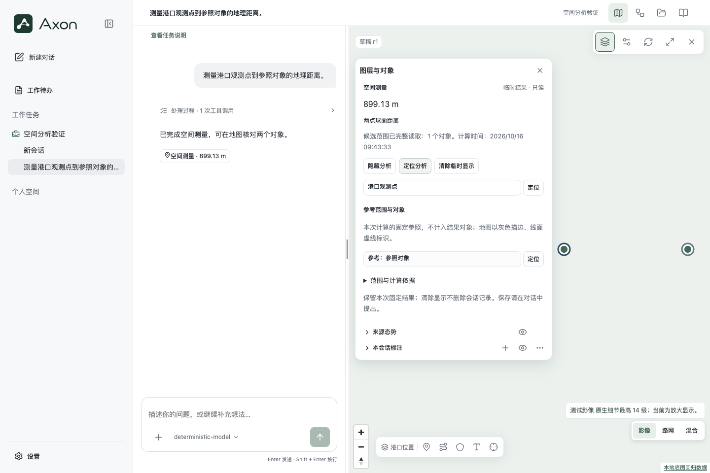
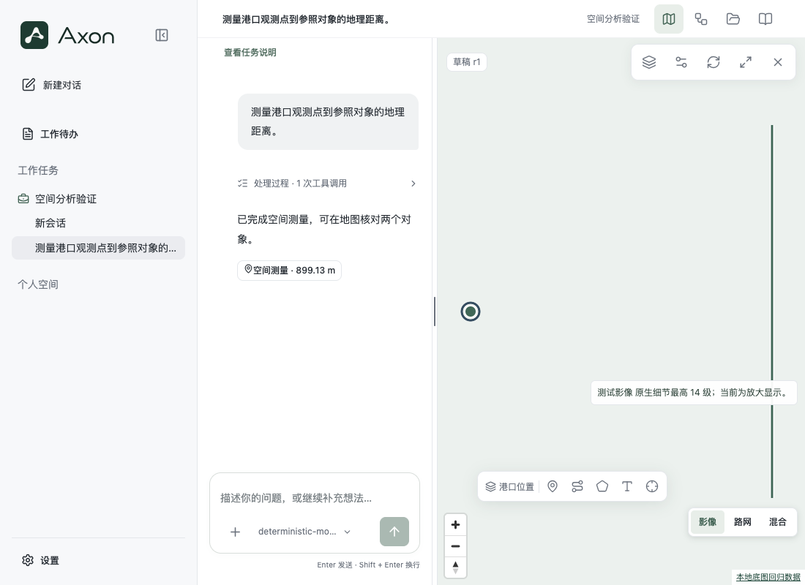
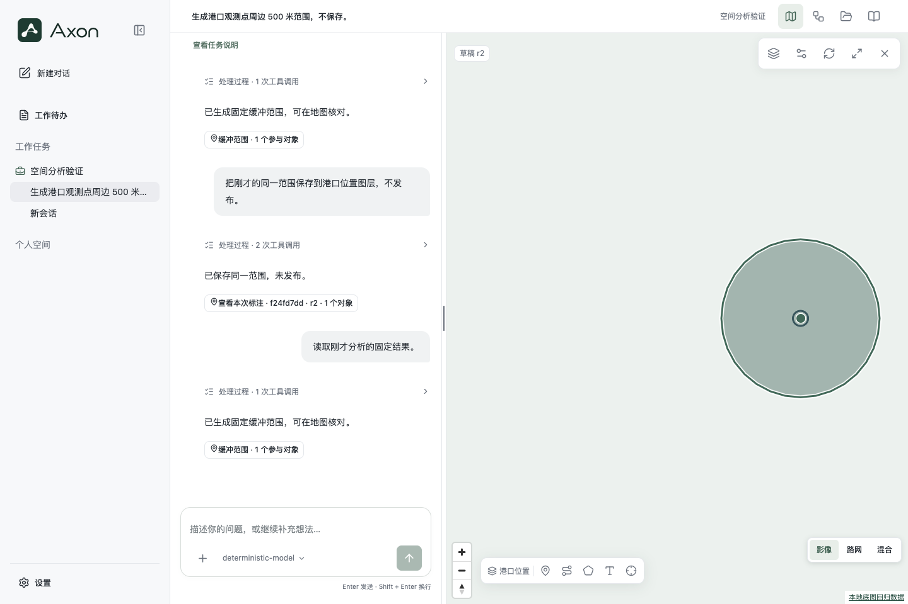

# 空间分析浏览器验证（2026-10-16）

独立 worktree，1440px 与1100px桌面窗口。完整6场景一次6/6通过（约1.1分钟），其后仅React callback ref规范修复，测量两场景再次2/2通过（31.8秒）；前端单元14项通过。最终全量检查另记。

场景覆盖中国青岛港与澳大利亚悉尼港三底图、快速切换/加载失败、未完成绘制；两点测量、点到线测量与参考对象展示；真实缓冲保存后跨请求read；无WebGL时可读列表与计算结果。宽屏定位按面板实际占位留边，窄地图可见区域不足时显式定位收起对象面板。

原始完整截图、trace与测试产物：`/private/tmp/spatial-browser-panel-final`；最终测量确认：`/private/tmp/spatial-browser-panel-confirm`。早期失败保留在 `/private/tmp/spatial-browser-first`、`/private/tmp/spatial-browser-second` 等目录。修复包括有效PNG夹具、等待指定会话加载、面板开关状态判断及等待实际图形渲染。

## 可核对截图

这些截图已实际查看，数值、参考点线和缓冲面可见，未以GeoJSON源注册成功代替渲染完成。

## 证据范围

使用本地平色栅格和合成MVT，验证底图生命周期、独立叠加层、真实坐标和交互；不证明公共影像服务可用性或影像质量。脚本模型固定规划，实际Pi工具、计算、API、权限、原生历史、保存与读取真实执行；不证明真实模型会正确选方法或解释结论。真实模型效果单独按冻结ABC计划评测。
