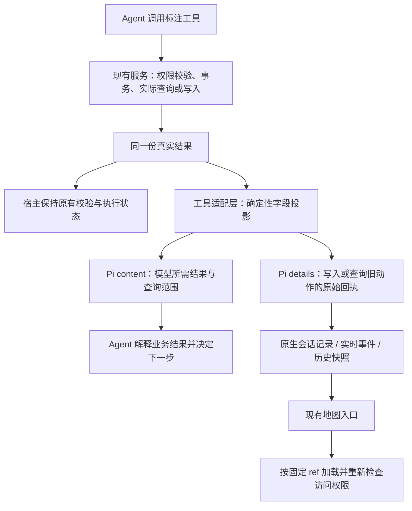

# 地图结果分离与查询范围表达：已批准方案

2026-10-15，根据审阅讨论修订并获用户批准，实施及复测已完成；实际通过项与遗留问题见 validation.md。先前实现及验证记录已提交为 `efe2fb6`；下文“当前”描述设计时的基线状态，实际结果另见实施与验收报告。

## 1. 改进后的使用效果

**现有地图按钮已经由程序根据真实工具回执生成，不要求模型为按钮抄写 ID、hash 或 URL。** 上轮 hash 抄错发生在助手正文中，与按钮生成无关。本次保留现有按钮，分开界面所需回执与模型所需结果，减少模型顺带复述校验数据的机会；同时澄清现有查询参数、计数和分页的含义。

模型仍收到后续调用需要的固定 ref。方案没有禁止模型复述或编造技术标识的代码机制，也不承诺它必然生成某种回答。

例如用户要求“发布为西区讨论第一版”，前后数据分工如下（为便于阅读省略其他字段，P1 是真实 publicationId 的示意代称）：

| 接收方 | 当前 | 修改后 |
| --- | --- | --- |
| 模型 | 发布成功、名称、ref=P1、校验 hash 等整份结果 | 发布成功、名称、ref=P1 等必要结果，默认省略校验 hash |
| 界面 | 从上述工具结果 JSON 提取 P1 并生成按钮 | 从同次执行的结构化原始回执提取 P1，继续生成原按钮 |
| 助手正文 | 可能额外复述 hash，并抄错 | 少收到一项不必要的校验数据，期望只说明业务结果；仍需验证 |

期望用户看到：

```text
Agent 正文：已发布“西区讨论第一版”；本次没有执行设为任务当前。

现有界面入口：［查看发布标注 · 程序生成的发布标识］
                              ↓ 点击
                    打开这次回执对应的固定发布版
```

正文里的业务解释仍由模型生成；入口、固定引用和标识格式由程序生成。之前讨论中的“查看西区讨论第一版”是效果示例，当前按钮实际使用“查看发布标注”加发布标识。本期复用该按钮及样式，不把改标题或新建结果卡片混入必要范围。

对于“比较两个版本里甲的备注”，若只读了甲，合适的回答是：

> 引用版本中甲的备注是“A 现场讨论”；本会话甲的备注是“基线备注”。本次只读取了甲，没有修改标注。

这次查询不能支持“引用版本没有乙”或“整个版本只有一个对象”。这只是解释查询语义的例子，不会写成专门针对甲、乙或备注的 prompt，也不规定固定回答模板。模型原本可以看到自己的调用参数；回显参数是在结果旁重申范围，并非补充此前完全不可得的事实。其收益与重复信息成本需要验证。

备注仍由模型在正文对比，本期不新增程序生成的备注对比表。程序能保证字段裁剪、参数回显和地图入口准确；回答是否遵循这些信息仍取决于模型，需要真实场景检验。

## 2. 当前差距与最小架构

目前服务返回真实结果后，`annotation-tools.ts` 将整个结果 JSON 送进模型；Web 又从同一段 JSON 提取按钮。两方的数据格式相互依赖，模型也收到默认不需要解释的校验 hash。本次在工具适配层分开这两个用途。



采用 Pi 0.85.1 原有 `AgentToolResult.content/details`。不修改 Pi 内核、不加第二套持久记录、不调用额外模型、不从助手正文提取“执行事实”。

服务、HTTP 的 `AnnotationReceipt`、存储、原始查询 DTO 不变。差异仅发生在标注工具适配层和现有 Web 消息传输层。普通查询不为了 UI 再复制整份地图到 `details`；界面需要具体内容时，继续通过既有授权接口按固定引用加载。

## 3. 模型结果与界面回执的职责

### 3.1 同次执行，两种表达

工具适配层从同一原始结果进行纯函数转换，示意如下（字段名为本方案建议，不是现有实现）：

```ts
const actual = await existingOperation();
// 原有宿主状态仍使用 actual；不从模型文本反推版本条件。
return {
  content: [{
    type: 'text',
    text: JSON.stringify({
      format: 'annotation.model-result.v1',
      data: projectForModel(actual, validatedQuery)
    })
  }],
  details: isReceiptResult(actual) ? {
    annotationResult: {
      schemaVersion: 1,
      origin: 'write', // 或 replay / receipt_read
      receipt: actualReceipt
    }
  } : {}
};
```

`origin` 由实际工具执行分支和 `replayed` 确定，模型不能指定。新格式标记用于区分旧 JSON 历史与新投影，不是新的业务版本机制。模型成功结果保留原业务字段名，外围只增加固定格式标记；不把所有动作再包装成一套抽象“事实列表”。错误继续走既有错误路径。

完整写入回执保存在原生 `details`，不等于默认在页面展开全部 JSON。界面只拿其中实际需要的固定引用和对象范围生成现有入口。回执本来就不包含整个地图文档。

### 3.2 哪些给模型，哪些由程序保留

| 数据 | 模型侧 | 程序侧 / 理由 |
| --- | --- | --- |
| `ref`、`beforeRef/afterRef`、对象/图层 ID、修订 | 保留真实值，用于后续读取、编辑、发布、比较 | 界面直接用原回执值；不依赖正文再次输出 ref |
| `baseRef`、草稿状态、`current`、权限 | 保留实际有提供的字段及现有语义 | 发布不补查 current；缺 current 不代表当前为空；`canSetCurrent` 是权限 |
| 名称、实际读取的备注/属性/几何等 | 保留被请求的业务内容 | 不替模型预先解释业务，不用省略业务字段制造“简洁” |
| 来源引用、来源修订、原始查询时间 | 保留已有精确值 | 来源复制和时间证据依然可核对，不改时间精度与时区 |
| `clientActionId`、`replayed`、提交时间、已有发布者/采用者字段 | 保留现有语义和恢复所需数据 | 不为了“隐藏技术细节”破坏查原回执或用户询问谁/何时的能力；不强制正文复述 |
| 标注文档及发布元信息的内容校验 `hash` | 新工具结果及新标注引用默认省略 | 原服务结果、写入回执、宿主依据和持久数据保留；减少正文无必要的 hash 转述机会 |
| 错误 `code/message/outcome/resources/clientActionIds` | 保留 | 区分未提交与结果不确定，按原规则恢复；不把错误压成含糊一句话 |

只省略已知标注元信息路径的校验 hash，不能递归删除所有同名字段：用户业务 `attributes.hash`、备注中的文本或来源数据均不属于这个范围。不是把全部 UUID、时间或版本号统统隐藏。

不新增 `committed=true` 来迎合上次错误说法。真实写入成功、未提交和不确定仍由既有服务结果和工具状态表达；正文无需把成功翻译成某个想象的字段。界面准确也不使正文虚构字段变正确，复测仍统计此类错误。

### 3.3 新引用输入也避免重复投放 hash

`LoadedAnnotationSelection` 当前带 hash，自动输入 v4 会整体序列化 `annotationRefs`。仅改工具结果会留下这条重复入口。

为新地图输入增加 v5：保留宿主原始引用记录及校验字段，模型文本仅省略标注引用的校验 hash，继续带固定 ref、标题、选中对象/图层摘要。紧邻引用说明“这是所选范围的摘要，不是整个版本的对象清单；未加载几何与业务属性”。

v5 原样保留 v4 的基线、草稿、任务当前和权限说明；这些关键规则不依赖 Skill。v1–v4 的历史生成与逐字验证不变，纯方法/角色输入维持原分支。这里只为新输入表示变化新增版本，不重构全部输入注册机制。

## 4. 查询范围如何表达

### 4.1 复用现有参数与计数

保留 `objects.total / offset / limit / hasMore` 的名称和数值，不另建对象范围类型、字段模式或替代计数字段。`annotation_read` 的 `draft/read` 成功读结果仅增加一个 `query` 对象，直接回显这次已验证参数中的 `objectIds / layerIds / fields`。

传入哪个选择字段就回显哪个，保留其原值；未传入的字段不补造，未传任何筛选或字段选择时为 `query:{}`。objectIds 与 layerIds 沿用现有互斥约束；`fields:[]` 和省略 fields 都沿用默认摘要语义。分页采用已有返回值，不在 query 再复制一份。不增加额外查询、总结器或自动生成的解释文字。

例如固定版本本来有甲乙，只读甲的备注时，模型收到以下业务部分（省略外围 format 和其他已有字段）：

```json
{
  "ref": {"setId": "固定版本所属集合 ID", "revision": 3},
  "query": {"objectIds": ["point-a"], "fields": ["note"]},
  "objects": {
    "items": [{"objectId": "point-a", "name": "甲", "note": "A 现场讨论"}],
    "offset": 0,
    "limit": 50,
    "total": 1,
    "hasMore": false
  }
}
```

上例 ID 为示意占位符，实际必须来自真实结果。`total=1` 仍表示本次筛选匹配一个对象；`hasMore=false` 表示该筛选范围已无后续页。两者均不证明整个版本只有一个对象。

若 offset 不是 0，或此前有页面没读，即使 hasMore=false 也不代表已经看过全部匹配对象。结果中的 layers 只是相关图层元信息，也不能代替对象字段的实际读取。

| 情形 | 表达及可得结论 |
| --- | --- |
| 指定对象 | 回显 `query.objectIds`；total 属于这些对象，不能对没查的对象下存在性结论 |
| 指定图层 | 回显 `query.layerIds`；数量只属于这些图层 |
| 未限定对象/图层 | query 中没有 objectIds/layerIds；total 可解释为所读固定版本的对象总数，当前页仍可能不完整 |
| 省略 fields 或 fields 为空 | 分别不回显 fields 或保留 `fields:[]`；返回基础摘要，未读业务字段，不能说备注为空或几何不存在 |
| 指定字段 | 回显 `query.fields`；仅这些业务字段被读取，基础对象元信息仍提供；已请求字段的缺值按原 DTO 语义解释 |
| 分页 | offset/limit 使用实际返回值；total 是筛选后、分页前总数；hasMore 仅控制同一范围后续页 |
| 对象不存在或无权访问 | 保持原错误；不把错误转成空列表，不帮助模型区分受保护资源是否存在 |
| 尚无会话草稿 | 保持 `status:empty` 及已有绑定语义，不伪装成成功读取了零对象版本 |

不为计算“整个版本总数”自动增加一次全图查询，不额外读取全图几何，不强迫模型在单对象问题上证明所有其他对象。只有用户要求全版比较、完整清单或对象缺失判断时，才按需要查询完整范围或使用已有 compare。

`compare` 仍比较两个固定版本，`changes.total/counts` 表示变化项而非对象总数，结果和工具说明明确该含义；`annotation_list` 的 drafts/publications 分别是当前权限可见的草稿/发布版分页，不是地图对象清单。来源查询已有 query 回显，本期不改 `situation_query` 的数据契约或它的界面证据链。

### 4.2 必要说明与防止过拟合

`annotation_read` 工具说明就近解释三个通用规则：total 是筛选后分页前数量；hasMore 只说明同一筛选范围的后续页；未请求字段不等于字段为空。列表/比较计数含义写入对应说明。结果回显参数，不在每次回执重复一整段规则。

现有结果报告说明整理成简短边界：“按实际读取范围说明业务结果；地图入口由界面提供，无须顺带复述技术标识。”关键语义直接随工具提供，不依赖 Skill。甲乙例子和上轮错误原句仅留在设计/验收证据中，不注入运行提示词；不要求模型每次回答都附带范围声明。

这部分是改善工具数据与提示说明，仍然通过模型上下文影响回答。程序不会拦截“未查对象不存在”等自然语言句子，不增加答案审核或自动改写。回显参数是否比仅看调用参数更有帮助，需通过后续结果判断，不能先断言已根治。

验证除原 B02 外，还覆盖其他对象选择、图层筛选、分页和不同字段组合，见 implement.md。确定性测试证明返回语义一致；真实模型的只读泛化案例用于观察它是否能迁移这些语义。二者分开报告，不以原甲乙用例通过证明普遍可靠，也不在失败后不断补针对该案例的提示。

## 5. 界面回执如何生成与传递

1. `annotation_action`、`annotation_from_source` 成功后，从原始回执生成 `details.annotationResult`；`annotation_read mode:receipt` 查到原回执时生成相同结构，但 origin 为 receipt_read。查不到回执不生成成功入口。
2. `lab.ts` 将经过校验的结构作为可选 `annotationResult` 放到现有 `tool.completed` 和历史 `PublicMessage`。实时与历史共用一个提取/验证函数；不把所有工具的任意 details 直接发送给浏览器。
3. `useChat` 保留这个结构，`evidence.ts` 优先从中获取固定 ref、对象范围及原动作标记，`EvidenceMapLinks` 继续渲染原按钮。同 requestId 关联、去重、对象数量限制与折叠不变。
4. 点击仍走既有地图加载及权限检查，打开只读固定参考，不切换编辑目标，不跟随草稿最新修订。发布用 publicationId，草稿写入用固定 setId/revision。

这一步放在工具结果适配与 Web 投影链路，**不放在模型最终回答的字符串处理里，也不把按钮生成塞进发布事务。** 发布服务只负责真实发布和返回回执；一个相同的回执可以同时支持模型理解、历史记录和界面入口。

新元数据须校验结构、工具名与动作相容、ref/afterRef 等一致性、原动作标记和当前消息所属请求；保留现有会话/任务权限边界。无权限、工具错误、结果缺失、结果不确定均不生成成功入口。不能仅凭消息包含一个字段就视为可信，不能从助手声称“已完成”填充回执。

## 6. 历史、宿主依据和兼容性

### 6.1 旧历史兼容

- 有合法新 annotationResult 的消息：只用结构化回执生成入口，不再解析模型文本来补齐缺失业务结果。
- 没有新格式标记的旧工具结果：继续用原严格 JSON 回执解析，保留已有按钮和旧单项来源回执兼容。
- 旧读结果可能没有 query。缺少 query 不等于“未筛选”，需结合可用的原调用参数理解，不能仅凭 total 推断完整版本；本次不回写旧结果。
- 新格式结果的 details 丢失、损坏或版本未知：不退回解析投影文本来凑成功；保留文本及可诊断状态，不显示成功入口。新外围 format 可明确区分此情形与旧历史。
- 旧助手错误文字不重写、不隐藏；旧文本中的 hash 不会被全量清理。承诺的是新结果分工及旧历史可读，不是修复已有会话污染。
- 原生会话重开、服务重启和压缩后的完整历史展示仍能恢复精确入口；模型压缩摘要不作为 UI 回执来源。用固定历史夹具验证，不能用新生成器即时构造“旧期望值”。

### 6.2 宿主读取依据不变

`AnnotationRequestState` 继续从原服务对象保留真实 hash/修订、来源读取记录和任务当前 sequence。省略模型侧 hash 不等于取消并发校验，也不是让模型选择 expectedRevision。

现有 pending → 下一次实际推理才接受读取结果的机制保留。`afterToolCall` 比较的应是工具实际产出的模型 content 与 hook 之后的 content；模型结果被替换/报错时，不能仅因 details 存在就视为已读。自有写入续接、旧回执不推进当前依据、不确定结果先查原回执再读取的规则不变。

结构化界面回执也要经过 hook 边界：若 hook 更改或破坏回执元数据，不展示未经核对的成功入口；内容被改写而 details 仍在，也不能绕过既有拒绝结果规则。具体校验优先复用原结果快照和边界函数，不新增长期 receipt registry。

### 6.3 范围与回退

不改业务数据库和 HTTP 标注契约，无业务数据迁移。新增字段只在宿主工具/Web 表示层；旧前端不能被当作新投影格式的完整读取器，发布时前后端同步构建。

若实施后需要回退，可以停用新结果写入，但保留新模型格式、新回执字段和 v5 输入的读取兼容；直接部署完全不认识新历史的旧程序会造成入口丢失或历史校验失败，不作为安全回退方式。

## 7. 验收和风险

完整步骤见 [implement.md](implement.md#原场景复测)。主要观察：

- 原 B02 三条链不再把只读甲的结果说成整版只有甲；原 C01/C02 发布、采用、拒绝中的入口均对应真实固定回执。
- 全新验收会话的 provider 输入不再由新工具结果/标注引用带入校验 hash，也不含完整 details；旧历史、用户原文与业务属性不在这项移除范围。模型仍能正常发布、查原回执、采用和继续编辑。
- baseRef/current、权限、固定引用、来源复制、手工与 Agent 接续均无回归；正文不得虚构回执字段、改变保存值或扩大查询范围。
- 所有助手可见文本都审阅；分开记录操作通过、界面通过、目标错误未复现、整体说明是否通过。新错误继续披露，不能因为原错误没出现而算全面稳定。

最大实现风险是实时/历史只接通一端，以及投影破坏读取依据或不确定结果恢复。先用确定性测试覆盖，再运行固定原场景；不靠多轮模型重试寻找漂亮结果。

本方案减少不必要的转述机会，给模型更明确的证据边界，但业务说明仍存在生成误差。无需因此提前建设答案审核器、通用 diff UI、完整状态注入或强制全图读回。成熟实现对照和本地证据见 [research.md](research.md)。
