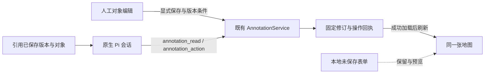

# Agent 与标绘整合设计（待审阅）

> 执行更新（2026-10-26）：用户已批准按方案实施及工程自动化测试。下文“待审/未实施”记载为原稿状态；真实模型批次须单独核对额度，不影响先完成 P1–P3。
> 2026-10-26。第一步范围与版本已确认；本文件是第二步方案，尚未实施。固定输入和排除项以 [prd.md](prd.md) 为准。实现顺序与验收预算见 [implement.md](implement.md)。

## 先审阅这五个决定

1. **引用已保存对象来交给 Agent。** 沿用“引用此对象”；页面选中和未保存预览不自动发送给 Agent。
2. **只改变用户要求的内容。** 保留现有 API 的样式整体替换语义，Agent 先读取完整样式，前端生成最小修改集合。
3. **未保存输入留在本地。** 可以继续对话；需要引用本地修改时先保存。Agent 写入成功后提示已保存版本变化，不替换正在填写的表单。
4. **冲突由用户明确处理。** 不同字段的改动在确认后合并；同一字段的不同改动逐项选择。不自动保存、不静默覆盖。
5. **验收整合后的同一版本。** 工程回归与真实 Agent 场景分开；模型选型、R14 和主线合并仍各自独立。

## 1. 架构与改动边界



复用既有共享目录、DTO、读写服务、权限、请求级 CAS、回执及 Pi 原生工具循环。来源态势仍为只读。新增的编辑起点、字段差异、冲突选择只存在于页面组件内，不进入服务端持久库，也不作为模型权限或事实依据。

本轮不新增工具种类、业务写入端点、全局提示词注入、服务端锁或自动字段合并服务。当前后端写入语义保持兼容；若真实验证证明现有参数形式无法稳定完成任务，再单独提出工具契约改版，不在实施中顺带扩大。

## 2. Agent 如何识别对象

### 2.1 定位顺序

| 用户提供的依据 | 处理方式 |
| --- | --- |
| “引用此对象”生成的固定 ref + objectId | 先核实引用所属版本和身份；编辑本会话对象前，draft 模式按 ID 读取当前对象及所需字段 |
| 明确图层/对象名称 | 使用已有 layerNames/objectNames 精确筛选；查看全部相关候选，重名时询问，不默认第一页第一个 |
| “这艘船”“选中的对象”，没有有效引用或唯一前文依据 | 请用户引用对象或说明名称/图层；不能假装知道浏览器当前选中状态 |
| 来源系统对象 | 用 situation_query；要生成标绘则按完整 sourceRef 复制为快照，不能写入来源系统 |
| 历史版、发布版或其他会话对象 | 可读取参考，不切换可写目标；复制到当前草稿或新会话派生须符合用户明确意图，不按同名/相同短 ID 偷换目标 |

标绘身份包含固定版本所属 set 与 objectId；显示名称、图标或短 ID 单独都不能跨来源证明同一对象。引用元信息不包含完整样式、几何或业务属性，不能代替 annotation_read。已有正确读取可复用，不要求每次机械重读全图。

同一草稿的旧引用：以引用确认对象身份，再读当前版本；若用户要求修改的字段在引用版本后已变化，核对旧值和新值，必要时让用户确认。其他字段变化时保留当前值。对象已删除、变成不兼容类型或不再可写时，说明并停止，不自动复活。

### 2.2 图标可发现性

继续从 MAP_SYMBOLS 生成 symbolId 参数枚举。每项简短说明包含名称、标准条款或“应用扩展”、是否支持方向；必要别名来自同一目录，不维护第二套列表，不把 SVG 放进上下文。Skill 只解释选择规则。

“消防车”不足以认定水罐车/泡沫车等具体类型，先询问；明确“冲锋舟”“救援舰船”“消防艇”分别映射各自条目。方向为真北 0°、顺时针，朝东为 90°；未设置不表示真实朝北。战斗员、集结地、消防无人机保持直立，不接受 heading。

## 3. 属性保留与修改契约

### 3.1 Agent 侧

现有 update_object 只合并顶层字段；style、attributes、sourceRefs 和 geometry 若传入，就是整体替换。保持这个契约，避免改变已有字段清除和旧客户端行为。

| 用户请求 | 必需依据与写入方式 |
| --- | --- |
| 改名或备注 | 在当前 draft 确认目标，仅提交 name 或 note |
| 改方向、尺寸、线箭头或标签 | 读取 style，基于完整原样式只调整目标键，再提交整个 style；不重新填写 geometry、attributes 等其他顶层字段 |
| 添加一个业务属性 | 读取 attributes，保留现有键及 null/缺省区别后提交完整新 attributes |
| 修改信息性质 | 按用户明确意图设置 informationRole；没有角色的历史对象不自动补成方案或现场记录 |
| 清除方向、改为固定直立图标 | 在重建的 style 中有意移除 heading；不发送 null 或用 0 代替清除。更换图标涉及保留还是清除方向，按请求意图和符号兼容性处理 |

示例（伪代码，oldStyle 必须来自真实 draft 读取）：

```ts
changes = { style: { ...oldStyle, heading: 90 } };
```

不能只传 `{style:{heading:90}}`，也不能为了通过验证只补 symbolId 而丢掉尺寸、标签等字段。失败修正只针对错误，不添加未要求的新对象。

### 3.2 人工编辑侧

编辑起点保存原始对象、原图层和对应固定版本。表单记录初始有效值与当前有效值的差异；未操作字段沿用原始保存值及缺省状态，不因 UI 展示了默认色/尺寸就写入默认值。清除方向与删除业务属性必须区别于未修改。

普通保存生成最小顶层 changes；样式或业务属性确实变动时，使用原对象加本地变化构成完整替换值。拖动几何只改 geometry，跨图层移动只改 layerId。对象 ID、来源引用和未改信息性质保留。服务器仍做完整校验与事务保存。

## 4. 未保存编辑与版本冲突

### 4.1 页面上的常态提示

有未保存输入时，编辑卡片保留简短提示：“这些修改尚未保存，Agent 只能读取已保存内容。”不增加常驻大面板，也不禁止用户继续普通对话。

新对象未保存前不能生成固定引用。有本地编辑或结果待确认时，引用入口提示先保存或取消；尤其防止全屏地图引用后跳回对话而丢失本地表单。已经发送的引用仍指向原固定版本。

Agent/其他页面产生新修订后，沿用现有消息刷新、手工刷新和重新加载入口；本轮不新增跨标签实时推送。无本地编辑时更新地图；有编辑时保留表单、预览、输入焦点和视角，显示“已保存版本已变化，请核对后保存”。若没有收到刷新，旧版本保存仍由服务端 CAS 拒绝。

### 4.2 先保证编辑依据一致

binding 和固定内容必须成对加载成功，才允许开始编辑或形成新的保存依据。不能把新 binding.headRevision 配上旧内容。刷新失败或权限变化时保留本地输入，但禁用确认合并/保存；错误恢复后重新加载。

### 4.3 三份内容的比较

- B：开始编辑时的原始已保存对象和图层。
- L：基于 B 形成的本地修改，不包含未触碰的 UI 默认补值。
- R：成功读取的最新已保存对象和图层。

只在当前编辑对象上比较三者。name、note、informationRole、layerId 为独立字段；style 的受控键和 attributes 的各键分别比较；geometry 及 sourceRefs 按整体比较，不做顶点或数组合并。缺失、空串、null 和删除分别处理。

| 比较结果 | 交互与结果 |
| --- | --- |
| 仅其他对象/图层标题变化，目标对象未变 | 展示版本变化，用户确认后把本地修改应用到最新版本 |
| 本地改名称，对方改方向等不同字段 | 展示双方变化，点击“合并我的修改并保存”后，基于 R 应用本地变化 |
| 同一字段双方改为相同值 | 视为已一致，不制造冲突；无剩余变化则清除已解决编辑，不新建空修订 |
| 同一字段双方改为不同值 | 展示“开始编辑时／我的修改／最新保存值”；每项选择保留哪边，全部选择后才可保存，不预选覆盖 |
| 对象/目标图层删除、对象类型改变、草稿身份改变或权限撤回 | 不自动复活/重定向；停止旧操作，保留输入供查看或复制，由用户显式取消后另行操作 |

比较区仅在发生冲突时展开；沿用浮动卡片的高度上限和内部滚动，保存/取消仍可见。查看最新内容不能盖掉本地预览；使用并排字段值和预览显隐核对，地图不自动跳转。

确认合并的对象从 R 构造，只应用用户选中的变化，按 R 的 revision 提交一次。确认后再次发生变化，继续拒绝并保留内容；不自动循环重试，也不复用旧的冲突选择来覆盖新值。取消核对仍保留原编辑；“放弃本地修改”须显式确认并加载最新对象。

### 4.4 保存结果不确定

复用原 pending.clientActionId 和查询回执流程。未知结果时先查原回执，不能换新 ID 重发；回执未找到不等于未执行。确认原动作成功后只清理它对应的提交缓冲并加载结果；恢复路径与版本冲突合并分开。普通输入校验错误也不冒充版本冲突。

### 4.5 Agent 遇到并发变化

保留现有请求级 CAS 和错误返回。Agent 收到冲突后定向读取当前 draft，重新判断用户意图；不能沿用旧完整 style 覆盖最新值。同一字段的意图不再明确时询问，明确后只修改该字段；其他字段保持最新值。该策略是 Skill 指引加真实验证，不宣称宿主能识别所有自然语言意图。

## 5. 事实说明与信息性质

observation/assessment/plan 表示记录的性质，不自行认证为现实真相。来源快照、图标、资源点数和 availableCount 等业务数量分别说明。发布和采用不改变信息性质，不意味着调度执行或实际到场。

成功答复依据真实回执，例如“已将冲锋舟方向改为 90°，保存到本会话草稿”。方向、图标和业务事实需要实际字段支持。保存前不得宣布完成；回执不足时定向核对。地图链接继续由已有结果投影生成，不让模型手写内部地址。

## 6. 预期改动位置

| 文件或模块 | 最小改动原因 |
| --- | --- |
| `src/pi/annotation-tools.ts`、`fixtures/skills/map-annotations/SKILL.md` | 从共享目录补充符号说明、字段整体替换与身份/接续规则；保留固定 Agent 基线规则 |
| `src/web/annotations/useAnnotations.ts` | 成对加载固定版本、保留 ApiFailure.code，区分普通错误、版本冲突和未知结果 |
| `src/web/annotations/AnnotationWorkspace.tsx`、`FeatureEditor.tsx` | 编辑起点与最小改动，未保存提示，引用离页保护，冲突核对入口及保存 |
| 该目录新增小型差异计算模块/冲突视图，及 `annotations.css` | 可独立验证的有限字段比较；冲突出现时才显示，不建立通用协同框架 |
| 对应单元、Pi、浏览器测试和任务内验收程序 | 覆盖属性不丢失、冲突不覆盖、实际 Agent 行为与完整证据 |

路径相对 `experiments/harness-lab`。`AnnotationService` 的现有顶层合并语义、公开 DTO 和数据库结构预计不改；如实施发现需要改变，先更新方案范围。既有单地图、旋转手柄、符号素材和标准颜色不重新设计。

## 7. 兼容与交付

固定版本组合在独立集成 worktree 实施，原两个工作分支保留。前端、后端字段支持和 Pi schema 同版本部署；已写入新字段的数据不能交给旧后端直接回退。验收用独立合成数据，不操作现有 4324 试用库。

R14 继续使用它冻结的产品、Skill 和样本，本方案不向其插入新能力或修改模型配置。合并成功只是进入验收的起点，验收通过后才提出主线合入与本地试用更新。

## 8. 审阅状态

以上交互、差异处理和验收安排均为建议方案。用户本轮授权的是落盘待审，不是实现或真实模型调用。第一步已确认的范围与哈希保持不变；本稿没有预先选择尚未审阅的 UI 行为作为已生效产品规则。
