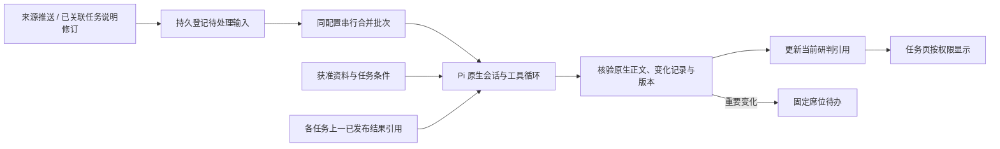

# 技术设计：持续后台研判

日期：2026-10-26。**用户已批准推荐设计。技术探针结果在实施中补充。**

## 1. 基线与最小增量

现有 `preprocess` 的输入、目录、原生 session、结果与投递均以单事件为单位。`TaskAssessment` 记录归属理由，不记录跨轮当前判断。当前来源规则已能选择 Profile、scope 和接收席位；Pi 已支持原生多轮、工具循环和默认压缩。

采用一个显式的持续分析配置（内部称 stream）：固定 Profile 快照、contextScope、来源集合和共同受众；同配置串行合并批次，每轮只启动一次 Pi 原生请求，由 Agent 自主查询和分析零个或多个任务。这里的“一次请求”允许 Pi 正常多次调用模型／工具，不是限制模型一步完成。

不选择“每事件完整研判后固定逐任务再跑一次”的流水线：它增加调用、重复取证和扇出，而当前需求可以由同一 Pi 循环覆盖。也不把所有来源、所有任务放入一个无限制共享会话。每任务独立流保留为后续吞吐或上下文实测证明确有需要时的选择。

## 2. 用户入口与配置边界

在已有处理与投递规则页增加持续模式及来源集合选择，后端验证：所有来源允许该 Profile、所有固定席位位于每个来源允许接收集合、所有席位满足 contextScope；管理者须有全部来源的 manage 权限。同一来源的有效规则只能选择旧模式或一个持续配置，不隐式双跑。

首次开启只处理此后接收的输入，不批量重跑旧事件。已接收输入保留接收时配置快照；切换模式只影响未来输入。关闭来源接收与暂停持续分析执行分开：前者拒绝新消息，后者保留积压，达到既有容量上限后明确拒绝接收。

分析目标、Profile/工具、来源集合、资料范围或受众变化建立新配置代次并使用新原生 session；旧代次数据和快照保留，不能扩大新受众的历史访问。已经受理的旧代次批次按原快照处理，并再次检查当前授权，权限收缩则阻止执行／发布。每代次结果不冒充新配置结果。

首期连续模式工具限定为受控只读资料／Skill读取、多源及任务查询、已发布研判查询、变化元数据记录；不启用 Bash、文件修改、指令修改、地图写入、业务交接或额外子 Agent 编排。普通前台与旧 Profile 不受影响。

## 3. 新状态为什么必要

| 必要元数据 | 已验证缺口 | 正文来源 |
| --- | --- | --- |
| 持续配置及代次、native session 引用、领取互斥 | 现有每事件新 session，无法稳定承接且无多来源共同授权边界 | 不保存正文 |
| 待处理输入、不可变批次及其 job、配置快照 | 现有 job 只能关联单 event/source；任务修订没有来源事件 | 原始事件固定文件或 task revision 快照 |
| streamEpoch 最新已发布轮次，以及 `(streamEpoch, taskId)` 当前已发布结果引用与任务版本 | 最新事件归属不能表达任务当前研判；模型历史末尾可能是失败轮次 | Pi 原生 request 的公开说明及最终答复 |
| 每轮已核验的变化记录、通知投递回执 | 不能从自然语言关键词推断需提醒，也不能因静默而失去读取权限 | 变化工具的原生成功记录 |

不另存一份分析 Markdown、证据库、长期摘要或通用 Run 引擎。现有 native JSONL 继续承担内容权威；SQLite 保存关系、版本、状态及稳定引用。

## 4. 输入、合并及领取

输入区分 `event` 与 `task_revision`。来源事件沿用 `(sourceId,sourceMessageId)` 幂等和固定附件 hash。任务说明成功保存与相关 task_revision 待处理输入应在同一 SQLite 事务中提交，避免保存后崩溃丢失触发。任务修订只唤醒当前有效代次中已发布过该任务研判的配置；退役代次只处理切换前已受理的输入，不再接收新来源事件或任务修订。新代次不继承旧代次的任务订阅或原生历史，首次从之后的来源事件自主查询开始；新任务不自动启动全系统回扫。任务说明修订本身是新证据，不重置原生会话。

候选验证参数：静默 5 秒、从本批首条起最长等待 30 秒。触发条件持久化，定时器仅唤醒；重启后从数据库继续。批次还有输入数量／总字节容量，达到边界即截取一批，剩余输入保持待处理，不静默丢弃或截断。具体容量按现有输入限制及隔离探针确定，不能把批量无限塞进 prompt。

领取事务冻结有序 input refs、配置代次、接收截止及上一次发布基线；同配置只允许一个运行中请求，不同配置仍受 BackgroundService 作业并发与共享 ModelPermits 限制。队列占用按实际待处理输入计数，不能用一个大批次绕过 backlogLimit。

运行中新消息进入下一批，不取消当前轮；否则持续高频来源会导致永远不能发布。页面显示“依据截至本批／仍有更新待处理”，不把尚未分析的消息包含在已核对范围。接收顺序只安排执行，业务新旧由实际来源版本、业务时间及查询结果决定；缺失版本不能凭标题去重或猜测。

## 5. Pi 接续与发布基线

正常轮次打开该配置代次的原生会话，复用 Pi 默认工具循环和压缩。当前请求可取得本批原文、资料身份和输入引用；按需查询任务、来源事实和既有研判。

增加一个受控只读查询入口（建议名 `analysis_current_read`），从宿主发布索引读取配置代次最新已发布轮次、某任务最后成功发布的固定 request 引用及正文，而非猜测“历史最后一条 assistant”。同一入口支持有界分页列出已发布轮次的元数据，并读取由该索引返回的固定 resultRef；零任务归属轮次同样可查，避免恢复到新 session 时丢掉未归属的重要事实。读取仅限当前 streamEpoch，不能由模型选任意路径或私有会话；结果尺寸有界，超量明确报错。同一入口可按需读取指定已发布 request 的成功来源查询证据，复用现有 queryEvidence/native tool 投影；旧 assistant 对来源的转述不能替代原始事实，必要时按来源历史版本重新取证。历史查询有必要是因为原生压缩可能不保留某一任务精确旧判断，而比较必须能回到原文；工具不写摘要，也不定制 Pi 压缩。

当一个任务上轮未被评估，它的基线可能早于最近通道轮次。未列出任务表示本轮未评估，不能表示没有变化。来源事实、先前模型推断及人员维护的任务说明在上下文中明确标识；上一判断只作为待复核观点。

失败／中断轮次从不推进发布索引。正常上下文内若出现未发布轮次，宿主明确提供其状态和最后已发布基线，不能把未发布建议当成当前。恢复时使用新请求与已发布依据；是否能通过公开 SessionManager 分支／fork精确恢复已发布上下文，需要先做隔离验证。若失败历史污染无法通过公开机制可靠隔离，采用新原生 session 加受控已发布引用读取；不为此写一套自定义记忆机制。此选择须在实施 P0 证据完成后固化，不能凭假设实现。

## 6. 变化记录和原子发布

建议一个元数据工具 `information_record_analysis_update`，沿用已有归口工具的 recorded≠published 方式。参数表达：

- `taskUpdates[]`：任务 ID、与该任务相关的有效输入 refs、变化类别（首次／改变／无实质变化／撤回旧判断／依据不足无法判断）、变化理由和重要性；可为空。
- 未归属任务的变化及重要性理由：覆盖零任务重要事实，不强制先建任务。最终是否通知由宿主计算“任一 taskUpdate 重要 OR 未归属变化重要”，不存在一个批次静默标记覆盖任务重要性的第二套判断。
- 已无法确认的依据或未完成判断明确列出，不将“查询失败”归类为“无变化”。

任务 revision 从本轮成功 task 查询的观察记录派生；各任务比较基线由宿主绑定已发布索引，模型不能任选。input refs 限于当前批次或当前配置中已获准的固定历史引用；宿主验证任务可见且活动、来源引用存在、格式互斥及范围。任务关联须精确到输入，不能把批次所有事件都自动关联到所有任务。批次内若含 task_revision，宿主绑定 requiredTaskIds：模型须对这些仍活动的任务以当前 revision 明确更新，才可确认对应修订输入已处理。资料不足可发布明确的“无法判断／需要核实”，不得伪装无变化；漏评则视为元数据不完整，保留输入并暂停待核对，不无限自动重排。已归档任务由宿主明确记录不再参与，保留历史；同任务多次修订合并到最新版本，并记录旧修订被其覆盖。普通来源事件允许零任务结果。

正文仍是原生公开 assistant 输出及最终答复，元数据不再复制整份报告。沿用现有 processingText 分层展示“处理中说明”和最终答复；比较引用绑定固定 request 与 finalMessageId，不能把工具前的中间断言冒充最终结论，不增加修复正文的模型调用。首期一份多任务报告可被多个任务引用，在共同受众范围内显示该任务变化理由及完整报告；不解析 Markdown 章节伪造独立任务正文。现有 `information_record_task_assessment` 保留给旧模式；持续模式的新工具同时表达本轮输入关联及变化，避免要求模型重复登记同一业务关系。

只有正常结束、原生正文与成功工具证据匹配、配置仍有效、观察到的任务 revision 未改变，才在一次数据库事务内提交该轮发布元数据、任务当前引用及重要变化的待投递记录。某个 task revision 已改变时，本轮保留历史但不发布当前引用／通知，将相关输入与任务修订保留待下一批重新评估，不自动重放同一 request。

没有合法变化记录的正常文字答复可以保留执行成功状态，但发布状态明确为“未发布：缺少完整变化记录”；不能默认静默、用关键词猜重要性或强制追加一个修复模型调用。配置暂停领取并显示待核对，避免后续把不完整结果当成新基线。

## 7. 任务背景、人工输入及权限

首期任务背景来自当前 `TaskSpace.goal/context` 和获准的来源资料。task.goal 可以由管理者写入路线、截止时间、资源条件及明确进展；context 仍只用已有 refs/focus。没有计划资料时如实说明，绝不读取其他席位工作区或把已有 WorkItem 状态推导成实际执行进展。

“讨论此研判”沿用席位私有普通会话，固定携带当前选定 round/result refs。用户讨论中的假设不自动回流。确需共享的事实由有权人员明确修订现有任务说明，再触发 R08；不增加自动提取／发布私有聊天的路径。

读取连续结果必须满足：任务可见（若从任务入口）AND 结果已经成功发布 AND 满足冻结资料范围与当前权限。正文权限来自以下任一条：当前仍合格的配置固定接收席位，或对配置全部来源均有内容查看权限。前者是启用持续配置时明确授予的、仅限该配置已发布结果及其输入的读取权；不开放该来源任意历史库或未发布输入。

所有当前页、历史页、搜索、计数、工具过程、下载和对话导入复用同一个组合检查；不能用批次第一条 sourceId 代理全部权限。来源管理员没有 scope 时只见最小运行状态。通知回执只表示提醒，不再是连续结果能否阅读的唯一条件；这解决静默更新对固定受众不可见的问题。

## 8. 通知、页面和旧行为

旧模式保持每条成功预处理的固定投递及补充审批。持续模式不再生成每条原始事件的旧式预处理和待办，只有一轮重要变化的固定提醒；无变化轮次仍可查看。持续模式首期不启用补充投递候选和审批，避免累积历史随接收者变化泄露。

重要性由模型判断，宿主只校验记录与依据，语义准确另测。首轮有实际风险／重要变化才提醒；资料不足且影响关键判断时也可以提醒。技术失败属于运行关注，不伪装成业务风险或无变化。重复投递按 job×seat 幂等；失败只重试投递，不再调模型。

任务首页增加当前研判区块，分配置范围呈现，显示最后成功时间、任务 revision、输入截止和更新／暂停／失败状态。工作总览内补充仅包含当前身份可读内容的“研判记录”列表，覆盖无任务归属和静默轮次；导航及查询依据 continuous 内容能力开放，不要求接收者额外拥有来源管理权或跨席位工作总览权限，也不因此开放其他工作总览栏目。历史详情固定版本；新结果以“有新研判”提示，不抢导航／焦点或替换草稿。重要提醒保留旧版本及处理状态，显示后续结果入口，不自动结清，不宣称已有完整风险生命周期。

## 9. 数据库、兼容及恢复

现有 `background_jobs` 和 `background_deliveries` 的 event_id/source_id 为非空且 kind 仅允许两个值，不能拿第一条 event 伪装新批次。建议扩展为显式判别联合：旧 `preprocess/seat_analysis` 保留单事件约束；新 `continuous_analysis` 引用不可变 batch/streamEpoch，来源集合从其快照读取。数据库迁移须同步 SQL CHECK、FK、JSON 与索引完整性、所有读取投影、撤销／恢复／文件路由及验证器。物理上以少量 stream、input/batch membership、current-result 元数据补足，复用已有 job/notification 存储；不得另建第二套队列。

现有版本最高为认证+标注 v9、后台+标注 v10。具体下一版本须在实施开始及合并前重新核对并统一登记，避免与并行分支冲突。旧数据不开启新模式，无需迁移原生正文，也不追溯生成研判／提醒。升级先做停服完整备份及独立副本迁移；回滚恢复匹配数据库与原生文件备份，不能只回退代码。

queued 跨重启继续；running 恢复为 interrupted；普通 failed、人员主动 cancelled、缺少完整元数据同样保留输入、原生历史和上次已发布结果，并暂停所属配置代次的领取，显示一次“恢复分析”入口。主动停止不会被下一条消息立即重新启动；新消息仍按接收开关和容量持久保存。新活动代次不继承退役代次的暂停标记，退役代次恢复也不得领取新输入。任务版本竞争属于确定的业务更新，按前述规则自动重评，不混同执行失败。恢复动作登记幂等回执，创建新轮次，并明确未发布内容不作当前基线。已原子发布但提醒未完成时只补投递。普通来源／查询失败可由 Pi 返回带缺口的有效判断；整体运行失败不能静默覆盖旧结论。

## 10. 需要验证后再固定的技术点

- Pi 公开 session 分支／恢复在压缩、失败轮次、工具记录之后的行为；不能仅凭普通多轮可用认定恢复可用。
- 批量大小、5s/30s 合并候选值、多个任务的上下文和调用成本。
- 新变化元数据与普通正文一致性、缺记录时的恢复体验。
- 实际模型对旧推断纠错、任务条件变化、风险解除与无关信息的判断能力。

以上通过隔离实验解决；若结果要求改变权限范围、业务自动化或用户体验，回到方案审阅，不直接扩展范围。

## 已批准空间增量与改动边界

2026-10-27 以 `task-spatial-continuation-review.md` 为当前批准范围。最小能力缺口在任务发现、后台只读空间适配与首次触发；不重建几何算法或Pi运行循环。

- `contracts/access.ts`、`access/context.ts`、任务编辑组件：复用业务引用增加可选用途，旧引用保持兼容，明确实际路线/地点/作业范围。
- `context/task-query.ts`、持续分析服务/记录契约：完整分页清单与候选覆盖核验；对象与空间依据保留，漏项走已有有限补做。
- `access/store.ts`：新建/修订公共任务原子登记获准当前分析流输入，补无基线触发，不影响私有任务/退役流。
- `spatial/inputs.ts`、`spatial/service.ts`、`pi/spatial-tools.ts`、`pi/lab.ts`：明确服务主体读取授权来源与本流原生结果，沿用既有计算、上限、取消、原生记录；前台行为以既有测试保护。
- `background/context-evidence.ts` 与研判桌面组件：保留并显示固定空间结果，不用当前查询替换历史。
- 测试驱动与冻结样本：只供评测，预期不进入运行上下文；结果区分执行/发现/语义，保留所有失败。

新增元数据仅用于已发现的用途歧义和漏检缺口，优先扩展现有任务与每轮记录，不另建证据数据库。具体跨模块签名由实施协调统一后冻结。

## 已批准增量：条件记录与统一研判（2026-10-28）

本增量覆盖前文“正文仅取最终自由答复”的旧设计，新记录扩充在现有元数据与原生回执内，不另建事实数据库。任务更新保存总体判断、条件稳定标识、前后状态、依据性质与来源定位、重要性及建议；程序绑定上次已发布基准，核验引用、任务版本和可核验数值。analysis_current_read 增加按任务的条件及证据入口，旧记录保持兼容。新格式正文与通知从有效记录统一投影；原生自由答复保留为过程证据。只读计算通过Pi工具提供有限运算，不开放任意脚本。数据如需迁移须保护旧轮次；条件事实与正式业务对象不双向写回。取消/超时/版本冲突和两次补做上限沿用现有机制。详细行为和边界以 assessment-quality-review.md 为准。
