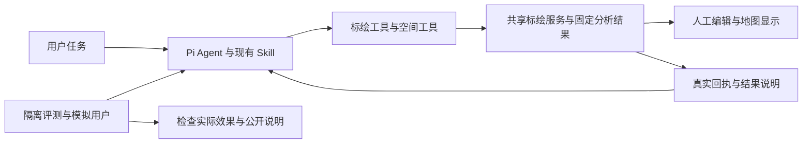

# 整合边界

基于标绘 ba3fc69 建立 codex/agent-spatial-plotting，合并空间分支已提交成果及R16归档提交。保留新标绘契约、前端、并发保护与空间结果说明/查询提示。合并不是效果验收通过。

同名Skill以标绘产品已提交版本为整合起点，R15候选保留在原评测目录，未经证明不直接覆盖产品Skill；检查规则兼容，确需调整须记录差异。未提交R12来源指引、resource-tools及旧工作区Skill不迁入。旧评测冻结源码和证据不改写。

评测流程先复用双方历史误判材料做离线核查。必要修复限新整合评测适配层，区分已响应/等待必需信息/需要复核；未知问题不猜回答、正常完成不重复发题；不建设新产品意图状态机或通用平台。不把旧分数转记为整合版分数。

