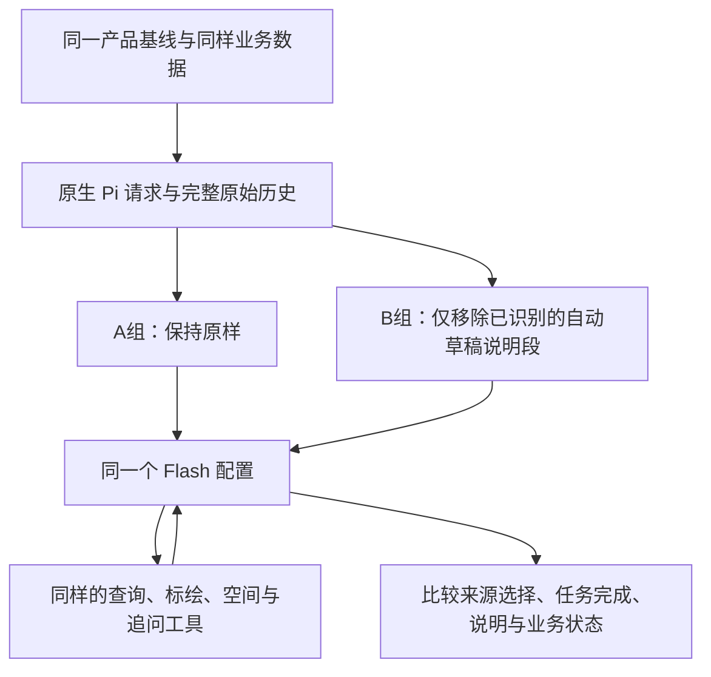

# 技术说明：只改变模型看到的自动草稿段落

状态：待审阅，尚未实施。总方案及预算以 [plan.md](plan.md) 为准。

## 已确认的代码事实

| 位置（相对仓库根目录） | 当前行为 | 对本轮的意义 |
|---|---|---|
| `experiments/harness-lab/src/pi/lab.ts:1051` | 从服务端取得 automaticContext 并加入 active.selections | 自动提供，不等于用户显式指定分析范围 |
| 同文件 `:1119` | recordedComposerText 作为 custom message 发给会话 | 本轮要控制的是模型收到的文字，不是删服务端绑定 |
| `src/pi/composer-input.ts:84` 的 composerInputTextV5 | 把自动草稿、用户引用、其他方法选择分别渲染成段落 | 可以精确区分自动提示与显式引用，不能整条 composer 消息删除 |
| 同文件 `:116` 的 composerHistory | 验证历史 details 与正文一致 | 只改原生正文、不改 details 会破坏历史契约；本轮不改持久历史 |
| `src/pi/annotation-tools.ts:118` | annotation_read 的 draft 模式不要求 ref，由服务端找到当前绑定 | 没有自动 ID 仍能读取草稿；这一能力要在 B 的离线链路再次验证 |
| `src/annotations/service.ts:129` | automaticContext 返回版本、基线与可编辑状态 | 自动段落不含完整几何，不是把全部地图数据塞给模型 |

上述 `src/...` 均位于 `experiments/harness-lab/`。核对基线为当前 `848f26d`；其产品 src/Skill 与 `925314f` 相同。将来如果工作区变化，仍归档固定提交运行，不偷偷改用新的 main。

## 实验边界

拟在**本轮评测传输适配层**完成 B 的改动，复用已验证的请求记录与 provider 路径。产品 `lab.ts`、composer 格式、数据库和线上配置不改，不新增产品开关或范围凭证。

只处理可由原生 composer 记录及固定渲染函数证明的自动段落。先从原生 selection 和 V5 渲染规则精确定位，再移除该段；不按“包含 draft / setId”等关键词清洗整个请求。保留同一消息中的公共前言、地图入口说明、显式 annotationRefs/contextRefs、Skill 和 Agent 选择。

若原请求只有自动草稿信息，也仅移除该段，保留原公共前后说明；不把 composer 消息整体删除。不得通过删掉服务端 selections 或伪造“没有草稿”来构造 B。

原生请求和实际外发请求分别保存，记录转换前后哈希、被移除的段落及其来源；原生会话历史仍是业务事实记录，**B 的模型暴露情况以外发请求为准**。两组使用同一记录器，A 明确记录没有变化。

## 每轮接续也必须保持唯一差异

- 每次真正外发前检查当前请求及携带的历史 composer 段落，不能首次移除、下一轮又重新出现。
- 模型实际调用 annotation_read 后返回的 ID、版本、几何是合法取证，正常保留。用户正文手写的 ID 或显式引用也不删除。
- AskUser 答复、普通澄清回复、工具参数和工具回执不改。模型思考按原协议回传，不修改思考正文来隐藏字符串。
- 若委派子 Agent，使用同一模型和总预算；检查它是否携带相同自动 composer 段落，按同一已识别来源规则处理。不得删除工具结果或父 Agent 真实工作摘要中的草稿事实。
- 若发生压缩、无法确定自动段落的来源、格式锚点漂移或无法避免旧自动内容漏入，记录流程限制并停下；不启发式重写未知摘要后声称只改了一项。

A/B 完全相同的要求适用于初始配置和受控离线输入。真实执行后模型动作、工具结果和追问次数可以不同，那是要观察的结果，不能强制两组走同一条路径。随机生成的会话 ID、对象绑定 ID、查询时间可做预先声明的机械映射；几何、业务日期、对象名字、Skill 正文不能借归一化被修改。

## 拟新增文件与复用范围

实施限定在本轮目录：请求段落适配、分组/调度/预算、运行器薄封装、必要离线测试和记录。复用上一轮 fixture/oracle、真实后端准备、澄清规则与评分契约；旧目录只读。若旧模块硬编码单组或预算，可在新目录增加本轮实现，不能覆盖旧冻结文件以节省改动。

不读 H01—H04，不把 oracle 或题目标签放进模型输入，不加入“请注意另一来源”的新提示，不强制每题追问。固定两次重复不共享可变状态，不在第二次带入第一次结果。

## 解释边界

B 的输入会自然变短，也少了自动提供的状态解释与读取提醒。因此改善只能先归为这段自动提示的整体影响；不是单独证明“信息更对称”或某个词导致偏向。若 B 因难以定位草稿而退化，必须报告，不能在本批中追加补偿提示。

不强制生成工具使用计划或新来源状态机。此次诊断结束后，才决定是否研究产品上下文呈现；即使 B 胜出，也不直接作为可上线修复。
