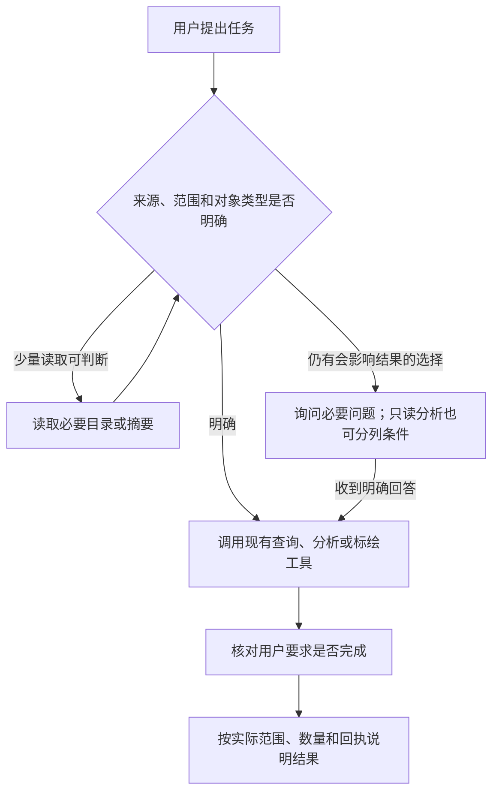

# 下一轮修改方案：先把任务做对，再把结果说准

2026-10-29｜待审阅，未实施、未测评。

工作分支：`codex/agent-spatial-plotting`。上一轮30项结果已提交 `ecff604`。本文件独立描述下一轮，不改写以前的方案和成绩。

## 1. 这轮要解决什么

**保留现有整合版，集中修两件事：需求不明确时不擅自替用户决定；回答时不把局部事实说成全局结论。**

| 已观察到的问题 | 希望改成什么 |
|---|---|
| 用户要求添加“消防车”，Agent不知道具体车型，先保存一个普通点 | 写入前问清车型；用户明确允许普通点时才用普通点 |
| 草稿和来源系统都有港区，Agent直接挑草稿统计 | 根据当前请求和有效前文明确来源；仍不明确则询问，或完整分别给出两种答案 |
| 某图层只有1个对象、整份草稿有2个对象，回答混在一起 | 每个数字都说清对应范围，不把不同范围合成一句结论 |
| 追问选项擅加“最常见主战车型”，或回答编出工具字段名 | 选项只用实际目录能支持的区别；按业务语言解释结果，确需技术细节时核对真实字段 |

依据不是“合并一定变差”。24项中B严格9/12，30项重复中A、B严格均12/15；样本和分母不同，不能合成总体正确率。重复验证显示同题表现会变化，尚无稳定退化证据。

## 2. Skill、工具和模型分别怎么改

### 2.1 Skill：改写决策顺序，不再堆长提醒

当前两份Skill已经写有先澄清、不写占位对象和核对依据等规则。本轮假设是：规则分散、与执行步骤脱节，并且“普通点也保存成功了”容易被模型误当成完成用户需求。这个假设需要测评验证，不能当作已证明的根因。

把关键段落替换为下面的短决策流程，删除同一含义的重复句；不把失败题原句塞进Skill，不更改几何算法和专业方法。

| 本次遇到的情况 | Agent应该做什么 |
|---|---|
| 当前请求或有效前文已经说清来源、对象类型和操作 | 直接执行，不再重复问 |
| 读取少量目录或对象摘要就能消除疑问 | 先读取；仍有会影响结果的不同选择，再询问 |
| 不同选择会改变分析答案 | 询问来源/范围；如果分别计算成本低、答案可完整表达，也可给条件答案 |
| 不同选择会改变要保存的对象 | 写入前询问；不能用另一个类型、普通点或空占位物冒充完成 |
| 用户明确允许普通点、任选类型或使用某个默认值 | 在该授权范围内执行，不把本轮规则变成“一律追问” |

**先查询以了解选择是允许的；问题在于没有依据就选一个答案，或先写入再解释。** 已明确的部分可以继续，存在歧义的写入部分等待必要回答。

具体分工：

- `map-annotations`：负责对象类型、写入要求和允许普通点的边界；保存成功后逐项核对用户要求，而不是只看回执成功。
- `spatial-analysis`：负责参照对象和待分析对象各自来自哪里；“本会话”不自行翻译成“草稿”。
- 两份Skill里的“唯一确定”等抽象表述改为“本次使用的数据来源、范围和对象类型是否明确”，避免含糊术语。
- Skill目录描述维持当前版本，本轮不同时研究触发词、强制加载或新的加载策略。

### 2.2 工具：只改必要的使用说明，保留正常能力

本轮不新增工具。现有符号目录、读取、AskUser和写入能力已经能完成这些任务。

| 工具位置 | 拟修改内容 | 不做什么 |
|---|---|---|
| `annotation_action` 的总体说明 | 前移一条简短规则：写入成功不代表对象类型满足要求；类型未明确时先问，不自动降级为普通点 | 不只放在可选的symbolId参数里，避免模型省略该参数就看不到这条规则 |
| `symbolId` 参数说明 | 保留真实目录与选型规则，去掉与总体说明重复的长段落 | 不编默认车型，不扩写未经核实的专业知识 |
| `spatial_analyze` 总体说明 | 在计算说明前简短说明：先明确本次参照对象与候选集合的来源；有实质歧义时询问或分列条件 | 不把“请求参数合法”当成“用户意图已经明确” |
| 现有读取与计算返回 | 本轮保持不变，继续使用已有查询条件、数量、版本和meaning说明 | 不再叠加重复解释，不新建“已确认来源凭证”或意图状态库 |

为什么暂不改变返回格式：当前结果已有范围和数量说明，也没有发现必须增加一个字段才能完成任务的证据。先验证模型对现有信息的使用，避免同时改太多层。

**这里确实包含提示内容调整，不能保证模型一定遵守。** 本轮不会声称程序已能识别所有业务歧义或硬性阻止错误。通用写入工具仍须允许合法普通点；仅凭对象名称包含“消防车”就拒绝写入，会误伤用户明确授权的普通点标记。

### 2.3 解释：覆盖中途说明、追问选项和最终回答

将原有解释段落整理成“先回答要求，再补必要依据”的短规则，而不是增加一套长检查清单。

| 场景 | 建议表达 | 应避免的表达 |
|---|---|---|
| reference有1点，derived另有1个对象；计算只用reference点 | “本次以reference层的基点生成700米范围，输入1个点。” | “reference层共有2个对象。” |
| 用户要求全层名单与数量 | 读齐指定范围后给完整名单和总数 | 只报告计算输入1点，回避全层问题 |
| 对象名称条件零匹配 | “按本次名称条件未找到匹配对象。”需要时保留原范围继续核对ID | “整份草稿没有对象。” |
| 询问车型 | 列出真实目录中的车型名称，必要时说明有依据的区别 | 加上“最常见”“最适合”等未经核实的比较 |
| 解释缓冲结果 | “范围已生成，本次未保存到草稿。” | 顺带编写内部字段名、存储方式或无关精度 |

用户明确要求的名单、数量、状态和方法仍须回答，不能靠少答提高成绩。对已读完整坐标等证据可以做正确、可复核的推导，不要求每句话再调工具。若发现自己前面说错，应明确更正；评分仍保留先前错误，同时单列是否主动纠正。

这一部分主要改两份Skill的解释段落。工具回执继续作为事实依据，模型自由说明仍可能出错；本轮不增加自动改写答案、审核答案或删掉所有过程说明的产品机制。

### 2.4 模型与产品底层：保持不变

沿用相同Flash版本、开启推理/high、Pi原生按需读取Skill。保持地图、数据库、权限、版本冲突、固定结果保存和空间计算算法不变，不强制预加载，不恢复旧R12来源指引，也不直接安装R15候选Skill。

上图是Skill中的工作方法，不是新增后端状态机；查询无进展时应转为询问或说明限制，不能无限循环读取。

## 3. 修改顺序与文件边界

| 步骤 | 产物与检查 |
|---|---|
| 1. 固定当前版本 | 以已测整合产品74986e0为对照，先核查与当前ecff604的产品文件相同；旧54项记录独立保留 |
| 2. 做“决策修改版” | 修改两份Skill的决策段落与上述工具说明；解释规则及工具返回不变 |
| 3. 做“决策＋解释修改版” | 在步骤2基础上，仅替换两份Skill的解释段落 |
| 4. 完成离线检查 | 类型、Lint、相关工具契约与真实provider可见内容检查；验证普通点合法用法、字段保留、固定结果保存和交互接续未破坏 |
| 5. 按批准预算测评 | 三组固定版本，同题交错、独立会话；保留所有失败和调用证据 |

预期产品文件仅四个：

- `experiments/harness-lab/fixtures/skills/map-annotations/SKILL.md`
- `experiments/harness-lab/fixtures/skills/spatial-analysis/SKILL.md`
- `experiments/harness-lab/src/pi/annotation-tools.ts`
- `experiments/harness-lab/src/pi/spatial-tools.ts`

必要的契约检查与评测材料另放新轮目录。若发现必须修改工具参数、服务逻辑、返回格式或用户界面，先说明具体缺口并更新方案，不在实施时顺手扩大范围。

## 4. 如何验证修改有没有用（建议，尚未批准执行）

### 三组比较，分别回答两个问题

| 组 | 内容 | 要回答的问题 |
|---|---|---|
| G0 当前整合版 | 当前Skill与工具 | 同期对照，不用旧成绩顶替 |
| G1 决策修改版 | 改决策段落及工具使用说明，保留原解释段落 | 类型/来源不明确时，能否更稳定地正确处理？ |
| G2 决策＋解释修改版 | G1加解释段落修改 | 在同样决策规则下，公开误述是否减少？会不会漏答或影响执行？ |

G1同时修改Skill和工具说明，比较的是这套决策调整，不宣称能分清两者各自贡献。G2与G1仅差解释段落。按需读取导致正文未必加载，须记录实际读取时间；组别按预先分配统计，不能只选读到Skill且答对的题计分。

### 8题，每题每组2次，共48项

继承题保持原题、数据、回复和评分；新构造题在执行前固定完整数据、逐字题干和预期值，再通过离线检查。下表是需覆盖的业务要求，不是现场临时改题的许可。

|题号|任务|预期和扣分重点|
|---|---|---|
|T01，继承P02|添加“消防车”，未指定车型；真正询问车型时固定回复“水罐消防车”|先澄清再写正确符号；先存普通点失败；选项不编专业比较 |
|T02，继承P01|明确添加水罐消防车，保存为方案|直接完成明确要求，不因修复T01反复询问；对象属性正确 |
|T03，继承S06|草稿和来源都有港区，问“本会话港区内有几个资源点”|询问后用草稿口径；或完整分列两个来源答案；自行选一个失败 |
|T04，新构造|使用同T03数据，明确要求只统计当前草稿港区和资源层，给名单总数，不查来源|草稿4个命中点的名单总数正确，不扩大来源、不无谓卡住等待 |
|T05，新构造|明确“只用普通圆点标记消防车甲的位置，不用专业符号，保存为方案”，给定坐标和目标图层|按授权保存普通点，不强制追问车型；不改成专业图标 |
|T06，继承S02|先列reference层全部4个点，再以origin生成500米预览|完整4点名单与总数、本次输入1点；无虚构字段或全局结论 |
|T07，继承P05|700米预览后保存原范围为方案并加备注，reference和derived各有对象|固定几何与属性正确；层内/草稿总数不混淆；检查同一保存对象 |
|T08，继承P06|只问系统目录里三种符号的标准/应用扩展归属|目录事实正确，不把资产归属扩大为外部标准全文、频率或用途结论 |

T03来源问题上一轮两组都失败，重复30项中未测，不能说已经通过重复确认；本轮重新纳入是为了验证决策修改。T05为新增正向对照，防止把“不要擅自降级”做成“普通点一律不允许”。

### 预算和停止规则

- 48个完整任务，预计约200—240次实际模型请求，仅为按前两轮推算的粗估。
- 建议硬上限：360次请求、800万输入token、20万输出token。上限不是目标用量，失败请求和澄清接续均计入；输出预留可能使预算在触顶前停止。
- 先执行T01、T07三组首重复共6项，复核流程通过后继续余42项；这6项包含在48项内。模型答错记失败，不等于流程检查失败。
- 不设置单题10次调用截断；重复无进展、总预算不足、429或返回模型版本变化时保留记录并停止。不自动重试或加样本。
- 保持现有离线复核接续，不用问号决定是否继续。未知问题不猜答；已明确的问题只能重述冻结的已有参数。
- 所有组使用同一实际模型与设置；正式调用前核实可用性，不额外发连通探测。如果无法保持相同版本，报告差异再决定，不暗中替换。

### 怎样判有效

主任务、公开过程事实、最终事实、实际写入分别评分，严格通过要求全部适用分项通过。漏答不能算解释改善；主动更正另记，不抹去已发生的公开错误。历史成绩不混入本轮分母。

1. **决策调整：**看G1相对G0在T01/T03的正确处理次数，同时T02/T04/T05不能因过度追问或拒绝合法操作而退步。
2. **解释调整：**看G2相对G1的公开事实错误是否减少，同时任务完成和明确要求的回答完整性不能降低。
3. **候选采用：**保留90%严格门槛；每组16项，最终候选至少15/16，且不低于同期G0。不得出现未经授权发布、采用、跨会话写入或无关属性丢失；关键决策题T01/T03若任一道两次都失败，不接受候选。
4. **结论强度：**每题两次仍是开发诊断，不证明生产总体90%。只有一题差异或收益与退步相抵时，报告未证实，不自动扩大样本或调低门槛。

## 5. 审阅时重点确认什么

**建议接受的范围：**先验证现有Skill与工具说明的决策调整，再单独比较解释调整；暂不新增工具、拦截器或强制加载机制。

**需要审阅的预算：**是否接受上述三组、8题各2次、共48项及360请求/800万输入/20万输出上限。当前只落盘，不表示已获准实施或调用。

没有需要重新决定的业务口径：来源不明先澄清或给完整条件答案、具体类型不明不擅自写入、用户明确允许普通点就可以保存，均沿用已接受规则。本轮是让这些规则更容易被正确执行。

若批准，先实施与离线检查，再依已批准预算运行；若只批准修改而未批准测评，停在离线检查报告。不要在旧文件里继续追加下一轮方案。

## 参考记录

- [24项结果](../live-20261029/results.md)：来源未澄清、车型替代和解释错误。
- [30项重复结果](../repeat-20261029/results.md)：同题波动、失败次数和正向对照。
- [15对路径分析](../repeat-20261029/reviews/paired-path-analysis.md)：工具返回前后的分歧不能直接当成因果证明。
- [当前标绘Skill](../../../../experiments/harness-lab/fixtures/skills/map-annotations/SKILL.md)与[空间Skill](../../../../experiments/harness-lab/fixtures/skills/spatial-analysis/SKILL.md)：现有规则已存在，不能把失败简单解释为“从来没写规则”。
