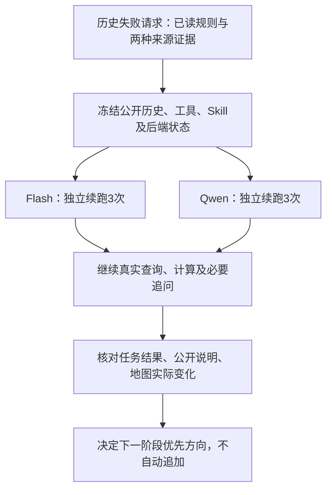

# 下一轮方案：同一失败现场，比较 Flash 与 Qwen

2026-10-30｜Key已配置，4次接入冒烟已完成并通过，见[冒烟结果](smoke-results.md)。用户已批准执行6次业务对照；完成后停止，不自动重试或追加。

分支：`codex/agent-spatial-plotting`。本轮独立归档，不修改上一轮方案、评分或原始记录。

## 1. 本轮只回答一个问题

**相同的要求、规则和查询证据已经给到，换成 Qwen 后，Agent 能否更稳定地处理来源歧义？**

暂停继续润色 Skill 和工具说明。先取得跨模型证据，再决定优先改模型选择，还是改来源判定和上下文呈现。不是预先认定 Qwen 更好，也不是把整个 DeepSeek 系列定性为能力不足。

上一轮48项中，G0主任务14/16、严格14/16；G1/G2主任务均15/16、严格均13/16。来源题三组第一次失败、第二次通过，且均已读取空间Skill。已有证据不能只用“规则没加载”解释，也不能证明稳定退化。

## 2. 固定哪个失败现场

选上一轮 **T03-R1-G1**，原题逐字保留：

> 本会话港区内几个资源点，只分析。

选择原因：原始第3次模型请求已经包含空间Skill正文，以及草稿和来源系统同名港区的查询结果。模型随后只完成草稿口径，没有澄清或完整报告两种口径。

| 材料 | 固定内容 |
|---|---|
| 历史记录 | `../improvement-20261029/` 对应T03-R1-G1；原始现场在仓库 `.local/agent-spatial-plotting-improvement-20261029/live/T03-R1-G1/` |
| 切入位置 | `provider-0055-wire-input.json`，已读方法和来源区域、尚未执行本次空间计算；实施时核验对应原生记录与哈希 |
| Skill和工具 | 沿用当时G1候选，保留原字节，不混入G2解释规则；在8d5b21b提交中已有归档 |
| 业务数据 | 草稿港区、资源点，以及来源区域和资源；实际查询与几何保持历史现场含义 |
| 允许的追问答复 | 仅当确实追问数据来源时，回复“按当前会话草稿的港区和资源层。”；不补工具提示或标准答案 |

使用G1是为了保留这个历史失败的完整条件，不是决定产品采用G1。首轮不加入车型、解释改写或新场景变量。

## 3. 如何让两组从同一位置继续

两组拿到相同的公开用户/助手消息、历史工具调用和结果、系统业务说明及Skill正文。历史前缀中旧模型的思考文本对两组统一移除，不向Qwen移植DeepSeek思考；移除范围和前后差异须留档。续跑产生的新思考则按各模型协议正常保留。

这是**标准化失败现场续跑**，不是原始请求逐字重放。此前由DeepSeek形成的公开探索路径仍保留，可能影响两组；结论仅适用于接手该现场后的能力，不能代表从零执行或主动读取Skill的成功率。

每次恢复独立隔离后端，不共用可变会话。历史set/version/object/tool-call引用必须真实可解析；如隔离身份必须重映射，只改机械标识并记录完整映射，不能改业务事实或丢工具证据。不能把失效引用直接塞给模型。如果不能可靠恢复，停在离线报告，不暗中改成静态问答或从零任务。

工具继续通过现有Pi与后端执行。不能在第一次调用草稿计算时就判失败；要等Agent完成答复，检查是否澄清或补齐另一来源。正常答错记失败继续，必要追问使用冻结回复；未知问题不猜答。

## 4. 模型、接口与工程边界

| 组别 | 固定模型 | 配置 |
|---|---|---|
| A | 方舟 `deepseek-v4.1-flash`，预期实际版本 `deepseek-v4-1-flash-261017` | thinking enabled，reasoning_effort high；沿用已测配置 |
| B | 百炼 `qwen3.8-max-0902` | enable_thinking true，reasoning_effort xhigh；不同时设置thinking_budget |

百炼Base URL：`https://ws-9o7uja66sj6pvrf9.cn-beijing.maas.aliyuncs.com/compatible-mode/v1`。

官方文档确认Qwen快照支持Function Calling及思考模式。Qwen默认保留历史思考；续跑产生的 `reasoning_content` 按原字段完整回传，不拼进 `content`。不同模型high/xhigh不代表等量推理，记录各自耗时和用量。本轮关闭平台内置联网搜索，不增加另一组无法使用的工具。

优先复用Pi公开SDK和现有模型配置，仅补必要的请求参数、流式响应及思考回传适配。当前宿主有 `thinkingLevel: off` 和模型 `reasoning:false` 配置，不能只改Base URL就宣称推理已正确运行。必须离线验证实际请求与多轮历史，再通过冒烟检查。不得修改业务Skill、空间算法、权限、工具返回和业务评分，也不顺带更换线上默认模型。产品同步已确定的推理配置属于后续工程事项，本轮诊断不得与线上发布混在一起。

本轮分清两项证据：

- 直接HTTP冒烟可以证明百炼接口可用，但不能替代Pi完整链路兼容证据。
- 正式续跑必须经过拟采用的Pi适配路径；检查tool_call_id关联、结构化参数、真实回执及后续请求，不能只靠请求HTTP 200判通过。

## 5. 实施顺序及已批准范围

1. **本次：**方案落盘、提交Git；准备不含密钥的示例及Git忽略的本地配置。无模型请求。
2. **Key填好后：**完成必要协议适配和离线检查；如发现需扩大产品修改边界，先报告，不边测边改变业务条件。
3. **冒烟：**两模型各1条“工具调用→执行工具→回传结果→回答”的短流程，各最多2次请求，共最多4次。使用中性合成数据，独立于T03，不计业务分数。Qwen核对原字段思考回传，Flash核对既定配置不变；零长度思考不单独判错，结合请求参数、响应字段、用量和接续判断。
4. **冒烟后汇报，用户已批准：**运行同一T03现场×两模型×3次，共6次业务续跑。运行顺序提前固定为A/B、B/A、A/B，分散时间顺序影响。首对也包含在6次内，不额外增加业务冒烟。
5. **完成即停止：**保留全部结果和未完成项，不自动重试、调参、换快照或追加题目。

冒烟检查的是接入，不宣称验证了业务准确率；6次续跑也不验证完整产品或主动Skill加载效果。

## 6. 评分与预先确定的下一步

| 维度 | 判定 |
|---|---|
| 主任务 | 先询问来源并按回答完成；或完整分别报告草稿4点、来源1点。自行选一组、末尾只邀请另查另一组，均失败 |
| 公开事实 | 过程说明、AskUser选项和最终回答均有实际依据；不能把草稿点说成现实可用资源 |
| 实际效果 | 只分析，不修改草稿、来源、发布或采用状态 |
| 严格通过 | 以上适用分项全部通过；不把成功工具调用当成任务完成 |

正确但顺序不同的工具路径允许；如有实际证据支持的等价计算，不强制指定工具。更正记录单列，不删除原公开错误。新评分按已有业务口径冻结，不因模型名称改变。

| 6次结果 | 下一步建议（不自动执行） |
|---|---|
| Qwen严格3/3，Flash至少2次同类失败 | 支持优先验证换模型收益，再用未见变体和从零完整任务确认 |
| 两模型都至少2次同类失败 | 优先审视该处规则、上下文呈现与来源判定设计；仍不能排除模型因素 |
| 两组都通过、表现交错或其他差异不明确 | 结论为尚未分辨，保留版本，不追加到出现满意分数 |

反向差异同样如实报告；不把结果推广为整个模型系列的优劣。跨平台实验比较模型与正确适配配置的组合，不能严格分离纯模型能力、行为偏好和供应商影响。

90%严格门槛保留用于后续独立验收。本轮每组只有同一现场3次，不能用3/3宣称生产正确率100%或已达到总体90%。

## 7. 预算与停止条件

总提议上限（冒烟加业务）：64次模型请求、200万输入、20万输出token。已完成冒烟4次；用户现已批准剩余6次业务续跑，二者共用总预算。失败请求及澄清接续均计入，思考按供应商usage纳入；保留未知用量，不按零处理。

请求完整输出建议上限32768 token；Qwen使用 `max_completion_tokens` 同时覆盖思考与答案，不把只约束回答的旧max_tokens当成同一含义。输出预算按单次最大额度预留，可能提前停止。若发生length截断，记录为受限未完成，不当成模型业务错误或自动补发。

不设单题10次请求/10分钟硬切断；有进展则允许继续，但总预算、无进展循环、平台429、传输错误、缺失用量、模型或冻结内容漂移需停并保留现场。预算是最高授权量，不是必须花完的目标。

按2026-10-30北京公开标准价：Qwen每百万输入12元、输出36元，不考虑缓存优惠；即使全部200万输入/20万输出都来自Qwen，约31.2元。建议百炼现金上限50元，实际按账号计费方式和账单核对；方舟Agent Plan另记实际套餐消耗，不由token凭空推算AFP。正式冻结前再次核实价格/输出预算语义。密钥不能证明某种套餐已生效。

## 8. 配置与交付

用户填写：`experiments/harness-lab/.env.qwen-bailian.local` 的 `LLM_API_KEY=`。本地文件权限600，由现有.gitignore排除，不提交、不打印。提交的 `.env.qwen-bailian.example` 始终为空Key。方舟继续读取此前已配置文件，不覆盖它。

配置文件只保存当前宿主支持的身份、端点与容量字段。思考参数在未来协议适配/冻结记录中明确落地，不创建当前代码不识别的环境变量来假装已启用推理。该配置不应直接用于替换线上服务。

交付包含：离线适配检查、冒烟请求/响应及用量审计、失败前缀与机械映射清单、逐次完整轨迹、6次独立评分与路线建议。关键公开证据可脱敏后归档Git；API密钥、认证头和供应商思考文本不作为公开报告内容。原始记录按既有本地证据机制保留，不把摘要冒充完整原始输入。

## 参考依据

- [用户分享讨论](https://chatgpt.com/share/6ae40a8c-0d68-83ec-b010-ed9b1f20583c)：冻结Skill/工具，优先真实失败现场，两模型各3次，先决定路线。
- [Qwen模型与价格](https://help.aliyun.com/zh/model-studio/qwen3-8-max)：固定快照、工具调用、北京标准价。
- [百炼Chat Completions接口](https://help.aliyun.com/zh/model-studio/qwen-api-via-openai-chat-completions)：enable_thinking、reasoning_effort、preserve_thinking、reasoning_content与max_completion_tokens。
- [上一轮完整结果](../improvement-20261029/results.md)及[独立复核](../improvement-20261029/reviews/independent-review.md)。

官方信息核查于2026-10-30；网页里的能力宣传不当作本项目已验证结果。
