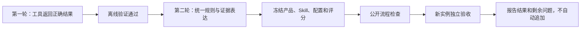

# 任务资源后续改进：两轮修改，一轮验收

状态：总体路线已获认可，已补入对 `da15e7b` 的审阅约束。日期：2026-11-02。代码基线：`codex/agent-spatial-plotting` / `99b2caa`。

本次只补充方案，不改产品、Skill、评分器，不调用模型。用户已认可第一轮实施依据；本次文档修订不启动实施。每轮单独成文，认可第一轮不等于授权后续测评。

## 阅读顺序

| 阶段 | 方案 | 要解决什么 | 模型调用 |
| --- | --- | --- | --- |
| 第一轮 | [修正工具结果](01-tool-correctness.md) | 空统计与校验冲突；汇总成员重叠时重复计数 | 0 |
| 第二轮 | [统一规则与回答依据](02-rules-and-evidence.md) | 何时必须追问；状态、时间、数量范围和限制怎样准确传给模型 | 0，先做离线检查 |
| 独立验收 | [新版完整流程验收](03-acceptance.md) | 两轮改完后，能否完整、准确地回答新任务 | 保留4公开+16正式，执行另行批准 |

继续使用当前分支；实施前检查它与 main 的差异。若其他会话正在修改相同文件，先协调隔离，不在验收中途合并变更。不更换 Pi，不新增一套 Agent 框架或业务持久化系统。

## 依据及核实程度

1. [用户提供的讨论](https://chatgpt.com/share/6ae8902d-9918-83ec-a09b-5c629735bc6a)：采纳最后的“两轮修改，随后独立验收”结构。早先自动把地图点击带入引用的提议已被用户否决，本轮不会恢复。
2. [本轮正式报告](../../11-02-task-resource-acceptance/report.md)：保留主任务15/16、严格9/16、解释9/15，以及A06-2产品失败。A08-1若采用更严澄清口径，主任务为14/16；旧原判和争议原样保留。
3. 已静态核对当前代码：`context/task-resources.ts` 的空集判断与 `contracts/resource-results.ts` 的选中集合判断不同；`contracts/resource-summary.ts` 的重叠检查主要看双方覆盖均不完整，没有完整成员集合交集判断；空间Skill仍允许较宽的条件答案。
4. 分享讨论报告了汇总重叠的函数级复现。本次未重跑它，也未验证完整HTTP链路；第一轮以复现和独立预期为起点。不能将这一新发现倒算为旧16次中的失败。
5. 分享讨论的59个点位独立复核是外部讨论的报告，本次没有重新执行，不当作新增验收证据。

## 已确认的范围与补充约束

- 保留“两轮修改、一轮独立验收”；两轮开发期间不调用付费模型。验收规模保留4项公开检查加16次正式执行，具体题包冻结前另行审阅，付费执行仍另行批准。
- 保留严格澄清规则：用户要单一区域、现有证据不能确定且结果不同，先问清；用户允许比较或多范围时才并列回答。
- 保留汇总去重边界：成员身份、数量含义、时间及统计范围足以支持时才给精确并集，否则明确合计未知。T13保留旧结果字节与版本读取；T14允许如实返回位置缺口。
- 工具修复单独验收：空统计集合自校验中断、符合前提仍重复计数、无合并依据却给精确合计，任一再现都不能用整体通过率抵消。具体标准见独立验收方案。
- 状态原因只解释已有状态，不改状态含义；N02受控副本只来自成员单体，不给汇总新增实体关联能力。

`hasDraft()` 未考虑 `annotationRefs`、用户补充消息无差别影响可用性这两个旁支问题，已记录但不纳入本轮修复。它们需要各自明确行为和回归，不顺手扩大修改面。后续报告继续保留这两项已知限制；本轮通过不代表全部资源业务已经完善。
