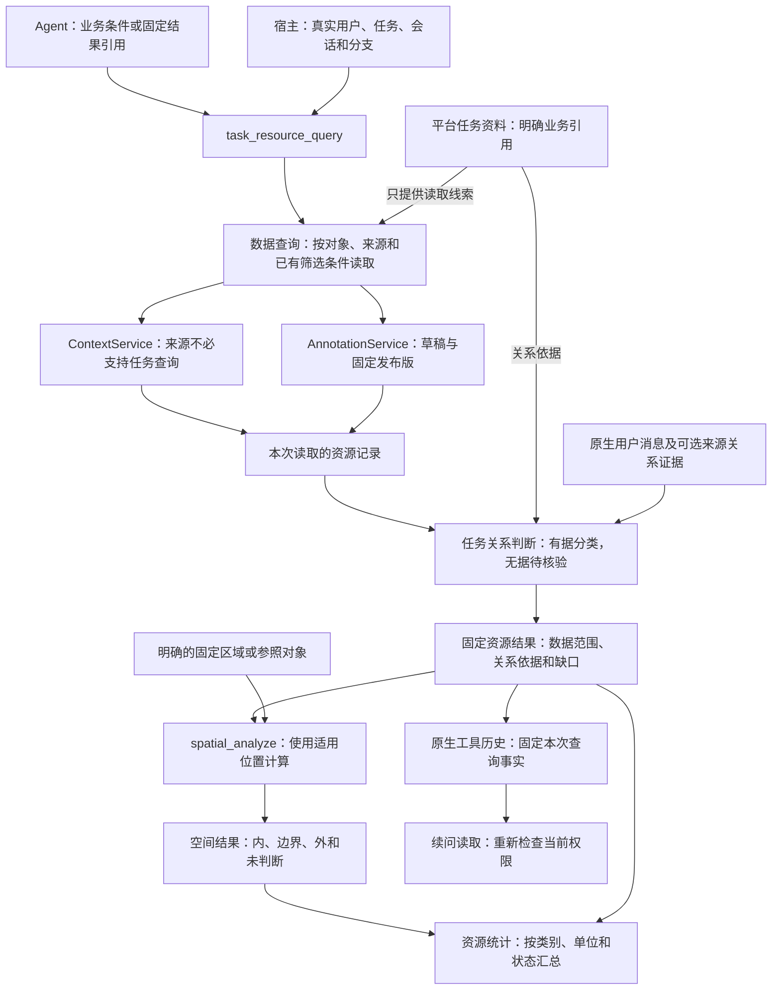

# 第二批：查齐本次资源，再准确计算位置与数量

2026-11-02｜实现与离线验收完成，待审阅｜[四批总览](README.md)

实施基线：第一批提交 `ea30f46`；业务规则沿用已确认的 `task-resources-v1`。本文件替换第二批原范围稿，独立记录本批设计、实施顺序和验收，不合并其他批次。

本次修订：**先按明确条件查数据，再根据证据判断任务关系。来源系统不必认识本平台的任务。** 保留已确认的默认业务范围，撤回“所有来源接入都要先支持任务映射和按任务查询”的前提；该修订已完成实施与离线验收，见[完成报告](../../11-02-task-resource-query/results.md)；未启动模型测评。

## 1. 这批完成后能做什么

工具分别处理两个问题：“这次读取哪些数据”和“这些数据能证明与任务有什么关系”。按明确对象、来源范围等条件取得资源后，结合本平台已有引用及其他可核实证据判断关系，再计算适用位置和数量。来源没有任务字段，不妨碍普通资源查询；没有关联依据，也不能补造任务归属。

例如用户问：“这个区域内，本任务有哪些可用资源？”工具链应完成：

1. 从本平台已有任务引用、当前草稿、采用发布版和有据支援规则确定读取线索；按来源支持的条件取数，不默认把任务 ID 发给外部系统。
2. 判断任务关系，并按可靠实体身份去重。同名不自动合并；已读到但关系不明的记录单列，不混进确定的任务资源统计。
3. 用实际位置判断内、边界上、外；计划位置、缺位置和位置冲突另列。
4. 分开报告已分配且可用、支援待确认、不可用和待核验；车辆与船舶分别计数。

**本批证明工具能按规则返回结果。** Agent 是否主动选对工具、是否答全且解释准确，仍需第三批衔接及第四批真实模型验收。

如果问题只是“这个区域内有哪些救援船”，按明确数据范围读取并计算即可，不要求船先关联任务。如果问“本任务已分配的船有哪些”，则必须有分配依据；“在区域内”不能替代“已分配”。

## 2. 前置条件与当前缺口

[第一批完成报告](../../11-02-task-resource-contracts/results.md)记录了资源字段、受控实体关联、保存/复制/发布兼容、来源与会话补充契约。226 项离线检查及 3 项桌面回归通过；12 个业务样例的集合、数量和空间预期尚未由新查询工具执行。

| 能力 | 当前实际实现 | 第二批拟新增或调整 |
| --- | --- | --- |
| 来源数据查询 | 按权限查询；支持 `objectRefs`、`areaIds`、关键词和分页；没有任务 ID/任务关系筛选参数 | 补资源类型提前筛选及候选收集；来源按任务查询只作为可选能力 |
| 平台任务引用 | `TaskContext.businessRefs` 可指向外部对象，但可为空、不保证覆盖全量、不表达分配 | 用明确引用定位来源记录，最多据此标为相关，不要求外部系统反查任务 |
| 标绘和固定资料 | 可以读取当前草稿、绑定基线、任务当前发布版和固定版本 | 整理其中的明确资源，不扫描其他会话实时草稿 |
| 资源任务关系 | 第一批可保存可选 `taskRelations` 等字段，尚无自动关联或关系判断服务 | 按每条关系的出处、时间和适用范围判断；缺失保持未确认 |
| 来源能力契约 | 第一批交接类型把 `taskIdMapping`、查询范围中的任务/关系设为必填；尚未实现其查询 | 分开基础读取与可选任务/支援能力，取消基础读取对这些字段的强制依赖 |
| 会话补充 | 仅有消息定位契约 | 核实原始用户消息与引用，不认证模型转述一定正确 |
| 空间与结果历史 | 空间输入缺几何会失败；已有固定空间结果和原生历史读取 | 新资源结果保留关系未明/位置缺失；已知位置可算，旧输入和结果仍兼容 |

当前配置只有模拟来源适配器。本批交付可运行的适配链路和受控模拟验证，不声称已接入真实中澳资源系统。

## 3. 建设边界

| 本批建设 | 本批不建设 |
| --- | --- |
| 一个资源业务工具、后端业务模块、资源结果契约和读取 | Skill 流程调整、资源表单、地图选择自动随消息发送 |
| 按条件取数、独立判断任务关系、可靠身份归并、数量统计 | 自动建立任务关系、模糊实体匹配、全文知识库检索、路网或专业调度决策 |
| 来源筛选、分页、快照验证和模拟能力 | 新服务、新数据库、插件系统、另一套 Agent 循环或消息存储 |
| 接现有空间工具，复用几何算法 | 更换底图、改变坐标算法、模型配置或真实模型测评 |

明确要求“数这个图层的点”时，继续直接用旧标绘和空间工具，不强制经过业务资源查询。查询只记录原生工具历史，不保存、发布或采用业务标绘。

## 4. 架构与职责

数据查询负责取得记录；任务关系判断负责说明哪些与任务有关、依据是什么。两者在同一后端模块内分开处理，不新增两个服务。任务资料可以先提供精确对象 ID 以减少读取，但来源不必接收任务 ID。空间模块计算位置关系；程序核算数量；Agent 理解问题并组织说明。

可访问、查询命中、任务相关、已分配是不同含义；任意前一项都不能自动证明后一项。结果引用也不能证明模型理解了用户意图。

继续使用现有 Node/TypeScript 后端和 Turf，不增加 Python 服务。浏览器只读共享契约，不导入 Pi 或计算模块。本批补必要的历史安全投影，新结果卡片的交互留在第三批。

## 5. 工具怎样设计

### 5.1 一个新增工具，三种只读操作

拟新增 `task_resource_query`，用操作参数区分查询、读取和统计。这个名字指本平台组织资源结果的入口，不表示外部来源必须支持任务查询。

| 操作 | Agent 提供什么 | 程序返回什么 |
| --- | --- | --- |
| `query` 查询 | 本次查明确数据范围，还是整理本任务相关资源；来源/对象/固定标绘限制、可选类别及用户补充引用 | 读取的资源、关系判断及依据、分别记录的数据与关系缺口，以及 `resourceResultRef` |
| `read` 读回 | 原资源结果引用；可选结果内 ID 或读取分页 | 原固定结果、总量及本页范围；不重新查询来源 |
| `summarize` 统计 | 资源结果引用；可选由它产生的空间结果和内/边界/外分类 | 记录数、可确认的实体数、分组数量，以及不能合计的原因 |

字段名可在实施时局部调整，下面的行为不能悄悄改变：

- 用户、席位、任务和会话由宿主注入，模型不能填这些字段授予权限。
- 查询目的与数据条件分开：“指定范围内的资源”不要求任务关联；“本任务资源”只按证据纳入已关联部分，并单列已读到但关系未确认的候选。范围省略时沿用已确认的任务默认规则，不自动查遍所有来源。
- 默认查询不先排掉未知、故障或缺位置资源；先带回事实，再分类。
- 明确限制使用完整来源身份或固定标绘引用；不接收模型抄写的坐标、数据清单或程序表达式。
- 结果回显实际范围。模型传入一个合法范围，不自动证明那是用户全部意图；显式限制后的结果不能称为任务全集。
- `read` 分页只展示已固定清单，不能把第一页当完整名单；后端统计直接使用完整固定结果。
- 不接受模型填“已去重”“已确认可用”覆盖服务判断。统计操作也有真实调用归属和固定回读，不能靠助手文字恢复数字。

普通 `situation_query` 增加可选 `objectTypes`，来源型空间输入同步支持；省略时保留旧行为。指定 `resource` 时，筛选在来源分页及几何检查之前发生，不能先取混合第一页再丢弃道路。精确对象引用与类型条件矛盾时明确报参数错误。

基础读取不附带任务 ID。来源缺任务能力时仍执行它支持的对象/区域标签等读取；只在需要额外关系发现时报告关系覆盖不足，不把普通读取判为失败。

### 5.2 一次典型调用链

1. `task_resource_query(query)`：按明确读取条件取得 Q，分别列出数据清单、任务关系判断和缺口。
2. `spatial_analyze(classify_points)`：输入 Q 和明确的区域 A，返回 S；不适用的位置另列。
3. `task_resource_query(summarize)`：读取 Q 与 S；统计明确数据范围时保留关系未知项，统计本任务已关联/已分配资源时只纳入有对应依据的项，未知另列。
4. Agent 回答；续问时读 Q/S，不凭旧回答还原事实。

这只是调用顺序示例，不是新工作流引擎。只问名单可止于查询；纯几何问题继续使用旧工具。

## 6. 数据怎么查，任务关系怎么判断

### 6.1 先确定读取条件，不要求来源知道任务

| 现有线索或用户要求 | 如何查数据 | 读取本身不能证明什么 |
| --- | --- | --- |
| 平台任务明确引用了来源对象 R1 | 将 R1 的 `systemId/objectType/objectId` 作为 `objectRefs` 查询；不发送本平台任务 ID | 不能证明 R1 已分配或可用，也不证明关联名单完整 |
| 用户明确查询某个来源的某批对象 | 按完整引用、类别等已支持条件读取 | 不能证明这些对象属于本任务 |
| 用户明确查询某来源在地区 A 登记的资源 | 可用来源 `areaIds` 标签筛选，并说明是登记地区 | 不能证明其实际位置在 A 内 |
| 用户要判断选中多边形内的资源 | 先在已明确的来源/对象集合中完整取数，再用实际几何计算；无空间查询接口时不虚构接口 | 多边形只确定计算区域，不自动确定所有数据来源或任务关系 |
| 当前草稿/基线、任务采用发布版 | 用现有绑定和固定引用读取实际资源字段；不创建新草稿 | 在任务资料里出现不等于已分配、可用或已到场 |

只有来源范围明确且容量允许时，才可完整读取该来源的资源集合后做空间过滤。多个来源仍有实质选择时，由 Agent 根据明确上下文补齐或澄清；不能将区域选择解释为自动扫描全部授权系统。

默认“本任务资源”查询优先使用平台已记录的外部对象引用、当前草稿明确资源、采用发布版和有据支援线索。没有草稿但有固定基线时读取基线并标明出处。同一固定记录从多入口到达时去掉重复引用，不把不同记录自动当成同一实体。

`businessRefs` 可能指向报告或区域，而不是资源。只能沿授权资料中明确的结构化资源引用继续读取，并保留关联路径；不能把报告标题、任务地区或自然语言提及自动变成资源分配记录。

用户明确“只看这个草稿图层”时，不再加入其他默认来源。宿主仍校验当前会话和任务绑定，这是权限要求，不要求外部数据认识该任务；原有普通查询入口也不因本批增加任务关联门槛。

### 6.2 再判断任务关系，保留依据

| 依据 | 可以得出的关系 | 不可以得出的结论 |
| --- | --- | --- |
| 平台 `businessRefs` 明确引用资源，或授权资料提供明确关联链 | 与本任务相关，记录关联路径 | 已分配、可直接调度 |
| 当前任务草稿/采用固定资料中明确标为实际资源 | 本任务资料中的补充资源 | 来源系统已登记、已获调配批准 |
| 可核实的分配记录，或带明确依据的资源关系字段 | 在其有效时间和条件内记录“已分配” | 设备正常、已到场；也不代表当前已有完整分配管理系统 |
| 已配置且实际执行的支援规则，或明确的支援关系资料 | 有依据的潜在支援 | 距离近就可支援、已批准调配 |
| 来源可选提供的任务关系 | 仅在任务映射及证据有效时采用 | 所有来源都应支持此能力 |

可用状态、数量、位置与任务关系独立。查到资源、位置在区域内、设备可用，都不能单独证明它是本任务资源。

无关联依据时派生为“任务关系未确认”，保留原因，不改原数据。明确只属于其他任务且没有当前任务关联依据的记录，与完全没有关系资料的记录分开说明；均不能自动纳入当前任务的确定统计。本批不新增关系数据库或分配管理流程。

### 6.3 缺少关联时，仍能做什么

| 场景 | 继续做什么 | 必须说明的限制 |
| --- | --- | --- |
| 来源不支持任务查询，但平台明确关联 R1 | 正常按 R1 精确引用取数，标为相关 | 分配状态仍需另有证据；不能承诺已找齐所有关联资源 |
| 明确查某来源区域内的船，查到 R1/R2，但没有任务关系 | 正常做空间判断、名单和资源数量统计，关系标为未确认 | 这些是本次数据范围内的船，不是本任务已分配的船 |
| 问本任务资源，只有部分明确关联 | 返回已确认关联部分；已读到的关系未明候选另列 | 未明候选不混入确定的本任务资源/已分配数量；不为补齐它们自动扩大查询 |
| 问本任务已分配资源，没有分配资料 | 保留已知相关资源和可核实事实，说明无法确定分配名单 | 不能把“未查到分配依据”说成“已分配 0 项” |
| 任务无引用，草稿/采用资料也没有资源，没有支援依据 | 返回“目前缺少明确关联资料”，由 Agent 判断是否需要用户补充具体范围 | 不是任务现实中没有资源，也不自动扫描所有来源猜关联 |

例如来源仅返回 R1 的位置和可用状态：平台引用了 R1，就可说“与任务相关，分配未确认”；平台没有关联但用户明确查询它，就可说“本次查询命中，任务关系未确认”。两种情况都能读取和计算位置。

### 6.4 来源适配：基础读取必需，任务能力可选

基础能力包括对象读取、来源已有筛选和分页。可选能力才包括按任务发现更多资源、任务关系筛选和支援查询。能力仍在现有配置/适配模块管理，不建插件框架。

| 契约或实现 | 本批拟调整 |
| --- | --- |
| `ResourceSourceCapability` 当前要求 `taskIdMapping`，关系目录与基础能力混在一起 | 分开基础读取与可选任务能力；只有声明任务查询时才要求映射/关系配置，不支持者也能接入 |
| `ResourceQueryScope` 当前要求任务 ID 和关系 | 基础数据选择独立表示来源、对象及筛选；宿主任务身份留在本平台，仅可选任务查询向来源传送已映射条件 |
| `ResourceCoverage` 当前绑定任务关系查询范围 | 分开报告数据读取覆盖与任务关系覆盖；数据完整读回但关系未知是合法结果 |
| 第一批已保存的资源字段与历史 | 保留既有读取及语义；调整交接契约不批量改写草稿、关系字段、快照或哈希 |

这些是第二批拟改内容，方案已获准，实施按本节调整。第一批字段存在不等于已经建立关联，也不证明真实来源已具备这些能力。

- 主验收路径使用**完全不支持任务查询**的来源，靠现有精确引用和明确数据范围工作。另设可选能力用例，验证有可靠映射/支援规则时的增量效果；两者不相互依赖。
- 同 ID 映射也必须明确配置，不能因为字符串相同就认作同一任务。`supportRule.id` 必须对应实际规则；无规则不标潜在支援，模型不能提交执行规则。
- 新类型筛选在分页前生效。来源不支持该筛选但已有精确资源引用时，可继续现有精确读取并验证返回类型；需要整类枚举却不支持时，只报告该请求能力不足，不误判为没有资源，也不自动扫描混合全域数据。
- 完整翻页核对快照、游标、重复记录内容及精确引用覆盖。分页漂移使该来源本次快照无效；其他独立有效来源可保留。不自动重试或拼接新旧页。
- 保留各来源时间、版本和旧 `availableCount＋辆` 的含义，不补造单体、分配或位置事实。

数据读取、关系判断、几何判断分别验收；不能因为来源缺任务能力，就把已经完整读到的数据记作加载失败。

### 6.5 会话补充：能核实原文，不等于程序证明理解正确

复用 Pi 原生分支和已有引用，不建记忆库、不扫描任意会话。宿主提供当前用户消息及明确资源选择；工具可返回当前分支中带明确资源引用的用户消息定位，Agent 据此提出补充。服务核对消息确实来自 user、属于当前分支、资源可访问，并保留实际原文。

自由文字的含义仍需 Agent 理解。模型整理的字段要标为“对用户报告的解释”，不能把引用检查当作内容认证。旧助手自述、压缩摘要或工具文字不能冒充新用户报告。没有明确引用的其他自由文本由 Agent 结合上下文核对；本批不增加关键词扫描器来假装自动理解全部历史。

例如用户报告“R1 于 12:00 故障”，可带回“用户报告：不可用、12:00、原消息”；不改外部系统。与有效来源报告矛盾时保留两种说法，R1 不再计为无争议可用。只有“它坏了”且指代不明时保留待核验文字，不任意绑定 R1。

对任意自由文字，本批不承诺自动抽取完整准确。未经结构化核实的补充不能单独升级“已分配”“已确认可用”，不能替换来源实际位置；不明或矛盾的内容留待核验。第三批 Skill 负责识别、核对和澄清，第四批检验语义是否正确。

## 7. 去重、状态与数量

### 7.1 只按明确身份归并

来源单体使用“来源系统＋实体 ID”，草稿用第一批受控 `resourceAssociation` 关联它。不同系统即使 ID 字符串相同，也不自动合并；首版不建设跨系统匹配引擎。

无实体关联的明确草稿资源仍进清单，但标为独立声明、是否重复未确认。`sourceRefs`、派生关系、同名或位置相近不建立实体等同关系。合并后保留全部原记录、字段依据和理由，不整条覆盖另一份资料。

### 7.2 状态逐项保留

- 任务关系与可用性分开：“相关”不等于“已分配”，“潜在支援”不等于可立即调度。
- 关系缺失不是无关或不可用；能否进入某项统计取决于该项统计是否要求任务关系。普通空间分类不以任务关联为前提。
- 实际位置与计划位置可以同时存在，不能拿计划位置覆盖实际位置。
- 同一事实有效冲突时列待核验；只有同来源明确的有效替代关系才能取后续版本，不按谁查询得晚决定。
- 过期事实不支持当前确认；无规定有效期时写“截至所述时间的报告”，不自设统一有效时长。
- 未满足条件的 available 不计作已确认可直接使用，仍保留条件和依据。

### 7.3 三类数字分开

| 数字 | 表示什么 | 禁止的混用 |
| --- | --- | --- |
| 记录数 | 取得多少条不同固定记录 | 不能称为多少辆车 |
| 实体数 | 有可靠身份范围内，去重后的单体数量 | 身份不明记录不能算入确定总数，须单列 |
| 资源数量 | 类别、单位、含义、范围、时间可比的数量求和 | 不能混辆/艘，也不能直接加库存与可用量 |

汇总与明细有覆盖依据时不重复相加；缺覆盖关系时分别报告、合计值为空并说明原因。站点有 3 辆车的报告与站点坐标，不证明 3 辆都在区域内。

未知数量保持未知，0 保持 0。“已知部分合计”带范围及缺口，不显示为任务总数。关系未确认不妨碍在明确数据范围内统计已有数量；但不能计入“本任务已分配数量”。无分配记录时可说“有据确认 0 项，实际数量未知”，不能只给“已分配 0 项”。类别分别统计；不做单位转换、数量估计或不确定区间推算。

## 8. 固定结果与空间计算

### 8.1 固定资源结果

结果包含：真实调用归属、实际数据条件、查询目的及规则版本；读取的资源和原记录定位；身份、状态、数量、时间；单独的任务关系判断、依据及未确认原因；数据读取覆盖与关系覆盖；各统计纳入/排除项、冲突、待核验；可计算位置及不适用原因。不会把“查询命中”字段直接当成“本任务资源”标志。

两种覆盖分开表达，例如“来源 2 条已完整读取；1 条有平台任务关联，另 1 条关系未确认；不能确认任务关联名单已齐”。缺少任务查询能力仅影响需要该能力才能证明的关系覆盖；不影响已完成的基础读取，也不影响有独立完整依据的明确名单核对。

完整数据放在实际 toolResult 的 details，模型获得可读投影，保留必要名单、数量、状态和限制，省去无需抄写的坐标。无位置清单采用独立资源结果，不强塞进旧 `SpatialResult`。

结果随 Pi 原生历史固定，不建结果数据库或长期缓存。新查询新引用，旧结果不随来源变化。读回校验原调用参数、归属与投影一致性；助手回答、伪造 JSON、重复引用或篡改内容均不能代替真实结果。

读取、送回模型、计算和已有显式保存路径都重检权限。权限撤销则拒绝使用相应固定结果，不删除依赖后声称仍是原结果。原审计记录保留，不重写历史助手正文；无权结构化内容不能再次送入模型。

### 8.2 资源结果接入空间工具

给 `spatial_analyze` 增加独立资源输入，引用 Q 并可选其资源项。默认使用适用、未过期且无冲突的实际位置；计划/估计位置、站点位置、缺失和冲突各有原因，不静默转成实际点位。

首先打通点面分类、区域/距离筛选及最近点，复用原算法。新输入不强行适配所有操作；类型或数量不适合时按旧规则报错。点面分类仍要求候选 Point、目标单个 Polygon，不把线面变为中心点。

结果同时说明三个独立情况：

- **数据读取情况**：实际读了哪些对象和来源，有没有缺页或未覆盖范围。
- **任务关系情况**：哪些有相关/分配依据，哪些未确认；本次计算是否要求任务关系。
- **实际计算范围**：哪些资源能判断位置，哪些未判断，计算出的分类或距离是什么。

例如清单 5 项、2 项缺位置，应是“3 项已判断：2 内、1 外；2 项位置待核验”，不能说 5 项全部判断。最近点也只能说“在位置可判断的这些资源中最近”。

派生结果继续保留 Q 的依据与缺口，不能在后续筛选、统计或读取时丢掉。统计工具核对 S 确实来自 Q，不能拿另次查询的分类套用。边界单列，要求含边界时再明确合计，不改变旧 contains 语义。

当前空间结果数据版本 1/2 只表达完整几何候选；本批新增资源来源结果版本，不把旧结构直接改成“局部也算完整”。数据版本与模型文本格式分开管理；旧正文、快照、哈希和 v1/v2 读取不变，新版校验、历史过滤和派生读取一起支持。

资源清单不直接传给 `annotation_from_analysis` 保存。其派生空间结果若走已有显式保存路径，须保留完整依赖、精确几何与权限；不丢来源后保存。原保存路径不支持的几何继续明确拒绝，不新增业务保存动作。

## 9. 异常与运行边界

| 情况 | 应有行为 |
| --- | --- |
| 明确的数据条件完整返回空 | 该数据范围为 0；若要断言任务资源为 0，还需证明任务关系清单覆盖完整 |
| 来源局部覆盖但无下一页 | 保留局部原因；无下一页不等于覆盖全部业务 |
| 来源读取失败 | 标数据缺口；其他独立有效数据可给有限结论 |
| 来源不支持任务查询 | 继续其支持的基础读取；用平台引用判断已知关系，仅对不能确定的关系覆盖说明不足 |
| 数据读完但缺关联/分配依据 | 数据读取成功、关系未确认；普通空间问题可继续，任务关系统计不能给无依据总数 |
| 没有支援规则 | 不标潜在支援；需要支援名单时说明缺依据，不阻断普通资源读取 |
| 缺状态、数量、实际位置 | 保留资源和缺项，不改为可用、零或区域外 |
| 越权、身份失效、固定结果损坏 | 拒绝使用，不以部分结果绕过校验；错误不泄露未授权内容或数量 |
| 分页漂移、重复游标 | 该来源本次快照无效，不混页、不自动重试 |
| 取消或容量上限 | 明确取消/超限，不伪装完整地返回截断清单 |

“数据完整”只针对本次授权读取条件，不代表现实世界所有资源已登记，更不代表任务关联名单完整。普通区域查询无需证明任务关系；要求本任务或支援全集时，必须另有覆盖依据。不支持按任务查询本身不等于数据不完整，但也不能凭平台可为空、非全量的 `businessRefs` 宣称任务全集已齐。

参考现有空间查询上限，本批拟限制：来源单页最多 100 条；单次资源查询读取原始记录合计最多 500 条、总续页最多 50 页、固定结果不超过 1 MiB。空间候选与参照合计仍最多 500 个、总顶点最多 10,000；HTTP 保留 15 秒/256 KiB 限制，几何运算保留现有 worker 限制。超限明确返回，缩小范围由后续调用决定，不自动漏数据。限制若需调整，在报告说明依据，不扩大为后台批处理。

## 10. 实施任务与依赖

以下清单已获准实施；执行记录见第二批任务目录。

| 顺序 | 建设内容与产出 | 依赖和完成条件 |
| --- | --- | --- |
| B2-01 基础查询与可选能力 | 调整交接契约，取消基础读取对任务映射/关系筛选的强制依赖；补类型提前筛选及 HTTP/模拟适配 | 第一批基线；无任务能力来源可按精确引用及支持条件读回；可选能力缺失不阻断基础查询 |
| B2-02 按条件取数 | 分开明确数据查询和默认任务线索收集；读来源、当前草稿/基线、采用版及真实消息，固定快照 | B2-01；基础请求不强加任务参数，来源范围和数据覆盖有据，不扫其他私有会话 |
| B2-03 关系判断与归并 | 用平台引用/明确证据判断相关、分配、支援；无据单列；可靠实体合并、状态冲突及时效处理 | B2-02；无关系照常保留数据；任务统计不混入未确认项；B1 相关样例含义可核对 |
| B2-04 数量统计 | 记录/实体/资源数量，覆盖、单位、未知及状态分组 | B2-03；B1-S06—07 通过，不能合计时原因明确 |
| B2-05 固定结果 | 共享契约、严格读取、原生结果、引用解析、授权读取、重启/压缩续问和安全投影 | B2-03—04；伪造或损坏结果不能继续，不建独立存储 |
| B2-06 空间衔接 | 新资源输入/结果版本，复用算法，保留缺口和依赖，接统计与原保存权限链 | B2-05；Q→S→统计通过，旧 v1/v2 与显式保存回归通过 |
| B2-07 Pi 入口 | 注册 query/read/summarize，工具说明与参数一致，供前台主 Agent 使用 | 前六项；确定性 provider 完整调用；不扩权后台/子 Agent |
| B2-08 验收交接 | 第 11 节检查、独立审查、已实现规范及第三批接口说明 | 本批无阻断缺陷；不启动 Skill、UI 新功能或真实模型测试 |

预计代码落点，文件名可按实际规模调整，不要求拆额外框架：

| 模块 | 拟改内容 |
| --- | --- |
| `contracts/task-resources.ts`、拟新增资源结果契约 | 基础读取与可选任务能力分开，数据/关系覆盖分开；保留第一批持久字段；补结果和统计 |
| `context/config.ts`、`validation.ts`、`service.ts`、`scripts/mock-context/server.ts` | 基础筛选、可选任务映射/支援声明、请求与响应核对；能力缺失不强加任务条件 |
| 拟新增 `context/task-resources.ts` | 分开收集记录和判断任务关系，复用 Access/Annotation；处理身份、数量及缺口 |
| 拟新增 `pi/task-resource-tools.ts`、`pi/task-resource-results.ts`，以及 `pi/lab.ts` | 注册、原生消息与结果读取、送模前权限过滤，不改 Pi 循环 |
| `contracts/spatial.ts`、`spatial/inputs.ts`、`service.ts`、`pi/spatial-tools.ts`、`spatial-results.ts` | 新输入/结果、缺口继承、统计与保存依赖；算法不改 |
| 共享历史投影及相关浏览器读取 | 仅补安全读取与兼容，不建设第三批结果卡片 |
| fixtures 与相关 tests | 独立预期、HTTP/SQLite/原生历史/确定性 Pi 回归，不改旧测评 |

现有 `pi/resource-tools.ts` 管运行资源，不直接当成本业务查询模块。开工前再核对分支是否变化，不自动合并其他分支。

## 11. 离线任务清单与判定

以下为 **24 组确定性开发检查**，不是 24 道真实模型题，也不是模型正确率样本。每组可有多个参数或反例；全部通过才算工具验收通过，不能用 90% 容忍确定的程序错误。

输入走实际服务、本地 HTTP 和原生历史，预期独立编写，不调用被测代码生成答案。第一批 [inputs.json](../../../../experiments/harness-lab/fixtures/task-resources-v1/inputs.json) 与 [expected.json](../../../../experiments/harness-lab/fixtures/task-resources-v1/expected.json) 继续分开维护；矛盾先记录修订理由，不能为通过测试改答案。

第一批部分样例已经显式提供任务关系字段，它们只证明“有这些证据时如何处理”，不证明来源普遍支持任务查询。第二批须额外验证没有任务字段、没有任务接口的路径；不为让用例通过而给所有模拟来源预装任务能力。

### 11.1 第一批的 12 个业务样例

| 编号 | 输入与任务 | 必须得到的结果 |
| --- | --- | --- |
| D01 / B1-S01 | 来源、草稿、区域 A，执行默认查询→分类→统计 | 资源项 R1、R2、D2、R4、R5；D1 与 R1 合并。内部分为已分配可用 1 辆、支援 1 辆、状态未知 1 艘、不可用 1 辆；另 1 辆缺位置；D4 未分类提示。5 项清单不等于 5 项可用 |
| D02 / B1-S02 | 指定图层 4 个点，均未注明资源含义，用旧工具数点 | 4 个点；不强制新工具，不因未认证资源拒绝 |
| D03 / B1-S03 | 两系统同名“救援车一号”，无跨系统身份依据 | 2 条记录；实体总数未知并说明原因，不合并为 1 辆或认证为 2 辆 |
| D04 / B1-S04 | 手工资源点引用 R1，未建立受控关联 | 保留引用，不自动与 R1 合并或继承可用状态 |
| D05 / B1-S05 | 同来源命名空间的同一船两份有效报告：可用、故障 | 身份只计一次，状态冲突，确认可用为 0，保留双方依据 |
| D06 / B1-S06 | 某站汇总 3 辆与一车明细，分别测有/无覆盖依据 | 有依据不重复相加；无依据分别报告、不给总和；站点坐标不证明车辆都在区域内 |
| D07 / B1-S07 | 2 辆消防车、1 艘救援船、另一船数量未知 | 分别给 2 辆、1 艘和未知项；不混单位、不补零 |
| D08 / B1-S08 | 实际车辆仅计划位置在 A 内，问当前位置及区域数量 | 保留资源；当前位置待核验，不计确认内部，也不说它在 A 外 |
| D09 / B1-S09 | 登记属于 A，实际位置在 A 外，分别问归属与位置 | 登记 A、几何外部分别成立，不能用登记标签代替几何 |
| D10 / B1-S10 | 来源一完整空、来源二不可用 | 前者范围为 0、后者未覆盖，不给任务资源总数为 0 |
| D11 / B1-S11 | 任务采用其他会话发布版，原草稿随后变化 | 只读采用的固定版，不跟随新草稿，不读未引用的其他实时草稿 |
| D12 / B1-S12 | user-12 明确报告某车指定时间故障；assistant-13 重复旧可用说法 | 保留用户报告的不可用、时间和原文；助手旧话非新证据；不改草稿或来源，不冒充来源已更新 |

### 11.2 补充的 12 个工程检查

| 编号 | 输入与步骤 | 通过标准 |
| --- | --- | --- |
| D13 类型筛选 | 多页混合道路/区域/资源，无关对象缺几何；请求仅资源 | HTTP 有类型条件，分页前生效；资源完整，无关对象不占页/不触发缺几何；省略条件保持旧行为 |
| D14 分页稳定 | 正常多页；再分别注入版本变化、重复游标、同 ID 内容变化、精确引用缺失 | 正常完整；异常来源快照不参与确定合计，原因准确；不重试、跳页或混版本 |
| D15 无任务接口及可选能力 | 以不认识本平台任务的 HTTP 来源为主路径，分别测试平台引用、普通区域查询、无关联、可选任务/支援能力，见下表 | 基础读取无需任务映射；数据与关系覆盖分开；无关联不是无资源，不自动扩大范围 |
| D16 权限与绑定 | 查后撤权；跨任务、跨席位、他会话私有草稿、无绑定查询 | 读回/续问/计算/送模不能绕权，不泄露拒绝对象内容或数量；无绑定不查全域 |
| D17 身份和时效 | 两系统同 ID；普通复制无关联；同实体旧状态、替代状态、冲突、未满足条件 | 只按可靠身份合并；不用查询时间覆盖事实；失效/冲突/有条件不算无争议可用 |
| D18 几何和缺口 | 独立构造内、边界、外、孔内/孔边点，加缺失/计划/估计/站点/冲突位置 | 分类符合独立预期；不适用原因明确，最近点和后续筛选仍带缺口；非法类型报错，不取中心点 |
| D19 统计对应 | 正确 Q/S，再传另一查询的 S；混合单位/数量含义；同一集合分别作普通范围统计和本任务已分配统计 | 普通统计保留关系未知项的合法数量；已分配统计只用有效依据，未确认另列；错误 Q/S 拒绝，不可比不求和 |
| D20 历史真实性 | 实际工具生成，重启/压缩读回；篡改参数、details、正文、归属或复制引用 | 真结果可读且不刷新；伪造/损坏明确拒绝；原调用和读回交付身份准确 |
| D21 固定数据和读分页 | 查询后更新来源/草稿/任务当前发布版，读旧结果各页，再新查询 | 旧结果/统计不变，新查询取得新版本；页带总量和下一页，单页非全集；版本可追溯 |
| D22 上限与取消 | 501 条、超续页/字节上限、途中取消；另测局部覆盖无下一页但有原因 | 超限/取消不生成成功截断全集、不遗留计算；局部覆盖保留原因，不误记完整或零 |
| D23 用户消息 | 真实明确补充；伪造/助手/他分支消息、撤权引用、模糊指代及不一致转述 | 真实原文可回溯；非法引用拒绝；未核实语义单列，不因消息 ID 合法就认证转述，不升级分配/可用事实 |
| D24 全链和兼容 | 确定性 Pi 跑 query→分类→summarize→read；核对业务数据、旧历史、数点、已有保存 | 参数/结果/历史一致，只读无业务写入；依赖不丢；旧 v1/v2、旧工具、授权保存与桌面历史回归通过 |

D12/D23 检查的是原文、解释和事实的分离及引用真实性，不要求程序通过自然语言理解识别所有错误转述。模型是否正确理解用户报告，必须留到第四批另行检验。

D15 的以下五个子场景属于同一组离线检查，不新增真实模型任务：

| 子场景 | 输入和操作 | 必须得到的结果 |
| --- | --- | --- |
| D15-a 平台有引用 | 来源无任务接口且不返回任务字段；平台 `businessRefs` 指向 R1 | HTTP 只使用来源已有对象条件，不强塞任务 ID；R1 正常读回，关系为相关、分配未确认 |
| D15-b 只问区域资源 | 明确来源和计算区域，R1/R2 位置可判，均无任务关系 | 两项照常进入空间分析，关系未知不导致拒绝或漏项；数据可完整、任务关系仍未知 |
| D15-c 缺全部关联 | 来源可读，但任务无引用、无草稿资源/采用资料、无支援依据；问本任务已分配资源 | 说明缺少关联/分配依据，不扫描所有来源，不返回确定的任务资源 0 项；已有明确数据查询能力仍可用 |
| D15-d 部分关联 | 在明确查询范围中读到 R1/R2，只有 R1 有平台关联，均无分配依据 | 两条数据保留；本任务有据关联仅 R1，R2 待核验；两者均不升级为已分配，不能以关联 1 条推断全任务只有 1 项 |
| D15-e 可选关系能力 | 另一个来源支持任务/支援查询；分别提供有效映射、缺映射、缺支援规则 | 只在实际具备能力时调用；缺配置仅影响关系发现，基础读取仍成功；同 ID 不自动映射，附近不自动算支援 |

### 11.3 运行方式与预算

- 先契约/模块，再真实本地 HTTP、Annotation/Access 服务及原生历史，最后确定性 provider 调用全链；不能只 stub 最终答案。
- 在 `experiments/harness-lab` 跑类型检查、lint、受影响 Vitest、构建。配置加载沿用 `--configLoader runner`，避免共享依赖缓存写入其他 worktree。
- 按影响运行既有桌面历史/空间结果回归，使用独立端口和产物目录，不连接线上服务或真实模型。
- **预算为 0 次付费模型请求、0 次真实 Agent 测评。** 24 组是检查范围，最终断言数以报告为准；修复后可重跑相关离线检查，不自动开启第四批。
- 保留首次失败、修复原因和最终命令结果；重复运行不累计为独立样本，不改历史测评分数。

## 12. 完成标准与交接

24 组检查、类型检查、lint、构建及受影响回归通过；独立审查无本批阻断问题；来源接入缺口和会话自由文本限制有明确说明，才算本批完成。尤其必须证明：没有任务接口的来源也能正常取数；缺关联不会阻断明确范围内的空间分析，也不会被伪装为确定的任务关系或零资源。

交付工具接口说明、真实固定结果样例、离线验收报告、已实现规范及第三批调用顺序。完整结果与原始依据可读，数字和范围足以核对，不能只展示“工具成功”。

通过不代表模型正确率达 90%、Skill 自动读取改善、模型不再误述或真实系统全量接入；开发样例通过也不是第四批新题通过。

新结果写入历史后，回退必须保留读取能力；可关闭新查询入口，不能删旧记录或让历史无法读。无数据库迁移，不自动部署、合并或推送。

## 13. 本次审阅重点

默认资源范围已确认；本次按用户要求拆开数据查询与关系判断。请重点审阅第 2 节现有/新增能力、第 6 节处理规则和 D15 的五个例子：

1. **来源不必认识本平台任务。** 普通读取使用实际支持的对象/范围条件；任务查询与支援能力是可选增强，不是接入前提。
2. **数据未知、关系未知、位置未知分开。** 数据读到不等于任务关联；无关联也不等于无资源；根据用户实际问题决定统计范围。
3. **保留可核实的有限结论。** 已知关系有依据、未知项有原因，不自动创建关系或扩大来源范围；用户原文与模型解释仍分开。
4. **本批只做实现与离线检查。** 验收范围为 24 组离线检查、0 次模型测评；Skill、交互和真实模型效果留到第三、四批。

用户审阅 D15 五例后于 2026-11-02 明确开始实施。执行任务：[第二批实施记录](../../11-02-task-resource-query/prd.md)。本次授权不包含真实模型测评或第三批开发。

## 14. 代码与文档依据

- [第一批契约](../../../../experiments/harness-lab/src/contracts/task-resources.ts)：现有资源、关联、覆盖、能力和补充字段。
- [平台任务上下文](../../../../experiments/harness-lab/src/contracts/access.ts)、[来源查询参数](../../../../experiments/harness-lab/src/contracts/context.ts)：平台可持有外部对象引用；当前来源查询没有任务 ID/任务关系参数。
- [来源服务](../../../../experiments/harness-lab/src/context/service.ts)、[配置](../../../../experiments/harness-lab/src/context/config.ts)、[模拟 HTTP 来源](../../../../experiments/harness-lab/scripts/mock-context/server.ts)：现有授权、筛选和分页。
- [标绘服务](../../../../experiments/harness-lab/src/annotations/service.ts)：当前绑定、固定版本、采用与权限。
- [空间输入](../../../../experiments/harness-lab/src/spatial/inputs.ts)、[契约](../../../../experiments/harness-lab/src/contracts/spatial.ts)、[服务](../../../../experiments/harness-lab/src/spatial/service.ts)：完整候选、算法及容量边界。
- [空间工具](../../../../experiments/harness-lab/src/pi/spatial-tools.ts)、[原生结果](../../../../experiments/harness-lab/src/pi/spatial-results.ts)、[Pi 宿主](../../../../experiments/harness-lab/src/pi/lab.ts)：真实调用、历史与送模授权。
- [已确认业务规则](01-business-and-data.md)、[第一批规范](../../../spec/backend/task-resources.md)、[来源规范](../../../spec/backend/context-analysis.md)、[空间规范](../../../spec/backend/spatial-analysis.md)。拟改设计不提前写成已实现规范。

## 实施结果（2026-11-02）

B2-01—08 已完成。最终统一检查 13 文件 226/226 通过，桌面回归 4/4，类型、lint、构建通过。检查覆盖 D01—D24，包括 D15 五种来源关系情形。

审查中补齐按可用状态筛选、固定统计时刻、来源局部覆盖原因及空间未分类对象传递；修正几何派生和数量覆盖的边界。详见[实施结果](../../11-02-task-resource-query/results.md)与[独立审查](../../11-02-task-resource-query/review.md)。这些检查不代表模型正确率；未改 Skill、未运行真实模型、未开始第三批。
