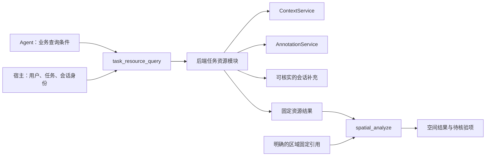

# 第二批：让工具取得正确资源，再做空间计算

2026-11-02｜范围与验收审阅稿｜[四批总览](README.md)

## 1. 本批目标与依赖

新增一个只读的任务资源查询入口，让 Agent 不必自行拼接草稿与来源系统的数据。它负责取对资源、带全依据；现有空间工具继续负责位置关系和距离等计算。

前置条件：[第一批](01-business-and-data.md)业务规则、共享字段、服务校验和来源适配约定已验收。真实来源不支持的能力必须明确列出，不能用模拟数据通过替代真实接入完成。

## 2. 建设内容

| 工作 | 具体改什么 | 交付结果 |
| --- | --- | --- |
| 提前筛选资源类型 | 给来源查询及来源型空间输入增加 `objectTypes` 等受控筛选，贯穿参数、适配器与模拟服务 | 无关道路、区域不会占用资源分页，也不会因其缺几何阻断资源分析 |
| 任务资源查询 | 拟新增 `task_resource_query`，按第一批规则取得任务相关来源、草稿及可核实补充 | 返回资源身份、关系、状态、数量、时间、依据与缺口 |
| 固定查询结果 | 新增独立资源结果类型与引用，例如 `resourceResultRef` | 后续空间分析、续问使用本次实际取得的同一批数据 |
| 接入空间分析 | `spatial_analyze` 支持经校验的资源结果输入 | 复用现有算法，保留资源身份和未判断部分 |
| 明确数量统计 | 区分对象计数、实体计数和数量字段求和 | 服务端检查类别、单位、范围和重复覆盖 |
| 明确错误与覆盖 | 区分空结果、未查完、无权限、来源不可用、缺位置及冲突 | 不把失败或缺失解释成零资源 |

类型筛选须在**来源分页及几何检查之前**生效。不能先取全部对象再在模型提示中说“只看资源”；不支持该筛选的来源须返回能力不足，或采用经验证能完整读取的明确兼容方式。

## 3. 工具与现有后端怎么衔接

复用现有权限、查询、标绘与 Pi 历史。拟增加 `context/task-resources.ts` 承载业务规则、`pi/task-resource-tools.ts` 暴露工具；具体文件粒度实施前再核对。现有 `pi/resource-tools.ts` 的名称不表示它已经是本业务查询工具，避免误复用。

模型只提供业务条件和显式引用。当前用户、任务、会话和可访问范围由宿主注入，不能由模型填写覆盖。会话补充须能回到实际消息或工具证据；工具不能把模型整理的一段文字直接认证为事实。

## 4. 查询与固定结果应怎样工作

1. 校验当前身份和任务、会话绑定，解析用户明确限定。
2. 根据第一批规则查询相应来源；保持完整分页和固定快照，不用 `areaIds` 代替实际几何范围。
3. 规范化身份、关系、状态和数量；仅按可靠实体关联合并。
4. 返回明确清单，同时报告覆盖、冲突、缺字段和无法判断位置的对象。
5. 结果随真实工具调用写入 Pi 原生历史；引用是定位结果的标识，不是证明模型理解正确的凭证。
6. 后续使用该结果时检查当前权限、任务/会话归属和原证据完整性。查询新状态应生成新结果，不悄悄改旧结果。

资源清单不必都有几何，不能直接塞进现有 `SpatialResult`。为资源结果增加独立校验与读取，再显式把适合计算的子集交给空间工具。已知部分可继续计算，但结果必须携带整体缺口。

例如：5 项资源中 2 项缺位置，空间结果可以说“已判断 3 项，其中 2 项在区域内；另外 2 项位置待核验”。不能把空间工具对 3 项的完整计算说成 5 项都已判断。

权限校验既包括读取历史结果，也包括后续计算与展示；无法读取的私有引用不得经新结果泄露。新类型不改写旧 `spatial:` 结果、旧模型文本或哈希，也不另建结果数据库。

## 5. 实施顺序

| 顺序 | 工作 | 开始条件 |
| --- | --- | --- |
| B2-01 | 来源类型筛选和分页、版本检查 | 第一批适配契约确定 |
| B2-02 | 后端任务资源集合、状态归一和实体合并 | B2-01 可用 |
| B2-03 | 资源结果引用、原生历史和授权读取 | B2-02 数据稳定 |
| B2-04 | 资源结果接入空间工具、统计和缺口传递 | B2-03 通过校验 |
| B2-05 | 暴露 Pi 只读工具，做完整离线调用链检查 | 前四项完成 |

本批不修改 Skill 或地图交互，不强制所有空间计算先经过新工具。用户明确指定图形集合时，继续支持原来的标绘输入和空间工具组合。

## 6. 验收标准

| 检查 | 必须看到的结果 |
| --- | --- |
| 类型筛选顺序 | 混合来源跨多页且无关对象缺几何时，资源仍完整返回；无关对象不占资源页容量 |
| 范围与身份 | 第一批样例的资源 ID 集合、合并依据、数量与预期一致；可见无关数据不混入 |
| 状态与数量 | 关联不冒充已分配、未知不冒充可用；单体与汇总不重复相加；混合单位被分开或拒绝合计 |
| 空间计算 | 使用实际固定几何，独立预期核对内、边界上、外；缺位置单列，不当成外部 |
| 结果与续问 | 重启、历史续问、原生压缩后仍能按原有机制读取合法结果；篡改或外部伪造引用不能使用 |
| 数据变化 | 分页版本变化明确失败；旧固定结果不受后续来源更新影响；新查询可取得新版本 |
| 权限和异常 | 权限变化、取消、来源失败、超限都有明确结果；不静默截断后宣称完整 |
| 副作用 | 查询与分析不改草稿、外部资源、发布或任务采用；原生分析结果记录不等于业务保存 |
| 兼容 | 旧工具输入、历史空间结果和既有明确图形计算回归通过 |

离线检查需覆盖真实服务与适配边界，不只模拟函数返回；几何预期独立于被测实现。类型检查、lint 和受影响服务/契约检查通过后，向第三批交付工具说明和已知能力限制。

本批不需要付费模型，不能用“工具成功”证明 Agent 会正确选范围或正确解释结果。
