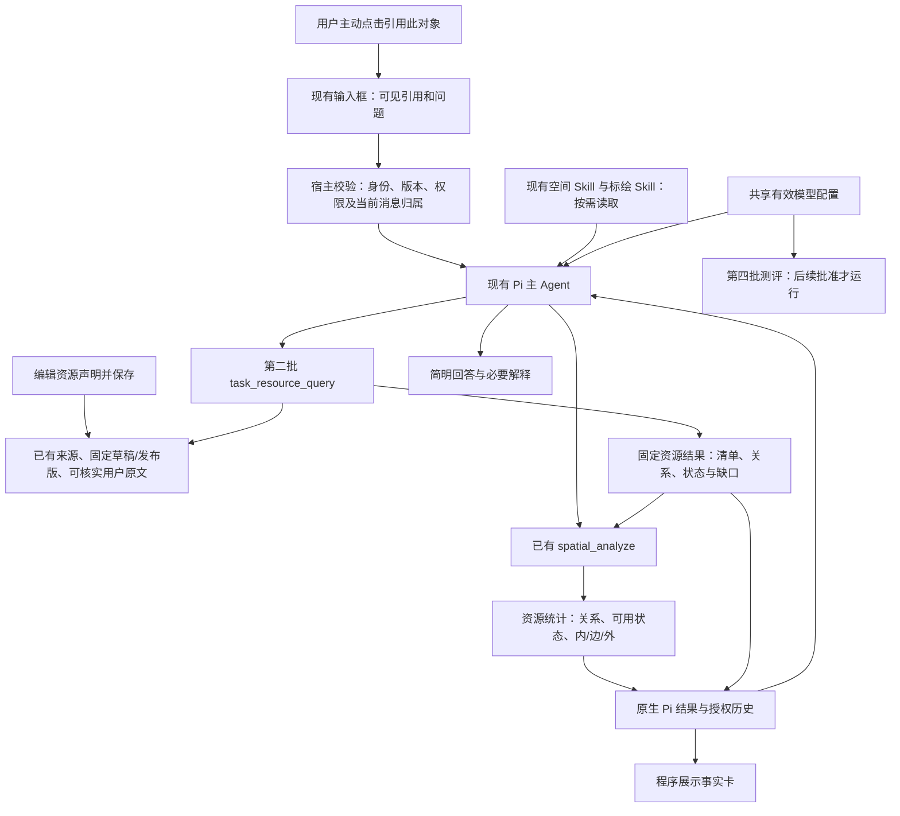

# 第三批：让地图引用、资源工具和回答接起来

2026-11-02｜已批准并完成实施与离线检查｜[四批总览](README.md)

基线：第二批提交 `56fa186`，分支 `codex/agent-spatial-plotting`。第二批已通过 226 项相关离线检查及 4 项桌面回归，见[报告](../../11-02-task-resource-query/results.md)。这些结果证明工具行为，不证明真实模型会选对方法或解释正确。

本文件只展开第三批，不合并前两批实施记录，也不提前执行第四批测评。以下“拟做”“建议”均等待本次审阅通过。

## 1. 这批交付什么

让用户能完成这条流程：**选中地图区域并点击“引用此对象” → 看清本条消息引用 → 询问本任务资源 → Agent 查询、计算 → 页面展示有依据的名单、数量、状态和缺口。**

已确认的交互边界：单击、选中、查看或编辑地图对象，都不自动加入对话引用。用户可以正常标绘后直接聊天，无需先清理地图选择；只有主动使用引用入口，才把对象附到消息中。撤回此前“单击自动带入”的方案建议，现有产品交互无需回滚。

| 本批建设 | 做到什么 | 不顺带扩展 |
| --- | --- | --- |
| 地图引用与消息 | 保留主动引用操作；优化名称、来源、版本和移除提示 | 不把单击、选中、编辑、悬停或高亮自动加入对话 |
| 资源编辑 | 用表单维护第一批字段，区分声明与来源事实 | 不建设资源台账、调度系统或通用实体绑定平台 |
| 两份现有 Skill | 说明何时查资源、何时纯算图形、怎样答全 | 不增加第三份重叠 Skill，不强制每题读全文 |
| 结果展示 | 用工具结果直接展示数字、名单与缺口 | 不假设卡片能自动纠正模型自由文字 |
| 模型运行配置 | 产品和后续测评使用同一有效配置 | 不做模型排名对照，不自动切换所有历史配置 |

仅面向桌面浏览器，覆盖三栏布局、窗口缩放和窄地图面板。不改底图、路网计算、专业作业决策；不新增独立 Agent 循环、结果数据库或权限体系。

## 2. 已有能力与本批缺口

以下为 `56fa186` 的代码事实，不是拟建能力。

| 已有能力 | 本批要补什么 |
| --- | --- |
| 地图的选中状态与“引用此对象”按钮分开；输入框可存来源引用、固定标注引用 | 保留现有两步交互，补可读名称、来源和版本信息 |
| `useComposerSelections` 已负责会话隔离、去重、发送消费及失败恢复 | 直接复用并回归检查，不新增自动引用状态或“保留到消息”操作 |
| 来源引用在发送时通过 `loadComposerContext` 查询最新对象；标注引用指向固定修订/发布版 | 在界面和 Skill 中讲清两者差异，不把来源点击时刻说成冻结版本 |
| 资源字段可保存，`FeatureEditor` 还没有专门表单 | 增加简明资源表单，未编辑字段和旧对象继续原样保留 |
| 受控 `from_source` 导入可建立实体关联；普通编辑不能填可信关联 | 提供来源导入入口和只读关联说明；不伪造“已有任意标注可直接绑定”的接口 |
| `task_resource_query` 已支持 query/read/summarize，支持关系、状态、空间条件统计 | Skill 使用真实接口；页面承接结构化结果，不重做查询/统计算法 |
| `resourceResult` 已进入事件和会话历史 | 增加资源结果卡及核对入口；使用原生授权结果，不从助手文字解析名单 |
| 两份 Skill 仍含旧的来源选择和联合统计规则 | 只对“任务资源业务问题”修订默认范围，保留纯图形和明确范围行为 |
| 模型目录、容量、会话选型及配置版本已有机制；运行仍有三处关闭思考的路径 | 统一能力声明、Pi 会话设置和最终请求，不只改一个开关 |

第二批的重要约束继续有效：数据覆盖、任务关系覆盖、位置覆盖分别报告；关系未知不是无关，未分类不是区域外；“任务相关”“已分配”“可用”不能互相替代。

## 3. 架构与一条完整流程

例：用户选中“港区 A”并点击“引用此对象”，问“区域内，本任务已分配且可用的救援船有哪些，边界上的单列”。

1. 输入框显示“港区 A · 来源/固定标注版本”；发送后宿主核实引用。
2. Agent 按第二批默认任务范围查询资源，取得固定结果 Q；不能因为选中了一个区域，就把区域来源系统当成唯一资源来源。
3. 用 Q 作候选、港区 A 作边界进行点面分类，得到 S；缺位置对象单列。
4. 用 `task_resource_query.summarize` 对 Q/S 按 `relation:assigned`、`availability:available` 及内部/边界条件分别统计。
5. 展示相应名单、数量及依据时间，同时说明覆盖或待核验项。没有保存要求，就不创建标绘。

工具调用次数不固定。已有同一范围、版本且仍获授权的 Q/S 可复用；不为完成流程重新查询，也不以一次工具成功代替完成用户问题。

## 4. 保留主动引用，讲清将发送什么

### 4.1 哪些动作会加入引用

| 动作 | 行为 |
| --- | --- |
| 单击地图对象或树中的对象、查看详情 | 只选中或查看，不影响聊天框引用 |
| 绘制、拖动、编辑资源表单 | 只处理地图作业，不附带到对话；正常聊天无需清理选择 |
| 点击“引用此对象/图层/版本” | 才加入本条消息；输入框显示可核对的信息，可追加或移除，不自动发送 |
| 多个对象重叠 | 先选具体对象查看，再由用户主动点击引用；不默认取第一个 |
| 悬停、平移缩放、切底图、结果高亮和定位 | 不添加或替换消息引用 |
| 主动尝试引用未保存的内容 | 提示先保存再引用，不自动保存，不用旧几何冒充新编辑 |
| 全局只读地图、尚无当前会话 | 只有用户主动引用时，才沿用现有选择/创建会话入口；不猜目标会话 |

撤掉自动带入、自动项替换、“保留到本条消息”及自动/手工状态区分。不引入额外操作来补救自动引用；已有去重、移除和发送消费机制继续使用。

### 4.2 引用发给 Agent 后，读取哪个时刻的数据

输入框显示“对象名称 · 来源或草稿 · 版本说明”，支持移除与返回地图核对。长名称可截断，但完整名称可通过键盘或详情查看；不要求用户理解内部 ID 或 hash。

| 引用对象 | Agent 实际读取什么 | 用户能看到的说明 |
| --- | --- | --- |
| 来源系统中的对象，例如救援船 R1 | 点击发送时，查询该对象的最新授权数据 | “发送时读取最新”；历史保留实际查询到的修订和时间 |
| 地图标注，例如草稿中的区域 | 引用指定的已保存修订或发布版 | 例如“草稿第 3 版”，不静默换成第 4 版 |

例如：引用 R1 后过两分钟再发送，期间船的位置更新了，Agent 收到的是发送时查到的位置，不保证是点击引用时看到的位置。引用草稿区域第 3 版后，即使已经保存第 4 版，原引用仍指向第 3 版。

**当次查询结果仍按已有机制保留，供续问和核对。** 本批不新增的是“查询来源系统过去任意时刻数据”的能力，也不另建点击时快照库，不是取消保存查询记录。

来源已删除、无权访问或读取失败时，提示刷新或移除失效引用，不能换成同名对象。用户明确要求之前某版时，优先复用已有固定查询/分析结果；若没有该版本，不假装来源支持历史重放。

### 4.3 发送恢复和未保存编辑

复用 `useComposerSelections` 与现有发送/恢复机制。切换任务、会话、席位时不能串用引用；返回原会话可恢复其原有输入。发送前捕获整份输入，发送失败恢复对应文本和引用，不被之后的操作覆盖。

主动引用未保存的新内容时，提示先保存；已经加入消息的旧版引用仍指向旧版，不能因为页面后来有编辑就悄悄换版。普通聊天不附带这些本地编辑，不因用户正在标绘而要求先保存。若用户要分析刚修改的内容，保存后重新主动引用即可。保留原有绘制缓冲和写入冲突/不确定回执处理，不新增全局聊天锁定。

## 5. 资源表单怎样设计

在现有对象编辑器中增加“资源信息”折叠区，继续使用现有保存按钮和草稿回执。先显示核心字段，依据、时间和条件按需展开；不要求用户填写 JSON。

| 用户看到的字段 | 保存含义与限制 |
| --- | --- |
| 这个标注代表什么 | 实际资源、计划位置、普通标注、未注明；旧对象不自动变成实际资源 |
| 资源类型 | 车辆、消防车、船舶、救援船、设施、消火栓、未知；使用第一批枚举 |
| 单个资源还是汇总 | individual/aggregate/unknown；单个资源不能填多台数量 |
| 数量、单位、数量含义 | 区分实体数、可用量、记录数；空值为未知，明确填 0 才是 0；车辆与船不合计 |
| 与当前任务的关系 | 相关、已分配、潜在支援、未确认；不因在当前会话编辑就默认已分配 |
| 可用状态 | 可用、不可用、未知；冲突是查询归并结果，不提供“强行改成冲突已解决”的快捷项 |
| 位置表示什么 | 实际/计划/估计/未知，以及位置代表资源本身还是站点 |
| 每项事实的依据与时间 | 允许用户声明说明，或选已有可访问来源/固定标注证据；保留报告、生效、失效时间及条件 |

提交有数量、关系、状态或位置事实时，按第一批要求附相应依据；不能后台自动写“系统已确认”。“用户声明可用”和“来源记录可用”在详情中可区分，声明不等于调度批准。

修改一项事实只改变对应内容，保留其他证据、条件、时间和未知值。现有 `resource` 是整体替换字段，表单先基于最新完整对象修改再提交；冲突仍由原有版本检查处理。旧对象未打开资源区或未改资源字段时，不填默认值、不清除已有隐藏字段。

### 导入时保留资源身份，暂不提供旧标注补绑

这里的“关联”是指：**这一个地图标注，对应来源系统中的哪一个具体资源。** 有可靠关联时，查询才能识别“来源记录与地图标注是同一艘船”，避免重复计数。

| 例子 | 本批如何处理 |
| --- | --- |
| 从来源系统选“救援船 R1”，导入地图 | 后端核对权限、来源与有效实体身份，符合条件时记录标注对应 R1 |
| 来源没有有效实体 ID | 可以按现有规则导入，但显示“实体身份未确认”，不认证为同一实体 |
| 先手工画一个船形标注，再想认定它就是 R1 | 本批不新增这种补绑按钮或接口，不凭同名、图标或手填 ID 建立可信关联 |

“受控导入”不是额外审批流程，而是调用已有 `from_source` 时由后端完成上述核对。页面提供查询来源 → 选择具体对象 → 核对信息 → 选择图层 → 导入的入口；已有关联只读显示，不允许直接编辑 `resourceAssociation`。

**手工标注仍可填写资源信息、保存并参与分析。** 缺少可靠实体关联时，只是不能自动认定它与另一条来源记录相同、据此合并去重。普通复制也不获得可信关联；导入新对象不会自动覆盖或删除原手工标注。

刷新来源几何、编辑声明、发布、任务采用仍是不同动作。刷新不顺便更新可用状态；发布或采用不代表资源已到场。

## 6. Skill 与宿主分别改什么

继续使用 `spatial-analysis`、`map-annotations`，不新增 Skill。目录描述和正文一起更新，版本/hash 对应同一份部署内容；保留正常按需读取和用户明确选择 Skill 的入口。

### 6.1 空间 Skill：按问题选择流程

| 问法 | 主要处理方式 |
| --- | --- |
| “这块面的面积多少”“数所选图层的点” | 原空间/标绘工具；不要求先认证为实际资源 |
| “仅统计来源 A 中港区的船” | `purpose:data`，明确 sources 条件；关系未知不阻断普通统计 |
| “本任务可用资源有哪些” | `purpose:task` 的已确认默认范围，再按可用状态分组；不默认只读草稿 |
| “这个区域里，本任务已分配且可用的船” | 任务资源 Q → 空间分类 S → 按关系/状态/位置统计 |
| “发布刚才的标绘方案” | 标绘 Skill 与真实发布回执，不把分析结果当作已保存对象 |
| “两份同名方案都可能是目标” | 先读取足够摘要；仍会改变答案才聚焦追问，不问已确认的信息 |

将旧的“只有明确联合统计才合并”改为：任务资源工具可以按已批准规则归并可靠身份；无据仍不合并。将“来源不明就列全组合”从任务资源默认结束方式中撤下；只有真实歧义或明确要求比较时才分别回答。

明确引用的区域只确定区域，不自动确定资源候选来自哪个系统。纯图形题与业务题的区别要用少量正反例讲清，不堆叠重复禁令。

### 6.2 标绘 Skill：接口用法与业务含义一起讲

补充资源字段含义、整体替换时的保留规则、声明证据、受控来源导入和普通复制的差别。保留原有读取、保存、冲突、回执、发布、采用流程。

修改“页面选中不等于已发送”表述：仅页面高亮仍不能作为依据；**宿主已随本条消息核实并传入的引用**可以使用，但引用摘要不等于已读所有几何和业务字段。未保存表单仍不进入 Agent 上下文。

### 6.3 宿主约定与回答核对

宿主只保留简短稳定规则：明确限定优先；任务资源使用批准范围；显示状态不构成事实；工具成功后继续完成尚未回答的要求。详细方法留给 Skill，权限与数字校验留给程序。

回答核对包括：本次使用哪些数据、用户要求的名单/数量/状态是否齐全、还有哪些来源/关系/位置未知、实际发生了哪些写入。不要为了少出错而漏答，也不要为了证明读过 Skill 添加无用调用。

本批离线验证“目录可见、读取正文正确、规则示例不矛盾、真实 Pi 工具链可接通”。**模型是否主动读取、读后是否遵守，留给第四批真实测评**，不以读取率高或读过一次作为成功门槛。

## 7. 结果展示与解释怎么衔接

### 7.1 事实卡来自真实结果

在现有工具消息/结果展示链路中增加资源卡，不建第二份结果存储。卡片读取授权后的 `resourceResult`；刷新、重启和历史读回沿用原生记录。查询结果卡与后续统计卡明确区分，read 标为“读取已有结果”，不伪装成再次计算。

卡片最少显示：

- **本次范围与时间**：来源/固定标注范围、任务关系筛选、可用状态筛选、原查询时刻。
- **名单与状态**：对象名称、类别、任务关系、可用状态、位置是否能判断；提供查看具体依据的入口。
- **数量**：记录数、已知实体数、不同单位/含义的数量分别标明；`null` 显示“无法确定总数”，不能显示 0。
- **三类缺口**：数据来源未查全、任务关联不完整、位置未分类分别展示；不能只留一个笼统“部分结果”。

名单使用固定结果 read 分页，显示“第几项/共几项”，统计使用完整结果而不是当前页。用户展开全文或换页时不重新查询来源；权限撤销后不能从浏览器旧卡恢复私有内容。前端只展示数量，不再实现另一套业务合计。

空间图层继续由原 `spatial_analyze` 结果控制；事实卡查看详情不自动移动地图。只有明确“定位”才调整视角，不打断绘制。

### 7.2 模型解释的边界

过程说明只陈述计划或当时已经核实的事实；结果未回前不说“已查全”“已保存”。最终回答可引用卡片中的数字，但仍须答全问题，不能只说“见卡片”。

例如应说：“已知资料中，区域内部符合‘已分配且可用’的救援船有 2 艘；另有 1 项缺实际位置，未纳入内外判断。”不能改说“全任务只有 2 艘船”“另一艘在外部”或“已调派 2 艘”。这是示例口径，不是硬编码答案。

程序不把自由解释自动判正确，也不新增一个模型审判器逐句重写。第四批继续核对过程说明与最终回答；错误解释仍影响严格正确率。

## 8. 模型配置：保证设置真的生效

### 8.1 当前具体缺口

`pi/lab.ts` 注册模型时写 `reasoning:false`，创建会话时写 `thinkingLevel:'off'`；`pi/controlled-stream.ts` 又对 provider 名为 deepseek 的请求写入 `thinking.type:disabled`。现有 `server/config.ts` 与 `model-settings.ts` 已管理模型身份、容量、输出预算和配置版本，但没有统一的思考策略。

本批目标是让能力声明、会话参数、最终请求一致。**“没返回思考正文”不是“没开启思考”的证据，也不是中断条件。** 不把私有思考内容作为产品展示或验收必需项。

### 8.2 拟定调整

| 项目 | 做法 |
| --- | --- |
| 配置归属 | 在现有模型 profile 中增加明确的思考模式与必要的能力说明，不新建一套配置中心 |
| 能力匹配 | 按实际服务商、模型 ID、端点及已核实适配区分，不仅根据自定义 provider 名猜能力 |
| Pi 使用 | 优先使用当前公开 SDK 的模型能力及思考选项；仅在已确认提供方适配缺口处补最小请求映射 |
| 产品与测评 | 抽取共享配置解析/运行适配，未来测评调用同一入口，禁止 probe 再偷偷覆盖开关 |
| 参数证据 | 用离线捕获记录脱敏的有效模型/端点、思考模式、输出预算及配置版本，不记录 API Key |
| 不支持或未核实 | 不显示为“已开启”；明确不支持或暂不可验证，不默默降级后声称开启 |
| 旧配置 | 缺新字段保持原行为；迁移须显式保存，保持现有原子更新及忙碌请求保护 |

建议以后续验收用的 **Agent Plan Flash 开启思考**作为一个明确 profile；不把所有模型强制改成同一字段或同一强度，也不在本次文档阶段改线上默认值。具体外部能力按实施时的官方资料与当前 SDK 核实，未核实的组合不宣称已支持。

主回复、工具续轮、手动/自动压缩、后台/子 Agent 经过同一解析入口；每条路径的有效策略明确记录。能遵循同一模式就沿用，SDK 或模型不支持的路径明确暴露限制，不能静默硬编码相反值。角色和工具权限不变。

不新增每条消息必须选择的思考开关。优先扩展既有模型设置页，普通会话继续选择已有模型 profile。更改只影响按现有规则创建的新请求，运行中的请求使用已捕获配置，历史保留原版本。

### 8.3 本批能够证明到哪一步

离线可证明：配置保存读回、模型注册、Pi 选项与发出的请求字段一致；长思考只有心跳/用量包时不被误判空闲；取消和真正超时仍有效。不能证明远端实际启用了哪种内部推理、套餐实际扣费或任务正确率。真实连通性及流程验证放入第四批批准预算，不能为核实开关在本批偷偷调用模型。

## 9. 改哪些模块，按什么顺序

| 顺序 | 建设内容与主要落点 | 依赖与交付标志 |
| --- | --- | --- |
| B3-01 引用显示与发送 | `web/main.tsx`、`annotations/AnnotationWorkspace.tsx`、`situation/SituationView.tsx`、`useComposerSelections.ts`、`useChat.ts` | 主动引用、隔离、消费恢复及未保存保护可验证；单击/标绘不影响对话，来源和固定版标签准确 |
| B3-02 资源表单与导入 | `annotations/FeatureEditor.tsx`、`edit-changes.ts`、现有来源导入入口 | 复用第一批契约；未知、证据、时间、关联身份正常保存与读回 |
| B3-03 资源卡片 | 现有 `ChatMessage`/工具消息、`useChat.ts`、共享资源契约 | 第二批结果直接展示；固定分页、三类缺口和撤权隐藏正确 |
| B3-04 两份 Skill 与宿主 | 两份现有 SKILL.md、资源目录描述、现有请求约定 | 新业务与纯图形方法不矛盾；目录、正文、版本/hash及实际 provider 输入一致 |
| B3-05 统一模型配置 | `server/config.ts`、`model-settings.ts`、`pi/lab.ts`、`controlled-stream.ts`、既有设置 UI 与测试入口 | 旧配置可读；新模式明确；各路径的实际请求可捕获比较 |
| B3-06 完整链路验收 | 下表离线组、既有回归、桌面浏览器 | 无未解决阻断问题；交付报告、截图和第四批接口/配置清单 |

实施时优先验证显式引用与配置适配这两条边界，再补界面细节；不能最后才发现模型仍被强制关闭思考。独立检查修复问题后，只重跑受影响检查，不将重复次数相加。

不扩展第二批查询语义。若发现实现不满足已批准契约，记录具体缺陷并修复；若必须改变业务规则、新增实体绑定或额外来源接口，先写变更说明审阅。

## 10. 离线与桌面验收清单

下列是 **26 组程序验收主题**，不是 26 道真实模型题，也不是固定单元测试数量。每组使用可核对的输入、预期和失败记录；实现后的报告逐组关联具体测试。

| 编号 | 场景与操作 | 必须通过的结果 |
| --- | --- | --- |
| T01 来源引用 | 选中来源区域 A，点击“引用此对象”，输入问题并发送 | 名称/来源可见；宿主按完整引用读取；历史记发送时快照，不声称点击时冻结 |
| T02 固定标注 | 主动引用修订 r3 的对象，另产生 r4 后发送 | 仍引用 r3；版本清楚；不得换成最新对象冒充 |
| T03 显式引用增删 | 主动引用 A、B，重复引用 A，再单击 C；移除 B 后重绘 | A 去重、B 可移除；单击 C 不追加或替换引用，移除后不因重绘恢复 |
| T04 同名与重叠 | 两个同名对象重叠，选定其中一个，再主动引用 | 显示来源/图层/版本差别；选中仅查看，主动引用后身份准确 |
| T05 标绘后普通聊天 | 单击查看、绘制、编辑对象，再直接发一条未引用对象的消息；另测悬停、缩放、底图切换和定位 | 不自动附带地图对象，不要求清理选择或保存后才能普通聊天；绘制保留 |
| T06 引用未保存内容 | 编辑尚未保存时主动点击引用；另测已引用 r3 后继续编辑 | 引用新编辑提示先保存；原 r3 引用保留固定含义，不冒充新几何；普通聊天不受阻 |
| T07 消费与失败恢复 | 成功发送后再发下一条；另模拟发送失败、期间主动引用另一个对象 | 成功后不暗中重复附带；失败恢复原输入，不混入之后新增的引用 |
| T08 会话与权限 | 切任务/会话/席位；从全局地图进入会话；来源被撤权或删除 | 无串用、无猜会话、无同名替代；失效引用明确处理 |
| T09 基础资源表单 | 旧普通点改名；新资源声明数量留空或明确填0 | 旧数据不补默认；未知与0不同；单个对象多台数量拒绝 |
| T10 事实依据 | 保存关系、状态、数量、位置与各自证据/时间/条件 | 无依据字段给明确错误；声明不显示为来源认证；其他事实不被清空 |
| T11 冲突与保留 | 别处改了同一对象，当前仅修改资源状态 | 不覆盖其他最新字段；冲突按原机制提示，隐藏字段完整保留 |
| T12 受控导入 | 导入有实体ID/无实体ID两种来源对象，再普通复制和刷新 | 仅合格导入建立关联；复制不继承认证；刷新不更新可用声明 |
| T13 数量展示 | 混合车辆/船、可用量/实体量、未知、潜在重复 | 不合计不同含义；已知数量与未知总量不同，前端不再重算 |
| T14 分页与覆盖 | 多页资源、partial来源、缺任务关联、缺实际位置 | 当前页不称全集，统计不受页码影响；三类缺口各自可见 |
| T15 历史与撤权 | 生成/统计/读取结果，重启刷新，随后撤权 | read不是新计算；旧结果不更新；无权结构化内容及详情不泄露 |
| T16 非写入与回执 | 查询/计算后再显式保存、发布、采用，模拟失败 | 无要求不写；各动作效果来自对应回执，不相互推断 |
| T17 Skill 交付 | 正常目录发现、显式选择、skill_read、旧会话续问 | 新目录与正文同版、hash一致，旧历史不改；不把受控读取当真实主动加载率 |
| T18 方法规则 | 资源业务、明确来源、纯图形、真实歧义四类公开样例 | 方法说明无冲突；纯图形不强制资源声明；明确范围不被默认业务扩大 |
| T19 完整资源对话 | 确定性 Pi 跑显式区域引用→query→分类→按状态/关系统计→read | 真工具、原生记录和卡片一致；名单/数量/状态/缺口可核对，无自动保存 |
| T20 配置兼容 | 旧单模型/目录配置读回，新增支持/不支持的思考模式 | 旧行为保留、支持状态明确；版本冲突拒绝，不泄露密钥 |
| T21 请求一致 | 同一profile从产品和未来评测入口构造请求 | 模型、端点、模式、预算一致；移除无条件关闭覆盖，其他模型不套错参数 |
| T22 各执行路径 | 首轮、工具续轮、手动/自动压缩、子Agent/后台 | 每条路径使用声明策略；中途配置更新不影响已运行请求，权限不变 |
| T23 思考与中断 | 无可见思考正文、有心跳；再模拟真正空闲和用户取消 | 不因没有思考正文误停；心跳维护活跃，取消/超时仍受控，无自动重试 |
| T24 历史格式 | 旧composer v1—v5、空间v1/v2和第二批资源派生结果 | 原正文/hash不改，重启/压缩可读；新格式仅用于新记录 |
| T25 桌面与键盘 | 三栏、窄地图面板、浏览器缩放、长名称、键盘编辑/移除 | 标签和错误可读，焦点可达，关键操作不遮挡；无手机端新增验收 |
| T26 发布交接 | 检查新版本变更与冻结材料 | 代码/数据/Skill/有效配置版本可追溯，离线失败留档；第四批未自动启动 |

执行方式：相关 Vitest 和类型/lint/构建检查；确定性 provider 驱动真实 Pi 服务；Playwright 实际操作桌面。HTTP 来源使用受控事实夹具，预期答案独立保存，不能让假工具直接返回预设业务结论。

沿用 `--configLoader runner` 与隔离临时目录，避免向共享 node_modules 写缓存。浏览器必须提供关键截图：可见引用、未保存提示、资源表单、三类缺口、模型有效设置及窄面板。页面是否显示正确以实际操作和截图复核，不能只靠静态 DOM 断言。

通过标准：26 组都具备有效证据，相关旧回归、类型、lint、构建通过，无剩余权限/写入/版本/统计阻断缺陷。**真实模型调用预算为 0**；执行型接口与条件替代程序能跑通，不计作模型正确率。

## 11. 兼容、回退与第四批交接

- 复用既有 `contextRefs` / `annotationRefs` 和 composer 数据。仅引用标签或显示方式改变时不升级历史格式；如果必须改变宿主正文或新增持久字段，新增 composer 版本，保留 v1—v5 解码与原文，不能重写旧 hash。
- 新资源表单必须保留第一、二批已经写入的字段；回退界面时也不能让旧保存路径擦除它们。资源卡隐藏或回退不删除原生结果。
- 模型配置若增加存储字段，明确新版本读写和旧配置迁移；回退需使用仍能读取新记录的版本，或备份后显式还原配置，不能承诺旧二进制天然兼容。
- 不新增全局自动保存或发布行为。第三批仍在本分支实现，其他会话并行修改时先核对 Git 状态，避免混入或覆盖。
- 交给第四批：冻结提交、Skill目录/正文hash、输入/结果协议版本、有效模型配置和脱敏请求样例、T01—T26检查及截图、已知限制。

第四批的真实流程题、新题与重复次数仍以其独立执行方案审阅为准。本批不把旧分数与新规则混算，也不预先宣称整体90%目标已通过。

## 12. 本次审阅重点与代码依据

交互方式已经确认，其余内容继续供审阅：

1. **引用方式（已确认）**：保持现有“选中 → 点击引用”操作。单击、查看和标绘不改变对话引用，不新增自动引用状态。
2. **读取哪个版本**：来源对象读取发送时的最新数据；地图标注读取引用指定的已保存版本。当次查询结果仍保留，不新增查询来源过去任意时刻数据的能力。
3. **标注对应哪个资源**：从来源导入 R1 时，后端核实并保留 R1 身份；暂不新增把任意手工旧标注补绑为 R1 的按钮。手工标注仍可填写资源信息和参与分析。
4. **模型策略**：提供明确的 Flash 开启思考 profile，旧配置不静默迁移；真实验证留到第四批预算。

除已明确确认的引用交互边界外，其余仍为本稿建议；本次文档修改不视为第三批实施授权。第二批已提交；第三批待本稿审阅后再创建实施子任务并准备执行上下文，不运行 `task.py start`。

代码依据（相对本文件）：

- 输入与地图：[main.tsx](../../../../experiments/harness-lab/src/web/main.tsx)、[AnnotationWorkspace](../../../../experiments/harness-lab/src/web/annotations/AnnotationWorkspace.tsx)、[useComposerSelections](../../../../experiments/harness-lab/src/web/useComposerSelections.ts)、[useChat](../../../../experiments/harness-lab/src/web/useChat.ts)。
- 表单与契约：[FeatureEditor](../../../../experiments/harness-lab/src/web/annotations/FeatureEditor.tsx)、[资源字段](../../../../experiments/harness-lab/src/contracts/task-resources.ts)、[标绘服务](../../../../experiments/harness-lab/src/annotations/service.ts)。
- 引用与原生历史：[来源消息装配](../../../../experiments/harness-lab/src/context/composer.ts)、[composer-input](../../../../experiments/harness-lab/src/pi/composer-input.ts)、[资源工具](../../../../experiments/harness-lab/src/pi/task-resource-tools.ts)、[资源结果解析](../../../../experiments/harness-lab/src/pi/task-resource-results.ts)。
- 方法：[空间 Skill](../../../../experiments/harness-lab/fixtures/skills/spatial-analysis/SKILL.md)、[标绘 Skill](../../../../experiments/harness-lab/fixtures/skills/map-annotations/SKILL.md)、[受控目录](../../../../experiments/harness-lab/src/resources/service.ts)。
- 运行：[配置解析](../../../../experiments/harness-lab/src/server/config.ts)、[模型设置](../../../../experiments/harness-lab/src/server/model-settings.ts)、[Pi 会话](../../../../experiments/harness-lab/src/pi/lab.ts)、[实际请求](../../../../experiments/harness-lab/src/pi/controlled-stream.ts)。

## 实施结果（2026-11-02）

本方案提交 `d194f4c` 后获准实施。已完成B3-01—06，30个文件409项相关离线测试、15个不同桌面用例通过，类型/lint/构建通过。真实模型调用0，第四批未启动。见[结果报告](../../11-02-task-resource-experience/results.md)、[独立审核](../../11-02-task-resource-experience/review.md)与[验收映射](../../11-02-task-resource-experience/acceptance-trace.md)。

实施按现有代码澄清了三点：资源卡分页复用授权会话快照，不另调用模型；产品没有独立手动压缩入口，核对自动压缩及共用适配；保留原有Pi会话级瞬态重试，T23“不自动重试”不代表整个产品禁用重试。旧缺省模型配置保留原请求行为，不等于已核实远端关闭思考。详细边界见[执行说明](../../11-02-task-resource-experience/execution-notes.md)。
