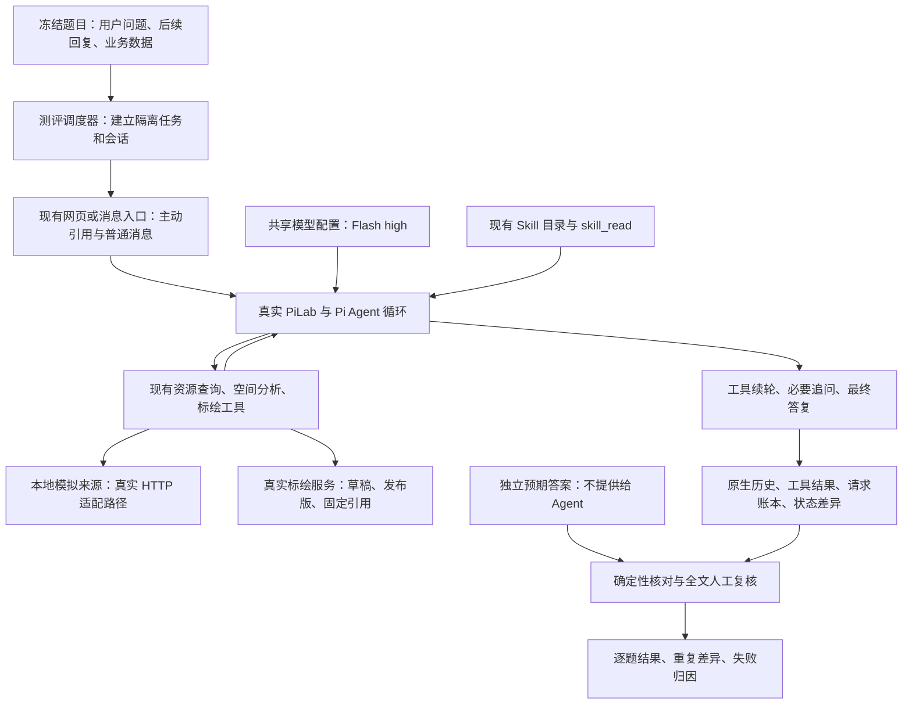

# 第四批：任务资源完整流程验收

2026-11-02｜详细技术方案，待审阅｜[四批总览](README.md)

**本批先建设测评材料和执行流程，再验证 Agent 能否按前三批的新规则完成任务。暂不调整产品逻辑、Skill 或模型。建议 4 项公开流程检查＋8 道新题各执行 2 次，共 20 次完整任务。** 本文件落盘不代表已启动测评。

## 审阅速览

这轮要看的是：**Agent 能否找对数据、理解资源含义、完成计算，并准确解释结果。** 先用 4 项公开题检查引用发送、工具续轮、追问接续和固定结果读取，再用 8 道新题做正式验收。一个任务可以有多轮对话和多次模型调用，20 次任务不等于 20 次 API 请求。

### 八道题各测什么

| 题号 | 主要检查 |
| --- | --- |
| A01 找本任务资源 | 根据任务引用和支援证据取数，不把全部可访问资源都算进来；来源没有“按任务查询”接口时仍能处理。 |
| A02 理解草稿内容 | 分清实际资源、计划部署点、普通标绘和未知对象；考虑明确的草稿补充，不凭图标认定资源可用。 |
| A03 识别重复资源 | 同一资源的来源记录和受控导入副本有依据才去重；同名不等于同一实体，不能确认的单列。 |
| A04 区分关系与状态 | 分清任务相关、已分配、支援条件、可用、故障和未知，正确找出“已分配且可用”的资源。 |
| A05 算位置与数量 | 按实际位置区分区域内、边界和区域外；缺位置不算外部，记录数不等于资源数量，不跨单位相加。 |
| A06 区分零结果与没查全 | 分清确实零命中、只查到部分和任务关系未知；回答已知部分，同时说明缺口。 |
| A07 遵守明确范围 | 用户指定图层就只算该图层；改问全部点图形时切换为纯几何分析，不继续套用资源筛选规则。 |
| A08 问清后继续完成 | 两个同名区域无法确定时针对性追问，收到回答后继续查询和计算，不能停在范围说明。 |

### 能验证什么，不能验证什么

| 本轮能得到的证据 | 本轮不能据此得出的结论 |
| --- | --- |
| 前三批合起来，在这些场景中能否完成完整任务；失败最早发生在哪一层。 | 不能把全部变化归因给某个工具或某段 Skill，也不能与旧业务口径的分数直接比较。 |
| 工具结果正确时，过程说明和最终回答是否仍有数量、状态、来源或处理过程误述。 | 不能因为结果卡正确，就认定整段回答正确。 |
| 相同题目执行两次是否出现不同结果，提供初步重复性证据。 | 两次重复不足以精确估计波动概率，也不等于新增了不同场景。 |
| Skill 是否收到、是否读取、何时读取，以及适用规则是否落实。 | 没有预加载或旧版对照，不能单独证明加载机制的因果影响或 Skill 修改带来的净提升。 |
| Flash 开启推理、正常按需加载下的表现。 | 不能比较模型优劣或推理开关效果，也不能证明生产环境总体正确率达到 90%。 |

来源使用模拟业务数据、工具与标绘服务实际运行；本轮不覆盖真实外部系统的数据质量、生产规模性能或全部地图作业。

**验收与预算**：正式 16 次中，主任务成功和严格成功均至少 15 次；严格成功要求任务完成、解释准确且无未授权业务动作，关键约束须全部通过。拟定全批上限为 240 次实际模型请求、800 万输入和 100 万输出 token，包含原生重试用量，不自动重跑整题或追加测试。具体评分见第 8 节，预算及停止规则见第 10 节。

下文保留架构图、逐题数据与问法、实施顺序和验收细节，供逐项审阅。

## 1. 基线、目标与边界

前三批已提交：业务规则 `ea30f46`、查询工具 `56fa186`、交互与运行配置 `12e1cc9`。第三批已有 409 项不同离线测试和 15 个不同桌面浏览器用例通过，真实模型调用为 0，见[第三批报告](../../11-02-task-resource-experience/results.md)。这证明程序接通，不代表 Agent 正确率已通过。

本批回答三个问题：

1. 面对任务资源、明确数据范围和纯图形问题，Agent 是否选对处理方式并完成？
2. 工具结果正确时，过程说明和最终回答是否忠实，是否混淆“相关、已分配、可用”？
3. 相同题目在两个独立会话中，结果是否稳定，失败最早发生在哪一步？

保留总体 **90%** 门槛。新业务规则改变了题目含义，本轮不能与旧来源选择题直接比较后宣称提升。只有一个模型、一套 Skill、一种正常按需加载方式；两个重复是检查波动，不是两套产品的对照。

本批不建设路网、调度决策、知识库、来源历史数据库；不修改默认资源范围，不把单击地图变成聊天引用，不新增任意旧标注补绑身份。若测评暴露产品缺陷，先记录并提出修复，不能边改边混算。

## 2. 技术架构：真实运行，模拟业务数据

**不是把整张地图和正确答案写进提示词。** 来源记录进入模拟来源 HTTP 服务，标绘经现有 AnnotationService 建立并持久化，任务关系进入现有任务上下文。Agent 通过真实工具读取和计算。用户明确引用的对象通过现有 `contextRefs` / `annotationRefs` 发送，仍保留产品原有上下文装配。

来源本身可以不认识平台任务 ID：按明确对象、区域等条件读取，再依据平台引用或资源证据判断任务关系。没有关系依据就保留未知，不通过测试专用提示暗示答案。

公开流程题 P01 经桌面浏览器实际点击“引用”并发送，观察真实模型回复；P02—P04及正式题通过同一产品服务入口调度，核对发送后的引用及原生历史。后者验证服务及 Agent 完整流程，不冒充每题都做过鼠标交互。第三批浏览器验收继续作为 UI 证据。

## 3. 复用什么，新增什么

| 部分 | 复用 | 本批需要补齐 |
| --- | --- | --- |
| 业务运行 | PiLab、ContextService、AnnotationService、TaskResourceService、原生会话历史 | 隔离建题及清理程序；不另写 Agent 循环 |
| 资源计算 | `task_resource_query.query/read/summarize`、`spatial_analyze` | 读取真实结果做集合、范围、数量和缺口核对 |
| 模型与 Skill | `configuredRuntime`、产品推理配置、两份 v2 Skill | 冻结有效配置并记录实际请求；不改外发提示或偷偷预加载 |
| 旧测评基础 | 隔离运行目录、账本、原始响应、冻结 hash、澄清审阅记录的做法 | 新业务题适配；不直接运行硬编码旧 revision 的脚本 |
| 追问接续 | 产品交互 API、普通用户消息入口 | 用业务事实表匹配实际问题，替代问号/关键词判断 |
| 评分 | 旧轮经确认的事实与表达区分方法 | 新资源口径的预期、评分校准与逐句证据表 |

特别注意：旧轮 `provider.ts` 会重写思考及输出参数，旧 `runtime.ts` 固定旧提交。本批不沿用这些改写。模型请求由第三批共享配置生成，测评包装只负责记录、预算检查与取消；离线检查应证明除授权信息脱敏外，没有更改请求正文。

建议审阅通过后另建执行目录 `.trellis/tasks/11-02-task-resource-acceptance/`，放任务清单、运行配置、调度器、评分与报告。本文件继续作为第四批独立方案，不能把旧轮原始记录覆盖掉。

## 4. 数据与新题如何准备

每题分成四份材料：

- **给产品的数据**：来源记录、任务引用、标绘版本、用户已说过的事实、授权范围。
- **给 Agent 的输入**：正常用户问题、主动引用、合法追问答复；不包含判分提示。
- **给评审的答案**：应纳入/排除/待核实的对象、数量、几何、证据与允许的回答路径。
- **执行说明**：何时发送第二轮、来源何时变化、允许哪些写入、如何判断完成。

先公开能力和用户问法。正式名称、坐标、数量、证据时间等在产品冻结后由未参与对应实现的复核者另行制作，制作后封存并记录 hash。预期不能调用被测统计函数生成；使用人工可核对几何与独立集合/数量计算交叉确认。

只有满足独立制作和未用于调参，才称“新题验收集”。否则标为新开发题，不能以它作为正式新题验收结论；须在运行前说明并重新安排。固定随机种子便于复现，但种子与答案不进入模型上下文。

重复 1、重复 2 使用相同业务事实及措辞、全新隔离会话。对象 ID 可按会话映射，名称、数量、几何和时间含义不变。两轮使用相同受控业务时钟，避免状态过期造成假波动；实际请求墙钟另行记录。不共享上一题答案或上一轮对话。

## 5. 四项公开流程检查

这四项检查“测评能不能可靠运行”，不加入正式正确率分母。

| 题号 | 用户要求和安排 | 必须验证的流程 |
| --- | --- | --- |
| P01 主动引用 | 网页单击区域只查看，再主动引用并问“统计这个区域中的实际资源，边界单列” | 未引用时不附带；引用后身份/版本正确；真实模型可调用工具并答复；界面卡片与原生结果一致 |
| P02 查询到统计 | “查本任务已分配且可用的资源，分别列出区域内、边界、区域外；缺位置单列” | 真实查询→空间分类→资源统计→最终回复；不得到 tool_calls 就结束任务 |
| P03 追问后继续 | 两个同名区域均可选，先问“查北区资源”；实际追问后说明具体对象 | 识别待回答事项，按实际问题回复，继续同一会话到完成；不要求固定问句 |
| P04 固定结果续问 | 先查名单；由测试控制器更新来源，再问“继续列出刚才名单剩余部分，不重新查询” | 读取原 resultRef、覆盖全部页；不把 read 说成新查询/再次保存；新来源变动不污染旧结果 |

四项均须有完整可审计轨迹、正确会话接续、有效预算记录和隔离状态。**模型答错但过程可评分，不等于流程检查失败。** 普通文本澄清和交互 API 均有离线分支检查；真实模型未使用某条分支，就不宣称该分支已在线验证。

## 6. 八道正式题：逐题要求

以下是可审阅的出题规格。正式执行前还须产出具体实例和独立预期，不能只拿这些自然语言描述开跑。

### A01 本任务资源从哪里找

- **数据**：任务明确引用一项来源资源；有证据的支援资源可经已配置发现能力读取；另有无关但可访问的资源。至少一个来源没有按任务查询接口。
- **用户**：“查一下本任务有哪些资源，任务相关和有依据的支援分开列；已分配、可用情况按证据说。”
- **正确处理**：沿任务引用/受支持关系发现取数，分开任务关系和可用状态；无任务接口仍能按对象读取，不把全库可见资源当本任务资源。
- **追问**：数据已足够，不应要求用户再次指定草稿或来源系统。若确实发现题目遗漏，暂停核题而非临时补答案。
- **判分**：候选名单、分类与证据匹配；未说明的覆盖范围不能宣称完整。来源不支持任务接口本身不算失败。

### A02 草稿补充不是图标认证

- **数据**：当前草稿含明确实际资源、计划部署点、普通图形及未分类旧对象；另有一份任务采用的固定发布版。用户此前明确引用一项资源并补充状态，保留原文。
- **用户**：“把本任务已知的实际资源列出来，草稿和任务采用版本也考虑；计划位置、不能确认的对象和状态另外说明。”
- **正确处理**：实际资源可进入候选；计划点不能冒充现场资源，旧图标不自动认证。用户补充须核对真实原文，标为用户报告，不能说成来源系统已确认。
- **追问**：未知项单列即可，不必为了补齐所有未知阻断已知结果。
- **判分**：纳入、排除及未确认名单正确；无漏掉明确草稿补充，无把计划或图标直接当已可用资源。

### A03 同一资源多份记录

- **数据**：来源对象与受控导入的标注指向同一实体；另有同名但不同实体，及名称/位置相似却没有可靠身份关联的手工对象。
- **用户**：“整理这批资源的名单和数量，同一资源的副本不要重复算；身份不能确认的单列。”
- **正确处理**：只按可靠实体关联去重；同名不同实体保留；无法确认的重复贡献不能硬并入精确总数。
- **追问**：允许询问缺失身份，但不能靠用户确认名称相同就伪造来源实体 ID；既有数据足以给有限结论。
- **判分**：记录数、确认实体数与未知贡献区分清楚，不用 `items.length` 冒充资源实体总数。

### A04 相关、已分配和可用不是一回事

- **数据**：分别提供已分配且可用、相关但未分配、有条件支援、故障、状态未知、证据冲突的资源；有效时间与条件明确。
- **用户**：“哪些已分配给本任务而且目前可用？有条件支援、不可用和待核实的也分别列出。”
- **正确处理**：关系和状态分别判断，再求所问交集；条件未满足、冲突与未知单列，不编造调度结果。
- **追问**：条件未知时可提出必要问题，但应先完成有依据的部分，不能一句“请确认资源范围”结束。
- **判分**：主名单和分组准确，证据时间未被忽略；没有把相关当分配、把没有故障记录当可用。

### A05 位置与数量怎样计算

- **数据**：同一区域有内部点、边界点、外部点；另有登记归属、计划或缺失实际位置的资源。包含单体记录和一个无成员重叠、数量单位明确的资源组。
- **用户**：“按实际位置统计这一区域内的资源，边界另列；数量按类别和单位分开，无法定位的不要当区域外。”
- **正确处理**：按有效实际位置分类；登记地/计划位置不能代替现场位置。分开记录数、实体数、资源数量，不跨单位相加。
- **追问**：用户已规定边界单列，无需再次询问是否包含边界。
- **判分**：几何分类和数量吻合独立预期；缺位置贡献保留未知，已知部分可以给数，但不能说成精确全量。

### A06 真零与“没查全”

- **数据**：两个授权来源均属于本题范围；其中一个在区域内确实零命中且覆盖完整，另一个返回明确 partial 的有限清单，部分关系字段缺失。另将完全不可用路径放离线检查，避免一题塞入过多故障。
- **用户**：“查这两个来源在该区域的资源，有没有资源、查全没有、任务关系是否明确，分别说明。”
- **正确处理**：完整来源可报告本次范围内零命中；局部来源报告已知名单及未覆盖部分；数据覆盖与任务关系覆盖分开。
- **追问**：不能靠用户一句“按全部算”消除数据缺口，也不因缺口拒答所有已知结果。
- **判分**：空集合、缺字段和局部覆盖没有混淆；局部成功不被解释成全量零或全量完成。

### A07 明确范围与纯图形问题

- **数据**：用户已主动引用固定图层及区域，其中有实际资源、普通点和计划点；另有无关来源可访问。
- **第一轮**：“只统计我引用图层中的实际资源，区域内和边界分开，不分析任务关系。”
- **第二轮**：“再看同一图层里的全部点图形，包括普通点和计划点，分别有多少在区域内、边界和区域外？”在第一轮完成后发送，不根据第一轮对错改变问题。
- **正确处理**：第一轮采用明确数据范围，不强加任务关系门槛；第二轮切换纯几何口径，不把资源筛选结果当全部图形，也不扫描其他来源。
- **判分**：两轮都完成才算本题主任务成功。正常完成无需读取资源 Skill 的简单步骤，不因未读而扣分。

### A08 真歧义需要问清后继续

- **数据**：有两个同名区域，形状及命中名单不同；用户未引用区域。任务资源范围按已确认业务默认值，没有第二个隐藏来源选择题。
- **第一轮**：“看北区内本任务的可用资源，边界单列。”
- **预设事实**：用户实际指港口侧区域；允许回复其完整名称、可见 ID 或地图引用。答复按 Agent 实际提出的问题发送，不预设固定选项顺序。
- **正确处理**：先通过工具发现候选；现有上下文仍不足时聚焦确认区域，得到回复后继续查询、计算及回答。
- **判分**：没有猜区域，没有只说明范围就停下；确认后完成全部任务。若不追问却有其他实际可见证据支持选择，评审须检查证据，不能只按“没问”判错；出题时应排除这种无意线索。

八题两次共 16 次；A07、A08 内的多轮属于同一个任务，不额外增加任务数。默认只读。测试控制器的预设建图、导入或来源更新与 Agent 行为分开记录，不把夹具写入误判成 Agent 越权。

## 7. 如何让 Agent 真正做到完成

使用现有 Pi 执行循环，工具返回后继续模型处理，不在第一次回复、第一次计算或 `tool_calls` 时停止。

| 实际状态 | 调度器动作 |
| --- | --- |
| 正在执行工具或原生续轮 | 等待原生流程，不注入“继续”提示 |
| 产品交互 API 正在等待 | 使用实际 question ID，核对所问内容后提交对应用户事实 |
| 普通文字要求用户补充且影响继续处理 | 复核全文，选择冻结的业务事实回复；不按问号或关键词判断 |
| 正常最终回答 | 核对本题是否还有预设用户轮次；有则发送，没有则进入评分 |
| 模型说“还需查询”但自行结束且未询问用户 | 记未完成；不能临时替它决定工具或用提示救答 |
| 问题超出预设可答事实 | 保留现场，暂停该题核题；不得编造答案。独立题可继续，受影响题不自动重试 |

澄清记录保存原句、匹配事实、发送回复及理由。业务事实不足和评测器接续失败分别记录，不能一律计成模型错。无思考正文、正常心跳、合法用户追问均不是中断理由。

离线至少覆盖：工具多轮、正常终答含问号、普通澄清、API 澄清、先回答再可选追问、冗余追问、未知问题、两轮保存状态判定、固定结果读取、取消/断流/限额、原生重试与账本一致。这里的保存状态用于兼容旧判定，不授权正式只读题保存标绘。

## 8. 评分与校准

每次任务分别记录以下结果，不把“调用过工具”当成功：

| 指标 | 判定 |
| --- | --- |
| 主任务成功 | 范围、名单、数量和必要后续完成；合法缺失场景给出正确有限结论与缺口 |
| 解释事实正确 | 过程与最终回答无错误数量、状态、来源、排名、保存或查询过程说法 |
| 严格成功 | 主任务成功＋解释事实正确＋无未授权业务动作 |
| 表达问题 | 全文事实成立但措辞不清；单列建议，不硬判事实错误 |
| 流程故障 | 输入、接续、记录或评分器出错；独立统计，不伪装成模型失败或通过 |

统计集合、数量、版本、几何、写入差异由程序核对；用户意图、解释依据和遗漏由两遍人工复核，第二遍先看原始材料再看初判。每个争议附原句、当时证据、原判与复核理由。当前方案不另调用付费裁判模型。

先准备 **12 条离线评分校准样例**：有据正确、数字/状态错误、合理推导、仅表达不清、当时无证据但后来猜中、读取冒充重算/保存，各 2 条。历史原句与构造样例分开标明，不复用正式新题答案。关键事实判定须全部一致，残余措辞争议在正式运行前解决，不能测完临时换标准。

### 正式验收门槛

- 16 次中，主任务成功和严格成功均至少 **15/16（93.75%）**，这是本样本量下达到不少于 90% 的整数门槛。
- 关键约束必须 **16/16**：无越权数据/写入、无无据合并实体、无虚构分配或可用状态、无把部分结果说成全量。此类失败不能被其他题分数抵消。
- 同一题不能两次主任务均失败；分别报告重复 1、重复 2，以及两次都成功的题数，不挑最好一次。
- 公开 4 项、正式 16 次、历史测试分开。中断/无效项仍列在计划 16 次内，既不算正确，也不直接归为模型错；未补齐前不宣布验收通过。

每次只要一句必要解释不实，即可导致严格失败，但并非所有冗长表达都算事实错。卡片正确不抵消模型旁白错误；后来的工具证据也不能为先前断言补证。

## 9. Skill 加载机制怎么判断

记录 Skill 目录是否进入输入、正文是否实际成功读取、读取时机、适用规则有没有落实。区分“没收到”“有目录未读取”“读了未遵守”“不需要读”。

- A01—A06、A08重点看复杂判断前是否及时获取规则，以及遗漏是否造成具体错误；规则已在有效上下文中则不要求重复读取。
- A07第二轮是负向检查：简单纯几何不应被资源业务流程阻断；无必要读取只记录额外耗时，不直接判任务失败。
- 未读取但答案和过程正确可以通过；读取了也不自动加分。加载是否合理，要看该读时能否支持完成、不该读时是否增加无谓步骤。

本轮只能给行为证据与失败关联。要判断“主动加载机制导致失败”或“Skill 修改净提升”，还需同题、同模型、同工具的预加载对照。本轮不自动追加此组，也不把按需读取率当正确率。

## 10. 模型、预算和停止规则（提议，待批准）

| 项目 | 本批提议 |
| --- | --- |
| 运行配置 | Agent Plan `deepseek-v4.1-flash`；`thinkingMode=high`；同产品 `configuredRuntime` |
| 输入能力/单次输出 | 测试 profile 明确 contextWindow=1,024,000、maxOutputTokens=32,768；由 SDK 正常生成和裁剪，不在外发层改写 |
| 对产品配置的影响 | 仅隔离测试 profile；不覆盖用户线上配置。输出上限与官方容量示例不同，报告披露有效值 |
| 任务数 | 4 公开＋8×2正式＝20 次；不是 20 次 HTTP 请求 |
| 全批请求上限 | 240 次实际模型 HTTP 尝试，包含原生重试、子任务与压缩；无额外付费评分请求 |
| 全批输入/输出上限 | 输入 800 万 token、输出 100 万 token；输出包含提供方计入输出的思考量，不重复累加 |
| 并发 | 先串行执行，避免互相污染和用量预留竞争 |
| 平台 | 仅现有 Agent Plan；不启用其他模型或按量回退，不从 token 猜 AFP |

估计依据：上一轮草稿上下文对照 32 次任务实际 146 次请求、输入 3,309,631、输出 71,121 token，见[审计](../draft-context-comparison-20261031/records/final-audit.md)。按任务数折算，20 次约 91 次请求、207 万输入、4.4 万输出；**这只是历史参照，新资源流程和多轮题可能明显更贵**。提议上限留有空间，不是预期消耗或花费承诺。

每次出网前记录并预留本次输入估计和最大输出；不能足额预留则在下一请求前停，不截断已正常运行的响应。用量返回后结算；缺失用量、估算溢出或响应不完整则保留记录并暂停，不能按 0 计。启动时查看平台实际余额/窗口；不承诺预算能保证 20 次全部完成。

**不设每题 10 次调用硬停，也不无限跑。** 单题超过 20 次模型请求或 30 分钟先人工查看进展，数字本身不是失败；有新证据且全批余额足够可继续。连续重复同一无效动作且无新证据、无新状态时，人工确认陷入循环后停止该题并说明原因。提供方持续无字节按产品空闲超时处理；有正常心跳不以“没有思考正文”中止。

重试口径必须讲清：产品 Pi 原生最多 3 次额外瞬态重试仍保留，transport 重试为 0；每次实际尝试都计预算并保留失败。**不自动重跑整题、不补测、不追加组别。** 原生重试预算同样须经过出网检查；持续限额、认证失败、平台不可用时暂停全批，不做等待窗口后自动复跑。

隔离草稿中的未授权保存：该题失败，确认影响被限制在本题后继续剩余任务。权限隔离失效、影响外部数据、写入结果未知、证据链损坏或版本漂移：暂停全批核查。这区分业务错误与不能继续信任测试环境的故障。

## 11. 实施顺序与阶段门槛

| 顺序 | 做什么 | 进入下一步的条件 |
| --- | --- | --- |
| 1 固定基线 | 核对 `12e1cc9` 与依赖锁文件，记录 Skill、模型配置、评分及执行脚本 hash | 产品无混入改动；测试配置明示；本方案获批准 |
| 2 准备材料 | 4公开题、8独立新实例、澄清事实、独立预期、12校准样例 | 身份、数量、关系及几何可复核，无答案泄漏 |
| 3 补齐流程 | 隔离建题、实际产品调用、接续、预算、全轨迹收集及评分适配 | 所有新增离线检查通过；请求无私自改写 |
| 4 冻结执行清单 | 逐题记录、排期、模型实际请求字段、权限与状态基线 | 无未解决的业务/评分争议；真实调用授权和预算明确 |
| 5 公开流程检查 | 执行 P01—P04，不单独追加连通性调用 | 4条轨迹可可靠评分；若需修评测器，修复及影响单列，不自动重跑 |
| 6 正式执行 | A01—A08重复1，再以冻结的逆序执行重复2 | 同一产品版本、数据与评分；不按失败情况改变排期 |
| 7 复核交付 | 汇总分数、全文解释、Skill轨迹、实际费用和限制 | 每个分数有证据，每个未完成有原因 |

正式运行若模型返回版本发生变化，暂停核实，不把不同版本默默合并。未展示思考内容不等同于推理失效，核对实际请求配置和响应协议，不要求模型公开思考过程。

## 12. 交付物与结果解释

拟交付 `cases.md`（逐题可读清单）、`protocol.json`（冻结版本与配置）、`schedule.json`（20次排期）、`ledger.json`（实际尝试与用量）、`scores.json`（分项评分）、`review.md`（争议复核）、`results.md`（结论）及证据文件清单。

原始请求、响应及原生历史保留在隔离本地目录；密钥不进入日志，私有思考正文不提交 Git。可提交脱敏用户/工具/助手对话、hash、用量、状态差异和判分依据。统计失败首次发生的位置：题目/业务规则、输入装配、数据接入、工具计算、Skill/模型选择、解释误述、评测器故障。

通过只能表述为“冻结版本在本轮 8 个新场景、16 次执行中达到工程验收门槛”。重复次数不是独立场景数量，小样本不是生产总体 90% 的证明。未通过时先按失败层定位，不能直接得出“再堆 Skill”或“模型不行”。失败题随后可变开发回归；修复后需另审新的验收实例，不反复刷同题到过线。

## 13. 本次审阅重点

1. 是否接受 **单模型、正常按需加载、4＋16次** 的验收规模；本轮不做模型/预加载净效果对照。
2. 是否接受八题覆盖及 **15/16 严格成功＋关键约束全通过** 的门槛。
3. 是否接受 **240次请求、800万输入、100万输出** 的全批预算及“原生重试计费、整题不自动重跑”的规则。

方案审阅通过后才建设本批测评材料与流程；真实运行前材料须冻结并完成离线检查。当前只写方案，未开始第四批实施或真实模型调用。

## 参考与复核入口

- [第二批工具规范](../../../spec/backend/task-resource-query.md)：数据查询与关系判断、固定结果和空间统计的实际契约。
- [第三批交互规范](../../../spec/backend/task-resource-experience.md)：主动引用、表单、结果卡和按需 Skill。
- [第三批模型检查](../../11-02-task-resource-experience/model-checks.md)：共享 SDK 配置、兼容范围、原生重试和未验证边界；内含官方文档依据。
- [旧澄清实现](../source-generalization-20261030/clarification.ts)：语义复核选择事实，不用固定问句；其旧题业务轴不可直接搬到新题。
- [旧隔离运行](../source-generalization-20261030/runtime.ts)、[旧请求包装](../draft-context-comparison-20261031/provider.ts)：复用记录/隔离思路，撤去旧提交及请求改写依赖。
- [当前真实工具回路测试](../../../../experiments/harness-lab/tests/pi/task-resource.test.ts)：服务、查询、空间统计、固定读取和授权链；它使用确定性提供方，不能替代本批模型验收。
