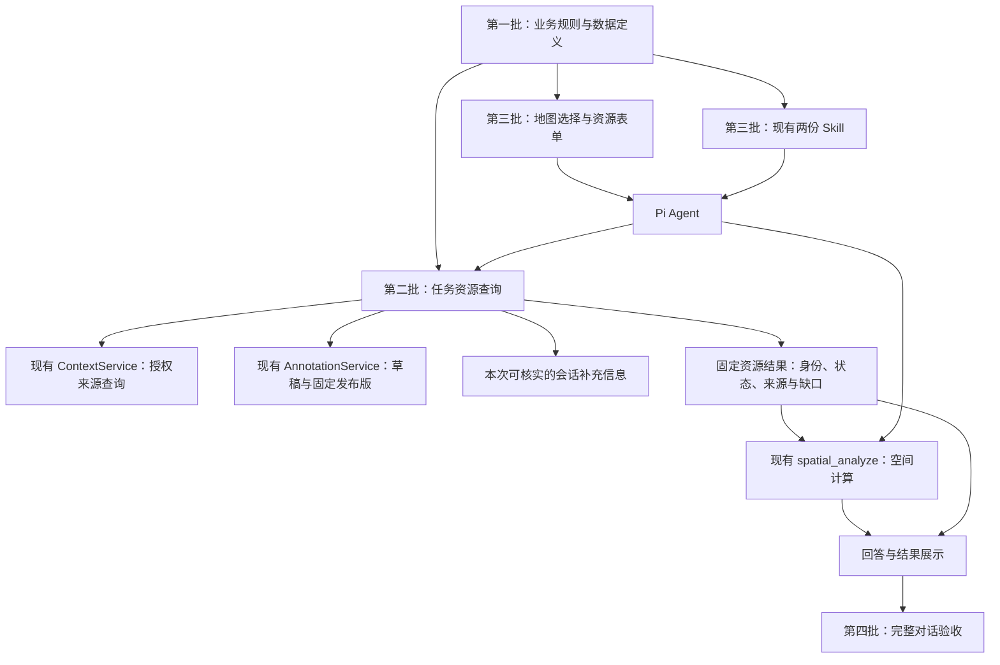

# 任务资源分析：后续四批开发方案

2026-11-02｜第一批已获准实施；后三批保留审阅稿｜基于 `codex/agent-spatial-plotting` 的 `7a6b830`。

本目录保存四批独立方案。用户于 2026-11-02 确认默认资源范围，要求先提交四批方案，再实施第一批。后三批仍须分别审阅、实施和验收；本次不启动模型测评。

当前进展：方案已提交 `2a5fd9f`；第一批实现与离线检查已完成，见[完成报告](../../11-02-task-resource-contracts/results.md)。后三批尚未开工。

## 要解决什么问题

用户选中地图区域，问“这个区域内，本任务有哪些可用资源？”时，系统应能取得有依据的任务资源，区分实际资源与计划位置，处理同一资源的多份记录，再回答名单、数量、状态和待核验项。

上一轮移除自动草稿提示的对照，没有显示改善：保留组主任务通过 7/16，移除组 5/16；关键题默认选草稿的次数都是 4/8。因此，本方案不把删除该提示作为修复方向。具体结果见[上一轮报告](../draft-context-comparison-20261031/records/results.md)。

下一步先明确业务含义，再让工具按这些规则取数，最后让 Agent 使用并验收。新规则改变了默认任务含义，不能与旧题分数直接比较后宣称“模型能力提升”。

## 四批分别交付什么

| 批次与独立方案 | 建设内容 | 前置依赖 | 完成标志 |
| --- | --- | --- | --- |
| [第一批：业务规则与资源数据定义](01-business-and-data.md) | 资源范围、身份、任务关系、状态、数量、位置和证据；模拟数据与兼容规则 | 用户审阅业务口径；核对现有数据能力 | 不依赖模型，人和程序都能明确每个样例应如何处理 |
| [第二批：查询与计算工具](02-query-and-spatial-tools.md) | 类型筛选、任务资源查询、固定结果引用、空间计算和数量统计 | 第一批规则与数据定义通过验收 | 不调用模型，也能得到正确资源集合和空间结果 |
| [第三批：交互、Skill 与运行配置](03-interaction-skills-runtime.md) | 地图选择随消息发送、资源表单、两份 Skill、共享模型配置和结果展示 | 第二批工具可用；第一批规则稳定 | 用户的实际选择、工具处理和回答形成完整流程 |
| [第四批：新版验收](04-acceptance.md) | 公开回归、新题封存、完整对话评分、失败归因 | 前三批离线检查通过，版本与评分冻结 | 给出有证据的通过或未通过结论，明确剩余问题 |

每批完成只代表该批通过。**第一批不交付可用的新查询工具；完整业务流程在第三批形成，第四批验证效果。** 后三批本次列清范围和验收，临近实施时再细化其任务及预算，不提前运行。

## 架构与职责

“任务资源查询”是现有后端里的小型业务模块，通过 Pi 工具供 Agent 调用，不另建空间服务、独立数据库或 Agent 框架。业务查询负责“分析哪些资源”，空间计算负责“它们与指定区域有什么关系”。

保留已有底图、权限、固定版本、原生 Pi 历史、标绘保存/发布/采用机制。不在本轮建设路网计算、调度优化、专业作业决策、知识库或通用实体融合平台。底图切换不改变资源身份或计算数据。

## 当前事实与拟改设计

| 当前代码事实 | 本方案的对应安排 |
| --- | --- |
| 草稿有几何、属性、信息性质和来源引用，没有独立的资源业务定义 | 第一批定义可选字段，第三批提供表单 |
| 任务 `businessRefs` 表达关联，没有证明资源已分配 | 第一批分开定义“任务关系”和“可用状态” |
| 来源资源主要为 `availableCount` 和单位“辆”，查询没有 `objectTypes` 筛选 | 第一批补适配契约，第二批实现筛选与查询 |
| 空间结果已经有固定引用、来源校验和历史读取 | 第二批复用机制，增加独立资源结果类型 |
| 地图高亮和“引用此对象”是两个步骤 | 第三批让明确选择可见地进入本条消息 |
| 产品代码声明 `reasoning:false`、会话 `thinkingLevel:'off'`，DeepSeek 出网分支还强制关闭思考；上一轮测评另行开启 | 第三批统一产品与测评的有效配置，检查实际请求 |

上述事实基于当前分支，不代表其他并行分支已经或尚未完成的工作。每批开工前重新核对最新代码；是否合并其他分支另行处理。

## 审阅与后续管理

先看[第一批方案](01-business-and-data.md)的第 3—5 节业务规则、第 8 节样例及第 11 节审阅事项。后三批通过链接独立阅读，避免把后续讨论继续追加成一份长文件。

沿用当前 worktree 与 `codex/agent-spatial-plotting` 分支。按用户授权先提交本目录方案，再为第一批补齐 Trellis 实施任务与检查上下文后开工。不推送、合并或部署，不改写旧测评目录和原始评分。

## 参考依据

- [本次共享讨论](https://chatgpt.com/share/6ae74a13-0c38-83ec-a78d-73bcd27036bc)：四批顺序与业务查询、空间计算分工。讨论中的建议在本目录整理为待审设计，不当成已经实现的能力。
- 当前契约：[标绘对象](../../../../experiments/harness-lab/src/contracts/annotations.ts)、[来源查询](../../../../experiments/harness-lab/src/contracts/context.ts)、[任务上下文](../../../../experiments/harness-lab/src/contracts/access.ts)、[空间结果](../../../../experiments/harness-lab/src/contracts/spatial.ts)。
- 当前实现：[来源校验](../../../../experiments/harness-lab/src/context/validation.ts)、[空间输入](../../../../experiments/harness-lab/src/spatial/inputs.ts)、[标绘编辑器](../../../../experiments/harness-lab/src/web/annotations/FeatureEditor.tsx)、[Pi 运行](../../../../experiments/harness-lab/src/pi/lab.ts)、[出网请求](../../../../experiments/harness-lab/src/pi/controlled-stream.ts)。
- 当前规范：[多来源查询](../../../spec/backend/context-analysis.md)、[会话标绘](../../../spec/backend/map-annotations.md)、[空间分析](../../../spec/backend/spatial-analysis.md)。这些规范仍描述旧行为；相关变更须在对应批次获准并实施后同步。
