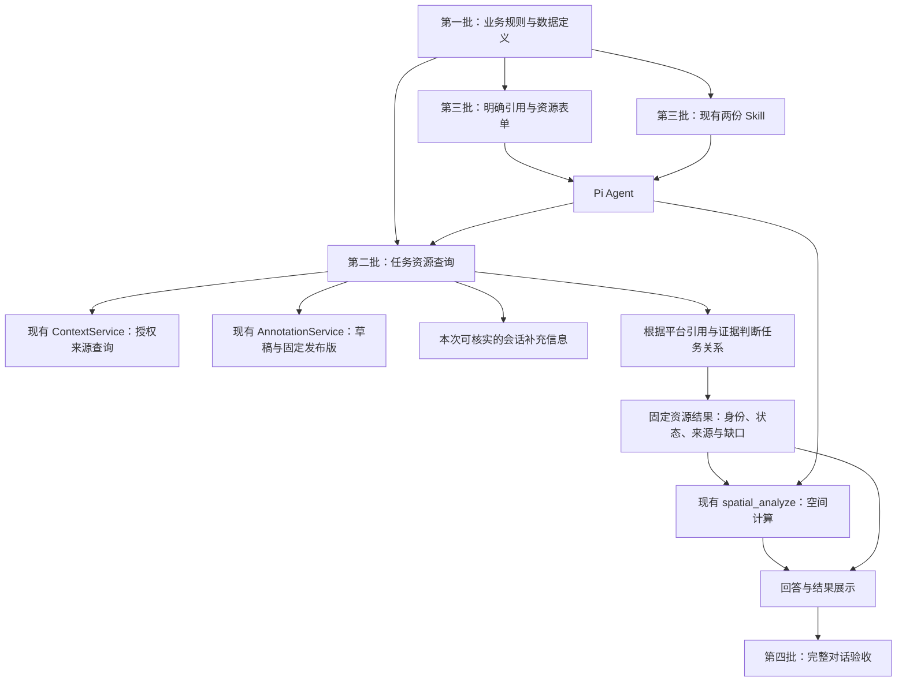

# 任务资源分析：后续四批开发方案

2026-11-02｜前三批已提交；第四批详细技术方案待审阅｜分支 `codex/agent-spatial-plotting`。

本目录保存四批独立方案。用户于 2026-11-02 确认默认资源范围，要求先提交四批方案，再实施第一批。第二批已获准并完成实施及离线验收，第三批已批准并完成；第四批详细方案待审阅，本次未启动模型测评。

当前进展：四批初稿已提交 `2a5fd9f`；第一批实现与检查记录已提交 `ea30f46`，见[完成报告](../../11-02-task-resource-contracts/results.md)。[第二批方案](02-query-and-spatial-tools.md)已基于该实现详细展开，包含工具分工、数据处理、实施顺序与 24 组离线检查，用户审阅修订与 D15 五例后已批准第二批实施，实现和检查结果已提交 `56fa186`，见[第二批报告](../../11-02-task-resource-query/results.md)。[第三批方案](03-interaction-skills-runtime.md)已详细展开，包含架构、交互规则、Skill/工具/配置职责、实施顺序和 26 组离线验收，方案已提交 `d194f4c`，用户批准后第三批实现与离线检查已完成并提交 `12e1cc9`，见[第三批结果](../../11-02-task-resource-experience/results.md)。第四批现已详细展开，拟4项公开流程检查＋8道新题各2次，共20次完整任务；未开始实施或真实模型调用。

第三批审阅修订：已确认保留“选中后主动点击引用”的交互，撤回单击自动带入；补充来源发送时读取与标注固定版本的例子，以及导入资源身份与手工旧标注补绑的区别。该修订已纳入第三批实施；检查结果见第三批报告。

第二批本次修订：数据查询与任务关系判断分开；来源不必认识本平台任务。沿用已有对象引用和明确读取条件，关系无依据就标未确认；任务查询/支援接口仅作为可选能力。详见第二批第 2、6 节及 D15 子场景。

## 要解决什么问题

用户选中地图区域，问“这个区域内，本任务有哪些可用资源？”时，系统应能取得有依据的任务资源，区分实际资源与计划位置，处理同一资源的多份记录，再回答名单、数量、状态和待核验项。

上一轮移除自动草稿提示的对照，没有显示改善：保留组主任务通过 7/16，移除组 5/16；关键题默认选草稿的次数都是 4/8。因此，本方案不把删除该提示作为修复方向。具体结果见[上一轮报告](../draft-context-comparison-20261031/records/results.md)。

下一步先明确业务含义，再让工具按这些规则取数，最后让 Agent 使用并验收。新规则改变了默认任务含义，不能与旧题分数直接比较后宣称“模型能力提升”。

## 四批分别交付什么

| 批次与独立方案 | 建设内容 | 前置依赖 | 完成标志 |
| --- | --- | --- | --- |
| [第一批：业务规则与资源数据定义](01-business-and-data.md) | 资源范围、身份、任务关系、状态、数量、位置和证据；模拟数据与兼容规则 | 用户审阅业务口径；核对现有数据能力 | 不依赖模型，人和程序都能明确每个样例应如何处理 |
| [第二批：查询与计算工具](02-query-and-spatial-tools.md) | 基础数据查询、独立任务关系判断、固定结果、空间计算和数量统计 | 第一批规则与数据定义通过验收；不要求来源支持任务查询 | 无任务接口也能正常取数；有据判断关系，无据单列；空间结果正确 |
| [第三批：交互、Skill 与运行配置](03-interaction-skills-runtime.md) | 主动引用的显示与发送、资源表单、两份 Skill、共享模型配置和结果展示 | 第二批工具可用；第一批规则稳定 | 用户的实际选择、工具处理和回答形成完整流程 |
| [第四批：新版验收](04-acceptance.md) | 公开回归、新题封存、完整对话评分、失败归因 | 前三批离线检查通过，版本与评分冻结 | 给出有证据的通过或未通过结论，明确剩余问题 |

每批完成只代表该批通过。**第一批不交付可用的新查询工具；完整业务流程在第三批形成，第四批验证效果。** 第三批现已详细展开，真实模型预算为 0；[第四批方案](04-acceptance.md)已细化逐题要求、架构、评分、预算和停止规则，待审阅，不提前运行。

## 架构与职责

“任务资源查询”是现有后端里的小型业务模块，通过 Pi 工具供 Agent 调用，不另建空间服务、独立数据库或 Agent 框架。数据查询负责“本次读哪些记录”，任务关系判断负责“这些记录与任务有什么关系”，空间计算负责“它们与区域有什么位置关系”。来源系统不必知道本平台任务；数据完整读回也不代表任务关系已经明确。

保留已有底图、权限、固定版本、原生 Pi 历史、标绘保存/发布/采用机制。不在本轮建设路网计算、调度优化、专业作业决策、知识库或通用实体融合平台。底图切换不改变资源身份或计算数据。

## 方案审阅时的基线与各批安排

| 审阅时的基线 | 本方案的对应安排 |
| --- | --- |
| 第一批已为草稿增加可选资源声明和受控实体关联，旧对象不自动认证成资源 | 第二批消费这些字段，第三批提供表单 |
| 任务 `businessRefs` 可指向外部对象，但可为空、不保证全量，也不表达分配 | 第二批按引用读数据，再判断有据关系；缺失保持未确认 |
| 来源支持对象引用、区域标签等读取，没有按本平台任务 ID 查询；资源元信息可选，查询仍无 `objectTypes` | 第二批补提前筛选；任务映射/关系查询为可选能力，不阻断基础读取 |
| 空间结果已经有固定引用、来源校验和历史读取 | 第二批复用机制，增加独立资源结果类型 |
| 地图高亮和“引用此对象”是两个步骤 | 第三批保留两步操作，仅优化引用显示；单击、选中和标绘不自动附到对话 |
| 产品代码声明 `reasoning:false`、会话 `thinkingLevel:'off'`，DeepSeek 出网分支还强制关闭思考；上一轮测评另行开启 | 第三批统一产品与测评的有效配置，检查实际请求 |

上述事实基于当前分支，不代表其他并行分支已经或尚未完成的工作。每批开工前重新核对最新代码；是否合并其他分支另行处理。

## 审阅与后续管理

第一批业务规则已确认，数据承载已实现。第二批已批准，实施记录见[任务文件](../../11-02-task-resource-query/prd.md)。可回看[第二批方案](02-query-and-spatial-tools.md)，重点看第 2 节现有能力、第 6 节数据查询与任务关系判断、第 11 节 D15 具体例子，以及第 13 节审阅边界。每批仍独立成文，避免将多轮方案追加成一份长文件。

沿用当前 worktree 与 `codex/agent-spatial-plotting` 分支。前三批实现与检查已分别提交；第四批方案已落盘待审阅，尚未实施，不执行真实模型测评。不推送、合并或部署，不改写旧测评目录和原始评分。

## 参考依据

- [本次共享讨论](https://chatgpt.com/share/6ae74a13-0c38-83ec-a78d-73bcd27036bc)：四批顺序与业务查询、空间计算分工。讨论中的建议在本目录整理为待审设计，不当成已经实现的能力。
- 当前契约：[标绘对象](../../../../experiments/harness-lab/src/contracts/annotations.ts)、[来源查询](../../../../experiments/harness-lab/src/contracts/context.ts)、[任务上下文](../../../../experiments/harness-lab/src/contracts/access.ts)、[空间结果](../../../../experiments/harness-lab/src/contracts/spatial.ts)。
- 当前实现：[来源校验](../../../../experiments/harness-lab/src/context/validation.ts)、[空间输入](../../../../experiments/harness-lab/src/spatial/inputs.ts)、[标绘编辑器](../../../../experiments/harness-lab/src/web/annotations/FeatureEditor.tsx)、[Pi 运行](../../../../experiments/harness-lab/src/pi/lab.ts)、[出网请求](../../../../experiments/harness-lab/src/pi/controlled-stream.ts)。
- 当前规范：[资源字段与生命周期](../../../spec/backend/task-resources.md)、[多来源查询](../../../spec/backend/context-analysis.md)、[会话标绘](../../../spec/backend/map-annotations.md)、[空间分析](../../../spec/backend/spatial-analysis.md)。前三批规范已随实现同步；第四批拟建测评流程仍是待审设计，不能提前写成已有能力。
