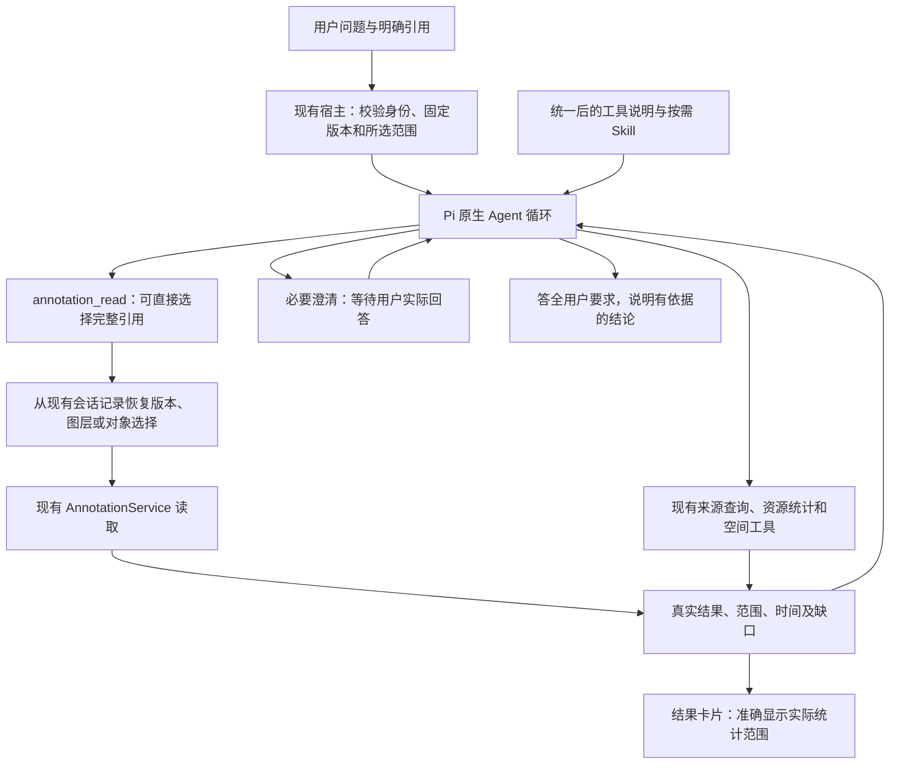

# 技术设计：让规则一致，让引用范围完整传到工具

2026-11-03｜待审阅，未实施。对应[本轮方案](prd.md)。

## 1. 架构保持不变



不另建空间服务、规划 Agent、裁判 Agent 或通用范围凭证。模型仍负责理解问题和选择工具；程序负责忠实执行已经明确的引用、保持结果和范围一致。

## 2. Skill 与真实工具输入采用同一条澄清规则

统一含义：**用户只要一个范围的答案，但目前存在会改变答案的多个合理选择时，先问清再统计。用户明确要求比较时，直接分别分析。**

允许先查询区域名称、注记、几何等资料，帮助识别候选；不能先把多个候选都当作用户目标完成业务统计，再在末尾邀请用户选一个。已有有效引用或前文确认时直接执行，不机械追问。

| 位置 | 怎么做 | 怎样证明已改到实际输入 |
| --- | --- | --- |
| spatial_analyze描述 | 删除“询问或完整分列条件答案”的无条件出口，写明单一范围与比较任务的区别 | 检查真实注册工具及提供方请求中的description |
| spatial-analysis / map-annotations | 核对澄清、固定引用、范围继承及答复要求；只修冲突或缺口，不重复堆长段落 | 检查按需读取和显式选择时实际送达的正文 |
| 宿主上下文、参数说明、错误恢复提示 | 排除默选范围、错误扩大范围或反复询问的旧指导 | 确定性提供方捕获首请求、错误后续请求和下一轮请求 |
| 评分规则 | 单一范围先问、明确比较直接处理，与产品一致 | 正反例校准，不只检查是否出现某句关键词 |

保留“先答用户所问，再说明直接影响结论的限制”。把失败转成短例子：来源对象不等于标绘对象；工具已经剔除的计划记录不能再扣一次；同一对象在两个区域的分类要分别保留；用户要求的每项时间不能省略。允许有证据的正确推导，不要求每句话都调用工具。

不增加自由文本拦截器、自动改写答案或强制读取Skill。规则能否减少模型误述，仍需对照验证。

## 3. 在annotation_read中增加“按用户引用读取”

**现在：**用户引用固定版本中的一个图层后，模型仍要重新填版本和layerIds；漏掉后者就会读取整个版本。

**拟改：**同一工具增加只读分支。模型选择宿主展示的引用定位，宿主恢复完整选择，再交给现有读取服务。

示意接口（字段名实施时结合现有类型定稿，含义固定）：

```json
{
  "mode": "reference",
  "reference": { "requestId": "用户发送引用时的请求ID", "index": 0 },
  "fields": ["geometry", "resource"],
  "offset": 0,
  "limit": 50
}
```

reference只是定位既有记录，不证明模型理解了用户意图，也不是新增授权凭证。

- 从当前会话分支的真实composer记录解析，核对工作区、会话、请求、选择序号及原记录有效性。其他会话、错误序号、伪造定位明确失败。
- 完整保留固定版本和图层／对象范围。新分支不同时接受模型另填ref/layerIds/objectIds，避免两套选择冲突。
- fields只选字段，offset/limit只分页，均不能扩大对象集合。总量与后续分页属于同一选择；返回实际版本和选择范围供核查。
- 每次读取仍经现有权限检查。引用失效或资料不可访问时失败，不退回最新版本、整个草稿或同名对象。
- 第二轮“同一图层全部点”可继续用第一轮定位；扩大的是业务筛选，不是图层。用户明确改范围时采用新选择，不把第一次引用永久锁定。
- 多份引用逐份选择；同版本拆成多份对象引用可读取同一对象集合，不得扩大成图层或整版本。
- 保留旧read/draft/compare/receipt参数含义。无显式引用的普通查询仍使用原入口；读取引用不建立可写草稿依据。

复用现有composerHistory和固定引用校验，不另建引用数据库。新请求向模型展示定位；若改变composer文本，新增版本模板，保留v1—v5原文本和解码，不能直接修改历史模板。验证重启、历史重开和压缩后的续问，防止定位仅在一次请求内有效。

**能力边界：**入口针对N08-2漏传图层，不能阻止N08-1主动另查来源；旧入口也仍可能被错误使用。因此不宣称形成全局范围强制约束，实际是否扩大读取继续单独评分。

## 4. 修正结果卡片范围标签

summarize传spatialResultRef、未传position时，后端使用该空间结果items，不自动只取内部。

卡片显示“按所选空间结果集合统计”；仅显式传interior/boundary/exterior时显示内部／边界／外部。不改统计集合或历史结果。所选集合可能本身经过筛选，也不能一概写成“全部内部、边界和外部”。

## 5. 评测修正独立于产品修改

**指定工具覆盖：**旧requiredCase已声明但未参与通过判断。旧轮复核按旧指定题号：N05不能代替N02的两汇总加副本组合。任何已确认同根回归均失败；无回归但缺指定证据为未充分验证。新轮以确定性调用覆盖指定工具组合，Agent题允许等价正确路径，分别报告。

使用旧记录离线复核并新增勘误文件，列明pass→unverified原因；旧轨迹、裁决、聚合文件原样保留，旧报告只增加勘误入口，不改写历史分数。

**多问题接续：**复用产品现有交互API，评测侧逐问匹配冻结事实，可一次回答多问，普通文本也适用。保留原问题、选项、映射理由及实际回复。例如问选哪个北区与边界含义，分别回复冻结东侧选择、确认题干已有口径；只回答实际问到的内容，不提前提供名单或数量。

超出事实表不猜答或默认同意。标记具体缺口，停止该题依赖步骤；若影响后续协议可靠性则停批。已给答案而没有合法澄清时，不发送补救选择。多问本身不判主任务失败；不必要追问另记效率，最终仍须完成任务。

**证据与历史：**Skill统计兼容实际skill.read与skill_read，区分正文送达与只见目录。旧N06-1仍是未完成，不事后续答；新题是在新协议下独立开始。旧结果版本和字节不变。
