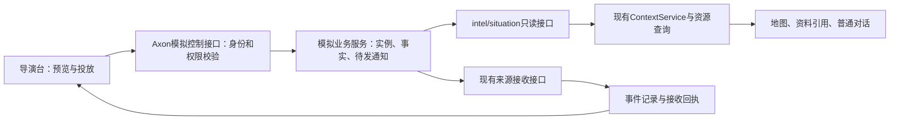

# 第一里程碑设计方案：P0—P2

版本：v0.5｜日期：2026-11-04｜状态：待用户审阅，未实施

关联：prd.md、story.md、world.md、design.md、implement.md。代码依据为main@278d82f；当前分支codex/scenario-demo。本文中的新接口、字段、页面行为和存储结构均为设计提案，现有能力另行注明。

## 先读这一页

第一里程碑交付一个“有丰富背景、可查询、可按幕推进”的场景底座。操作员能看到六站二十四车等对象，投放来报、更新道路、核对接收结果，并从现有态势地图和任务入口查看事实。

| 阶段 | 本次设计交付 | 完成标志 |
| --- | --- | --- |
| P0 | 故事、对象清单、时间口径、地图制作要求、来源/作者材料边界 | 场景定义能独立核对，数量与因果一致 |
| P1 | 独立场景实例、单体资源与报告数据、场景时钟、来源HTTP查询及任务初始化 | 普通席位能查询真实返回的数据，二十四车不会被预先筛成七车，资源按场景时点判断 |
| P2 | 导演台、预览/应用/投放/核对、时间控制/重演、基础地图 | 手动推进、暂停和重演可核对，重复不重复生效，新旧轮次可区分 |

建议采用以下边界：

1. 主故事模式推进到“待选择/批准方案”暂停；P3/P4尚未建设时不生成批准、出发或到场事实。
2. 另提供独立标识的“来源回放模式”，可验证全部十二次来源投放和旧消息晚到；完成表示来源回放完成，不表示支援任务完成。
3. 本期保持一个模拟服务，复用intel/situation来源接口；按管理域拆服务保留为SIM-DOMAIN-001。
4. 场景时钟纳入本期P0—P2：由模拟服务维护，导演台操作，资源查询按该时点校验来源状态；查询结果向Agent明示场景判断时间与真实处理时间。登录、超时和操作日志沿用真实时间，不单独建设时间平台，详见第4节。
5. 地图复用现有一张MapLibre地图，先显示来源对象、位置和时间；车辆执行过程与移动模拟在P4补齐，结构化方案卡在P3新增，任务综合展示在P5扩展现有任务首页。现状与缺口见下表。
6. 重演创建新实例，保留旧轮对象/报告与Axon记录；当前来源默认读活动实例，旧轮通过固定引用读取。
7. 用户已确认：设专用导演席，独立授予场景控制权限；总体、情报、筹划、态势四个业务席位不开放导演台。沿用同一登录页面与应用，登录后按身份显示入口；具体划分见第1、7、10节。本项确认不表示已授权实施。

本文末尾列出审阅项。通过本文审阅后仍先收敛地图数据与实施子任务；本轮不创建产品代码、不启动服务、不运行模型或部署。

## 当前实现与后续建设差距

以下是2026-11-04核对的现状，不表示四项功能均从零建设。本分支基于main@278d82f；复核时main@51e04dc在相关src、mock-context与backend spec范围内与本分支无差异。

| 能力 | 当前已有 | 场景演示仍缺什么 | 后续建设阶段 |
| --- | --- | --- | --- |
| 车辆执行过程记录 | 已有消息接收/处理、工具操作及工作交接记录；工作可分派、办理、提交、退回、完成 | 车辆接令、出发、途中、到场等逐车业务事实，以及与任务/方案的关联；现有工作完成不代表车辆到场 | P4补齐模拟执行与逐车回报，P5汇集展示 |
| 车辆移动 | 已有来源对象几何、地图位置与标绘；地图可随对象数据刷新 | 当前模拟页面不能更新坐标；需补随剧情推进的单车位置、历史轨迹及到场状态联动。地图能刷新位置不等于已有车辆移动模拟 | P1准备单车数据与初始位置，P2展示，P4补动态模拟与轨迹 |
| 结构化方案卡 | 已有聊天/文件方案、工作提交与接受/退回机制 | A/B候选方案的结构化内容、并排比较、固定版本、人员决定及依赖变化后的有效性；现有文件审核不能直接当作车辆调派批准 | P3新增方案与决定能力，P5接入综合展示 |
| 任务综合展示 | 已有TaskHome任务首页，包含目标与说明、当前研判插槽和新建对话入口；另有地图、信息和工作待办等组件 | 在现有任务入口汇集剧情时间线、最新事实、候选方案、审批与执行进度，并关联原始记录 | P5扩展现有任务首页，复用地图/研判/待办组件 |

这里的“执行轨迹”指车辆行动的业务过程；地图上的位置历史称“移动轨迹”，两者分别建设。任务综合展示定位为丰富现有页面，不另建一套任务或流程状态。

代码依据（路径相对experiments/harness-lab）：src/web/TaskHome.tsx、src/contracts/collaboration.ts、src/contracts/task-resources.ts、src/web/situation/Simulation.tsx、src/web/situation/MapCanvas.tsx。具体核对记录见research/m1-design-basis.md；上述缺口均尚未实施。

## 1. 使用者与首期流程

| 使用者 | 首期能做什么 |
| --- | --- |
| 专用导演席 | 持独立场景控制权限查看定义与实例、预览/应用/投放事件、核对结果、暂停/继续、开始新轮；任务初始化另受既有任务管理权限约束 |
| 总体、情报、筹划、态势四个业务席位 | 按原授权查报告/车辆/道路、查看地图、进入任务和收件记录；不能进入导演台或调用场景控制接口 |
| Agent | 经现有只读工具获取实际来源数据；没有导演台或场景推进工具 |

### 登录与页面入口（用户已确认）

- 沿用同一个Axon登录页面、密码认证和登录会话。演示账号配置新增“导演席”（拟用seat-director），与原四个业务席位并列；账号固定绑定席位，选择席位仍须通过对应密码认证，登录后不能任意切换席位。
- 导演账号登录后默认进入独立的“场景导演台”页面，拟定路径为/scenario-director；导航中显示同名入口。四个业务账号保持原业务首页及导航，不显示导演台入口。
- 未登录直接访问导演台时进入现有登录流程；以有权导演账号完成登录后进入导演台。业务账号直接访问该路径时显示“无权访问场景导演台”，提供返回业务工作台入口，不加载剧本定义、未来事件或操作记录；控制API分别返回未登录401、无权403。
- 同一浏览器配置下的标签页共用登录会话。导演可在多个标签页使用同一导演身份；导演与业务席并行演示使用不同浏览器配置文件或独立会话窗口。不开发表签页级多账号登录，切换登录后旧标签页沿用现有身份变化检测，不能继续用旧身份操作。

首次流程：以导演账号登录→进入独立“场景导演台”页面→选择“临港仓储火情 v1”与运行模式→创建新实例并核对基线→初始化三个公共任务→核对旧轮并激活新轮→预览下一步→应用事实→投放通知→核对接收。业务席在其独立登录会话内查看对应任务/地图；导演也可按自己的读取权限打开核对页面。

M1默认配置保留来源接收，但不启用自动分析规则；未匹配处理规则是可见状态，不伪装成已研判。自动分析与真实模型样本随P3/P6配置和审阅。来源接收、处理作业、模型回答分别显示。

## 2. 组件与数据流



- 模拟服务拥有场景业务事实、步骤和通知；Axon拥有任务、会话、交接以及自己的接收记录。
- 查询令牌、控制令牌、来源投放令牌继续独立；浏览器拿不到令牌或后台服务地址。
- Axon不import场景fixtures获取事实；正常查询经过HTTP及现有授权/解码。导演台的未来步骤和作者预期仅专用导演席持场景控制权限可读；不打包进公开前端资源、不随公共任务或普通来源响应发送给业务席或Agent。
- 普通来源API只返回已经生效的事实；不返回后续剧情、推荐车组、A→B答案或验收分数。

## 3. P0：场景定义与地图制作

### 3.1 定义文件

拟新增版本化场景目录，仍位于现有mock-context附近，不建设可视化剧本编辑器：

| 材料 | 内容 | 可见边界 |
| --- | --- | --- |
| definition.json | 定义ID/版本、业务日期、两种模式、固定来源标识、步骤顺序 | 操作员可读摘要，原文件不挂入Agent工作区 |
| objects.json / geometry.geojson | 当前世界的初始对象、身份、状态和几何 | 装载后通过来源查询 |
| reports.json | 各步骤所需的独立报告及修订 | 本步事实应用后可查询，通知尚未发送不影响读取 |
| steps.json | 每步时刻、事实变更、待发通知、前置条件 | 控制端独有 |
| author-checklist.md | 核对清单、推荐路径、预期差异 | 作者/验收侧独有 |

M1只注册一个故事、两个固定模式；不支持模型上传脚本、任意表达式或浏览器传入文件路径。

### 3.2 对象口径

| 类型 | 数量 | 兼容现有来源表示 |
| --- | ---: | --- |
| 车辆 | 24 | resource；20辆消防专用车为fire_engine，2通信+2后勤为vehicle；细分车型另列 |
| 消防站点 | 6 | resource，category=facility |
| 仓库及背景事件/训练地点 | 3 | resource，category=facility；表达地点，不表达可出动车辆 |
| 消火栓 | 8 | resource，category=hydrant |
| 道路 | 6 | road，LineString与通行状态 |
| 区域 | 6 | area，Polygon与成员引用 |

初始共53个来源对象，其中41个resource；“资源记录41项”和“车辆24辆”不能混为一个数。站点不再保存另一份可相加的车辆总量。T01/T02/T03是三个Axon任务，其地点引用指向上述地点对象，不再算成三辆资源。

初始车辆状态：17辆一般可用、5辆不可用、2辆待确认。忙碌/检修事实不用“带条件的unavailable”表达：现有资源组织函数会把带conditions的事实视为不能直接采用，导致其成为unknown。明确不可用用无条件的unavailable及证据；V21跨区待确认和V24信息旧用unknown及各自原因。

拟在TaskResource中增加可选vehicle字段：type为water_tanker/foam/ladder/rescue/communications/logistics，homeStationRef为完整来源引用。仅允许单体vehicle/fire_engine使用。沿既有resource字段进入来源、固定结果与显示；旧数据不补默认车型，不从名称或图标推断。

单体quantity=1、meaning=entities、unit=辆；这不是“可用量1”。位置事实分别表达actual/estimated/unknown及观测时间。V24保留08:50最后位置记录，并明确未提供当前实际位置；地图可显示最后记录及时间，不参与当前实际位置空间统计。

### 3.3 地理方案建议

建议保持“真实港区底图承载合成业务数据”。具体城市/片区作为本次审阅后的P0内容决策，当前不编造真实道路坐标、桥梁名称或已核验的行驶距离。

P0数据交付需包含：范围及WGS84坐标口径、六区域边界、六站/三个地点/八水源坐标、六路几何、R01和R02/R03的合成通达关系、数据来源与署名。采用真实道路时保存原始几何依据；合成部分标为业务覆盖层，不宣称与真实路况一致。校核V02/V14位于T02、V05位于训练地点，而不是一律画在所属消防站。

首期不计算真实ETA、不建立路网路由；09:28/09:34是后续执行阶段的合成时序，不显示为P1计算结果。只有站点坐标而没有车辆当前定位时，不自动把车辆位置等同站点位置。

## 4. 业务时间与资源有效期

### 4.1 本期范围与维护责任

场景时钟是M1的必需增量。现有TaskResourceService把statisticsScope.at设为真实createdAt，固定结果校验也要求两者相等；仅暂停页面或给Agent一句时间提示，仍会使场景资源按真实时间过期。

本期继续只有一个模拟服务。场景控制后台位于该服务内，按实例保存唯一businessNow、暂停状态与实例revision，随场景快照持久化；不部署独立时间服务，也不新增供Agent选择调用的“虚拟时间”工具。

| 参与方 | 本期责任 |
| --- | --- |
| 场景控制后台 | 场景时间的唯一维护者；验证操作、更新实例时间及事实、持久化和恢复 |
| 导演台页面 | 展示服务器返回的场景时间，提交预设步骤、暂停/继续和重演操作；浏览器计时器不产生权威时间 |
| 模拟intel/situation来源 | 从同一实例快照读取时间与事实，经现有HTTP接口返回；各模块不自行计时 |
| Axon资源查询服务 | 校验响应时间归属，固定本次判断时点，检查来源状态的有效期并整理结果；不维护另一份时钟 |
| Agent | 从实际工具结果读取判断时点和依据；不修改时钟，不以操作日志或系统时间替代场景时间 |

businessNow初始为2026-11-03T09:10:00+08:00，仅在应用预设步骤时前进到该步时刻，允许同一时刻的多份报告。即使处于“继续”状态也不按现实秒数自行走时；暂停用于禁止新增步骤和投放，读取与回执核对仍可进行。继续只解除暂停，不自动推进。

场景时间不允许在同一实例内回拨或任意跳时；重演按第5节新建实例，恢复初始业务时间并冻结旧轮。重启读取已保存时间，不按停机时长补走剧情。revision沿用实例修订，不新增独立的时间版本。

### 4.2 时间字段的含义

| 时间 | 语义 |
| --- | --- |
| snapshotClock.businessNow | 本次来源快照对应的场景当前时刻；不是单条报告的观测时间 |
| observedAt / effectiveAt / validTime | 对应事实在场景中的观测、生效与有效时段 |
| publishedAt / occurredAt | 来源发布与事件发生时间；晚到报告仍保留旧观测时刻 |
| asOf | 新场景接口返回快照的业务时刻，与该响应snapshotClock.businessNow一致；其中的报告可以描述更早的事实 |
| statisticsScope.at | 资源工具实际用于有效期校验与统计的固定时点；场景结果采用businessNow |
| receivedAt / queriedAt / Axon结果createdAt | 实际接收、查询、结果生成时间，继续用于审计；不作为场景“现在” |

所有时间保存完整日期和时区；本故事业务日期固定为2026-11-03，真实演示日期不同也不改写它。登录过期、队列调度、网络/模型超时、文件和命令日志仍按真实时间。普通read/bash输出可能带真实时间，保留其原义；不替换Date.now、容器系统时间或Pi原生历史。

### 4.3 模拟来源如何共用时间

1. 应用步骤时，模拟服务在同一个SQLite事务内更新本步事实、businessNow、实例revision和待发通知。事实或持久化失败时整步不生效；重复同一操作返回原回执，不再次推进时间。
2. 新场景的报告查询、态势current/changes响应增加可选snapshotClock，包含instanceId、businessNow和实例revision。单个响应的事实、asOf与时钟必须从同一实例快照读取，不能分开读取后拼接；同进程内intel/situation共用该快照。
3. Axon仅接受服务器配置明确标为场景来源的时钟。新场景来源缺少时钟、时间格式无效或身份不匹配时明确失败，不静默退回真实时间；旧来源仍走原协议。
4. 一次资源查询固定首个合法snapshotClock；后续分页/来源必须匹配同一实例、businessNow及revision。中途推进、换轮或来源不一致时返回快照变化/时间口径冲突，不拼成成功总数，也不自动换时点重试。
5. 同一次场景统计不合并不同实例、真实时钟来源和无时间归属的私有标绘；明确要求统一范围。单条观测可以早于当前场景时间，E09的09:11观测在09:24到达，不会使场景时钟倒退或恢复R01开放。

完整管理域拆分继续按SIM-DOMAIN-001后延。未来多个模拟服务应消费同一实例时间及修订并声明已处理到的快照；未同步时不能当作完整当前状态。本期不建设跨进程广播、同步屏障或分布式时钟。真实外部系统继续使用自身真实时间，不能因接入Axon而被切换到场景时间。

### 4.4 资源工具的职责边界

现有task_resource_query是Agent入口，TaskResourceService是其背后的查询服务。当前服务读取来源已声明的availability.state，再检查适用时段、条件、冲突及数量；它没有从维修记录原文推导完整出动资格。模拟场景应复用这些职责，只把有关计算采用的时点切到businessNow。

- 车辆检修、占用、出发、到场等事实由模拟业务服务按来源责任提供；资源查询只读，不维护或写回这些业务状态。
- 状态、任务关系、位置和数量依据的有效期判断及统计必须实际使用同一场景时点；不能只修改结果里的statisticsScope.at文字，内部仍用真实时间计算。
- 例如V12的不可用记录有效至09:40，剧情09:23时仍采用这条记录，即使真实演示已到次日。剧情到09:40而没有新的检修完成确认时，原记录过期只使该项依据不足；没有其他有效证据时显示unknown，不能自动改成available。
- 多份有效证据冲突继续保留conflict，带conditions但未核实的状态继续保留未知。车况正常、定位在线、未被占用和满足本任务条件是不同事实；M1不新增综合出动资格规则引擎，不把查询成功当作可调派或已批准。

### 4.5 固定结果与兼容

场景资源结果使用新schemaVersion=4：createdAt保持真实生成时间，statisticsScope.at=businessNow，timeBasis明确标识场景口径，并保存固定snapshotClock。v4校验要求判断时点等于该场景时钟；现有v1—v3保持原校验和原历史字节。普通来源继续沿用既有真实时间口径。

read/summarize沿用原结果的场景时刻和输入版本，不随导演台推进重新计算旧结果；要看当前情况就重新查询。地图详情、资源卡、统计和相关空间消费者均保留这个口径，历史视图明确显示“当时按哪个时点判断”。

以下仅示意结果含义，不代表已有响应：

```text
场景：run-001
业务判断时间：2026-11-03 09:23 +08:00
实际查询时间：2026-11-04 14:00 +08:00
V12：不可用，依据为场景09:40前有效的检修记录
```

### 4.6 Agent实际接收的时间说明

演示任务说明标注“模拟场景，业务判断采用来源返回的场景时间”；不把易过期的固定businessNow写成长期任务说明。每次成功查询在模型可见的工具正文中返回snapshotClock及明确的时间含义，资源结果另说明statisticsScope.at与真实createdAt的区别，不能只存在于页面或模型看不到的details中。

通知正文冻结“投放时的场景时间”及原始观测/发生时间；receivedAt保留真实值。旧通知或旧工具结果中的时间表示当时，不冒充最新场景时刻。需要回答“现在”时，Agent应以对应实例最新成功查询的场景快照为依据；缺少该依据时查询或明确未知，不从最新接收时间、日志时间或date输出补齐。

工具说明复用现有提示入口补充上述含义，不另建Agent时钟、提示词同步服务或第二份历史。真实时间出现在上下文中本身不是失败；业务计算正确采用场景时点、时间字段用途清楚才是验收目标。模型是否稳定解释仍需后续真实模型验收。

### 4.7 阶段分工与本期验收边界

| 阶段 | 场景时间建设 |
| --- | --- |
| P0 | 冻结业务日期/时区、步骤时刻、事实有效期和来源状态责任 |
| P1 | 实例时钟与快照持久化、HTTP时间字段及解码、资源v4与历史/空间消费者兼容、模型可见时间说明 |
| P2 | 导演台显示/手动推进/暂停/重演，跨午夜或次日演示、异常和旧消息晚到的工程联调 |

M1用真实HTTP、持久化及确定性模型替身验证计算口径和实际模型输入，不将其称为真实模型语义已通过。持续后台研判的场景解释随P3核验，固定真实模型样本随P6执行；本期不增加付费模型批次。本节均为本次补充的待审阅设计，尚未实施。

## 5. 实例、查询与重演

### 5.1 实例身份

来源系统仍用受配置管理的intel/situation标识；对象ID、实体ID、报告ID和消息ID都带实例前缀。示例：run-001-V01，三元组仍为systemId/objectType/objectId。业务短号V01仅用于展示。

同一个模拟服务可保存多个实例，只有一个活动实例；旧实例冻结为只读。场景版本/hash在实例创建时固定，不允许重启后悄悄换fixtures。活动实例加载在内存中，旧轮按完整引用按需读取，列表分页；重演不自动删除历史。

### 5.2 查询选择规则

- 无实例对象/区域/报告限定的当前查询只读活动实例，普通全局地图不会混出旧轮二十四车。
- 含完整实例前缀的objectRefs、areaIds、reportId时，读其所属实例；同一请求不得混多个实例，前置校验明确报错。
- 分页游标和变化游标绑定实例、来源及快照revision；翻页期间切活动实例，原游标仍固定原快照，快照变更则报游标失效，不返回另一轮。
- 旧轮固定引用可以读旧轮最终来源状态；旧轮“当时读取到的版本”仍以原生工具结果为准，不用最终状态覆盖原证据。报告各修订可按revision精确读取。
- 配置保留固定来源/凭证；不在导演台编辑LAB_CONTEXT_CONFIG或热切换服务器URL。动态区域通过来源area对象和初始化后的任务引用选择，不依赖静态配置列出每轮区域ID。

### 5.3 任务初始化

创建实例与创建Axon任务是两侧操作：来源先生成实例；Axon宿主再用当前获授权操作员创建T01/T02/T03，并保存实例→实际任务UUID映射。来源数据不写入Axon私有目录、不获得任务管理身份。

Axon只增加必要的本地映射文件：LAB_DATA_DIR/scenario-runs/<instanceId>.json，含创建主体、稳定操作ID、来源实例ID、三个任务回执与初始化进度；复用现有原子文件写入。它不保存第二份方案或聊天，不改变任务状态机。任务创建沿用现有clientActionId去重，部分创建失败可核对已有回执再补齐，不删除已创建任务。

新轮进入活动状态前，旧轮必须暂停、待发通知已核清、没有运行中的后台作业；否则显示具体待处理项。旧轮演示专属任务由人员在新轮准备页明确确认归档后再切换，保留会话/资料。归档仍受既有忙碌与未完成交接限制，不强制绕过。若有未来执行请求则M1拒绝重演，待P4接入其专门检查。

“通知已核清”包括：已确认接收；或者尚未发送且人员显式选择终止旧轮、保留未投放记录。接收未确认必须先核对；已接收的事实不能撤销。冻结旧轮后不再发送其未投放消息，不要求为重演先把不想发送的消息全部发送。

T01现场关注临港，六站资源检索是另一个显式范围。M1不因所有车辆可读就写入assigned/potential_support。未建立可靠任务映射时继续使用明确source/area/object查询，并诚实显示关系未知。

## 6. 剧情步骤与首期停止点

| 步骤 | 业务时刻 | 来源操作 | 主故事模式 | 来源回放模式 |
| --- | --- | --- | --- | --- |
| S00 | 09:10 | 装载完整基线，不发送通知 | 可用 | 可用 |
| S01 / E01 | 09:12 | 首报位置描述不一致 | 可投放 | 可投放 |
| S02 / E02 | 09:13 | T02仍占用V02/V14 | 可投放 | 可投放 |
| S03 / E03 | 09:14 | V05演练继续 | 可投放 | 可投放 |
| S04 / E04 | 09:16 | 园区确认与无人机报告，各自消息ID | 可投放2条 | 可投放2条 |
| S05 / E05 | 09:18 | 资源清单确认，V24当前状态仍未知 | 可投放 | 可投放 |
| G01 | 09:18 | 等待方案决定/模拟执行 | M1停在此处 | 明确标识为仅回放来源，不跨越业务决定 |
| S06 / E06 | 09:19 | R04施工限制 | 待P3/P4 | 可投放 |
| S07 / E07 | 09:21 | R05正常巡查 | 待P3/P4 | 可投放 |
| S08 / E08 | 09:23 | R01封闭 | 待P3/P4 | 只含道路事实，不编造“哪几辆车尚未过桥” |
| S09 / E09 | 09:24 | 观测09:11的旧畅通报告到达 | 待P3/P4 | 可投放，R01仍关闭 |
| S10 / E10 | 09:25 | R02道路来源确认正常 | 待P3/P4 | 可投放 |
| S11 / E11 | 09:30 | T02仍占用原车辆 | 待P3/P4 | 可投放 |
| S12 / E12 | 09:40 | 现场“趋稳、继续处置”的来源报告 | 待P3/P4 | 可投放，不归因于未发生的本系统调派 |

两个模式在创建时固定，分别有定义hash及模板；同一实例不能中途切换模式以跳过批准。来源回放只验证来源时序和接入，导演台结尾写“来源回放完成”。本地三车09:22到场、跨站四车09:34到场及轨迹都在P4生成，不写入M1位置变化。

## 7. 导演台交互

提供独立的“场景导演台”页面，有独立路由，仅对已登录且获授权的专用导演席开放；可用同一导演身份另开浏览器标签页。与业务席并行展示时按第1节隔离登录会话。本文的“导演台”和“场景控制台”指同一管理页面，界面名称统一为“场景导演台”。

现有导航仅在服务端确认当前身份可进入导演台后显示入口，四个业务席不显示；直接访问页面也要重新核验权限。原“模拟验证”的手工编辑功能保留供旧实例使用，不能作为四个业务席操作新场景的旁路。新页面按场景选择、实例准备、事件列表/预览、投放控制、重演和操作回执设计专门布局与交互，不受现有逐条编辑表单的布局限制。

技术上复用Axon现有前端工程、页面壳、登录/权限、useApi请求机制和后端模拟控制接口，本期不新增一个需要独立部署、单独登录的前端应用。React/useApi仅表示工程与请求机制复用，不表示导演台要沿用现有业务页面的操作流程；导演台可拆分自己的页面组件。

页面第一层只显示当前实例、业务时间、模式、当前步骤和下一步；详细对象与原始消息折叠展开。

```text
当前登录：导演席
临港仓储火情 v1   本轮：run-001   模式：来源回放
业务时间 09:23    进度 8/12       已暂停
[继续] [准备新轮] [查看本轮任务]

步骤列表             下一步：09:24 旧道路报告到达
✓ 首报/确认          观测于09:11；将新增报告1份
✓ 资源清单           R01当前关闭状态不会被更改
✓ 中轴桥封闭         [应用本步事实：暂停期间不可用]
→ 旧报告到达
  东环线确认         上一步通知：接收已确认
                     [查看接收记录]

操作记录：已保存 / 未发送 / 接收未确认 / 接收已确认
业务对象、来报、任务与接收记录 → 各自详情入口
```

- “下一步”仅能按顺序应用，允许预览后续步骤但不能任意跳步提交；不会新增“批准方案”或“车辆出发”的导演按钮。
- 本步主要按钮随实际状态变化：应用事实→发送通知→核对结果→下一步；按钮旁显示具体原因和恢复入口。
- 应用不发送，发送不保证已分析；发送响应不明时禁用重复新操作，仅可核对原操作或原消息回执。
- 暂停禁止应用新步骤和新增投放；已经发出的请求继续核对，接收成功不会回滚。继续不自动推进或发消息。
- 页面打开/刷新/切换只做查询；浏览器草稿和焦点保留。多操作员同时操作依赖服务端revision校验，后到者刷新后重审。
- 空态、失去权限、来源不可用、基线初始化失败、接收未确认分别有明确文案，不把错误显示成对象零个。
- 沿用现有按钮/色彩token及Lucide图标；状态同时有文字，不只靠颜色。键盘可访问所有动作，错误有可聚焦提示和明确恢复路径。
- 面向桌面宽窗及窄工作面板；窄时上下排列预览与记录，操作区保持可见，不增加手机端要求。

## 8. 拟新增接口与职责

下表为提案。所有新场景接口，包括定义/实例列表、预览、操作记录和控制，均执行第10节的独立导演授权；不能仅靠隐藏按钮。已有/api/simulation及actions/:id查询/发送继续兼容旧实例；新场景能力按实例/操作归属识别，不能复用旧来源管理权限绕过导演授权。

| Axon入口（均在既有认证作用域内） | 用途/关键输入 | 模拟服务对应控制接口 |
| --- | --- | --- |
| GET /api/simulation/scenarios | 定义摘要与可用模式，不含作者答案 | GET /control/scenarios |
| GET /api/simulation/instances | 有界分页实例摘要 | GET /control/instances |
| POST /api/simulation/instances | definitionId/version、mode、businessDay、clientActionId、expectedActiveRevision | POST /control/instances |
| POST /api/simulation/instances/:id/initialize | 初始化/核对三个Axon任务；客户端不传席位或任务所有权 | 只查询来源实例；任务由Axon现有服务创建 |
| POST /api/simulation/instances/:id/activate | 校验初始化、旧轮暂停/回执、归档及未投放保留决定；带revision及操作ID | POST /control/instances/:id/activate |
| POST /api/simulation/instances/:id/preview | nextStepId、expectedRevision；只读，不产生操作 | POST /control/instances/:id/preview |
| POST /api/simulation/instances/:id/steps/:stepId | 应用预置事实，clientActionId、expectedRevision | 同路径/control/... |
| POST /api/simulation/instances/:id/control | pause/resume，clientActionId、expectedRevision | 同路径/control/... |
| GET /api/simulation/actions/:id | 核对原操作/冻结通知，新增步骤复用此入口 | 既有/control/actions/:id扩展定位新实例操作 |
| POST /api/simulation/actions/:id/send | 发送原冻结消息；多消息步骤逐条返回状态 | 既有发送语义 |

源查询继续走现有reports/search、reports/:id、situation current/changes，不新增Agent工具。实例查询返回权威businessNow、暂停状态和revision，来源查询按第4节携带snapshotClock；推进时间只能应用预设步骤，不提供任意set-time接口。preview返回本步前置条件、事实差异、业务时刻、冻结通知预览和是否被阶段门阻断，不接受任意执行代码/目标URL/替换通知正文。

创建与激活分开：初始化失败的新实例可恢复，但不影响当前活动实例。激活时对旧轮归档与源活动指针切换使用可核对的多步回执，不声称跨两侧HTTP原子提交；未完成则暂停两轮的新增投放，先核对，再由人员继续。普通查询仍能通过固定引用读取已有数据。

## 9. 版本、持久化与重复请求

### 模拟服务

保留旧simulation_snapshot表不变。拟为新定义增加两个结构：scenario_instances按instanceId保存带schema版本的有界JSON快照（businessNow/暂停状态/实例revision、事实、历史报告、步骤、操作与冻结通知）；scenario_active保存活动实例及递增revision。控制操作另保留真实操作者userId/seatId，由Axon从已认证身份填写，不接受浏览器冒填。场景时钟不另存一份数据库或仅保存在浏览器内；旧数据不自动变成新场景。

每次应用步骤在一个本地SQLite事务内：验证实例/定义/顺序/revision→修改本步事实与业务时刻→保存步骤和待发消息→保存操作回执。步骤操作ID相同且内容一致返回原结果；同ID换内容或旧revision冲突。一次步骤多份报告/通知一起保存，实际网络发送逐条进行。

每实例沿用最多1000次控制操作的现有约束，控制状态分页或只展示最新20条，普通来源响应保持现有256KiB边界。超限明确报错，不静默截断为完整事实；不在本期增加自动历史清理。

### 通知发送

消息ID由实例+步骤+消息序号固定派生。正文在应用步骤时冻结；发送/补发保持原ID、原内容。发送前记录未确认，超时后先向Axon查询接收回执，按现有(sourceId,sourceMessageId)语义去重。E04一条成功一条未确认时逐条显示，不重跑整个步骤。

### 重启与编辑

重启只恢复已保存实例、暂停状态和未确认回执；不自动应用下一步、不自动补发通知、不自动创建Agent请求。固定定义hash不匹配时停止该实例写入，仍保留可读历史并说明原因。

旧模拟手工编辑在旧实例中保留；新场景实例只允许预置步骤修改，避免临时表单编辑破坏已冻结的数量/时间关系。需要改故事时形成新定义版本和新实例。

## 10. 权限与数据边界

### 10.1 席位划分（用户已确认）

| 席位及拟定ID | 导演台页面/入口 | 未投放步骤及导演操作记录 | 投放、推进、暂停、重演 | 业务页面 |
| --- | --- | --- | --- | --- |
| 导演席 seat-director | 有独立场景权限时允许 | 允许 | 允许 | 按另行授予的读取/任务权限核对 |
| 总体席 seat-overall | 不开放 | 不开放 | 不允许 | 保持原权限 |
| 情报席 seat-intelligence | 不开放 | 不开放 | 不允许 | 保持原权限 |
| 筹划席 seat-planning | 不开放 | 不开放 | 不允许 | 保持原权限 |
| 态势席 seat-situation | 不开放 | 不开放 | 不允许 | 保持原权限 |

导演是场景操作角色；场景控制权限不会赋予方案批准、正式调派或其他业务审批权。四个业务席按原授权读取已投放/生效的事实，不因公共任务、来源管理权或总体席名称获得导演台权限。新增导演席不自动加入后台信息的固定接收或补充候选名单。

### 10.2 独立场景控制能力

拟新增席位级能力controlScenarios，通过现有登录Identity返回，默认false。演示配置另指定唯一directorSeatId（本方案为seat-director），并校验其不与四个业务席位重叠；服务端仅在当前启用账号绑定该导演席且controlScenarios=true时允许导演访问。名称叫“导演席”或仅知道页面路径不构成授权。

现有账号升级时该能力全部保持false，由既有离线账号/席位管理方式显式授予专用导演席。它不从来源manage、createPublicTask、manageModelSettings、viewWorkOverview或旧simulationEnabled推导，也不反向赋予这些权限；不新增通用角色管理平台。

导航入口使用服务端核验的当前导演访问能力，不把旧simulationEnabled当作新权限。每次控制请求都重新按当前身份及配置检查；撤权、停用或导演配置变更后，已打开的页面也不能继续操作。

### 10.3 页面、API与旧入口边界

- 页面和API同时约束：未登录进入既有登录流程，API返回401；已登录的四个业务席直访导演路径显示无权，相关API返回403，不先返回剧本内容再由前端隐藏。
- 定义列表、实例列表、未来步骤预览、初始化/激活、应用步骤、暂停/继续、重演及导演操作/通知回执查询与发送均校验导演能力。Agent没有这些工具，登录权限不会自动注册控制工具。
- 旧模拟接口仅服务旧实例。新场景对象、状态和操作记录不得通过旧/api/simulation、手工编辑、actions/:id或发送入口绕过授权。复用操作路径时，由服务器核实实例/操作归属后选择授权规则，不接受客户端声明“这是旧实例”。
- 新导演控制只作用于配置中的模拟场景、实例和投放来源；它不是修改任意来源、后台处理规则或来源授权的管理入口。普通来源查询继续返回已生效事实并遵守原读取授权，不暴露未来步骤和作者材料。

### 10.4 来源读取与任务准备权限

导演核对来源事实/接收回执仍需配置对应读取权限：intel/situation的席位读取范围纳入导演席，后台来源记录授予所需read权限。新场景控制不再沿用“管理全部入站来源即可控制”的旧判定，不要求为此给导演授予通用来源manage；原业务席的来源权限保持原用途。

初始化/归档公共任务继续另查既有createPublicTask（任务管理）能力。演示开通清单需为导演单独列出这一既有授权，以支持首轮准备/重演；该能力现有作用范围是所有公共任务元数据，不宣称只限本轮，也不授予其他席位私有文件/聊天的访问权。缺少它时初始化/归档明确不可操作，不通过伪造身份或自动提权绕过。总体席即使有相同任务管理能力，也仍不能进入导演台。

前端不传actor、seatId、数据目录、目标服务器或令牌；运行目录和可用定义由部署控制。控制记录保存实际操作者，后台分析和只读子Agent不获得未来步骤接口。旧轮导演记录也检查当前导演能力；普通历史业务资料继续遵守来源/任务授权，不绕过撤权。

### 10.5 开通与兼容边界

实施时复用现有席位/账号与认证存储，补独立能力字段及默认关闭的兼容迁移，不自动创建导演账号、不改四个业务账号现有权限。演示配置和开通说明明确导演账号、directorSeatId、场景控制授权、来源读取与任务准备权限；权限授予由既有离线管理机制完成，不在导演台提供自助授权。

本期仅在独立演示LAB_DATA_DIR和模拟数据目录使用，旧部署配置不自动开启本场景。后续域拆分沿SIM-DOMAIN-001演进；本期不为此增加网关、注册中心或新Agent框架。

## 11. 基础地图设计

- 来源树把“资源池”按显示层分为车辆、站点/地点、消火栓；底层仍是resource，不为图层显示增加新业务对象类型。
- 车辆卡片展示短号/车型/归属站、一般可用状态及理由、最后位置/观测时间和来源revision；不把“可用17辆”写成“本任务已分配17辆”。
- 车辆图形由明确车型映射到既有受控目录；没有适合的素材时用中性图形+车型文字，不冒充某个专业型号。标准图形不按状态随意改色，状态使用独立文字标记。
- 站点/水源用既有素材或中性符号。V24显示“最后记录08:50，当前位置待确认”，不消失、不混入当前实际位置统计。
- 道路开放/限制/封闭沿用既有线型及详情；E09增加旧报告，不改变R01当前关闭样式。
- 复用原地图与底图切换，保留相机、选中项与未保存标绘；刷新来源不重建地图、不改变标绘版本。
- M1不画出发/到场动画或预测轨迹。普通查询、选择、引用、打开来报不会运行模型或发布标绘。

## 12. 兼容变更和建议实施拆分

| 增量 | 主要修改范围（均为拟定） | 前置验证 |
| --- | --- | --- |
| M1-A 场景定义/数据 | 新场景目录、mock装载、几何与独立核对表 | 数据数量/身份/地理来源、日期/时区及有效期定稿 |
| M1-B 查询与资源口径 | mock实例快照/查询读取、contracts/context/task-resources/resource-results、context查询/资源服务、Pi工具正文、固定历史及卡片 | 场景时钟读取、可选车型字段、snapshotClock/v4与模型可见时间的端到端兼容 |
| M1-C 身份权限、实例与导演控制 | Identity/AccessStore及认证存储兼容、离线开通说明、场景配置、mock控制/持久化、simulation契约、Axon代理与最小任务映射 | 独立controlScenarios与指定导演席校验、旧代理旁路封闭、时间/事实一并提交、回执及重启 |
| M1-D 导演台与地图 | 复用登录页并增加导演落地/无权页面、独立导演路由与条件导航，复用SituationView、SourceTree、MapCanvas及来源详情 | 导演专用入口、业务席拒绝、登录会话隔离说明、场景/真实时间标签与桌面地图回归 |
| M1-E 联调验收 | 现有HTTP/Pi/桌面测试及隔离启动说明 | 完整首期验收矩阵 |

建议顺序：M1-A→M1-B→M1-C；M1-D在契约定稿后准备；最后M1-E。每个实际实施子任务补精确接口/schema及验证命令后再开始，当前不运行task.py start。

升级需同时部署新字段读写端，保证旧场景与旧资源结果继续可读；模拟数据库与认证库新增结构先停服备份，独立能力默认关闭。回退使用完整旧数据备份和旧二进制，不让旧严格解码器打开写过新车型/v4/认证能力的数据。不得为了试新场景重置现有用户数据目录。

## 13. 第一里程碑验收矩阵

以下均为拟执行验收，当前没有任何产品验收通过的声明。

| 编号 | 检查与通过标准 |
| --- | --- |
| M1-A01 | 53个来源对象、41项resource、24辆车、6种车型数量一致；20 fire_engine+4 vehicle，站点/水源不算车辆 |
| M1-A02 | 初始车辆一般可用17、不可用5、未知2；V02/V14/V05占用依据、V04/V12检修、V21条件、V24旧信息均能解释 |
| M1-A03 | 资源/报告经过真实HTTP、身份校验与解码进入Axon；来源未携带作者答案，普通接口查不到未来步骤 |
| M1-A04 | 已查询名单可分页且完整；业务时钟/快照变化不拼页；单体与站点汇总不重复计数 |
| M1-A05 | 暂停十分钟真实时间后，业务时钟和场景有效期不漂移；真实receivedAt/queriedAt/登录超时不受影响 |
| M1-A06 | 新v4固定结果在推进、刷新、重启后仍按原业务时刻解释；v1—v3历史保持原语义；混合时钟明确报错 |
| M1-A07 | 主故事模式在G01停止；没有批准/执行能力时不生成出发/到场，也不宣布任务完成 |
| M1-A08 | 来源回放十二步至少十三条独立消息，E04两份身份分别可查；E09晚到不解除R01关闭 |
| M1-A09 | 应用不发送，接收不代表分析；重复提交/刷新/响应丢失均可核对，不产生第二次事实或消息 |
| M1-A10 | 多消息部分发送可恢复；暂停后无新投放；重启不自动推进、重发或启动模型 |
| M1-A11 | 新实例创建/任务初始化部分失败不影响活动轮；归档/激活中断可核对恢复，不清空旧会话/文件 |
| M1-A12 | 活动轮默认查询不混旧车，旧完整引用可读旧轮；同请求混两轮明确失败，旧原生证据不被覆盖 |
| M1-A13 | 四个业务席均不能进入导演台或调用任何新场景控制/预览接口；总体席即使有来源manage及任务管理权限也不例外；跨任务/私有文件读取与未配置令牌仍按原边界拒绝 |
| M1-A14 | 全量背景在地图和列表可见；V24有历史位置说明；图层筛选不冒充服务端数据缺失 |
| M1-A15 | 导演台有独立页面/条件导航，同一导演身份可另开标签页，跨身份演示用隔离会话；打开页面不投放事件；真实底图/几何另有校核，桌面宽窗、缩放与窄面板可用，WebGL/来源失败诚实降级 |
| M1-A16 | 旧场景、标绘保存、底图切换、原资源查询/历史回归通过；M1结果不声称P3—P6已完成 |
| M1-A17 | 单一实例时钟随预设步骤与事实原子提交；失败不前进，重复不再前进，继续不自动走时；重启保留原时刻，重演新轮回到初始时间且旧轮冻结 |
| M1-A18 | 场景来源时钟缺失/格式错误/实例不符，以及分页期间推进/切轮明确失败；跨来源时钟不一致不输出成功总数，不回退真实时间 |
| M1-A19 | 相同场景时点在不同真实日期查询时，资源有效期判断一致；过期检修记录无新确认时不自动变成可用，未知/条件/冲突及状态写入责任保持明确 |
| M1-A20 | 捕获实际模型输入，查询正文明确场景判断时点与真实查询/结果生成时间；通知保留投放场景时间和旧观测时间，固定历史不冒充当前；确定性替身通过不冒充真实模型解释验收 |
| M1-A21 | 同一登录页可用导演账号认证并进入导演台；四个业务账号保持业务首页且无导演入口，直访无权，未认证API返回401/已认证无权返回403，拒绝响应不含剧本/未来事件 |
| M1-A22 | 新能力默认关闭，旧账号不自动获权；仅指定导演席显式获权可用。场景权限与来源管理、任务管理、方案审批分别验证；撤权/停用后旧页面下一次操作被拒绝 |
| M1-A23 | 旧模拟state/编辑/操作查询与发送不能读写新场景来绕过导演授权；服务器校验实例和操作归属，伪造seatId/actor或猜测操作ID不获得控制权，正常业务来源查询仍可用 |
| M1-A24 | 独立会话中导演和业务席可同时使用；同一浏览器配置切换登录时旧标签页识别身份变化，不沿用旧身份提交；控制记录保留真实userId/seatId，初始化缺任务管理权限时明确拒绝 |

验证分三类：独立数据/几何核对、真实HTTP/SQLite/native Pi的工程验证、桌面浏览器流程。模型提供方可用确定性替身验证工具循环；本期不需要付费模型实验。后续真实模型语义仍按总体计划单独核验。

## 14. 请审阅的决定

| 项目 | 本方案建议 | 若调整，影响什么 |
| --- | --- | --- |
| 导演席隔离（用户已确认） | 同一登录入口，专用导演席单独授予场景控制能力，四业务席不开放页面/API；沿用读取和任务准备权限的独立检查 | 实施时补能力存储、指定导演席配置、登录落地及旧接口归属校验；本次仅修改方案 |
| M1演示边界 | 主故事停在待决策；另有来源回放模式 | 若首期要演完批准/到场，需要提前纳入P3/P4 |
| 业务时间（纳入本期） | 模拟服务维护单一实例时钟，查询使用受控snapshotClock/v4，Agent可见双时间用途；P0定口径、P1接入、P2控制联调 | 不单独建时间平台；若移出本期，需重新设计故事有效期及可复演承诺，不能仅保留暂停按钮 |
| 重演方式 | 新实例+旧轮冻结/显式归档，保留历史引用 | 原地重置会破坏现有固定引用和回执，需要另一套恢复设计 |
| 地图选址 | 真实港区底图+合成业务对象；具体城市/片区在P0确认 | 决定道路几何、站点/水源坐标、署名和视觉校核工作 |

本文件是待审阅方案。文档生成与检查不代表P0已定稿、M1已获实施授权或任何运行能力已实现。
