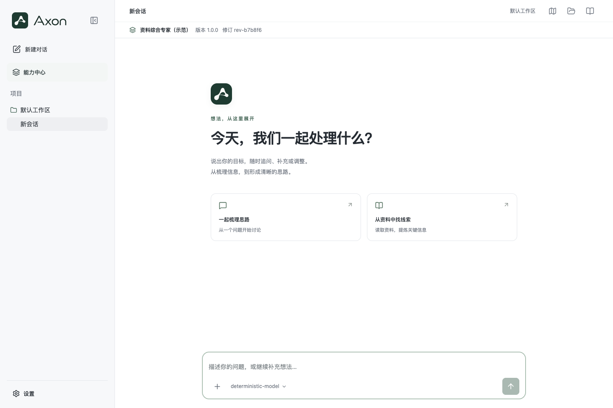

# R1 验收记录

实际实施基线：`feat/chat-rendering-c` / `66d0cba3ad4420d74593f31ffd540b893ed41ae6`。实施分支 `codex/axon-r1-experts`。三份用户原文保存在 research/，source-manifest.json 核对文件字节和 SHA-256，未改写原文。后续4316测试数据迁移、提交及合并记录见下文。

## 当前结论

R1-1—R1-4 代码已实现，确定性验证、受影响浏览器回归和独立审查已完成。按用户指定的方舟配置，R1-5 已完成真实模型三轮任务和独立新进程的一轮续聊验证。真实 Docker 文件/确认验证现已在服务器独立环境通过，见 research/online-sandbox-acceptance.md。上述为既有技术检查证据，不记为 R1 验证完成。按用户要求，任务保留 in_progress，R1 用户验收未完成；已提交实现并继续合并聊天分支，随后重新回归及部署4316供用户查看。

## A01—A12

| 项目 | 当前结果 | 主要证据 |
|---|---|---|
| A01 专业目录、通用新建、取消、空会话与幂等 | 确定性及浏览器通过 | capabilities.spec.ts 四项真实应用 API 测试；目录排除通用/子角色；未发消息零模型调用；丢失已提交响应后刷新重试同一动作仅一会话 |
| A02 专家实际生效 | 确定性及方舟真实样例通过 | capability-lab/guards 断言实际 provider prompt、Skill 原文与工具集合；ark-live-probe.json 的三轮真实综合/复核，ark-process-restart.json 的独立新进程续聊；均使用 synthesis-expert 同一修订及固定技能正文 |
| A03 身份与业务隔离 | 确定性及真实认证 HTTP 通过 | capability-admin.test.ts 3项，含停服离线 grant/revoke 和重启；普通403、管理员200；他人私有任务/资源/会话/创建仍404，模型配置仍403，零模型调用；原 access 回归 |
| A04 刷新、重启、中断恢复 | 确定性、浏览器及真实跨进程续聊通过 | capability-lab 在绑定后工作区发布失败再重启恢复同一 ID；旧请求不重放；浏览器刷新保留原修订和草稿；方舟新进程读取历史字节不变、只追加一次明确用户续聊 |
| A05 旧能力回归 | 自动回归及线上真实沙箱/确认通过 | 全量首轮1693项中1685通过、8失败；8项已修复并由对应6文件110项完整重跑通过；聊天/确认/引用/能力中心4个浏览器文件109项通过。线上真实 ask_user、文件生成/交付、批准/拒绝/取消、多轮修改、只读子 Agent 和重开验证通过，详见 online-sandbox-acceptance.md |
| A06 同发布版本的新旧修订 | 确定性通过 | controlled-synthesis 的同 releaseVersion r1/r2；新会话用新修订，旧会话多轮与重启仍使用旧 prompt 和技能 |
| A07 技能快照与冲突 | 确定性通过 | 受控技能快照不读取已变源正文；显式同 ID 异修订拒绝；显式/按需技能读使用同一快照和状态守卫 |
| A08 停用、封禁及撤权 | 确定性通过 | 普通停用允许已接受原请求收尾并拒绝追加输入；父/子专家联合准入；自动 skill_read 的停用/封禁/账号撤权；等待确认及批准落盘后撤权均未执行 Bash |
| A09 损坏与伪造 | 确定性通过 | 缺绑定/缺内容/错误摘要拒绝；热路径校验 revisions 元数据；新绑定后置及伪造 legacy 标记拒绝。不可变正文缓存的外部磁盘篡改在冷读/重启检测，不宣称实时磁盘监视 |
| A10 并发、响应丢失与重启重试 | 确定性及浏览器通过 | 同动作8并发、异参409、原意图先于最新指针；已提交响应丢失、刷新及显式重试，仅原会话；不自动重发消息 |
| A11 缓存与耗时 | 确定性及本地实测通过 | 有界缓存、只缓存内容、状态实时读取；research/performance.json 的20次冷读、100次热读和10轮真实 Pi 装配（替身 provider） |
| A12 显式迁移与完整回退 | 隔离数据演练通过 | dry-run 字节不变、apply重入、prepared中断恢复、完整备份校验；rollback-proof.json：真实66d0cba旧程序创建会话→新程序迁移续聊→完整备份副本→旧程序打开及继续原历史，备份原件无新绑定 |

## 命令与结果

- Node `v24.14.0`，按现有 package-lock 安装依赖，未升级 Pi 或修改 lock。
- 基线独立导出 `66d0cba`：typecheck、lint、build 通过；lint 原有 InteractionCard 两条 ref cleanup 警告。首次测试受沙箱端口限制；放开监听后，高并发基线出现资源超时，已中止并保留临时日志，未宣称基线全量绿。
- `npm run typecheck`：通过；新增检查文件后再次核验。
- `npm run lint`：通过，0错误、原有2警告；后续改动定向 ESLint 通过；边界检查通过。
- `npm run build`：通过，原有大 bundle 提示保留。
- `npx vitest run --maxWorkers=2 --testTimeout=60000`：151文件，1685通过、8失败（research/final-test-first-pass.log）。这些失败均在以下完整文件重跑中解决，未再执行第二次全量：
  - collaboration + annotations：70/70通过（affected-70-pass.log）。
  - file-api + model-settings + compaction + migration：40/40通过（compat-40-pass.log）。
- 新增能力核心/管理/迁移/Pi历史及守卫/创建动作辅助测试合计42项分别通过；真实认证 HTTP 管理测试最后单独验证3/3，独立守卫回归7/7。不同命令有重叠，不把重复执行计作额外覆盖数量。
- `AXON_E2E_PORT=5194 npm run test:e2e -- tests/e2e/chat.spec.ts tests/e2e/hitl.spec.ts tests/e2e/references.spec.ts tests/e2e/capabilities.spec.ts --workers=2`：109/109通过（browser-109-pass.log），并非全部25个浏览器文件均重跑。
- 独立审查7个实质问题全部修复并复查，见 independent-review.md；其新增守卫测试7/7通过。

## 首轮失败的处理

1. 旧交接夹具：先还原旧格式目录，再显式迁移；不放开新会话缺绑定的拒绝策略。
2. 账号替换：更早停止工具，保留终态 AUTH_REQUIRED；原生工具结果可为 Operation aborted，测试同时证明没有后续模型调用和草稿效果。
3. 文件 API：重启验证使用新应用实例，不对已关闭旧 lab 继续发请求。
4. 模型配置错误：先完成原模型设置校验，再检查能力迁移，保留既有 MODEL_SETTINGS_INVALID 错误契约；模型设置 open 不写配置正文。
5. 压缩时限：保留整轮 deadline；测试给固定配置准备留出时间，实际验证模型摘要在途超时，没有修改产品时限默认值。
6. 旧工作区迁移：明确再执行 R1 能力迁移；已被旧迁移跳过的损坏孤立夹具保存在隔离目录，不猜测其归属。

## 实测与外部限制

本地合成数据：冷读 n=20，p50约17.57ms、p95约208.00ms；热读 n=100，p50约0.14ms、p95约0.47ms；含首次装载的缓存命中率100/101。10轮实际Pi装配 p50约56.69ms、p95约118.79ms；首文本片段 p50=72ms、p95=146ms；工具 p50约3.54ms、p95约11.12ms。该 provider 是确定性替身、测量期间还有回归负载，不代表真实模型延迟或性能SLO，首片段不称作精确首Token。

首次实测使用主目录的 DeepSeek 直连配置，返回 insufficient_quota（原 live-probe.json 保留）。用户随后明确指定使用现有方舟配置；当前 worktree 的忽略文件 .env.local 已采用 volcengine-agent-plan / deepseek-v4.1-flash，凭证未写入报告或 Git。

方舟复测：同一 synthesis-expert 完成资料综合、review 复核、实例重建续聊三轮；记录实际 provider 为 volcengine-agent-plan，三次执行清单使用相同 revisionId/digest，显式方法依次为 synthesis/review/review，原生 source_read 成功读取两份合成资料。显式技能已加载正文，不伪造 skill_read 工具调用。复核轮能指出首轮“资源基本够用”等缺乏依据的表述；对休息口径提出额外假设，属于模型建议，未作为原文事实或确定规则。该样例证明真实配置与协作链路可用，不宣称任意任务的答案完全准确。

进一步使用新的独立 Node 进程（PID 66075，原探针 PID 65573）打开同一会话：启动和 GET 不改写历史字节，专家修订/摘要及固定 review 技能保持，明确发送一条合成续聊后仅追加一个用户输入，并成功取得方舟真实回答；原历史前缀完整保留。见 ark-process-restart.json。补充探针首次在模型调用前因内存 undefined 可选字段与 JSON 快照直接比较而误判，修正为比较序列化 DTO 后通过；说明保存在 ark-process-restart-harness-note.json，未改产品代码或重放用户请求。

本地 Docker daemon 不可用的环境限制已通过线上服务器独立验收补齐。线上实际 Docker + 方舟的确认、文件交付、多轮修改、旧下载固定、只读子 Agent 与重开检查均通过；原失败尝试和显式续作过程保留。详见 research/online-sandbox-acceptance.md。技术验收完成不等于正式服务已发布 R1。

## 4316 测试环境更新（2026-11-13）

按用户要求更新 http://49.232.156.14:4316。独立发布目录为 `/home/ubuntu/axon-r1-preview-4316-20261113`，继续使用原 `/home/ubuntu/axon-chat-c-preview-20261112/data` 和服务器现有方舟配置；原代码目录保留。构建包 SHA256 为 `4a717920b91a6b01e101bf33b3631c2c374aaf1a00b1c8bb700589d608e8f807`，对应当前未提交的已验收工作树快照。

运行时 dry-run 被临时 mock.sock 拒绝；34 条原生历史均单独校验通过，优雅停服后 socket 已清理，离线 dry-run 与完整备份校验、apply 全部通过。完整迁移前备份为 `/home/ubuntu/axon-chat-c-preview-20261112/backup/r1-before-20261113`，摘要 `65f99e0e52e5be96c8c3d51fb422560758e03e640cc893ef49a8d30dea8aa3ea`。回滚须配对原代码和该数据备份，不能仅启动旧代码读取已迁移数据。

新进程 PID 1923717，健康检查 200；总体席、情报席使用原账号重新登录通过，专家目录与权限接口通过，专业目录返回可用的资料综合专家；两份线上 JS/CSS 与本次 dist 字节一致。未额外授予能力管理员角色。见 `research/online-4316-deployment-verification.json`。本次仅更新 4316 测试环境，等待用户查看效果。

## 当前验收状态

用户要求先提交实现再同步聊天分支；本记录中的通过项仅为已执行技术检查的证据，不代表用户已完成R1验证。R1保持进行中，等待用户线上验收，不归档。
