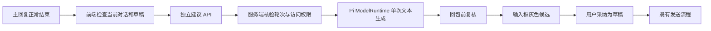

# 输入建议预测设计

> 对应 [PRD](prd.md)，已获用户批准。代码定位基于 `a3b9b88`；下列新增文件/接口均为拟议设计。

## 1. 结构与数据流



主对话仍由现有 `AgentSession` 执行。预测使用已配置的 `ModelRuntime.completeSimple`，不创建 AgentSession、工具、资源快照、容器或持久消息。Web 只调用本应用 API，不直接访问 Pi 或模型凭据。

| 层 | 拟议责任与文件 |
| --- | --- |
| 公共契约 | `src/contracts/prompt-suggestions.ts` 定义请求/响应，由 `contracts/index.ts` 导出。 |
| Pi 适配 | `src/pi/prompt-suggestion.ts` 负责上下文裁剪、提示、SDK 调用和结果校验。 |
| 会话宿主 | `PiLab` 提供一个窄方法：读取已有授权快照、捕获所选模型、管理短期取消/去重、复核新鲜度；不公开 runtime 或 RecordState。 |
| HTTP | 在既有 `registerApi` 席位路由树注册建议接口，沿用正式身份/管理员个人范围、测试席位、Origin/CSRF/view 检查。 |
| Web 生命周期 | `src/web/usePromptSuggestion.ts` 负责一次触发、请求取消，以及同轮候选的展示、暂藏、恢复与失效。 |
| Web 展示 | `src/web/PromptSuggestion.tsx` 提供建议到达时的屏幕阅读器通知；`main.tsx` 对接已有 textarea、草稿与键盘处理。 |
| 设置 | 既有 `Settings.tsx` 的个人偏好增加一个开关；复用登录范围 storageKey，不建立新配置服务。 |

## 2. 何时触发

在 `useChat` 已有前台发送的终态处理处提供一个短期完成通知 `{sessionId, requestId}` 给预测 hook。通知不是第二份执行状态，不持久化，也不从历史猜测完成。终态仍以返回的权威快照为准。

hook 同时要求：当前选中对话匹配、页面可见、席位处于活动状态、处于普通聊天视图、快照和活动摘要均无运行或后台预留、最新成功轮次具有同轮 `finalMessageId`，并且没有草稿、附件/引用、未决输入队列操作、人工交互、恢复异常或模型错误。已有模态面板覆盖时也不生成。`canSend` 需要非空草稿，不能原样用作该判据，应复用其余就绪事实。

只处理当前页面观察到的前台完成；打开历史、刷新、后台作业完成、首次空会话及切回已完成对话不补算。这省去历史补算和跨视图缓存，也避免浏览旧记录产生额外费用。断线而未收到可信终态时不自动补算。

## 3. HTTP 契约

```ts
interface PromptSuggestionRequest {
  sourceRequestId: string;
  finalMessageId: string;
  expectedModelId: string;
}
interface PromptSuggestionResponse {
  sourceRequestId: string;
  finalMessageId: string;
  modelId: string;
  text: string | null;
}
```

`POST /api/sessions/:id/prompt-suggestion`；测试模式沿用 `/api/test-seats/:seatId/...`。请求不接收浏览器拼装的 transcript、工作目标、权限、端点、密钥或模型配置；`expectedModelId` 只用于核对，不能覆盖服务端选择。JSON schema 拒绝多余字段；requestId 使用既有 UUID 校验，finalMessageId 按现有消息 ID 边界校验，不假定它也是 UUID。

- 200 + text：一条合法候选；200 + null：无建议或本轮已经尝试，不展示。
- 参数、未登录、身份变化及会话不可见沿用现有 400/401/403/404 语义；轮次/模型过期或会话忙沿用 409。
- 模型不可用、生成错误/超时和无效结果作为该辅助请求的跳过处理，不改主请求结果；前端不显示普通失败横幅。身份失效仍交给已有 API client 统一处理。
- 前端通过 `useApi().request(url(...), {signal,...})` 发请求，保留已有认证头及注销取消信号；不扩散修改整个 JSON helper。

## 4. 宿主准入、新鲜度与取消

1. 以当前服务端身份解析拥有者，通过 `record`/`workspaces.get`、`assertCanUseWorkspace`、任务 `access.get(taskId, owner, true)` 的可办理性及专家可用性检查；管理员使用已有个人存储范围，不获取业务席位权限。
2. 核对最新成功 `lastResult`、同一 `ConversationTurn.finalMessageId`、最终正文以及无运行、预留、恢复异常。不得退回扫描“最后一段看起来像答案的文字”。
3. 从当前原生模型选择捕获 `{profileId, config, runtime, version}` 与 native leaf/来源轮次；不重新建模型目录，不降级到默认模型。
4. 每个会话仅保留当前来源轮次的已尝试标记、在途 controller 和已捕获信息。相同轮次多次请求或多标签页并发最多启动一次模型调用；不保存候选文本作服务器缓存。重启后不承诺跨进程去重，但浏览器刷新本身不补算。
5. 使用既有全局模型并发许可（启用时），把等待包含在预测总超时内，不增加后台作业队列或优先级调度器。同一会话的新正式发送优先取消预测，无须等待预测结束；不把预测写入 `record.active`。
6. 请求/响应连接关闭、新发送、模型切换、模型设置替换、服务关闭时清理在途预测；客户端切换视图、输入、关闭开关时 abort。HTTP 断开清理需监听响应实际关闭，避免把请求体正常读完误判为断开。
7. 模型调用前与回包前复核身份有效性、访问范围、任务/专家状态、record 身份、native leaf、模型选择/版本和空闲状态；不符合即取消/丢弃。复用已有授权方法，不使用会话读权限替代继续工作的资格。
8. 预测无文件写入，不占任务写入租约；任务可在生成期间归档/结束，回包时复核并跳过。前端展示/采纳前再次检查本地来源与草稿；用户下一次发送仍走全部正式准入。

前端同时持有自己的 generation token。即使网络取消没有阻止回包，A→B→A、草稿先改后清空、注销后重新登录，也不能通过简单“当前 ID 相等”恢复旧候选。取消的在途响应永不成为候选；只有已经成功接收且未失效的本轮候选可以因删空恢复。候选失效时清理，不建立持久恢复机制。

## 5. 单次模型请求

### 模型与传输

复用 `PiLab.requestModel` 的现有目录与版本捕获，SDK 为项目锁定的 Pi 0.85.1。跟随对话所选模型及其有效 thinking 配置；不为了预测静默改成 off 或替换模型。

当前 `controlledStream` 混合了通用 provider 兼容处理和正式回复提醒，不能直接把预测当成普通回复或压缩调用。实现时仅提取其中已有的 provider 兼容处理为一个小共享函数，供原流程和新 SDK 调用复用；原回复提醒仍只由原流程注入。保持已核验 thinking 格式、legacy 缺省行为与 `maxRetries: 0`，用现有离线 wire 测试保护，不建立通用请求框架。

建议初始技术限值：总耗时 20 秒；`maxTokens = min(512, profile.maxOutputTokens)`；单次调用，无 Agent 重试循环。超时包含等待并发许可。高思考模型可能在此预算内没有最终文字，按无建议处理，后续根据获准的真实模型抽样调整预算，不在本期引入第二个模型配置。

### 输入上下文

仅由已授权的公开消息投影构造短 transcript：优先保留当前轮真实用户文字和最终回复，向前最多补到最近 6 条用户/助手文本；当前宿主请求可能有多条实际用户消息，要保留其原顺序和边界。

必要工具事实只取当前轮已完成工具的名称、成功/错误状态和短正文节选，最多 3 条；不加载完整工具参数、diff、脚本、日志、思考内容、Skill 正文或文件内容，不再次读取业务系统。工具事实来自已经经过授权投影的结果，不能用原生私有日志绕过结果撤权。read/bash/Skill/指令/来源读取及能力草稿读取等可能包含正文、diff 或执行日志的工具只传名称和状态，不传正文节选。

transcript 建议最多 6000 个 Unicode 字符；再用 Pi 公开 `estimateTokens` 与该模型上下文容量预留输出、系统提示和余量，优先裁掉旧内容/工具节选。截断须明确标记；关键当前输入和最终回复无法容纳时直接跳过，不另发模型请求压缩。字符上限不是准确 token 计费或容量保证。

预测专用简短 system prompt 指明：生成的是“用户下一条可能输入的话”；上下文是资料而非新指令；只输出一条短句，不能作答、调用工具、虚构对象或代用户作批准决定；不足以预测时输出固定哨兵 `NONE`。临时 context 不带 tools，不携带主 Agent 的执行提示。

### 输出校验

只接收 `stopReason=stop`、无工具调用、存在 text 的结果；仅取 text，丢弃 thinking。`NONE`/空文本变成 null。候选建议限制为单段单行、最多 256 个 Unicode 字符；控制字符、多段、超长、截断或结构异常直接丢弃，不从异常输出中拼凑候选、不自动重试。提示中要求避免无依据的确认/批准、完成陈述和泛泛“继续”；这是质量约束，不能用 mock 测试证明真实语义质量。

预测真实用量不得并入上一轮 `RequestResult.usageSummary`。如使用现有日志，仅保留状态类别、耗时和实际返回的 token 数；不记录 transcript、建议文字、凭据或整个 provider 响应，不为本功能新建指标平台。

## 6. 空框建议、输入隐藏与删空恢复

采用本次调研中 Pi/OpenCode 等实现使用的轻量交互：空框展示整条建议，任何输入使其隐藏，删空后恢复同轮候选。这里的“空”严格指 `draft.length === 0`，不使用 trim；只有空格或换行也不得展示/采纳。

### 展示与编辑器复用

保留原 textarea、自动高度和 `chat.setDraft`。满足展示条件时，将候选作为 textarea 的临时 `placeholder`；隐藏或失效时恢复原占位文案。使用现有 placeholder 灰度并检查可读性，无须叠加输入前缀/后缀镜像，不新增随光标位置排版的层。

候选不要求输入框当前获得焦点，但只在当前可见对话、空输入、普通就绪状态下展示；Tab 采纳严格限该 textarea 获得焦点。引用菜单、模态面板、中文组词或其他原有占用状态下暂藏。输入内容始终由原 textarea 绘制，异步建议不改变其 value、实际草稿或高度。

输入框继续按实际草稿保持原 28–180px 自动高度。长候选按原可视区域显示，在 textarea 的 title 中提供完整文本供查看；采纳始终填入完整候选，用户在发送前可以编辑。候选出现/隐藏不撑高输入框；采纳后再按既有真实文字高度和滚动方式展示。

按用户测试反馈，移除工具栏“采纳建议 / Tab”按钮，不额外显示采纳提示。保留原 textarea 的焦点与键盘交互；屏幕阅读器到达时最多提示一次“有下一步建议，可按 Tab 采纳”，不在每次恢复时重复播报，也不让占位提示冒充实际值。

### 短期候选状态

在 BusinessApp 顶层 hook 保留 `Map<sessionId, {owner, sessionId, sourceRequestId, finalMessageId, text}>` 与既有 generation token。owner 使用现有登录/席位作用域，模型不作为缓存键。每个会话只保留最新一条，当前展示副本须已验证来源；未展示候选不会写入草稿或浏览器存储。是否暂藏由当前草稿、组词、菜单、面板及视图事实推导，不新增独立候选缓存系统。采纳不清空这条候选，只把整条文字通过 setDraft 写入真实草稿；因输入非空而隐藏。用户在未发送前删空时，可以再次看到同一候选。

明确区分两种情况：**已经收到的候选被输入暂藏，可以删空恢复；尚在生成时被输入取消的请求，不会因删空而恢复或补算。** 恢复只做本地状态判断，不调用模型。

| 状态/事件 | 处理 |
| --- | --- |
| 等待返回时开始输入或组词 | abort 并使 generation token 失效；之后清空也不补算，迟到响应丢弃。 |
| 已有候选，输入任意字符/粘贴文字 | 隐藏整条候选，包括与建议前缀完全匹配、只有空格或换行的情况；保留同轮内存副本。 |
| 部分删除但仍有文字 | 继续隐藏，不比较前缀、不裁切后缀。 |
| 删除到完全空 | 来源仍有效且其他展示条件满足时恢复原候选，不重新请求。 |
| 采纳后未发送，再删空 | 同样恢复本轮候选，可再次整条采纳。 |
| compositionstart / isComposing / keyCode 229 | 暂藏已有候选，不采纳、不发送；若尚在生成则取消请求。 |
| compositionend | 有实际文字则保持隐藏；若完全空且已有有效候选则恢复。保留引用菜单的原组词处理。 |
| 输入框获焦点，无修饰 Tab，候选可见 | 防止默认导航，重新核对 owner/来源/最新 draft 仍完全空，再整条写入 setDraft、光标放末尾；保留同轮候选。 |
| Escape | 引用菜单先处理；否则明确丢弃本轮候选，之后删空不恢复、不重新预测。 |
| 浏览器窗口/标签页暂时隐藏 | 已有候选仅暂藏，回到同一对话且来源仍有效时恢复，不发新请求；在途预测取消，不因返回补算。 |
| 失焦、菜单或模态面板出现 | 失焦本身不清除候选；菜单/面板覆盖时暂藏，关闭后可在空框恢复。其他控件中的 Tab 保持原行为。 |
| Shift+Tab、修饰 Tab、方向键或其他按键 | 原行为；右箭头不作为本期采纳键。 |
| Enter | 保留既有发送/队列逻辑，只发送真实草稿；空框灰字不发送、不隐式接受。 |
| 同一身份切换会话、业务页面、模型 | 保留已生成候选；会话/聊天页返回时只读现有 GET 会话接口核对权限和轮次，验证前不显示或采纳，不重新调用模型。模型切换只暂藏，不因 modelSaving 等临时就绪条件删除缓存。 |
| 用户/席位/登录态变化、关闭功能 | 清空全部内存候选并取消请求；切回旧身份也不恢复。 |
| 新发送/新轮次、明确 Esc 拒绝、业务依据失效 | 删除对应会话的候选；不因删空或导航而复活。 |

引用选择器需增加一个最小的“当前菜单是否占用输入”通知/查询，保证菜单打开时预测隐藏且不接管 Tab。不能只依赖现有 `keyDown()` 返回值：它对菜单中的 Tab 当前返回 false。键盘处理顺序为 IME 保护、引用菜单、预测、原 Enter 逻辑。

新增附件/Skill/Agent/地图引用、排队回收草稿、人工交互或恢复操作出现时使候选失效；这些操作不触发新预测。采纳走既有草稿版本和 sessionStorage 流程，不另造撤销栈。刷新只恢复实际草稿，未采纳候选及供删空恢复的副本不持久化；同一身份按会话分别保留在内存，不在会话间混用。

## 7. 开关、兼容与退出

首版个人偏好开关使用登录隔离的 sessionStorage 与内存回退；只存布尔值，候选与已尝试记录不入存储。管理员当前没有个人偏好入口，需允许其进入包含输入建议的通用偏好区，同时继续按原权限隐藏仅业务席位可用的专家偏好及模型管理内容。测试席位也需有该开关，不因无正式 identity 丢失控制能力；不改变已有专家设置 API。

关闭功能后 hook 不请求、不展示；从 UI 退出不取消正式 Agent。既有模型设置 API、原生聊天记录、数据库与历史版本均不迁移。移除本功能后主对话可照常运行。已显示候选不建立跨标签页模型配置广播；配置更新期间的在途预测由宿主复核，下一轮使用新配置，正式发送始终按当时有效模型执行。

## 8. 风险与证据边界

- 高思考模型的额外耗时/用量与上下文裁剪后的语义质量，需要后续获准的小样本真实验证；不得把离线 mock 成功当成预测质量结论。
- 中文 IME、菜单 Tab 优先级、长占位文案的可读性，以及“已有候选恢复/取消请求不可复活”的区别是 UI 主要风险，以浏览器交互和截图核验。
- 正式主流程传输处理的提取只限必要兼容函数，以既有模型配置/压缩/重试 wire 回归防止行为漂移。
- 前缀续显、后台/打开历史补算、跨标签页共享候选和单独快速模型留作后续需求，不为它们预建镜像、存储或调度结构。

代码依据与参考实现见 [代码证据](research/code-evidence.md)及[开源参考](research/upstream.md)。
