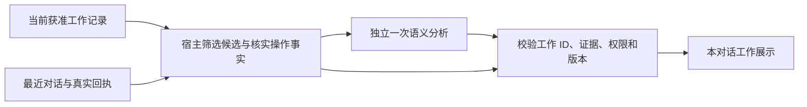

# 会话工作识别与面板展示：评审方案

2026-11-17 · 状态：**建议方案，待用户审阅；未实施、未部署**。

本文是输入建议独立请求路线的后续复用评估，暂存于当前任务的 research；不扩大已部署输入建议的验收范围，不代表 WORK-SESSION-001 已解决。

## 1. 结论与目标

针对此前明确的目标“在面板上展示用户正在做什么工作”，推荐采用：**业务数据提供确定事实，独立模型请求识别对话中的工作内容，服务端校验后形成可撤销、可重算的展示结果。** 支持一个对话涉及零项、一项或多项工作，不要求用户先管理关联。

独立请求适合这个展示目标；不适合直接把模型判断写入现有正式关联，或直接作为文件提交对象、主 Agent 的默认工作目标。后两者会把概率判断变成业务决策，且轮后分析无法影响已经执行的本轮操作。

这是一项结合本项目的工程建议，不宣称所有 Agent 都采用相同实现。Anthropic 的 [Building effective agents](https://www.anthropic.com/research/building-effective-agents) 建议先采用简单、可组合的工作流，许多明确任务使用检索与单次模型调用即可；其 [context engineering](https://www.anthropic.com/research/effective-context-engineering-for-ai-agents) 强调选择少量高价值上下文。这些原则支持本方案的简单分析路径，不构成特定业务关联策略的行业标准。

## 2. 已核对的项目事实

| 事实 | 当前代码依据（相对仓库根目录） |
| --- | --- |
| 一个对话只能保存一个正式工作关联 | `experiments/harness-lab/src/access/database.ts:31`：`session_id` 是主键；`src/collaboration/service.ts:170` 的 `bindSession` 拒绝另一工作 |
| 正式关联参与每轮上下文 | `src/pi/lab.ts:1620` 获取关联工作；`:1043` 组装目标、状态、revision、附件引用、最近审核等信息 |
| 工具可以按显式 ID 办理同一任务中的不同获准工作 | `src/pi/collaboration-tools.ts:59` 开始的查询和办理工具；单值关联不等于工具只能处理一项工作 |
| 现有工作状态和回执已有权威存储 | `src/contracts/collaboration.ts`、`src/collaboration/service.ts`；工作台是原业务记录的查询投影 |
| 输入建议具备可借鉴的独立调用与内存生命周期 | `src/pi/prompt-suggestion.ts`、`src/pi/lab.ts:732`、`src/web/usePromptSuggestion.ts`、`.trellis/spec/backend/prompt-suggestions.md` |

表内缩写 `src/` 均相对于 `experiments/harness-lab/`。行号是本次检查时的定位，后续代码改动可能移动。

原问题记录位于另一工作区：[WORK-SESSION-001](/Users/lau/workspace/berserk/.trellis/tasks/09-19-w01-8-task-handoff/issues.md)。已只读核对，其明确区分展示需求与正式关联改造，并记录多工作混淆、自由切换对话后的上下文缺口；本次不修改该工作区。

## 3. 面板信息与交互

建议保留两个主要区块，工作标题、业务状态、来源席位都取自正式记录：

| 区块 | 内容及范围 | 是否需要模型 |
| --- | --- | --- |
| 待接收 | 当前席位获准查看、接收方为本席位且状态为 assigned 的工作；可包含不同任务，并显示任务名称 | 不需要，复用工作待办 |
| 正在处理 → 本席位 | 本席位承办且状态为 working／returned 的工作；已提交另按正式状态显示，不冒充仍在编制 | 不需要，复用正式工作记录 |
| 正在处理 → 本对话 | 默认视图。展示最近对话识别出的工作内容，可有多项；区分“本轮处理”与“此前处理” | 确定事实直接展示，其余用独立分析 |

“本对话”视图使用“根据最近对话识别”的说明，不能据此推断用户在其他会话、业务页面或线下的全部工作。每项显示工作名称、简短活动描述、正式状态（存在正式工作时）、证据入口。既有单值关联只标记为“已关联”，本身不证明当前仍在办理。

例如用户说“分别编制设备采购建议和人员培训计划，两项分别上报”，允许显示两项；若两个文件共同满足同一工作的交付要求，显示一项工作及两个成果，不根据文件数量拆工作。没有可确认的正式工作时，可显示“正在编制设备采购建议 · 未匹配工作记录”，不创建虚构的工作 ID。

仅提及、对比或参考其他工作，不进入“本轮处理”。有多个合理候选但证据不能消歧时，保留活动摘要并显示“未能确认对应工作”。不展示未经评估校准的“95% 置信度”。

点击已识别工作打开现有详情；点击依据定位原消息或已有操作回执。提供“忽略本次判断”，只隐藏当前分析版本的推测项，下一轮有新证据可以重新识别；不改变工作或正式关联，也不收集训练数据。确定的业务记录仍可在“本席位”查看。

折叠/展开沿用桌面三栏布局，保留聊天输入空间；窄面板允许折叠。更新不抢焦点、不滚动主对话。只做桌面窗口和分栏适配。

## 4. 识别流程

1. **范围与候选由服务端确定。** 从当前登录身份、席位、会话工作区及所属任务读取候选。模型只能选择当前任务内获准工作；工作总览权限不能替代参与者权限。个人空间不检索业务席位的工作，可只显示本对话活动摘要。
2. **先提取确定事实。** 使用真实业务回执中的 workItemId、operationId、状态及文件引用。成功提交证明提交对象和实际文件；读取详情只证明查看过，不能证明正在办理。旧关联、文件名或普通读取动作也不能单独证明工作归属。
3. **再分析语义。** 给模型最近的真实用户要求、必要的助手回答、当前轮核实的操作事实，以及候选工作的标题、目标、状态与必要交付信息。以当前明确用户意图为主要依据；助手声称“完成”不能替代回执，旧关联不能覆盖用户本轮转向。
4. **允许多项与不确定。** 模型输出工作 ID 或未匹配活动、处理/参考/不确定判断、短描述及证据 ID。仅返回传入的工作与证据标识，禁止自行创作正式工作状态或 ID。最终正式名称、状态由宿主重新读取填充。
5. **校验后展示。** 程序校验结构、候选成员、证据存在与轮次、身份权限、业务 revision、当前会话版本；越界或陈旧结果不展示。ID 校验只能证明对象存在且获准，不能证明语义判断正确，仍需模型质量验证。

上下文应限量，但不能直接照搬输入建议的“最近六条消息、三个工具片段”：工作识别需要业务目标和更明确的证据。优先保留当前要求、明确引用和真实操作对应工作，再在当前任务范围内检索其余候选。上一版结果只能作为查找原始证据的索引，不能循环当作新的事实。

候选或上下文超出预算时，标明覆盖不完整；不能把“没放入上下文”判成“没有对应工作”。不引入向量库或全历史模型扫描，先用已有授权查询和有界上下文验证是否足够。

## 5. 触发、请求与复用

业务状态按现有查询及真实回执更新，不等待模型。即使某轮后续失败，已经提交成功的回执仍是真实业务事实。

语义分析在一轮正常结束后异步触发，面板关闭时延后到再次打开；首次打开已有会话或页面刷新后，可在会话空闲且存在有效历史来源时分析最新对话。这与输入建议“只由新完成轮次触发”不同：工作展示需要覆盖已有会话。

同一身份、同一会话来源与候选版本只保留一次有效结果，并合并相同的在途请求；失败不自动反复重试，允许用户在面板重试。新一轮发送、来源失效、权限或身份变化会取消并丢弃旧结果。打字、光标移动和输入框失焦不影响工作分析。

建议独立接口 `POST /api/sessions/:id/work-activity-analysis`，沿用当前认证、Origin/CSRF/view、取消、模型配置捕获和调用许可。客户端只提交来源标识，正文与候选由服务端读取。结果包含来源版本、候选版本、覆盖情况和多项识别结果。具体 DTO 在批准后按已有 TypeBox 契约细化。

复用 Pi 公开 `ModelRuntime.completeSimple` 与既有 provider 适配；一次无工具调用、严格 JSON 结果校验、限量输入输出、总超时和无自动模型重试。复用输入建议现有 20 秒总时限作为首轮试验上限，输出预算按多项结构单独设置和测量，不照搬 512 token 文本限制。

输入建议与工作识别保持独立提示词、返回契约、缓存和开关；两者目标和上下文不同，暂不合并成一次调用或抽象出通用后台 Agent 框架。前台业务优先于辅助请求；复用既有许可与取消机制，验证两个辅助功能同时启用时的等待、成本和饥饿情况。

## 6. 存储与时效

第一版使用当前浏览器标签页的 JS 内存 Map，按身份域＋sessionId 保存最近分析、来源版本、工作候选版本及本次忽略项。复用输入建议的生命周期模式，不共用它的缓存内容。

| 情况 | 建议行为 |
| --- | --- |
| 同一身份切换会话、业务页面 | 保留各会话分析；返回时先校验会话及业务权限和版本 |
| 同一身份切换模型 | 保留已生成结果；新分析使用新模型；在途结果遵守捕获配置的有效性检查 |
| 同一身份切换页面时分析仍在途 | 允许在原会话身份与来源仍有效时完成到原缓存，不写入当前另一会话；不把输入建议的导航取消规则原样照搬 |
| 新一轮发送 | 取消旧分析；上次结果只能标明“上一轮识别”，不能继续标成当前轮判断；新结果更新或明确无法识别 |
| 工作新增、状态/目标/revision变化 | 通过现有读查询重新验证，失效的业务字段及时更新；影响匹配的变化使分析过期，按需重算 |
| 用户、席位或登录态变化 | 清空当前身份的全部会话缓存，取消在途请求；旧身份回调不能重新写入 |
| 具体会话或工作权限撤销 | 清除受影响的结果与可见业务内容；读取失败期间不展示未经复核的敏感旧结果 |
| 刷新、关闭页面 | 内存结果丢失；正式工作仍在原数据库，可在再次打开面板时重算 |
| 分析失败或服务不可用 | 正式待办仍可查看；区分“未识别”“未找到可确认对应项”“暂时不可用”，不把失败显示成没有工作 |

候选版本可由服务端对获准候选 ID/revision 等已有字段生成临时签名，不新增业务版本表。返回展示前还须重查当前授权，版本签名不能替代权限校验。面板可见时沿用项目现有查询刷新节奏；这是最近已核实的视图，不宣称逐毫秒实时。

不保存到 localStorage、sessionStorage、Pi 聊天历史或新的业务表；不承诺跨设备恢复、离线重算或关闭浏览器后继续分析。未来若需要稳定的跨对话接续记忆，再为该具体需求设计服务端持久记录。

## 7. 本期边界与另一条路线

本期只实现工作识别与展示：不改 `session_links`，不自动签收、提交、导入文件、变更状态或为主 Agent 注入分析结果。关联事实和模型判断不会相互覆盖；WORK-SESSION-001 继续保持开放。

如果目标升级为“让 Agent 在任意对话正确接续、编制并提交多项工作”，推荐另行设计：

- **本轮执行前定位工作范围**：依据用户明确引用、当前要求及获准业务查询确定零到多个对象；有歧义时澄清，旧会话关联仅作线索。
- **按需组织本轮上下文**：取得对应工作的最新目标、附件、提交和审核信息，按工作分组；避免长期只突出旧关联的一项，也避免把全部工作塞进每轮上下文。
- **每次业务操作明确对象**：继续按 workItemId、revision、实际文件执行并确认。展示侧的“可能对应”不能成为提交授权或默认文件归属。
- **单独处理接续记忆**：同任务同席位文件共用，但聊天记录不共用。工作记录可以恢复正式目标；未写入工作或文件的对话决策不能靠识别器猜回。确需接续时再设计可追溯摘要/显式引用，不能放宽访问范围。
- **明确正式关联的产品语义后再改模型**：若仍需长期记录一段对话涉及多项工作，再设计多对多关系及迁移；仅更改主键不能解决上述执行问题。

独立分析可以给上述执行流程提供候选，但必须在使用前重新核实；轮后面板识别不能作为这条路线的替代品。

## 8. 难点与验证

最主要的难点是“正在办理”与“仅提及”的语义边界、同名相近工作的消歧、对话切题后旧结果的失效，以及没有正式记录的自发工作。版本和身份检查可以程序化保证，语义准确性须用真实模型验证。

建议至少准备以下验收组，分别统计误匹配、漏项、多项识别完整性、不确定判断、延迟及额外 token；不要用格式校验通过代替识别正确。真实模型试验保留每次输入范围、结果和人工判断，具体质量门槛由样例基线支持后确定，不预先声称准确率。

| 场景 | 预期 |
| --- | --- |
| 同一对话编制两份分别属于不同工作的文件 | 可显示两项，证据与各自目标对应 |
| 同一工作的两个交付文件 | 仍为一项工作，不按文件数拆分 |
| 顺带提及另一工作、讨论反例或历史已完成工作 | 不误标为当前办理；历史/参考明确区分 |
| 对话已关联 W1，用户明确转而办理 W2 | 展示可识别 W2；不修改原关联，不宣称已修复主 Agent 的上下文风险 |
| 用户新建 B 只说“继续刚才的工作” | 无充分证据时无法确认，不伪造从 A 继承的记忆 |
| 多个同名候选、目标被截断、候选检索不完整 | 保留不确定及覆盖限制，不强选 |
| 个人空间、自发工作、闲聊 | 可有无正式 ID 的活动摘要；闲聊可无工作，不自动建工作 |
| 切换会话/模型/页面、用户/席位变化、晚到响应 | 正确保留或清空，不能串会话或身份 |
| 新轮次、工作 revision变化、权限撤销 | 旧结果不冒充当前事实；越权标题、理由或文件信息不显示 |
| 超时、无效 JSON、伪造 ID/证据、模型不可用 | 安全跳过分析，正式待办与主对话可继续使用 |

## 9. 建议实施顺序

1. 批准本方案的展示边界后，再建立独立实施任务。保持当前输入建议验收和变更记录独立。
2. 先用少量合成/获准样例验证候选范围、证据抽取和一次分析；确认有意义的识别收益，再接面板。不得使用测试账号之外的线上业务做写入试验。
3. 实现类型契约、受权只读接口、独立模型调用和前端内存状态；复用工作待办及详情入口，避免复制工作状态机。
4. 做身份/权限/版本/API单测与桌面导航浏览器测试，再单独记录真实模型识别质量与成本。
5. 提供可关闭的展示功能，保留原工作入口；部署与用户验收另行执行。

本次交付是路线判断与可审阅方案。没有产品代码、数据库、提示词或线上服务变更，也没有执行上述试验。
