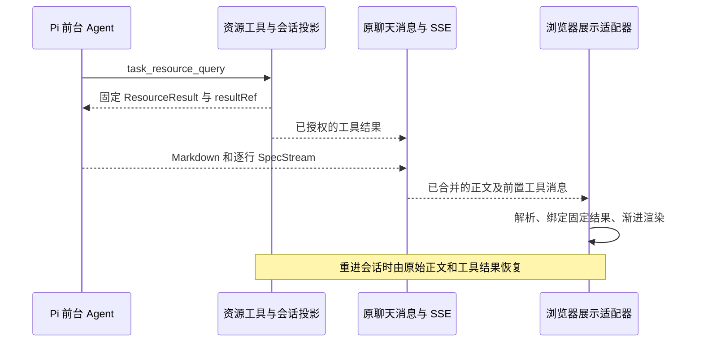

# R1.1 聊天结果流式展示技术方案

## 目标与边界

在桌面聊天的同一条回复中，把一次真实资源查询的固定结果显示为指标和分类柱状图。组件随回复逐步出现，原会话重新打开时恢复同一份展示。查询、统计和固定数据由既有资源工具负责，模型选择展示组件和顺序。首轮目录包含纵向布局、资源指标和按类别统计条目数三种组件。通用计算数据和其余图型由 R1.2 承接。

方案依据 [R1 分阶段讨论](https://chatgpt.com/share/6b046523-a9e0-83ea-9ae2-8336a23d5448)。[需求和验收标准](./prd.md)定义交付范围，[实施与验证](./implement.md)记录自动化和 4316 发布证据。

## 架构与职责

| 层 | 落点 | 职责 |
| --- | --- | --- |
| 宿主与模型 | `src/server/config.ts`、`src/pi/lab.ts`、`src/presentation/resource-ui.ts` | 读取开关，在符合条件的前台请求注入目录和示例。模型使用常规回复流输出展示块 |
| 聊天投影 | `src/web/useChat.ts`、`ChatPresentation.tsx`、`ChatMessage.tsx` | 沿用现有累计正文和终态快照。将当前会话、请求以及前置证据交给展示组件 |
| 展示适配 | `src/web/result-ui/markdown-fence.ts`、`spec-stream.ts`、`ResultUiBlock.tsx` | 从 Markdown 中识别专用围栏，验证受限补丁，调用 json-render 编译器和 React 注册表 |
| 业务数据与绘制 | `ResourceResultCard.tsx`、`src/contracts/resource-summary.ts`、`src/web/result-ui/ResourceBar.tsx` | 复用同会话结果筛选和统计口径，按固定数据构造指标和 ECharts 配置 |

选择普通 Markdown 内的版本化围栏，以复用 Pi 原生消息、已有 SSE 和历史回放。业务层继续使用 `ResourceResult`。json-render 和 ECharts 分别留在展示适配器及图表组件中。构建会延后加载展示适配器，柱状图进一步独立加载，纯文字回复和只有指标的回复按实际需要下载前端代码。

## 协议和流式状态

`berserk-ui-v1` 是行首专用 Markdown 围栏。第一条非空行包含块 ID、目录和固定引用，例如 `{"id":"resources","catalog":"resource-v1","resultRef":"resource:request-id:tool-call-id"}`。后续每行是一条原生 SpecStream 补丁。首版允许 `add`、`replace` 写入 `/root` 或一整个 `/elements/<id>`。根元素为 `Stack`，子元素为 `ResourceMetrics` 或 `ResourceBar`，叶节点属性为空。执行样例由 `resourceUiInstructions` 提供。

- 块 ID 和元素 ID 使用 1 至 40 个字符的受限标识，排除原型属性。块正文最多 32,768 个 JavaScript 字符，最多接收 32 条补丁，根布局最多容纳 8 个互异子节点。
- 围栏扫描依据实际源码位置和换行推进，普通代码、列表和引用中的示例沿用 Markdown 渲染。每轮增量只编译完整新增行，相同快照复用已有状态，正文发生替换时重新解释当前快照。
- 根及任一子组件具备渲染条件后显示已验证的部分。围栏闭合时核对完整结构。非法配置提示「资源展示格式有误」，引用不可用提示「原资源结果不可用」，回复停在开放围栏时提示「资源展示未完成」。
- 行为取决于既有 SSE 的到达分片和浏览器渲染调度。指标和图表可能相邻出现。柱状图在数据和组件结构就绪后绘制，关闭图表自身动画。

## 数据语义、权限与历史

前端从同一会话中位于正文前的成功 `task_resource_query` 投影查找精确 `resultRef`，优先取其本轮投影。投影阶段沿用服务端对会话身份、任务及资源依赖的授权。展示适配器再次校验结果契约，绑定失败时保留常规文字和已有工具信息。会话历史用当时保存的回复和固定工具结果重建展示，继续使用当前授权下的投影。

指标取 `summary.recordCount`、`summary.itemCount` 和 `summary.entityCount`。实体总数为 `null` 时显示「未知」及已识别实体数。柱图对 `resourceStatisticsItems` 选出的条目按类别计数，单位为「项」。统计时间、任务关系、可用性和适用的空间范围随固定结果展示。类别值可在图表下通过「查看各类条目数」以键盘读取。空集显示「当前统计范围内没有条目」。

`ResizeObserver` 根据聊天栏尺寸调整已创建的图表实例，卸载时释放。模型参数限制在已注册组件和受控属性，组装图表配置、展示文字和布局样式的权责归宿主组件。

## 部署、验收与取舍

- 服务端 `LAB_RESULT_UI_ENABLED` 默认为 `false`。具备资源工具资格的前台请求在开启时收到生成指引，关闭时收到按常规 Markdown 回答的指引。既有围栏的历史读取独立于生成开关。部署使用原数据库结构和会话记录。
- 交付的确定性回归使用真实 Pi 工具、Fastify SSE 和 Chromium。测试在回复挂起时分别等待指标和柱形出现，并检查固定值、未知实体、普通围栏、桌面分栏、刷新和服务重启。单元测试覆盖分片、重复累计、终态替换、不完整或非法补丁及围栏隔离。
- 4316 实测保存了有效展示块。首次任务关联查询得到空集，Kimi 两次空参数后才成功，正文对「各类别均为 0 项」的描述超出了结果。展示层处理空集时保留未知实体并提示无条目。该记录支持验证绑定及空态，实时出现时序仍需在真实模型有数据的回复中观察。
- 已用同一业务席只读核对临港 A01 的非空态势快照。指定来源及区域查询可返回 12 个条目，分类为消防车 5 项、消火栓 4 项、设施 3 项。真实模型验收应记录所用模型、查询时的固定结果以及界面实际出现时刻。
