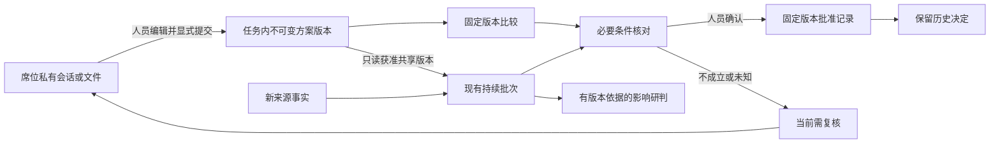

> 2026-11-11归档：备选设计，暂不实施。是否将方案独立于普通文档管理尚未决定；本文不是当前产品契约。当前沿用普通文档及现有提交、审核、交接流程。详见[归档决定](archive-decision.md)。

# 方案、批准与有效性复核设计

2026-11-06 · v0.1 · 待审阅；按 review.md 的 D01 建议方案展开。本文不是已经冻结的实现契约。

## 1. 边界及主流程

现有业务任务是归属容器；Pi 继续负责人员私有对话、工作区和原生工具证据；新增 PlanService 只负责共享方案、固定人员决定及必要条件核对。ContinuousService 继续使用既有队列、批次、原生会话和发布机制。模拟业务服务继续拥有道路/车辆事实，P3 不向其发送执行命令。



批准与条件状态分别显示。第三轮才能从明确批准版本显式下达；本轮没有执行适配器、资源占用或位置更新。故事中“本地三车已到场、四车未过桥”尚无对应执行事实，本轮不能在方案页展示为已发生。

## 2. 任务内交互

在现有 TaskInformation 增加“方案”栏目，TaskHome 只增加当前批准摘要和入口，不提前改版为综合指挥大屏。沿用现有 CSS tokens、Lucide 和表格/弹层，支持任务深链接及固定版本链接。

### 2.1 列表与卡片

卡片同时展示：方案名称/版本/提交席位；车辆类型与数量、路线及时窗摘要；人员决定；最近条件核对状态/业务时点；当前批准或有新候选提示。不同事实使用独立标签，不压成一个绿色“已完成”。

```text
临港三号仓库火情   [说明] [相关信息] [方案] [历史]
当前批准：经中轴桥 · v1   总体席于实际时间批准
条件核对：业务09:23 · R01封闭，必要条件不成立   [查看依据]

[提交候选]                            已选择 2/3 [比较固定版本]
[ ] 经中轴桥 v1  当前批准 / 条件不成立   [查看] [复制修订]
[ ] 东环线   v1  待决定 / 条件已核对     [查看]
[ ] 等待检修 v1  待决定 / 有未知条件     [查看]
```

上例仅为结构线框，名称/车组/状态由实际记录决定。空态显示“尚未提交共享方案”；只读任务显示真实状态，不提供失效操作入口。

### 2.2 草稿与提交

- 草稿继续用公共任务下本席位的工作区文件、会话及现有编辑草稿，不指个人空间，也不新增一套持久私有方案系统。Agent 可用原生文件工具生成符合模板的候选 JSON，人员也可直接填表。
- “导入工作区候选”只读当前席位、当前任务下人员选择的固定文件。复用现有工作区路径/文件授权，校验 schema/内容 hash 后填入表单；导入不共享、不批准、不启动模型。修改文件后旧预览不静默改变。
- 提交表单分为目标/需求、车辆、路线及时窗、必要条件、依据/风险五部分；未知值允许保存候选。提交前给出共享内容预览和受众说明，由人员明确确认。
- 发布内容是人员确认的新业务记录，不是另一席位完整聊天的副本。不得自动复制思考、AGENTS.md、工作区目录、私有标绘或未选文件。
- 共享版本不原地编辑。“复制修订”带父版本和修订理由生成下一版；退回后也用新版本回应。删除共享历史不在本轮范围，可显式撤回候选的后续使用。

### 2.3 比较与决定

- 比较 2—3 个明确版本；列头固定为名称/版本/提交时间，行统一为任务目标、车辆明细及去重数量、路线、预计到达及估计依据、条件、风险与原证据入口。只做字段对照和差异标记，不自动打分或选出最优。
- 选择按版本 ID 固定。出现新版显示提示，可由人员主动换入；轮询不得重置比较、滚动、焦点或表单草稿。
- 总体席进入批准确认区，明确显示版本/hash、替换的当前批准、核对时点、条件及估计假设。主要动作是“批准此版本”；“退回修改”要求理由，“撤销当前批准”保留理由。
- 未知/不成立项显示文本和证据，禁用批准并指出补证入口。请求中禁用重复提交；409 保留原表单，显示新旧版本及重新读取入口；响应不明查原 action 回执，不另造 action 重发。
- 桌面三栏窄内容区可折叠非关键说明；比较区可以独立横向滚动或展开为宽面板，表头和行名保持可定位，不能让整个应用溢出。键盘可选版本、读取全部标签、进入/退出确认区，退出回到原按钮；状态变化用文本且不抢焦点。无手机范围。

## 3. 方案版本与最少持久记录

建议增加 `contracts/plans.ts`、小型 `plans/{service,store,conditions}.ts`，存入已有 collaboration.sqlite。每条新增记录对应实际需要：

| 记录 | 核心字段 | 原因 |
| --- | --- | --- |
| plan_versions | versionId、planId、taskId、sequence、parentVersionId、taskRevision、payload/schemaVersion、contentHash、submittedBy/At | 固定比较与批准对象，不能从聊天/文件名猜 |
| plan_decisions | decisionId、taskId、versionId/hash、approve/return/revoke/withdraw、reason、actor、decidedAt、checkId | 保留人员决定及当时依据，后来变化不覆盖 |
| plan_checks | checkId、versionId/hash、taskRevision、业务时点/来源快照、逐条件结果、整体结果、checkedAt | 固定一次有限核对，不复制整段原生会话 |
| task_plan_state | taskId、revision、各候选 headVersionId、currentApprovalDecisionId | 任务范围的比较并发控制及唯一当前批准；不另存执行阶段 |
| plan_actions | userId、clientActionId、payloadDigest、结果引用 | 提交/决定响应丢失、刷新/重启时幂等查回 |

`planId` 由服务器生成；版本 sequence 在候选内递增，版本 ID 全局稳定，hash 用版本化 canonical payload。操作人和时间由服务器写；浏览器不能写审批人、核对结果或 scenarioInstanceId。轮次通过父任务的可信归属核验，不复制成可编辑字段。

方案载荷建议包含：

- `objective`、人员确认的 `requirements`（车型/数量、目标位置、截止时间等）；保存所依据任务 revision，不从自然语言自动推导所有必要约束。
- `vehicles[]`：稳定 ContextRef/entityId、车型、安排说明；不得靠 V01 显示名匹配。重复身份报错，不重复计数。
- `routes[]`：人员声明的有序路段引用及适用车辆组；不声称道路拓扑或导航引擎已验证路线完整性。
- `timing`：计划时窗、最晚预计到达、估计依据/假设、批准有效时窗。预计值明确标为筹划估计，不改变来源事实。
- `conditions[]`：稳定条件 ID、有限类型、对象引用、期望值及适用业务区间；人员确认哪些是必要条件。本轮不支持任意表达式/脚本。
- `evidenceRefs[]`：来源对象/报告的固定修订，或已发布研判 job 的固定引用；以及人员明确共享的业务说明。私有原件不作为后台可以解引用的引用。
- `risks`、`unknowns`、`changeReason`。无依据的内容只能标声明/估计，不提升为来源事实。

列表和原文分页遵守现有结果边界；版本单体建议上限 128 KiB、32 辆车、16 条路段、32 个条件、64 个依据引用，超过明确拒绝而非截断成功。比较最多 3 版。历史版本分页，不设自动清理。

## 4. 状态与权限建议

### 作业审核的现有机制与待决边界 D02

现有 CollaborationService 根据 creatorSeatId/assigneeSeatId 授权：接收方签收、提交，派工方审核最新提交；accept 才完成该工作，return 要求修改后重新提交。它不按“总体/筹划”的席位类型决定谁可审核。筹划 A 分给 B/C 的两项工作由 A 审核；如总体席另有分派给 A 的整合工作，该工作的审核者是总体席。各项工作仍是独立 WorkItem，当前没有父子依赖或自动完成传播。

下表“总体席专属方案批准”是原稿提出的新增限制，**待 D02 确认，尚非最终权限契约**。需要决定采用以下哪种映射：优先复用派工者审核，并在审核采用方案时明确 versionId/hash；或在作业验收之外确实需要独立采用决定时，另指定任务批准资格。不能仅因本场演示由总体席决策，就禁止未来筹划 A 审核自己分给 B/C 的工作。也不能默认让同一人先验收最终方案、再重复确认一次同义批准。

若复用已有审核，决定证据应关联具体 Submission.review 与确切方案版本，重新评估独立 plan_decisions 的最小必要字段/记录，而不是先照搬两套批准账。若验收对象含多个候选，普通 accept 仅表示交付验收，不能自动挑选方案。D02 收敛后同步修订状态、API、配置及迁移设计。

2026-11-06 补充审阅：当前稿仍有“作业验收 + 独立方案批准”两条路径，尚未完成统一设计。建议改为方案作为作业成果，沿实际分派关系审核；最终审核明确采用版本时同时形成后续执行可引用的决定，不再默认再审一次。方案卡是结构化展示和后续查询入口，不决定必须另建审批流程。采用后进入待下达，第三轮由人员显式下达并核对执行反馈。该收敛建议尚待 D02 确认，下面的独立权限/决定 API 与记录均保留为未冻结原提案，不作为实现依据。

### 原稿的方案状态与角色建议（待 D02）

人员决定、内容版本和条件核对为三个维度：

| 维度 | 表达 | 转换规则 |
| --- | --- | --- |
| 内容 | 某候选的 v1/v2…，或已撤回 | 不可变；新版本不继承批准；筹划席只可撤回未作为当前批准的候选；当前批准先由总体席撤销，再撤回候选 |
| 决定 | 待决定、已批准、已退回；历史批准已被替换/已撤销 | 只由获准人员操作；每任务最多一个当前批准 |
| 条件 | 未核对、已满足所列条件、不成立、未知/待复核 | 来源核对或时点变化可改变；不覆盖历史决定 |

“需要复核”是当前批准仍在但不宜继续依赖的提示，不是删除批准。来源恢复后可以得到新的条件核对，但不自动切回旧批准或新建人员决定。被替换/撤销的批准不会因路恢复而复活。

| 操作 | 总体席 | 筹划席 | 情报/态势席 | 导演 | 后台/子 Agent |
| --- | --- | --- | --- | --- | --- |
| 读获准共享版本/比较/条件依据 | 是 | 是 | 是 | 仅按已有显式读取授权，不自动授予 | 受控后台只读；子 Agent 不新增共享工具 |
| 提交/修订共享候选 | 是 | 是 | 否，可在既有协作中建议 | 否 | 否 |
| 批准/退回/撤销当前批准 | 是 | 否 | 否 | 否 | 否 |
| 受控条件核对 | 是 | 是 | 是，须有依赖读取权 | 否 | 后台按服务权限执行只读核对 |

采用服务端配置中的提案/批准席位集合，默认空；不硬编码中文席位名，不把 `createPublicTask`、模型管理权或导演权当批准权。当前账号启用、业务协作资格、任务可见/活动/可写、依赖来源 scope 和相应操作资格均要在真正提交时核验。总体席可自行批准自己提交的版本是本稿建议，待用户确认。

共享读取采用“任务权限 AND 方案所依赖来源/上下文权限”的组合；过滤后再分页计数，跨任务版本不能混比。显式发布只共享选中的业务摘要，原报告、研判或文件入口仍按原权限核验。后台及其共同受众必须都能读取这些来源；不通过某一个席位的私有交付资格扩大整个 stream 权限。变更受众沿用新 epoch/新原生会话，不沿用已泄露给旧受众的私有上下文。

## 5. 有限条件核对

条件服务只实现场景明确需要的五类核对，不建立通用出动资格引擎：

| 类型 | 输入及核对 | 不得推导 |
| --- | --- | --- |
| road_passable | 当前道路引用、期望 open、有效区间；读取当前 passability/修订 | restricted 不等于一定可过；旧巡查消息不覆盖当前封闭 |
| vehicle_available | 明确单车、当前 availability、有效期及条件 | 占用到时不等于释放；检修预计结束不等于完成；可用声明不认证全部出动资格 |
| vehicle_type_count | 单车 entityId 去重、已知车型，核对人员声明数量要求 | 站点库存/记录条数不替代已识别单车 |
| arrival_estimate | 人员声明的预计到达与任务截止，核对时间运算并保留估计依据 | 不由直线距离生成可靠 ETA；符合截止只是估计层面满足 |
| decision_window | 业务判断时点位于人员明确的方案适用时窗 | 计划出发时间过去不证明已出发/已到场，也不伪造执行失败 |

缺对象、未获准来源、未知状态、期限失效、自由文本前提无法核验或矛盾未消解均为 unknown；明确相反事实为 blocked；全部必要项 met 才允许批准。辅助说明可以不构成硬条件，但人员不能为了过门禁删除任务已明确的必要要求。宿主校验结构和已列条件，人员确认要求完整性；模型解释两者，不能替人员确认。

复用 ContextService 的授权查询、现有资源 decoder、resourceFactActive、场景 snapshotClock/固定分页一致性，不再建一份车辆/道路状态表。核对以同一场景业务时点取得各必要事实，分页或来源时点不一致即失败/unknown；真实 queriedAt/checkedAt 另列。历史核对只保存引用、修订、所需字段及结果，不复制完整原生工具输出。

核对入口为显式 POST 或现有后台批次内部调用；普通 GET/打开方案页读取已存状态，不触发模型。持续批次先核对当前批准的有限依赖，再执行模型影响研判，因此模型漏关联不应让明确 R01 封闭继续显示满足。候选在比较/批准时核对，不为所有历史版本循环查询。自动核对失败也保留真实失败和上次时点，不能当作条件保持满足。

已接收到但未处理的来源变化显示“有待核对变化”，不把旧 check 标成实时保证。R04 等同系统背景通知可以促成一次检查，但若 A 的所列依赖未变，结果仍为 met，不生成“R01 受阻”之类错误风险。无需依赖 Agent 先正确归口才能核对当前批准。

批准前以当前身份重新取必要事实并保存 check；短事务中再次确认任务 revision、plan state revision、候选 head、当前批准指针、已知来源变更水位及轮次可写。来源在读取与提交之间有变化则冲突，重新核对。外部 HTTP 与本地数据库不构成原子事务，决定准确含义始终是“人员基于某业务时点/来源快照批准”；不可宣称覆盖未收到的外部变化。第三轮下达必须重新查事实。

## 6. API 与幂等建议

所有路径为拟议契约，实施前用项目既有 schema/decoder 固化：

| API | 作用/关键输入 |
| --- | --- |
| GET /api/tasks/:taskId/plans | 授权过滤后的候选及当前批准摘要；分页 |
| GET /api/tasks/:taskId/plan-versions/:versionId | 固定内容/hash、决定和核对引用；无副作用 |
| POST /api/tasks/:taskId/plan-versions | clientActionId、expectedTaskRevision、expectedPlanRevision、可选 planId/parentVersionId、payload |
| POST /api/tasks/:taskId/plan-comparisons | 2—3 个 versionId/hash；返回固定字段差异，无模型调用/新业务状态 |
| POST /api/tasks/:taskId/plan-versions/:versionId/checks | 明确发起条件核对；自动模式内部复用同一服务 |
| POST /api/tasks/:taskId/plan-decisions | clientActionId、versionId/hash、expectedPlanRevision、expectedCurrentApprovalId、approve/return/revoke/withdraw、reason；approve 需当前核对 |
| GET /api/plan-actions?clientActionId=… | 当前操作者的原 action 结果；只查、不重放 |

读接口逐次复核当前权限。check 可按 action 去重并返回其固定时点；批准不得靠重试一次陈旧 check 绕过重新核验。提交/决定同 action 同内容返回原结果；相同 action 不同内容报 409。结束轮次后的旧写重试拒绝，允许另用只读回执接口查旧结果。两次不同 action 同时基于同 plan revision 批准，只能一个成功；无“最后写入覆盖”。

共享版本/决定、当前指针、action 回执以及适用的持续修订输入在同一个已有 SQLite 事务提交。文件读取和 HTTP 核对在短事务外完成，在提交处复核身份/内容和版本。中断不撤销已提交决定、不补造成功回执。

## 7. 共享方案接入持续研判

### 7.1 读取与证据

新增只读 `task_plan_list/read`，为前台及获准持续 profile 提供共享版本。后台不获得席位 workspace、私有标绘、Bash、共享写入或批准工具。service principal 继续由宿主固定 scope、epoch、来源及轮次；模型不能选择凭证或受众。

完整任务发现同时返回每任务 `planContextRevision` 和全部当前候选 head/当前批准的固定引用摘要；正文通过确切版本 read 按需读取，受既有消息大小与完整性上限约束，超限显式失败而非省略方案。原生工具 receipt 固定版本/hash，发布元数据由宿主从成功读取证据核验，不信任模型自填“已读取”。

### 7.2 触发与版本保护

复用 `kind:task_revision` 输入，增加可选 `sharedPlanContext`（revision、heads、当前批准引用）；不为方案改写任务 goal，不伪造一次任务描述编辑。入队去重键从 taskId/task.revision 扩展为 taskId/task.revision/planContextRevision。旧输入缺字段仍按旧语义读取，不追改历史结果。

提交/修订/撤回候选、批准/退回/撤销决定会改变共享方案上下文 revision；仅保存一次条件检查或发布模型解释不递增该 revision，防止自身触发无限循环。修改事务使用现有任务修订入队入口的扩展，并保留全来源 scope、当前配置 epoch、旧基线及轮次选择规则。

requiredTaskIds 仍必须覆盖本次方案变化涉及的任务；条件业务引用要纳入任务发现的用途化引用集合，以免只因 task.context 没有路线字段就漏掉方案 R01。来源定位/用途不完整保持 uncertain，不能自动 unrelated。上述依赖来自显式共享方案，绝不混入私有草稿。

记录前、原生完成检查和发布事务均核对任务 revision、planContextRevision、候选 heads、当前批准版本/hash与观察到的来源快照；旧版本结果标 superseded，保留输入供已有重新研判机制处理。需要说明“当前批准受影响”时，至少须成功读取该固定版本与本轮依据。模型不保存或证据不匹配时不发布为成功；复用既有有限原生 completion repair，不新建宿主模型重试循环。

### 7.3 队列和结束

保持每个 stream 串行、原有并发许可、批次上限及手动恢复。方案变更不直接启动新会话或自动重跑旧批次。新建运行分区、启用 stream 时初始任务输入也必须含共享方案上下文，不能只改运行中的 taskChanged。

结束门禁先封存写权限，再按既有队列取消/停止核验终态；在途核对返回时再次核验轮次，不能写入下一轮。历史方案/决定/核对与原 Pi 证据留在原任务；不因任务未归档而变成可写。

## 8. 持续首报仍由人员建任务（D01）

建议从首报起在隔离演示配置使用现有持续模式，统一接收 intel/situation 两通道。只启用一个包含双来源的 stream，显式关闭这两个来源的逐条规则；不叠加双跑。共同收件人仍以总体席为主，其他席位通过现有协作及来源授权参与。

### 8.1 持续结果建任务

在固定已发布持续结果的输入列表中，为每条人员实际有权读取的事件提供“从本条来报新建任务”。多消息批次必须先选中实际 event/input，不选择第一条、不凭模型名称匹配任务。

新入口建议为 POST /api/continuous/rounds/:jobId/inputs/:inputId/tasks，携带 clientActionId、名称、目标、关联理由及 context。宿主从固定 batch 核验 inputId 属于此 job、是 event、实际 eventId、真实轮次，且 job 已成功发布、原生结果可核验。无新建建议时也可打开空表单，始终由总体席确认。

复用 AccessStore.createInTransaction、task_actions 和信息关联写入。给创建来源增加严格判别类型，区分 preprocess job 与 continuous published input；新增事件创建回执索引只保存必要定位，旧 taskSuggestionCreation 不改写。共同服务在同一事务内检查新旧两类事件创建回执，防止同一事件重新预处理、另批次重评或并发跨入口重复建任务。旧 API、旧 hash、旧回执仍可读。

原来源、共同受众、context scope、任务管理权、业务资格和当前轮可写全部核验；关联到任务不额外授权读取原结果。当前批次若混合了调用者不可读来源，不提供该批次创建入口，也不只靠单个 input 的权限绕过整批结果授权。持续结果来源关联与任务信息展示需支持这一判别来源，不能伪造 preprocess job 或其 SQL event/source 列。

### 8.2 可信报告定位

为新通知增加可选、类型明确的 `evidenceRef:{kind:information_report,systemId,reportId,revision}`，与 transport sourceId、既有 subjectId 分开。来源配置限制可以引用的业务系统，接收/查询处核验授权和实际报告身份；请求字段不能扩大权限或指定预期任务。

新场景在生成通知时使用实际已生成的报告修订填 evidenceRef；道路通知仍走 situation 接入通道，报告事实仍按 intel 报告定位，再从报告对象引用取得 R01。持续任务发现优先按该固定证据定位读报告，保留当前对象/业务时点核验。旧系统仍用既有 subjectId 路径；无法证实身份的旧通知保持未知，不通过正文或实例编号后缀猜答案。

通知合同、持久 event、payload hash、来源模拟服务和投递重试一起版本化：无 evidenceRef 的旧输入保留原 hash 算法；新输入将定位纳入受版本标记的 hash。旧事件/实例/回执不追改，新场景定义显式升级，不在原 v4 保存记录上原地添加字段。

该修补只为当前两通道的可信报告定位服务，不引入七类系统、服务发现或管理域拆分。

## 9. 兼容、迁移与回退

- 所有新增 DTO 使用严格 decoder 与判别类型；旧任务没有方案时自然为空。旧 task revision、原生历史、工作交接和资源声明继续原义。
- 方案表及新创建回执在已有业务库迁移；迁移前停服备份，纳入 AccessStore、BackgroundStore、AnnotationsStore、数据库打开校验与可选模块的所有受支持布局。版本号按合并后的实际库确定，不能只在某个 store 放宽 user_version。
- 新 profile 工具、提案/批准席位集合和单一处理模式只针对隔离演示配置明确开通，不默认改变其他来源。配置变化用新 epoch；首次发布不自动开始场景或调用模型。
- 回退先停止新来源投放和处理，保存升级后库/原生证据；恢复成对代码、配置和迁移前数据库。旧二进制不直接打开新 schema；新批准记录不能被静默丢失。
- 实施前从原 codex/scenario-demo 对齐第一轮收尾提交，重审本文第 7/8 节与来源建任务、场景定义、权限迁移的冲突；不覆盖原 worktree 的并行工作。

## 10. 关键取舍

新增方案/决定/check 是现有聊天、工作交接无法提供的固定业务对象；私有草稿、文件和会话继续复用 Pi。只增加完成本轮的有限条件核对、来源创建兼容及共享版本保护，不引入通用工作流、规则 DSL、第二套 agent runtime 或证据全文仓库。

如果 D01 不纳入，本稿第 8 节及第 7 节的演示持续配置/自动模型复核不能进入本轮验收，需同步改 PRD、实施计划及主线说明。本轮剩余功能仍可在现有逐条初析上通过人员显式核对演示，不能称作自动持续复核已经完成。
